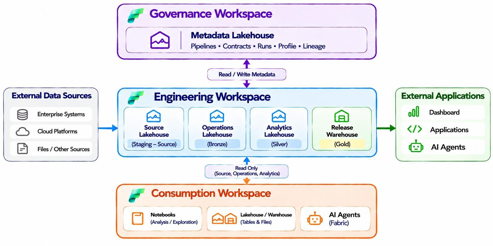
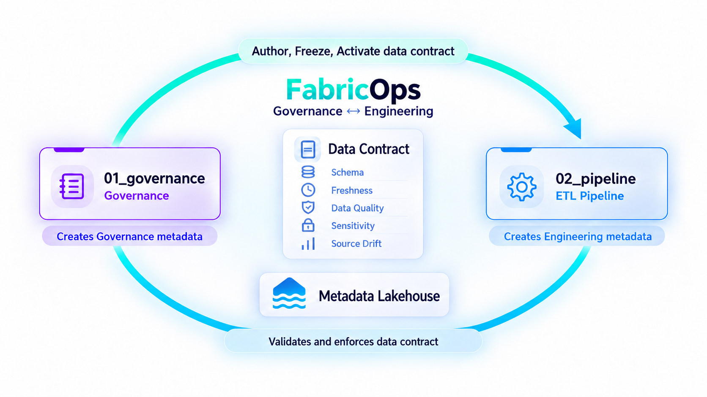

# How FabricOps is set up in Microsoft Fabric

**Governance defines expectations, Engineering produces and validates data, and shared metadata connects both without hiding project-owned transformations.**

{ .fabricops-section-evidence }

## Workspace operating model

FabricOps separates Governance, Engineering and Consumption responsibilities. A single Engineering workspace is enough to build, validate and run a governed pipeline. A separate Engineering workspace is optional when teams want workspace isolation or deployment separation.

| Area | Responsibility | FabricOps assets |
| --- | --- | --- |
| **Governance Workspace** | Owns stewards, agreements and governed table definitions. | `00_env_config`, `01_governance`, shared Metadata Lakehouse |
| **Engineering Workspace** | Builds and runs pipelines, observes physical tables, profiles data, validates Contracts and executes approved pipelines. | `00_env_config`, `02_pipeline`, source, operations, analytics and release stores |
| **Consumption Workspace** | Provides a separate place for analysis or consumer workloads when useful; consumption can also happen through permitted Fabric interfaces. | Notebooks, Lakehouses/Warehouses, reports or AI workloads |

`00_env_config` maps logical store names to configured workspaces and items. The pipeline addresses configured stores instead of assuming the notebook's default Lakehouse. Teams may keep the pipeline in one Engineering workspace or clone `02_pipeline` into another workspace with its own `00_env_config`. A clone must be validated there, have Contracts activated for its physical tables, and receive a separate Governance approval for its exact submission before governed execution. Promotion and cloning do not transfer metadata authority or Fabric permissions.

??? info "Under the Hood — workspace and store resolution"

    `setup_notebook()` loads the environment configuration and resolves the caller workspace. Internal `resolve_fabric_context()`, `get_store()` and `resolve_store()` select the configured Lakehouse or Warehouse. Lakehouse access resolves OneLake paths; Warehouse access uses the Fabric Spark connector. Unknown workspaces and missing permissions fail rather than falling back to another store.

    Configuration is stored in `00_env_config`, not a metadata table. The shared metadata target is configured independently and every `METADATA_*` read or write routes through it.

    A central configuration notebook can be selected with `config_workspace_id`, but that does not grant cross-workspace access. Native Fabric identity and item permissions still apply.

## Governance ↔ Engineering cycle

{ .fabricops-section-evidence }

**Frozen Data Contract definitions are global; their activations and pipeline approvals are scoped.** The stable `table_id` joins a physical table to its global Contract version history, while physical table activation and pipeline approval are workspace-specific.

1. Engineering registers physical table identity and records observations, profiles and lineage.
2. Governance uses that evidence to author Enrichment and Guardrails in a versioned Data Contract.
3. Freezing makes the exact `contract_payload_json` immutable for review and testing.
4. Engineering selects the frozen version in Dry Run and evaluates the real Read → Transform → Write path without publication.
5. Governance activates each exact Contract and Agreement for its physical workspace/table, then independently reviews the saved pipeline submission.
6. Engineering deploys the exact approved snapshot as a separate Governed notebook and explicitly rebinds its schedule. Approval and deployment remain separate decisions.
7. Governed execution remains fail-closed pending signed-in Fabric acceptance. Consumers use published data through native Fabric permissions; metadata does not replace access controls.

??? info "Under the Hood — implementation hand-off"

    | Handoff | Functions | Persisted state |
    | --- | --- | --- |
    | Governance context | [`widget_data_steward()`](api/reference/widget_data_steward.md), [`widget_data_agreement()`](api/reference/widget_data_agreement.md) | `METADATA_DATA_STEWARD`, `METADATA_DATA_AGREEMENT` |
    | Observe and profile | [`orchestrate_read()`](api/reference/orchestrate_read.md), [`orchestrate_write()`](api/reference/orchestrate_write.md), [`profile_table()`](api/reference/profile_table.md) | `METADATA_DATA_CATALOGUE`, `METADATA_DATA_PROFILED`, `METADATA_DATA_PROFILED_FREQUENCY`, `METADATA_DATA_LINEAGE` |
    | Author and freeze | [`widget_data_contract()`](api/reference/widget_data_contract.md) | `METADATA_DATA_CONTRACT.contract_payload_json` |
    | Preview enforcement | [`setup_pipeline()`](api/reference/setup_pipeline.md), [`orchestrate_read()`](api/reference/orchestrate_read.md), [`orchestrate_write()`](api/reference/orchestrate_write.md) | Dry Run keeps results in memory and commits no target or operational state |
    | Activate physical Contracts | [`widget_activate_data_contract()`](api/reference/widget_activate_data_contract.md) | [`METADATA_DATA_CONTRACT_ACTIVATION`](reference/metadata/metadata_data_contract_activation.md) |
    | Approve saved submission | [`widget_activate_pipeline()`](api/reference/widget_activate_pipeline.md) | [`METADATA_PIPELINE_ACTIVATION`](reference/metadata/metadata_pipeline_activation.md) |
    | Deploy and retain versions | [`finalize_pipeline()`](api/reference/finalize_pipeline.md) Engineering controls | [`METADATA_PIPELINE_REGISTRY`](reference/metadata/metadata_pipeline_registry.md) and immutable notebook snapshots |
    | Persistent run state | [`finalize_pipeline()`](api/reference/finalize_pipeline.md) and orchestration internals | [`METADATA_PIPELINE_RUN`](reference/metadata/metadata_pipeline_run.md), [`METADATA_GUARDRAIL_RESULTS`](reference/metadata/metadata_guardrail_results.md), [`METADATA_PROCESSING_STATE`](reference/metadata/metadata_processing_state.md) |

    Guardrail Results store aggregate outcomes and continuation decisions, not full failed business rows. DQ `failed_values` and token `support_mapping` are returned to the caller and are not automatically persisted.

## Shared metadata model

<a class="fabricops-metadata-preview fabricops-metadata-preview--compact" href="reference/metadata/" aria-label="Explore the interactive FabricOps metadata relationship map">
  
    Interactive relationship map
    <strong class="fabricops-metadata-preview__title">Fourteen canonical tables, one traceable model</strong>
    Inspect keys, columns, writer functions and Governance ↔ Engineering relationships.
    Open metadata explorer →
  
  
</a>

The configured Metadata Lakehouse holds five Governance-owned tables and nine Engineering-owned tables. The ownership boundary identifies authoritative writers; it does not imply separate physical Lakehouses. Governance owns the central Lakehouse itself; schema ownership describes which workflow is authoritative for each record.

| Group | Canonical tables |
| --- | --- |
| Governance | [`METADATA_DATA_STEWARD`](reference/metadata/metadata_data_steward.md), [`METADATA_DATA_AGREEMENT`](reference/metadata/metadata_data_agreement.md), [`METADATA_DATA_CONTRACT`](reference/metadata/metadata_data_contract.md), [`METADATA_DATA_CONTRACT_ACTIVATION`](reference/metadata/metadata_data_contract_activation.md), [`METADATA_PIPELINE_ACTIVATION`](reference/metadata/metadata_pipeline_activation.md) |
| Engineering and operations | [`METADATA_DATA_CATALOGUE`](reference/metadata/metadata_data_catalogue.md), [`METADATA_DATA_PROFILED`](reference/metadata/metadata_data_profiled.md), [`METADATA_DATA_PROFILED_FREQUENCY`](reference/metadata/metadata_data_profiled_frequency.md), [`METADATA_DATA_LINEAGE`](reference/metadata/metadata_data_lineage.md), [`METADATA_DATA_ACCESS`](reference/metadata/metadata_data_access.md), [`METADATA_PIPELINE_REGISTRY`](reference/metadata/metadata_pipeline_registry.md), [`METADATA_PIPELINE_RUN`](reference/metadata/metadata_pipeline_run.md), [`METADATA_GUARDRAIL_RESULTS`](reference/metadata/metadata_guardrail_results.md), [`METADATA_PROCESSING_STATE`](reference/metadata/metadata_processing_state.md) |

??? info "Under the Hood — identity, timing and transaction boundaries"

    `METADATA_DATA_CATALOGUE` is the canonical table/column and physical-location record. Profile snapshots link back through `table_id` and `column_id`; lineage records a table's pipeline participation. `METADATA_DATA_CONTRACT` stores one exact authored payload per version, while `METADATA_DATA_CONTRACT_ACTIVATION` selects it for a physical workspace/table and applicable Agreement.

    Governance decisions in `METADATA_PIPELINE_ACTIVATION`, Engineering deployments in `METADATA_PIPELINE_REGISTRY`, business-table publication and metadata progress are deliberately separate boundaries. FabricOps accepts incremental checkpoints and publication receipts in `METADATA_PROCESSING_STATE` only after it can verify publication. Pipeline-owned Source Drift baseline heads wait for successful whole-run finalization and every required verified target publication; all candidate heads advance in one Serializable conditional transaction. The Pipeline Registry coordinates managed mutations in a Serializable transaction, but multiple target writes are not one cross-target atomic transaction.

    The [Metadata Reference](reference/metadata.md) is generated from `src/fabricops_kit/config/metadata_schemas.py` and writer ownership metadata. Use it instead of inferring columns from a diagram.

## What's next

  <a class="fabricops-card fabricops-card--governance" href="../governance/">
    <strong>Governance</strong>
    <small>Inspect Governance as Code, Data Contract authoring and activation, sensitive data treatment, Data Quality, and reporting metadata.</small>
  </a>
  <a class="fabricops-card fabricops-card--engineering" href="../engineering/">
    <strong>Engineering</strong>
    <small>Inspect orchestration, Fabric I/O, incremental and historical processing, publication recovery, profiling, lineage, and observability.</small>
  </a>

<a class="fabricops-metadata-preview fabricops-guided-preview" href="../guided-demo/" aria-label="Start the seven-step FabricOps Guided Demo">
  
    Guided Demo
    <strong class="fabricops-metadata-preview__title">Run the seven-step FabricOps workflow</strong>
    Prepare Microsoft Fabric, build the pipeline, author and preview Data Contracts, then follow the Production and consumption hand-offs.
    Start Guided Demo →
  
  
    
  
</a>

