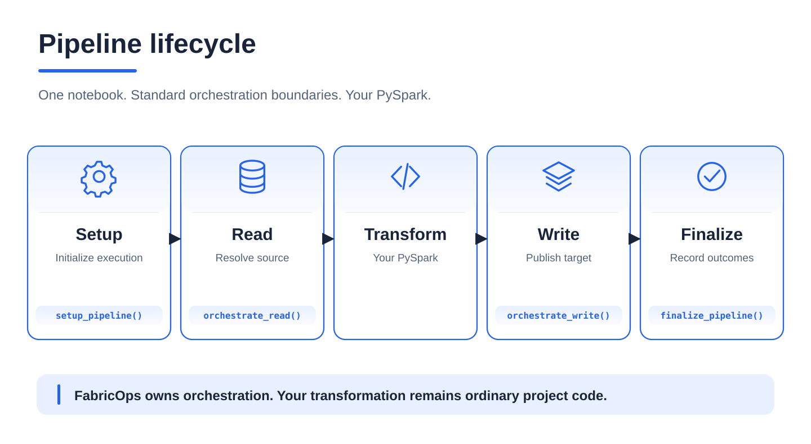
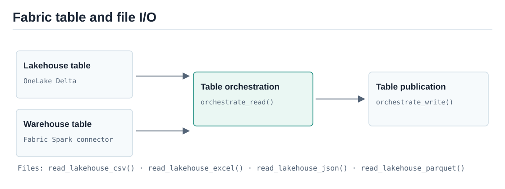
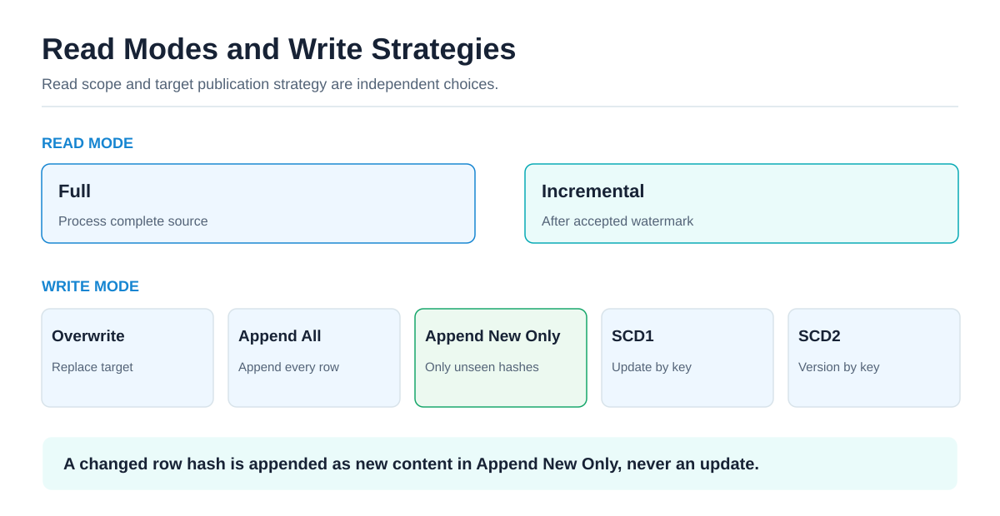
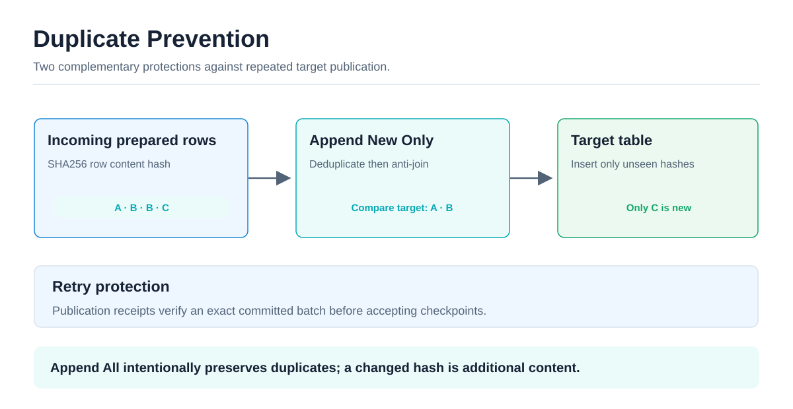
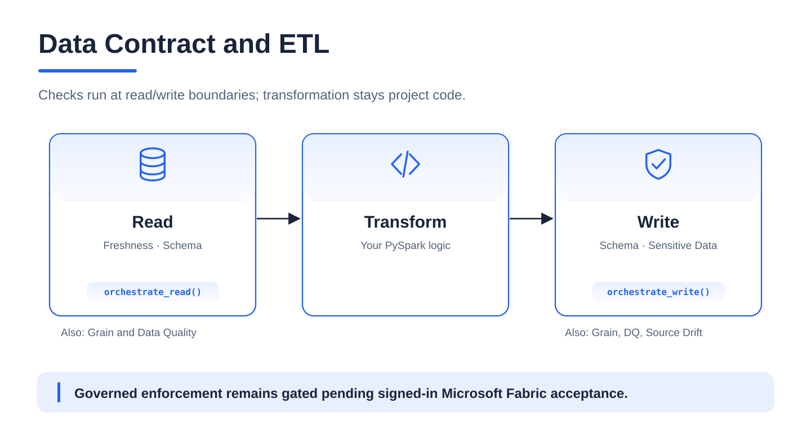
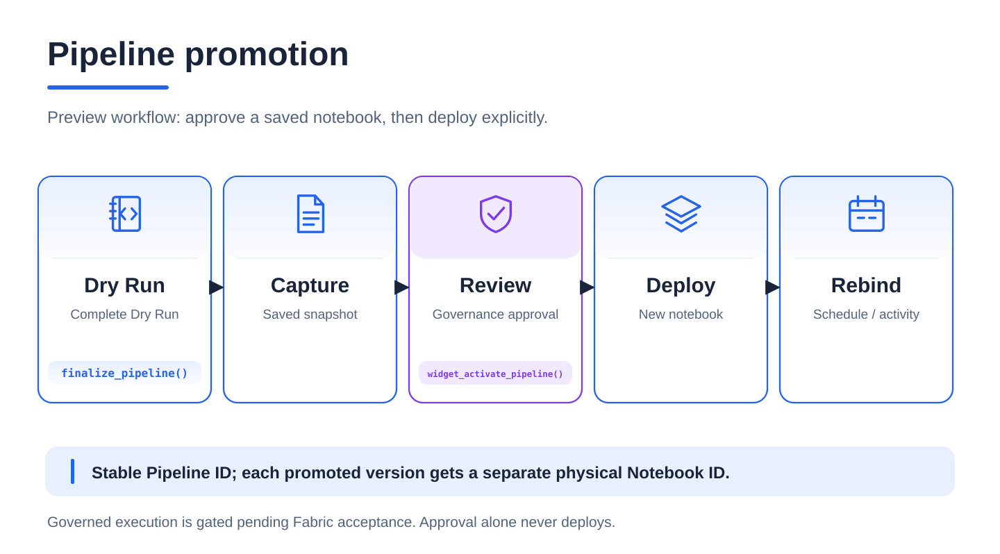
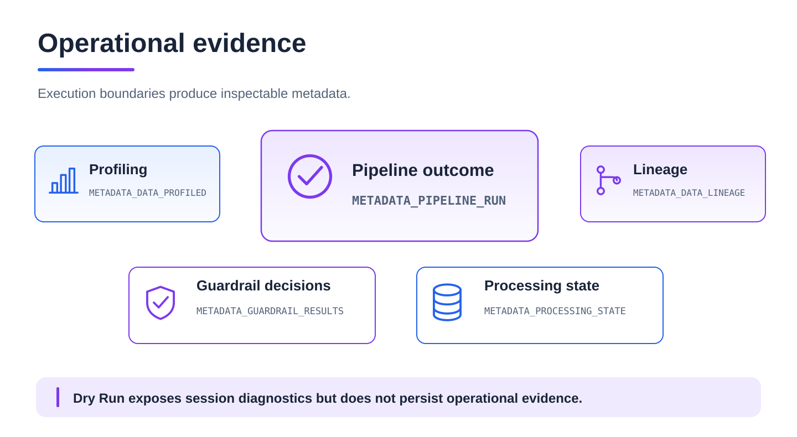

<div class="fabricops-product-page" markdown="1">

# Engineering

**Build one readable notebook pipeline that can address multiple configured Fabric stores, apply reliable processing strategies, and expose the evidence Governance needs.**

<div class="fabricops-status-row">
  <span class="fabricops-release-status fabricops-release-status--live">Core pipeline: Live</span>
  <span class="fabricops-release-status fabricops-release-status--preview">Governed execution: gated</span>
</div>

## What is a FabricOps data pipeline? { #plug-and-play-pipelines-and-orchestration }

A FabricOps pipeline is the standard notebook flow **Setup → Read → Transform → Write → Finalize**. FabricOps owns the repeatable boundaries; the PySpark transformation remains project code.

{ .fabricops-section-evidence }

```python
context = setup_notebook()
pipeline = setup_pipeline(pipeline_mode="Ungoverned")

orders = orchestrate_read(
    store="Bronze", schema="demo", table_name="orders",
    query="SELECT * FROM demo.orders",  # Optional Full Read SQL; None reads the whole table.
)
products = orchestrate_read(store="Bronze", schema="demo", table_name="products")

prepared = transform(orders["dataframe"], products["dataframe"])

result = orchestrate_write(
    prepared,
    store="Gold",
    schema="demo",
    table_name="customer_summary",
    write_mode="overwrite",
)
finalize_pipeline(pipeline)
```

One execution can register multiple reads and publish multiple targets. FabricOps records pipeline participation, not invented column-level lineage; your transformation code remains visible between the boundaries.

??? info "Under the Hood — execution ownership"

    [`setup_pipeline()`](api/reference/setup_pipeline.md) fixes the stable Pipeline ID, execution mode and session plan. [`orchestrate_read()`](api/reference/orchestrate_read.md) resolves and evaluates each source. [`orchestrate_write()`](api/reference/orchestrate_write.md) prepares and evaluates each target, then previews or publishes it. [`finalize_pipeline()`](api/reference/finalize_pipeline.md) records the complete outcome.

    The original Fabric Notebook ID establishes the logical identity. The Pipeline Registry maps every promoted physical Notebook ID back to that identity; no Pipeline ID is declared in notebook source.

## What does FabricOps add to Microsoft Fabric?

Microsoft Fabric provides notebooks, Spark, Lakehouses, Warehouses and deployment tooling. A project still has to wire together locations, table identities, incremental bounds, Write strategies, retries, profiling, lineage and governance checks. FabricOps provides one configuration and orchestration pattern for that work.

| Daily engineering concern | FabricOps support |
| --- | --- |
| Read several tables in one notebook | Call [`orchestrate_read()`](api/reference/orchestrate_read.md) for each configured table; each result carries its DataFrame and stable table identity. |
| Write several targets | Call [`orchestrate_write()`](api/reference/orchestrate_write.md) independently for each prepared DataFrame and destination. |
| Move between Lakehouses and Warehouses | Use logical store keys; FabricOps selects the configured OneLake or Warehouse connector path. |
| Run Full or Incremental | Choose `read_mode` per source. |
| Overwrite, append or retain history | Choose `write_mode` per target: Overwrite, Append All, Append New Only, SCD1 or SCD2. |
| Preview safely | Dry Run uses real reads and transformations but publishes no target or operational state. |
| Capture operational evidence | Profiling, pipeline participation, run outcomes and Guardrail results are produced at the normal boundaries. |

Fabric notebooks can of course read multiple DataFrames directly. The missing convenience FabricOps addresses is **portable, configuration-driven resolution and one consistent lifecycle across multiple items and store types**, without attaching the whole pipeline to one default Lakehouse or repeating workspace/item IDs throughout project code.

## How do I read Lakehouses, Warehouses and files?

Lakehouse files use the same `orchestrate_read()` lifecycle. For example, `orchestrate_read(store="Bronze", relative_path="demo/orders.csv", file_format="csv", read_options={"header": True, "inferSchema": True})` returns the familiar `dataframe`, a distinct file `source_id`, location, format, stage results, Guardrail outcomes and profiling metrics. CSV, JSON, Parquet and Excel dispatch to the existing foundational readers, which remain usable independently of Setup Pipeline. File selectors are confined beneath the configured Files root, preserve cross-workspace routing and reject Warehouse stores. Single files, folders and wildcard patterns such as `incoming/*.csv` are supported; brace expansion such as `{incoming/,../}*.csv` is rejected before reading.

Files support Full Read only. Their stable selector identity does not imply immutable content, exactly-once ingestion, file checkpoints or deduplication. File Read and subsequent target Write operations retain typed Source ID participation in `METADATA_PIPELINE_RUN.operations`; they do not place file paths in table lineage or prove transformation dependencies. Source Drift remains a physical-table capability. File profiles use the pipeline settings and explicit row limit, remain in memory per execution and do not consume durable table profiling schedules. Bounded profile counts do not claim total file rows read.

For registered table pipelines, the same [`orchestrate_read()`](api/reference/orchestrate_read.md) call shape works across configured Lakehouse and Warehouse stores. FabricOps resolves the store type internally:

{ .fabricops-section-evidence }

- Lakehouse tables use OneLake Delta paths.
- Warehouse tables use the Fabric Spark connector.
- Full reads accept `query`: Spark SQL for Lakehouses and T-SQL pushed down to Warehouses. Incremental reads retain framework-owned bounds and reject caller SQL.
- Lakehouse SQL uses the declared `table_name` or `schema.table_name`, with optional aliases, CTEs and self joins. FabricOps binds it to the configured OneLake source, including cross-workspace stores, instead of the notebook's default Lakehouse. Other physical sources, paths and table functions are rejected.
- A simple `SELECT TOP (100) id FROM demo.orders ORDER BY id` on a Lakehouse can become Spark `LIMIT 100`. `TOP PERCENT`, `WITH TIES`, functions and compound T-SQL are rejected with a source-specific error. Write native Spark SQL for these cases. SQL endpoint fallback is not available because the store configuration does not identify a Lakehouse SQL endpoint. Use Spark backticks for quoted identifiers; bracket conversion is limited to simple TOP queries.

The pipeline example above uses `SELECT * FROM demo.orders` to demonstrate the optional Full Read SQL argument without filtering the source. Set `query=None` to use a plain table read. For a narrowed Lakehouse read, `orchestrate_read(store="Bronze", schema="demo", table_name="orders", query="SELECT id FROM demo.orders WHERE is_active = true LIMIT 100")` executes Spark SQL on the configured Lakehouse. Warehouse queries keep their supplied T-SQL and connector routing. The declared source remains the governed participant; query text does not discover or enroll additional sources.

For direct, lower-level file access outside a pipeline, the format-specific foundational functions remain available: [`read_lakehouse_csv()`](api/reference/read_lakehouse_csv.md), [`read_lakehouse_excel()`](api/reference/read_lakehouse_excel.md), [`read_lakehouse_json()`](api/reference/read_lakehouse_json.md) and [`read_lakehouse_parquet()`](api/reference/read_lakehouse_parquet.md). For pipeline reads of files, prefer `orchestrate_read()` so the file participates in the usual read stages and operational evidence.

??? info "Under the Hood — store and file routing"

    `00_env_config` maps logical aliases to workspace IDs, item IDs, physical names and store types. Internal [`resolve_fabric_context()`](https://github.com/Voycepeh/FabricOps-Starter-Kit/blob/main/src/fabricops_kit/config/shared.py#L108), [`get_store()`](https://github.com/Voycepeh/FabricOps-Starter-Kit/blob/main/src/fabricops_kit/config/shared.py#L823) and [`resolve_store()`](https://github.com/Voycepeh/FabricOps-Starter-Kit/blob/main/src/fabricops_kit/io/shared.py#L155) select the location. Table callers do not choose a Lakehouse versus Warehouse reader.

    File helpers resolve the same logical Lakehouse store but operate under its `Files` area. [`orchestrate_read()`](api/reference/orchestrate_read.md) selects [`read_lakehouse_table()`](api/reference/read_lakehouse_table.md), [`read_warehouse_table()`](api/reference/read_warehouse_table.md) or [`read_warehouse_query()`](api/reference/read_warehouse_query.md). Table publication ultimately uses [`write_lakehouse_table()`](api/reference/write_lakehouse_table.md) or [`write_warehouse_table()`](api/reference/write_warehouse_table.md); there is no generic governed file writer in the current pipeline orchestrator.

## How does metadata-driven Freshness detect changes?

**Freshness asks when the physical source was last updated, without inspecting business timestamp columns.** A frozen Data Contract supplies a positive maximum age (minutes, hours or days), an Enabled/Disabled decision and Warn/Block enforcement. The evidence method is always `metadata`, and the evaluation scope is the **complete physical source**, not a filtered SQL result or incremental batch. An event-date or record-age requirement belongs in a separately authored Data Quality rule.

| Source | Physical evidence | How the age is determined |
| --- | --- | --- |
| Lakehouse Delta table | Delta transaction history at the resolved OneLake table path | Take the timestamp of the most recent qualifying data-changing commit by version. |
| Warehouse table | Delta transaction history at the configured Warehouse table's resolved physical path | Use the same data-changing transaction-history check; this is **not** a query against a user-defined timestamp column or a claim that a generic SQL `last_modified` field exists. |
| Lakehouse file, folder or wildcard | Filesystem modification metadata for the resolved data-file members | Recursively expand matching files, exclude hidden/control files and evaluate the **oldest** member's modification time. A newly arrived file cannot disguise an older member in the selected set. |

The table check reads Delta history fields `operation`, `version` and `timestamp`, selecting the highest version among `WRITE`, `MERGE`, `UPDATE`, `DELETE`, `STREAMING UPDATE`, `CREATE TABLE AS SELECT`, `CREATE OR REPLACE TABLE AS SELECT` and `RESTORE`. Merely reading or inspecting a table does not reset Freshness. For files, the implementation records file membership and modification evidence; it does not infer the business event time inside the files.

??? info "Under the Hood — Freshness evidence and enforcement"

    The source is resolved via `00_env_config` and its physical identity. Internal [`collect_freshness_evidence()`](https://github.com/Voycepeh/FabricOps-Starter-Kit/blob/main/src/fabricops_kit/pipeline/shared.py) obtains the metadata. Table Reads reuse the **current run's Source Observation** evidence; file Reads evaluate the resolved file membership. [`check_freshness()`](https://github.com/Voycepeh/FabricOps-Starter-Kit/blob/main/src/fabricops_kit/pipeline/check_freshness.py) compares that evidence with the frozen Contract rule and records the guardrail outcome in [`METADATA_GUARDRAIL_RESULTS`](reference/metadata/metadata_guardrail_results.md) when persistence is permitted.

    The observed timestamp is compared with execution time minus the configured maximum age, in UTC. Missing paths, inaccessible or insufficient history, no matching data files, invalid/future timestamps and unsupported file-selection options produce unavailable/invalid evidence, **not** a silently invented refresh time. The configured Warn or Block policy then determines continuation. No fallback reads a timestamp column or scans business rows to guess Freshness. In particular, Warehouse metadata access must actually resolve and be readable in the Fabric runtime; the Warehouse label alone does not guarantee evidence is available.

    File selection options that can change which members the reader consumes (such as `pathGlobFilter`, `modifiedBefore`, `modifiedAfter`, `recursiveFileLookup`, `ignoreMissingFiles` or `ignoreCorruptFiles`) make reliable membership-based Freshness unavailable rather than risking a mismatch. File content may change without a meaningful business-data update, and a table's write time is not the same as a record's event time.

## How does SQL query pushdown reduce data transferred to Spark?

For a **Full Read**, pass `query` to [`orchestrate_read()`](api/reference/orchestrate_read.md). FabricOps preserves the configured physical source identity for governance while executing the returned SQL result. The engine differs by source:

- **Warehouse:** validate one read-only T-SQL SELECT/CTE and send it through the Fabric Warehouse Spark connector to the Warehouse SQL engine. The Warehouse performs the query's filtering, projections, aggregations and joins **before** Spark receives the result; `query=None` retains the full-table reader.
- **Lakehouse:** parse read-only Spark SQL, verify that physical table references stay within the declared source, bind them to its configured OneLake Delta DataFrame using a private temporary view, and let Spark plan the query. This is **Spark SQL execution over the configured Lakehouse**, not a push to a Warehouse SQL endpoint.
- **Incremental:** caller-supplied `query` is rejected; FabricOps owns the accepted-watermark predicate. Incremental Warehouse reads push the bounded predicate to the Warehouse connector, while incremental Lakehouse reads apply a Delta DataFrame filter.

```python
# Warehouse: only the filtered and projected result reaches Spark.
warehouse_orders = orchestrate_read(
    store="Gold", schema="demo", table_name="order_history",
    read_mode="full",
    query="""
        SELECT customer_id, COUNT(*) AS order_count
        FROM demo.order_history
        WHERE customer_id IS NOT NULL
        GROUP BY customer_id
    """,
)

# Lakehouse: Spark SQL runs against the configured Delta source.
lakehouse_orders = orchestrate_read(
    store="Bronze", schema="demo", table_name="orders",
    read_mode="full",
    query="SELECT order_id, customer_id FROM demo.orders WHERE is_active = true",
)
```

??? info "Under the Hood — SQL validation, execution and boundaries"

    [`pipeline_read()`](https://github.com/Voycepeh/FabricOps-Starter-Kit/blob/main/src/fabricops_kit/pipeline/pipeline_read.py) selects the reader after resolving the configured store. [`read_warehouse_query()`](api/reference/read_warehouse_query.md) passes validated T-SQL and the configured Warehouse artifact to the Fabric connector. A query narrows the returned rows and columns; it does **not** discover extra governed source participants or change the physical source's Freshness evaluation scope.

    For Lakehouse SQL, aliases, CTEs and self-joins against the declared source are supported. A limited simple T-SQL `TOP (n)` pattern can be converted to Spark `LIMIT`; `TOP PERCENT`, `WITH TIES`, unsupported T-SQL features, additional physical tables and table-valued sources are rejected rather than silently reinterpreted. Use native Spark SQL for more complex Lakehouse expressions.

    Pushdown can reduce Spark-side data transfer and downstream processing, but does not promise a particular speedup: SQL execution cost, Warehouse connector behavior, result size and Spark workload still matter. Filtering a result also does not prove that fewer underlying storage bytes were scanned by the query engine.

## How do Full, Incremental, Append and SCD processing work?

Read Mode controls which source rows enter this run. Write Mode controls how prepared rows change the target. They are independent.

{ .fabricops-section-evidence }

| Side | Mode | Use it when |
| --- | --- | --- |
| Read | Full | The complete source should be processed. |
| Read | Incremental | Only source changes after the accepted source-to-target watermark should be processed. |
| Write | Overwrite | The complete target should be replaced. |
| Write | Append All | Every prepared row should be appended, including repeated content. |
| Write | Append New Only | Only previously unseen final row content should be appended. |
| Write | SCD1 | The latest state should replace the previous state by business key. |
| Write | SCD2 | Historical versions should be retained by business key and effective column. |

Incremental Lakehouse reads filter the Delta DataFrame. Incremental Warehouse reads push a bounded T-SQL predicate through the connector. SCD1 requires `key_columns`; SCD2 also requires `effective_column` and can limit `tracked_columns`.

Use the [Read & Write Modes reference](reference/read-and-load-strategies.md) for exact parameters and combinations.

??? info "Under the Hood — accepted checkpoints and SCD state"

    [`orchestrate_read()`](api/reference/orchestrate_read.md) resolves the last accepted source-to-target watermark and captures the upper bound for the current batch. Internal [`pipeline_write()`](https://github.com/Voycepeh/FabricOps-Starter-Kit/blob/main/src/fabricops_kit/pipeline/pipeline_write.py) accepts that progress only after it can verify publication in [`METADATA_PROCESSING_STATE`](reference/metadata/metadata_processing_state.md).

    SCD2 maintains `_effective_from`, `_effective_to` and `_is_current`. FabricOps also recalculates `_row_hash` from final incoming business values after transformation and Sensitive Data treatment. Incorrect business keys still produce incorrect SCD semantics; the framework cannot infer business identity for you.

## How do I write Lakehouse files?

**Use file coordinates instead of table coordinates.** Both foundational
[`write_lakehouse_file()`](api/reference/write_lakehouse_file.md) (Preview) and
[`orchestrate_write()`](api/reference/orchestrate_write.md) support CSV, Parquet and
newline-delimited JSON under the Lakehouse `Files/` root configured by `00_env_config`.

```python
result = orchestrate_write(
    dataframe=final_df, store="Silver",
    relative_path="Exports/orders.parquet", file_format="parquet",
    write_mode="overwrite",
)
```

The default output is a distributed dataset folder, including when the path ends
with `.parquet` or `.csv`. Set `single_file=True` explicitly for one named artifact.
File modes are `errorifexists`, `overwrite`, `append` and `ignore`; append adds dataset
parts and is rejected for one physical file. Table-only SCD and Append New Only
strategies are rejected. Use foundational I/O when pipeline participation and
profiling are unnecessary; see the [source package guide](https://github.com/Voycepeh/FabricOps-Starter-Kit/blob/main/src/README.md#lakehouse-files-output)
for both APIs and output safeguards.

Dry Run never stages or publishes files. Ungoverned checks protection of physical
file destinations and overlapping folders. Governed file targets remain blocked
because current Pipeline Promotion authorizes file Reads only. File targets carry
file `source_id` values separately from table identities. Existing
[`METADATA_PIPELINE_RUN`](reference/metadata/metadata_pipeline_run.md) operations
capture source participation, physical output, writer settings, status and available
filesystem metrics; no additional metadata table is introduced.

File profiling honors pipeline settings, evaluates the supplied DataFrame and
remains session-local without table profile snapshots. Successful publication leaves
the execution open for `finalize_pipeline()`. Incremental checkpoint publication
remains table-only; use Full Read sources for file targets.

!!! warning "Single artifacts and shortcuts"

    Single-file output counts a bounded input, uses one executor, checks staged
    output bytes and renames a temporary Spark part. Its row/byte caps do not bound
    executor working memory. Single CSV/JSON is uncompressed; dataset compression
    and single Parquet internal compression remain available. Dataset overwrite
    also stages all rows before replacing its destination. Overwrites preserve the
    old output in a backup and attempt restoration on failure; failed or ambiguous
    publication retains recovery paths on the raised exception for inspection.
    Overwrite/rename remains nontransactional. Concurrent writes to the same
    physical path or overlapping folders are unsupported, including store aliases;
    there is no distributed lock. Serialize writers externally and coordinate
    readers, which may observe a temporary gap between renames. Inspect uncertain
    outcomes and recovery paths before retrying. Shortcuts must
    support writes, deletes and renames; SharePoint shortcuts are not presumed
    writable. Fabric failures never redirect output to another destination.


**File output remains Preview until signed-in Fabric validation is complete.**
Local Spark coverage does not prove OneLake permissions, cross-workspace routing,
shortcut write/rename support, rollback, recovery after lost acknowledgements or
reader coordination. These checks are required before production use. File overwrite
profiles the supplied input before publication so lazy reads of the destination
remain valid.

## How does FabricOps stop me loading the same data twice?

There are two protections for different failure modes:

{ .fabricops-section-evidence }

1. **Append New Only** removes duplicate hashes inside the incoming batch and anti-joins them against target `_row_hash` values. Unchanged content is not appended again.
2. **Publication receipts and checkpoints** identify the exact prepared batch and accept incremental progress only after physical publication can be verified. A retry can finalize metadata without publishing the same verified batch again.

Every managed output receives a lowercase SHA256 `_row_hash` through internal [`add_row_hash()`](https://github.com/Voycepeh/FabricOps-Starter-Kit/blob/main/src/fabricops_kit/pipeline/shared.py#L1005). Append New Only uses [`filter_unpublished_rows()`](https://github.com/Voycepeh/FabricOps-Starter-Kit/blob/main/src/fabricops_kit/pipeline/shared.py#L1046). Append All intentionally does not de-duplicate. A changed row hash is new content in Append New Only; it is not an update. Existing managed targets without valid historical hashes fail before non-overwrite publication and require a reviewed overwrite or migration.

??? info "Under the Hood — retry recovery"

    The publication identity includes the prepared business-row multiset, Processing definition, source membership, workspace and target. Lakehouse recovery verifies Delta commit evidence. Warehouse recovery requires the exact audit-marker row count. Partial or unverifiable publication fails closed instead of advancing the checkpoint.

    Source observations, incremental checkpoints, drift baselines and publication receipts are separate typed records in [`METADATA_PROCESSING_STATE`](reference/metadata/metadata_processing_state.md). Each business target has one owning pipeline; scheduling prevents overlapping writes, including old and new notebook versions. Stop that pipeline before changing its Contract Activation. Runtime does not acquire target leases or use a publication coordination Files ledger.

## What happens when pipelines write to the same Metadata table?

**Pipelines across engineers and workspaces share the configured Governance-owned Metadata Lakehouse. Confirmed aborted metadata conflicts are retried automatically.** Even when business targets differ, updates to shared tables such as [`METADATA_PIPELINE_RUN`](reference/metadata/metadata_pipeline_run.md), [`METADATA_DATA_CATALOGUE`](reference/metadata/metadata_data_catalogue.md) and [`METADATA_DATA_PROFILED`](reference/metadata/metadata_data_profiled.md) can touch the same Delta files.

Delta checks for conflicts at commit. If another writer's change causes a recognized aborted concurrency exception, FabricOps waits briefly and retries that metadata mutation against a fresh transaction. The intended rows and workspace scope stay fixed. Conditional Governance decisions and Pipeline Promotion updates re-read current state and recheck their expected revision; an outdated approval cannot overwrite a newer decision.

### How many attempts, and how long between them?

**Each metadata mutation gets up to 32 total attempts: one initial attempt and at most 31 retries.** This is a per-mutation retry budget, not a limit of 32 parallel pipelines or a request to run the whole pipeline 32 times. The first attempt starts immediately. After each retryable failure, a fresh random delay spreads competing writers apart:

| Failed attempt | Delay before the next attempt |
| --- | --- |
| 1 | 0.1–0.2 seconds |
| 2 | 0.1–0.4 seconds |
| 3 | 0.1–0.8 seconds |
| 4 | 0.1–1.6 seconds |
| 5 | 0.1–3.2 seconds |
| 6 | 0.1–6.4 seconds |
| 7–31 | 0.1–8.0 seconds each |
| 32 | Propagate the failure; no further retry or delay |

The delay ceiling doubles until it reaches eight seconds; the randomly selected delay itself can be shorter than the previous one. Permission errors, stale approvals, schema/protocol changes and unknown commit outcomes are not retried by this policy. Business-table publication, SCD processing, Sensitive Data mapping writes and complete workflows are outside the metadata retry boundary.

### Why can otherwise similar runs have different durations?

Elapsed time includes metadata work and any retry waits within the measured operation. With no conflict there is no backoff. One conflict adds 0.1–0.2 seconds of waiting plus the cost of another metadata attempt; two conflicts add 0.2–0.6 seconds of waiting plus two additional attempts. Different writers can encounter different numbers of conflicts and draw different delays, so they need not finish together.

Across all 31 possible waits, the scheduled waiting budget is **3.1–212.6 seconds per metadata mutation**, excluding transaction execution and storage latency. This is not a pipeline timeout: a run can perform several metadata mutations, and reads, transformations, target writes, profiling and Spark scheduling add their own time. A longer run alone does not establish a metadata conflict; these are policy-derived timing ranges, not measured Fabric performance results.

!!! important "Recover metadata without repeating a business write"

    Retrying an aborted metadata transaction does not replay the business publication. Existing publication receipts and physical target markers govern recovery. An uncertain target commit requires reconciliation; exhausting the metadata retry budget surfaces a failure even if an earlier business publication succeeded.

??? info "Under the Hood — retry implementation and validation"

    Internal [`retry_delta_metadata()`](https://github.com/Voycepeh/FabricOps-Starter-Kit/blob/main/src/fabricops_kit/io/shared.py) recognizes five aborted Delta concurrency exception classes and structured Fabric error conditions, including `DELTA_CONCURRENT_APPEND.WITHOUT_HINT`. It does not infer retryability from message text. After failed attempt `n` (1–31), it samples `uniform(0.1, min(8.0, 0.2 * 2 ** (n - 1)))` seconds. Metadata setup and schema evolution must finish before concurrent execution.

    Local Delta workloads passed at 5, 10 and 20 simultaneous synthetic workspace/user identities; the earlier 12-attempt budget was insufficient at width 20. These results do not establish a supported maximum concurrency or signed-in Fabric acceptance. See [Shared Metadata Lakehouse concurrency](maintainer/concurrent-metadata-reliability-plan.md) for writer coverage, retained record checks and the outstanding Fabric acceptance procedure.

## How is profiling scheduled without a Data Contract?

[`setup_pipeline()`](api/reference/setup_pipeline.md) owns Standard profiling, Grain discovery and Frequency for the whole execution, independently of mandatory Guardrails. Standard profiling is enabled by default (`profiling_enabled=True`, `profiling_interval_days=1`); `profiling_max_rows=None` profiles the full available physical scope. A positive row cap produces **bounded, selection-only statistics**, not authoritative full-table totals or uniqueness. Grain discovery and Frequency both default to `False` and can be enabled separately.

??? info "Under the Hood — shared profiling eligibility"

    A due Standard profile follows the configured interval and prior confirmed physical-table completion history; opt-in Grain discovery and Frequency each run once per physical table when sufficient scope is available. A bounded completion cannot suppress a later full-table request. Profiling schedules do not change mandatory Grain uniqueness, Freshness, Schema or Data Quality checks, and they do not bound complete-source Source Drift evidence. See [`setup_pipeline()`](api/reference/setup_pipeline.md) for exact controls.

## How does FabricOps detect Source Drift?

Engineering opts in through `setup_pipeline(source_drift_enabled=True, source_drift_interval_days=1, source_drift_block=True)`. Source Drift is independent of Standard profiling, Grain discovery, Frequency and the profiling row limit. An enabled due Read observes its **complete physical source**, including rows outside a SQL query or incremental watermark scope.

Read all sources before any Write. The first Write consolidates every source observation and closes the Read set; later Reads require a new pipeline execution. Additions alone never block publication, so normal upstream growth can continue through incremental ETL. Blocking stops confirmed removals, modifications, typed-schema changes or unavailable observations. `source_drift_block=False` permits warnings, while baseline acceptance still waits for successful finalization and every required verified publication.

The first successful exact snapshot establishes history; changes before it are unknown. Distributed SHA256 identity/content hashes preserve row multiplicities without storing historical business values. Validated authored unique keys support exact modified-row counts. Without trustworthy keys, added/missing content is measurable but modifications remain unknown; unrelated rows are never paired. Diagnostics retain at most ten hash-only examples per category.

`METADATA_PROCESSING_STATE` stores immutable snapshot manifests, distributed hash rows and acceptance history, plus one current head per physical source context. Different pipelines share confirmed acceptance history and apply their own configured intervals. Serializable conditional acceptance rejects stale parents across all candidates atomically. Failed, incomplete, blocked and nonpublishing executions do not consume eligibility. Dry Run never persists source baselines or publication state. Data Contracts retain Schema, Grain, Data Quality, Freshness and Sensitive Data requirements; **Processing mode, profiling and Source Drift execution policy are Engineering-owned**, outside the frozen Data Contract.

??? info "Scope, cost and recovery"

    A SQL result of 100 rows and a profiling cap of 100,000 rows do not restrict Source Drift observation. Due complete-source hashing scans the full source and uses distributed aggregation/shuffles. For a billion-row table with mostly distinct content, each due snapshot can retain close to a billion hash-evidence records. Repeated snapshots accumulate; automatic retention/pruning is not provided. Validate Fabric capacity, metadata storage and a retention policy before enabling this at that scale. Disabled Source Drift performs no additional observation scan. Freshness and incremental Processing retain their independent required scopes.

    A candidate becomes accepted only after successful finalization and verified required target publications. Warning mode does not bypass that boundary. Baseline acceptance failure is reported separately from already completed publications. If acknowledgement cannot be verified, `acceptance_unknown` means the transaction may already have committed; inspect immutable acceptance history before retrying. For a confirmed failure, repeat from Read and inspect retained `METADATA_GUARDRAIL_RESULTS` and `METADATA_PROCESSING_STATE` before relying on the next interval. See [pipeline configuration and Source Drift boundaries](https://github.com/Voycepeh/FabricOps-Starter-Kit/blob/main/templates/notebooks/README.md#read--write-modes).


## How does a Governance Data Contract affect my ETL?

Engineering can select an exact frozen contract in Dry Run and exercise the real pipeline without publication. The contract supplies dataset-level expectations and Guardrails; Engineering separately owns Read/Write processing choices, profiling schedules and Source Drift policy:

{ .fabricops-section-evidence }

| Pipeline boundary | Contract effect |
| --- | --- |
| Setup | Selects the exact frozen Contract version for relevant sources and targets; configures processing and profiling independently in Engineering. |
| Read | Applies Freshness, Schema, Grain and Data Quality where configured. |
| Transform | Leaves project PySpark visible and project-owned. |
| Write preparation | Consolidates pipeline Source Drift, then applies target Schema, Sensitive Data treatment, Grain and Data Quality. |
| Publication | Uses the explicitly configured Engineering Write strategy and parameters; any applicable activated Contract Guardrails still govern the prepared data. |
| Profiling | Follows `setup_pipeline()` settings, not a frozen Data Contract schedule: Standard is enabled by default; Grain discovery and Frequency are opt-in. |

Dry Run returns stage outcomes, prepared DataFrames, profiles and Guardrail diagnostics in the session but commits no target rows, [`METADATA_DATA_LINEAGE`](reference/metadata/metadata_data_lineage.md), [`METADATA_DATA_PROFILED`](reference/metadata/metadata_data_profiled.md) snapshots, [`METADATA_GUARDRAIL_RESULTS`](reference/metadata/metadata_guardrail_results.md) or [`METADATA_PROCESSING_STATE`](reference/metadata/metadata_processing_state.md) progress.

Ungoverned can publish without contract-dependent checks, but it cannot write a Table ID or physical destination already protected by an activation. Governed mode resolves activated contracts, an independently approved submission and the deployed notebook identity; it currently fails closed pending signed-in Fabric acceptance.

## What do I configure in my notebook?

| Location | Required Engineering configuration |
| --- | --- |
| `00_env_config` | Workspace IDs, logical store aliases, item IDs/names, store types and the shared Metadata target |
| Pipeline setup | `pipeline_mode`, Standard profiling enablement/interval/row cap, optional Grain discovery and Frequency, and optional Source Drift policy; the Fabric Notebook ID establishes the stable Pipeline ID |
| Each Read | Logical `store` and table coordinates (or a Lakehouse file selector), Full/Incremental mode, optional Full Read SQL query, and watermark parameters when incremental; files support Full Read only |
| Project code | Ordinary PySpark joins, filters, calculations and aggregations |
| Each Write | Logical destination, independently selected `write_mode`, SCD keys/effective column where required, and optional Spark repartitioning |
| Finalization | [`finalize_pipeline(pipeline)`](api/reference/finalize_pipeline.md) after all Reads, transformations and Writes, or `failed=True` after a caught project failure |

Call [`setup_notebook()`](api/reference/setup_notebook.md) before [`setup_pipeline()`](api/reference/setup_pipeline.md). A successful Write does not prove that the rest of the notebook completed; finalization records the whole execution outcome in [`METADATA_PIPELINE_RUN`](reference/metadata/metadata_pipeline_run.md). A killed notebook can remain incomplete and require reviewed operator reconciliation.

## How do I move the same pipeline between Development and Production?

Keep the same notebook flow and stable Pipeline ID, but give each workspace its own `00_env_config` mapping. The logical names—such as Bronze, Silver and Gold—stay in the notebook while each workspace resolves its own Fabric items.

{ .fabricops-section-evidence }

For the Preview promotion path, save the Development notebook with `PIPELINE_MODE = "Dry Run"` and run through [`finalize_pipeline(pipeline)`](api/reference/finalize_pipeline.md). FabricOps saves the complete submission in the Metadata Lakehouse. Governance reviews that exact package in [`widget_activate_pipeline()`](api/reference/widget_activate_pipeline.md); after approval, Engineering uses the controls below Finalize to deploy the accepted snapshot as a separate Governed notebook.

The same stable Pipeline ID spans environments while every promoted version receives its own physical Governed notebook ID. FabricOps does not copy permissions or move schedules: Engineering must explicitly rebind the Fabric schedule or notebook activity to the returned notebook. Git and Fabric deployment history remain useful for project source and environment assets outside the captured notebook.

### Can FabricOps freeze or recover the notebook itself?

The Preview promotion workflow archives the complete submitted and promoted notebook snapshots, deploys the exact approved snapshot, and records an immutable per-workspace version in [`METADATA_PIPELINE_REGISTRY`](reference/metadata/metadata_pipeline_registry.md). Engineering can submit a reviewed recovery request to restore the active notebook or roll back through a new auditable version; Governance independently approves the request before Engineering applies it.

This is not generic notebook time travel. Only the notebook is frozen—imported dependencies are not—and saved-definition checks have a time-of-check/time-of-use limit. The `Governed/` folder is organizational rather than a permission boundary. Governed admission and publication remain blocked pending the [signed-in Fabric acceptance checklist](maintainer/governed-pipeline-fabric-acceptance.md).

??? info "Under the Hood — submission, approval and deployment"

    Finalizing a captured Dry Run saves the complete pre-execution, submitted and promoted notebook definitions, their distinct hashes, recorded test claims, physical and deployment bindings, operation settings and exact applicable Contract payloads. Governance reads the saved submission directly; there is no package download, upload or JSON paste.

    [`METADATA_PIPELINE_ACTIVATION`](reference/metadata/metadata_pipeline_activation.md) holds Governance decisions and the protected accepted package. [`METADATA_PIPELINE_REGISTRY`](reference/metadata/metadata_pipeline_registry.md) separately holds Engineering deployment versions, snapshot pointers and active notebook identity. Approval alone never creates a notebook; deployment never creates Governance authority.

    To reopen controls in the same kernel, rerun `finalize_pipeline(pipeline)`. After a restart, run [`setup_notebook()`](api/reference/setup_notebook.md) and call `finalize_pipeline()`; this does not rerun the Dry Run or deploy automatically.

## What evidence do I get after a run?

{ .fabricops-section-evidence }

- technical table and column identity plus observed processing information in [`METADATA_DATA_CATALOGUE`](reference/metadata/metadata_data_catalogue.md);
- Standard and Grain profile outcomes in [`METADATA_DATA_PROFILED`](reference/metadata/metadata_data_profiled.md), plus Frequency results in [`METADATA_DATA_PROFILED_FREQUENCY`](reference/metadata/metadata_data_profiled_frequency.md);
- registered source/target pipeline participation in [`METADATA_DATA_LINEAGE`](reference/metadata/metadata_data_lineage.md);
- aggregate Guardrail results and continuation decisions in [`METADATA_GUARDRAIL_RESULTS`](reference/metadata/metadata_guardrail_results.md);
- publication receipts, accepted checkpoints and Source Drift baselines in [`METADATA_PROCESSING_STATE`](reference/metadata/metadata_processing_state.md);
- the authoritative complete, failed or incomplete outcome in [`METADATA_PIPELINE_RUN`](reference/metadata/metadata_pipeline_run.md).

??? info "Under the Hood — persistence and trade-offs"

    Persistent evidence is committed only at the applicable execution and finalization boundaries. Multiple target writes are independent publications, not one cross-target atomic transaction. Whole-table profiling, Frequency distributions and full Source Observation add compute and should be scheduled deliberately.

    Lineage records table participation in a pipeline; it does not infer exact column transformations from arbitrary PySpark. This preserves an honest boundary between framework evidence and project code.

</div>
