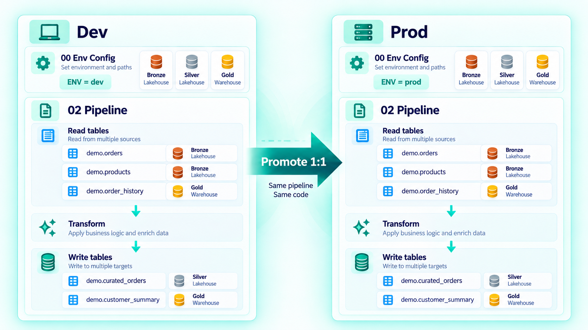

<div class="fabricops-product-page" markdown="1">

# Engineering

**Build one readable notebook pipeline that can address multiple configured Fabric stores, apply reliable processing strategies, and expose the evidence Governance needs.**

<div class="fabricops-status-row">
  <span class="fabricops-release-status fabricops-release-status--live">Core pipeline: Live</span>
  <span class="fabricops-release-status fabricops-release-status--preview">Governed execution: gated</span>
</div>

## What is a FabricOps data pipeline? { #plug-and-play-pipelines-and-orchestration }

A FabricOps pipeline is the standard notebook flow **Setup → Read → Transform → Write → Finalize**. FabricOps owns the repeatable boundaries; the PySpark transformation remains project code.

```python
context = setup_notebook()
pipeline = setup_pipeline(pipeline_mode="Ungoverned")

orders = orchestrate_read(store="Bronze", schema="demo", table_name="orders")
products = orchestrate_read(store="Bronze", schema="demo", table_name="products")

prepared = transform(orders["dataframe"], products["dataframe"])

result = orchestrate_write(
    prepared,
    store="Gold",
    schema="demo",
    table_name="customer_summary",
    write_mode="overwrite",
)
finalize_pipeline(pipeline)
```

One execution can register multiple reads and publish multiple targets. FabricOps records pipeline participation, not invented column-level lineage; your transformation code remains visible between the boundaries.

??? info "Under the Hood — execution ownership"

    [`setup_pipeline()`](api/reference/setup_pipeline.md) fixes the stable Pipeline ID, execution mode and session plan. [`orchestrate_read()`](api/reference/orchestrate_read.md) resolves and evaluates each source. [`orchestrate_write()`](api/reference/orchestrate_write.md) prepares and evaluates each target, then previews or publishes it. [`finalize_pipeline()`](api/reference/finalize_pipeline.md) records the complete outcome and releases any reservation.

    Persistent pipelines require an explicit UUIDv4 Pipeline ID retained in version-controlled source across environments and notebook redeployments. The original Fabric Notebook ID establishes the logical identity; promoted notebook IDs inherit it through the Pipeline Registry.

## What does FabricOps add to Microsoft Fabric?

Microsoft Fabric provides notebooks, Spark, Lakehouses, Warehouses and deployment tooling. A project still has to wire together locations, table identities, incremental bounds, Write strategies, retries, profiling, lineage and governance checks. FabricOps provides one configuration and orchestration pattern for that work.

| Daily engineering concern | FabricOps support |
| --- | --- |
| Read several tables in one notebook | Call [`orchestrate_read()`](api/reference/orchestrate_read.md) for each configured table; each result carries its DataFrame and stable table identity. |
| Write several targets | Call [`orchestrate_write()`](api/reference/orchestrate_write.md) independently for each prepared DataFrame and destination. |
| Move between Lakehouses and Warehouses | Use logical store keys; FabricOps selects the configured OneLake or Warehouse connector path. |
| Run Full or Incremental | Choose `read_mode` per source. |
| Overwrite, append or retain history | Choose `write_mode` per target: Overwrite, Append All, Append New Only, SCD1 or SCD2. |
| Preview safely | Dry Run uses real reads and transformations but publishes no target or operational state. |
| Capture operational evidence | Profiling, pipeline participation, run outcomes and Guardrail results are produced at the normal boundaries. |

Fabric notebooks can of course read multiple DataFrames directly. The missing convenience FabricOps addresses is **portable, configuration-driven resolution and one consistent lifecycle across multiple items and store types**, without attaching the whole pipeline to one default Lakehouse or repeating workspace/item IDs throughout project code.

## How do I read Lakehouses, Warehouses and files?

For registered table pipelines, the same [`orchestrate_read()`](api/reference/orchestrate_read.md) call shape works across configured Lakehouse and Warehouse stores. FabricOps resolves the store type internally:

- Lakehouse tables use OneLake Delta paths.
- Warehouse tables use the Fabric Spark connector.
- Full Warehouse reads can use a read-only `query`; Incremental Warehouse reads use a framework-built bounded predicate.

Lakehouse files are a separate foundational I/O surface because they need a relative file path and format-specific options. Use [`read_lakehouse_csv()`](api/reference/read_lakehouse_csv.md), [`read_lakehouse_excel()`](api/reference/read_lakehouse_excel.md), [`read_lakehouse_json()`](api/reference/read_lakehouse_json.md) or [`read_lakehouse_parquet()`](api/reference/read_lakehouse_parquet.md). FabricOps does **not** currently expose one orchestrated file/table function for every format.

??? info "Under the Hood — store and file routing"

    `00_env_config` maps logical aliases to workspace IDs, item IDs, physical names and store types. Internal [`resolve_fabric_context()`](https://github.com/Voycepeh/FabricOps-Starter-Kit/blob/main/src/fabricops_kit/config/shared.py#L108), [`get_store()`](https://github.com/Voycepeh/FabricOps-Starter-Kit/blob/main/src/fabricops_kit/config/shared.py#L823) and [`resolve_store()`](https://github.com/Voycepeh/FabricOps-Starter-Kit/blob/main/src/fabricops_kit/io/shared.py#L155) select the location. Table callers do not choose a Lakehouse versus Warehouse reader.

    File helpers resolve the same logical Lakehouse store but operate under its `Files` area. Internal [`pipeline_read()`](api/reference/pipeline_read.md) selects [`read_lakehouse_table()`](api/reference/read_lakehouse_table.md), [`read_warehouse_table()`](api/reference/read_warehouse_table.md) or [`read_warehouse_query()`](api/reference/read_warehouse_query.md). Table publication ultimately uses [`write_lakehouse_table()`](api/reference/write_lakehouse_table.md) or [`write_warehouse_table()`](api/reference/write_warehouse_table.md); there is no generic governed file writer in the current pipeline orchestrator.

## How do Full, Incremental, Append and SCD processing work?

Read Mode controls which source rows enter this run. Write Mode controls how prepared rows change the target. They are independent.

| Side | Mode | Use it when |
| --- | --- | --- |
| Read | Full | The complete source should be processed. |
| Read | Incremental | Only source changes after the accepted source-to-target watermark should be processed. |
| Write | Overwrite | The complete target should be replaced. |
| Write | Append All | Every prepared row should be appended, including repeated content. |
| Write | Append New Only | Only previously unseen final row content should be appended. |
| Write | SCD1 | The latest state should replace the previous state by business key. |
| Write | SCD2 | Historical versions should be retained by business key and effective column. |

Incremental Lakehouse reads filter the Delta DataFrame. Incremental Warehouse reads push a bounded T-SQL predicate through the connector. SCD1 requires `key_columns`; SCD2 also requires `effective_column` and can limit `tracked_columns`.

Use the [Read & Write Modes reference](reference/read-and-load-strategies.md) for exact parameters and combinations.

??? info "Under the Hood — accepted checkpoints and SCD state"

    [`pipeline_read()`](api/reference/pipeline_read.md) resolves the last accepted source-to-target watermark and captures the upper bound for the current batch. Internal [`pipeline_write()`](https://github.com/Voycepeh/FabricOps-Starter-Kit/blob/main/src/fabricops_kit/pipeline/pipeline_write.py) accepts that progress only after it can verify publication in [`METADATA_PROCESSING_STATE`](reference/metadata/metadata_processing_state.md).

    SCD2 maintains `_effective_from`, `_effective_to` and `_is_current`. FabricOps also recalculates `_row_hash` from final incoming business values after transformation and Sensitive Data treatment. Incorrect business keys still produce incorrect SCD semantics; the framework cannot infer business identity for you.

## How does FabricOps stop me loading the same data twice?

There are two protections for different failure modes:

1. **Append New Only** removes duplicate hashes inside the incoming batch and anti-joins them against target `_row_hash` values. Unchanged content is not appended again.
2. **Publication receipts and checkpoints** identify the exact prepared batch and accept incremental progress only after physical publication can be verified. A retry can finalize metadata without publishing the same verified batch again.

Every managed output receives a lowercase SHA256 `_row_hash` through internal [`add_row_hash()`](https://github.com/Voycepeh/FabricOps-Starter-Kit/blob/main/src/fabricops_kit/pipeline/shared.py#L1005). Append New Only uses [`filter_unpublished_rows()`](https://github.com/Voycepeh/FabricOps-Starter-Kit/blob/main/src/fabricops_kit/pipeline/shared.py#L1046). Append All intentionally does not de-duplicate. A changed row hash is new content in Append New Only; it is not an update. Existing managed targets without valid historical hashes fail before non-overwrite publication and require a reviewed overwrite or migration.

??? info "Under the Hood — retry recovery"

    The publication identity includes the prepared business-row multiset, Processing definition, source membership, workspace and target. Lakehouse recovery verifies Delta commit evidence. Warehouse recovery requires the exact audit-marker row count. Partial or unverifiable publication fails closed instead of advancing the checkpoint.

    Source observations, incremental checkpoints, drift baselines and publication receipts are separate typed records in [`METADATA_PROCESSING_STATE`](reference/metadata/metadata_processing_state.md). A target lease in [`METADATA_PIPELINE_REGISTRY`](reference/metadata/metadata_pipeline_registry.md) coordinates competing FabricOps writers, but it cannot stop an external writer that bypasses FabricOps.

## How does FabricOps detect Source Drift?

Source Drift is **not the same mechanism as target `_row_hash` de-duplication**.

Set `observe_source=True` for a manual complete observation, or set `source_observation_days` to a positive interval. FabricOps fingerprints the complete physical source independently of an Incremental predicate. At Write time, the Source Drift Guardrail compares the current source-to-target relationship with the last accepted baseline and reports inserted, updated and deleted change counts according to the source Processing definition.

The new baseline is accepted only after verified target publication. Observation alone is diagnostic; publication blocks only when the selected Data Contract contains a blocking Source Drift policy.

??? info "Under the Hood — full-source observation cost and limitations"

    Internal [`observe_full_source()`](https://github.com/Voycepeh/FabricOps-Starter-Kit/blob/main/src/fabricops_kit/pipeline/shared.py#L1077) performs the independent full scan and [`check_source_drift()`](https://github.com/Voycepeh/FabricOps-Starter-Kit/blob/main/src/fabricops_kit/pipeline/check_source_drift.py#L15) evaluates each contributing source before the target Write. This catches changes outside the current incremental window, but it adds a full-source scan. Accepted baselines are stored in [`METADATA_PROCESSING_STATE`](reference/metadata/metadata_processing_state.md).

    A changed fingerprint is evidence, not an automatic delete or update instruction. The configured Write strategy still determines target behaviour.

## How does a Governance Data Contract affect my ETL?

Engineering can select an exact frozen contract in Dry Run and exercise the real pipeline without publication. The contract affects both the allowed operation and the checks around it:

| Pipeline boundary | Contract effect |
| --- | --- |
| Setup | Selects the exact contract version and approved Processing definition. |
| Read | Applies Freshness, Schema, Grain and Data Quality where configured. |
| Transform | Leaves project PySpark visible and project-owned. |
| Write preparation | Applies target Schema, Sensitive Data treatment, Source Drift, Grain and Data Quality. |
| Publication | Requires the proposed Write strategy and parameters to match the selected authority. |
| Profiling | Uses the frozen Standard, Grain and Frequency schedule. |

Dry Run returns stage outcomes, prepared DataFrames, profiles and Guardrail diagnostics in the session but commits no target rows, [`METADATA_DATA_LINEAGE`](reference/metadata/metadata_data_lineage.md), [`METADATA_DATA_PROFILED`](reference/metadata/metadata_data_profiled.md) snapshots, [`METADATA_GUARDRAIL_RESULTS`](reference/metadata/metadata_guardrail_results.md) or [`METADATA_PROCESSING_STATE`](reference/metadata/metadata_processing_state.md) progress.

Ungoverned can publish without contract-dependent checks, but it cannot write a Table ID or physical destination already protected by an activation. Governed mode resolves activated contracts, an independently approved submission and the deployed notebook identity; it currently fails closed pending signed-in Fabric acceptance.

## What do I configure in my notebook?

| Location | Required Engineering configuration |
| --- | --- |
| `00_env_config` | Workspace IDs, logical store aliases, item IDs/names, store types and the shared Metadata target |
| Pipeline setup | Stable `pipeline_id`, `pipeline_mode`, and optional full Source Observation policy |
| Each Read | Logical `store`, optional `schema`, `table_name`, Full/Incremental mode, and watermark parameters when incremental |
| Project code | Ordinary PySpark joins, filters, calculations and aggregations |
| Each Write | Logical destination, `write_mode`, SCD/watermark parameters where required, and optional Spark repartitioning |
| Finalization | [`finalize_pipeline(pipeline)`](api/reference/finalize_pipeline.md) after all Reads, transformations and Writes, or `failed=True` after a caught project failure |

Call [`setup_notebook()`](api/reference/setup_notebook.md) before [`setup_pipeline()`](api/reference/setup_pipeline.md). A successful Write does not prove that the rest of the notebook completed; finalization records the whole execution outcome in [`METADATA_PIPELINE_RUN`](reference/metadata/metadata_pipeline_run.md). A killed notebook can remain incomplete and require reviewed operator reconciliation.

## How do I move the same pipeline between Development and Production?

{ .fabricops-section-evidence }

Keep the same notebook flow and stable Pipeline ID, but give each workspace its own `00_env_config` mapping. The logical names—such as Bronze, Silver and Gold—stay in the notebook while each workspace resolves its own Fabric items.

For the Preview promotion path, save the Development notebook with `PIPELINE_MODE = "Dry Run"` and run through [`finalize_pipeline(pipeline)`](api/reference/finalize_pipeline.md). FabricOps saves the complete submission in the Metadata Lakehouse. Governance reviews that exact package in [`widget_activate_pipeline()`](api/reference/widget_activate_pipeline.md); after approval, Engineering uses the controls below Finalize to deploy the accepted snapshot as a separate Governed notebook.

The same stable Pipeline ID spans environments while every promoted version receives its own physical Governed notebook ID. FabricOps does not copy permissions or move schedules: Engineering must explicitly rebind the Fabric schedule or notebook activity to the returned notebook. Git and Fabric deployment history remain useful for project source and environment assets outside the captured notebook.

### Can FabricOps freeze or recover the notebook itself?

The Preview promotion workflow archives the complete submitted and promoted notebook snapshots, deploys the exact approved snapshot, and records an immutable per-workspace version in [`METADATA_PIPELINE_REGISTRY`](reference/metadata/metadata_pipeline_registry.md). Engineering can submit a reviewed recovery request to restore the active notebook or roll back through a new auditable version; Governance independently approves the request before Engineering applies it.

This is not generic notebook time travel. Only the notebook is frozen—imported dependencies are not—and saved-definition checks have a time-of-check/time-of-use limit. The `Governed/` folder is organizational rather than a permission boundary. Governed admission and publication remain blocked pending the [signed-in Fabric acceptance checklist](maintainer/governed-pipeline-fabric-acceptance.md).

??? info "Under the Hood — submission, approval and deployment"

    Finalizing a captured Dry Run saves the complete pre-execution, submitted and promoted notebook definitions, their distinct hashes, recorded test claims, physical and deployment bindings, operation settings and exact applicable Contract payloads. Governance reads the saved submission directly; there is no package download, upload or JSON paste.

    [`METADATA_PIPELINE_ACTIVATION`](reference/metadata/metadata_pipeline_activation.md) holds Governance decisions and the protected accepted package. [`METADATA_PIPELINE_REGISTRY`](reference/metadata/metadata_pipeline_registry.md) separately holds Engineering deployment versions, snapshot pointers and active notebook identity. Approval alone never creates a notebook; deployment never creates Governance authority.

    To reopen controls in the same kernel, rerun `finalize_pipeline(pipeline)`. After a restart, run [`setup_notebook()`](api/reference/setup_notebook.md) and call `finalize_pipeline()`; this does not rerun the Dry Run or deploy automatically.

## What evidence do I get after a run?

- technical table and column identity plus resolved Processing in [`METADATA_DATA_CATALOGUE`](reference/metadata/metadata_data_catalogue.md);
- Standard and Grain profile outcomes in [`METADATA_DATA_PROFILED`](reference/metadata/metadata_data_profiled.md), plus Frequency results in [`METADATA_DATA_PROFILED_FREQUENCY`](reference/metadata/metadata_data_profiled_frequency.md);
- registered source/target pipeline participation in [`METADATA_DATA_LINEAGE`](reference/metadata/metadata_data_lineage.md);
- aggregate Guardrail results and continuation decisions in [`METADATA_GUARDRAIL_RESULTS`](reference/metadata/metadata_guardrail_results.md);
- publication receipts, accepted checkpoints and Source Drift baselines in [`METADATA_PROCESSING_STATE`](reference/metadata/metadata_processing_state.md);
- the authoritative complete, failed or incomplete outcome in [`METADATA_PIPELINE_RUN`](reference/metadata/metadata_pipeline_run.md).

??? info "Under the Hood — persistence and trade-offs"

    Persistent evidence is committed only at the applicable execution and finalization boundaries. Multiple target writes are independent publications, not one cross-target atomic transaction. Whole-table profiling, Frequency distributions and full Source Observation add compute and should be scheduled deliberately.

    Lineage records table participation in a pipeline; it does not infer exact column transformations from arbitrary PySpark. This preserves an honest boundary between framework evidence and project code.

</div>
