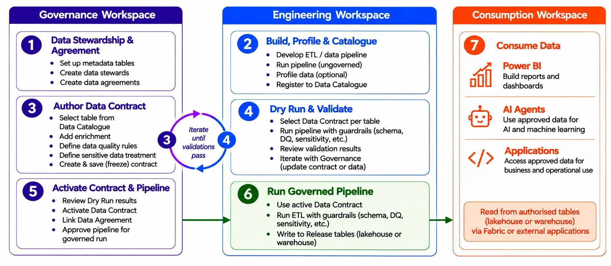
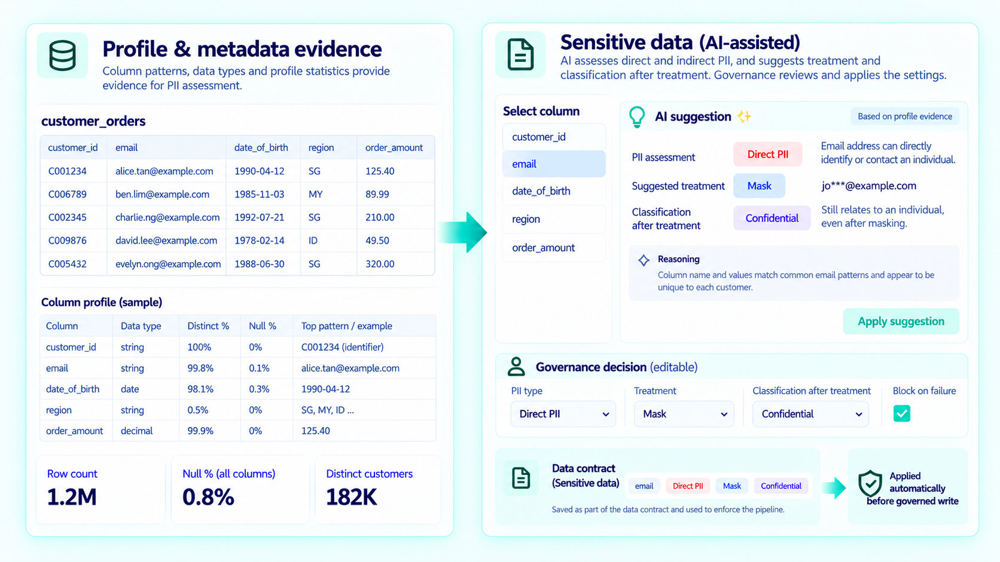
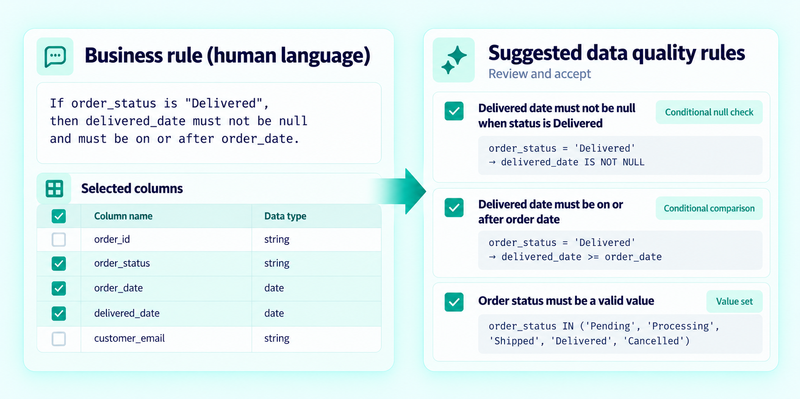
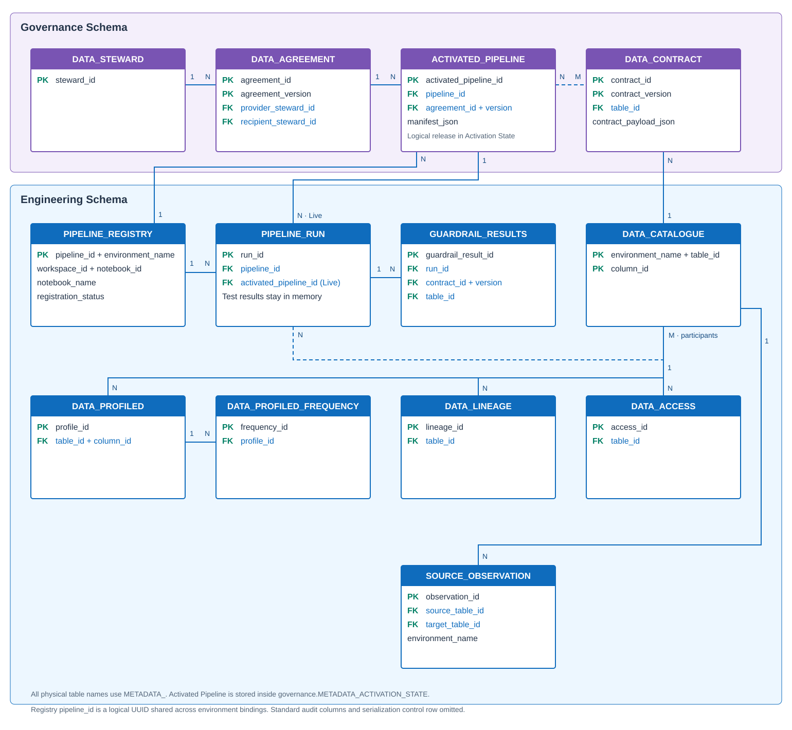

# Governance

**Turn governance decisions into versioned metadata that the engineering workflow can read, preview and—when the deployment gate is available—enforce.**

  Stewards &amp; Agreements: Live
  Contract authoring &amp; activation: Preview

## Governance as Code

FabricOps represents Governance context as structured, inspectable records rather than leaving it only in prose. Data Stewards establish accountability; Data Agreements establish purpose and approved use; table-centric Data Contracts combine observed Engineering identity with descriptive Enrichment and executable Guardrails.

| Decision | Authoring path | Canonical state |
| --- | --- | --- |
| Accountable people | [`widget_render_data_steward()`](api/reference/widget_render_data_steward.md) | `METADATA_DATA_STEWARD` |
| Provider/recipient purpose | [`widget_render_data_agreement()`](api/reference/widget_render_data_agreement.md) | `METADATA_DATA_AGREEMENT` |
| Table meaning and expectations | [`widget_data_contract()`](api/reference/widget_data_contract.md) | `METADATA_DATA_CONTRACT.contract_payload_json` |

??? info "Under the Hood — authoring and write boundaries"

    The steward and agreement widgets validate notebook inputs and write rows through the configured Governance metadata schema. Agreement updates use versioned business snapshots rather than silently changing the meaning of an earlier agreement.

    `widget_data_contract()` resolves one `table_id` from the Data Catalogue, loads the latest profile context as evidence, and creates or reopens a draft. Save replaces the mutable draft payload. Freeze validates and persists the exact payload with frozen status; later edits require the next version. The physical metadata target is always the configured Metadata Lakehouse.

    Widget functions return notebook state and actions. They do not grant Fabric permissions, deploy notebooks or change a physical business table.

## Data Contract lifecycle

{ .fabricops-section-evidence }

One globally versioned Data Contract belongs to one `table_id`. Engineering observations are workspace-specific evidence; the selected workspace does not own the resulting contract.

1. **Author** a draft from the observed table definition, then add Enrichment, Processing and Guardrails.
2. **Save** while the draft is mutable.
3. **Freeze** the reviewed `contract_payload_json`; that exact version becomes immutable.
4. **Validate** the frozen version in Dry Run against the real Read → Transform → Write path without publishing.
5. **Activate** an exact frozen version for an exact workspace/table through the Preview activation surface.
6. **Enforce** only when the trusted deployment gate can verify the executable; current Governed setup fails closed pending that integration.

??? info "Under the Hood — payload, state and limitations"

    The payload contains contract identity, table and column identity, data types, Processing, table/column Enrichment and Guardrails. Source contracts can define Schema, Grain, Freshness, Source Drift and Data Quality. Target contracts can define Schema, Grain, Data Quality and Sensitive Data treatment.

    [`setup_pipeline()`](api/reference/setup_pipeline.md) can select a frozen Data Contract for Dry Run. `orchestrate_read()` evaluates Freshness, Schema, Grain and Data Quality as applicable. `orchestrate_write()` evaluates Schema, Sensitive Data, source Source Drift, Grain and Data Quality. Dry Run keeps outcomes in memory.

    Activation records scalar `pipeline_activation`, `table_contract_activation` and control records in `METADATA_PIPELINE_REGISTRY`. It is separate from contract freezing and notebook deployment. [`widget_activate_pipeline()`](api/reference/widget_activate_pipeline.md) and [`activate_data_contract()`](api/reference/activate_data_contract.md) are Preview; do not interpret a frozen or activated metadata record as proof that arbitrary notebook code was deployed unchanged.

## Sensitive data discovery, classification and treatment

Preview authoring

{ .fabricops-section-evidence }

Governance can classify a column as Direct PII, Indirect PII or Not PII, choose an explicit **Mask**, **Bucket**, **Tokenize** or **Remove** treatment, and record the post-treatment information classification. AI can suggest; a person reviews and owns the final decision.

??? info "Under the Hood — AI context and deterministic treatment"

    The authoring path builds a compact prompt from governed table/column metadata and optional profile metrics/frequency evidence. It does not send the whole business table. A single-row PySpark DataFrame calls Fabric AI Functions through `ai.generate_response()`. Returned structured JSON is validated against supported PII and treatment values before it can be staged.

    The reviewed rule is stored in `METADATA_DATA_CONTRACT.contract_payload_json`. During Write orchestration, `check_sensitive_data()` prepares the DataFrame before hashing and publication. Treatment failures block. Token support mappings remain caller-owned unless a configured restricted mapping store is used; FabricOps does not put raw mappings in Guardrail Results.

    AI output is neither authoritative nor part of runtime enforcement. Classification alone does not trigger treatment. Preview availability also depends on Fabric AI Functions and the active Fabric runtime.

    [Explore the complete sensitive-data authoring flow →](solutions/ai-assisted-data-contract-authoring.md)

## Business rules and Data Quality

AI-assisted authoring

{ .fabricops-section-evidence }

Governance can author supported Data Quality rules directly or use AI to translate a natural-language requirement into explicit proposals. A person reviews each proposal; runtime evaluation is deterministic and does not call AI.

??? info "Under the Hood — rules, execution and persisted results"

    The AI path supplies the requirement, governed schema, optional profile evidence, existing rules and the supported DQ grammar. It prefers structured rules and uses constrained Custom Expression only when the requirement cannot be represented faithfully. Returned rule types, columns, parameters and expression grammar are validated before staging.

    Approved rules live in the contract payload. `check_dq()` evaluates them at the applicable Read or Write boundary. The orchestrator can return row-level `_dq_failed_rules`, `_dq_check_status` and `failed_values` diagnostics to the caller. `METADATA_GUARDRAIL_RESULTS` stores only aggregate outcomes including `guardrail_type`, `status`, `can_continue`, `reason` and `result_payload_json`.

    Warn/Block is authored policy, not an execution result. Profiling supplies evidence, not automatic contractual thresholds. Full violation material can be expensive and remains caller-controlled.

    [Explore natural-language rule authoring →](solutions/business-rules-to-data-quality.md)

## Metadata relationships and reporting

{ .fabricops-section-evidence }

The 12 canonical tables join Governance intent to Engineering observations and outcomes. The interactive explorer exposes their keys, exact columns, authoritative writer functions and relationships.

Use the [interactive metadata model](reference/metadata.md) to explore relationships, then inspect the exact [`METADATA_DATA_CONTRACT`](reference/metadata/metadata_data_contract.md) and [`METADATA_GUARDRAIL_RESULTS`](reference/metadata/metadata_guardrail_results.md) schemas when implementation detail is needed.

??? info "Under the Hood — Power BI and other consumers"

    The Metadata Lakehouse is a queryable source for Power BI, notebooks and SQL consumers. Stable IDs connect contracts, tables, columns, pipeline participation, runs, Guardrail Results and processing state. Report authors should model those documented relationships rather than parse UI screenshots or infer columns.

    This repository does **not** currently ship a `.pbix`, `.pbit` or Power BI project, so no Power BI dashboard is presented as a Live FabricOps capability. The interactive web metadata explorer is the maintained visualization included here. A Power BI semantic model/report remains a genuine product and documentation gap.

    The metadata is operational evidence, not a substitute for Fabric audit logs or permissions. `METADATA_DATA_ACCESS` records supported observed access paths; it is not a complete inventory of Direct Lake, workspace, OneLake and report-layer security.

## Go deeper

[Run Guided Demo Step 1](guided-demo/01-establish-governance-context.md){ .md-button .md-button--primary }

