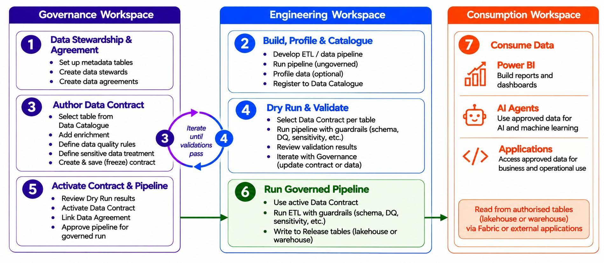

# FabricOps Guided Demo

**Run the FabricOps operating model yourself in Microsoft Fabric, from initial setup through governed Production consumption.**

`00A`, `00B`, and `00C` prepare the Fabric environment, configure the notebooks, exercise the FabricOps I/O helpers, and seed the managed demo tables. The seven numbered steps then walk you through the implementation.

!!! info "Want the conceptual operating model first?"

    Read [Architecture](architecture.md) for workspace relationships, the Governance ↔ Engineering cycle and shared metadata. This page focuses on the practical lifecycle you will run.

!!! tip "New to Microsoft Fabric?"

    Start with [Microsoft Learn: Fabric fundamentals](https://learn.microsoft.com/en-us/fabric/fundamentals/) for the platform concepts used throughout the demo. When you reach the engineering parts, continue with [Microsoft Learn: Fabric Data Engineering](https://learn.microsoft.com/en-us/fabric/data-engineering/) for Lakehouse, notebooks, Spark, and Data Engineering workflows.

    **Useful visual reference:** [Microsoft Fabric Visual Notes](https://www.slideshare.net/slideshow/microsoft-fabric-complete-handwritten-notes-pdf/289496813) — a visual community reference covering Fabric architecture, PySpark, pipelines, incremental loading, data quality, CI/CD, monitoring, and related concepts.

    FabricOps documentation remains the source of truth for how this starter kit is designed and used.

## Foundation setup

Start with <strong>0A–0C</strong> to prepare your Fabric environment, configure the notebooks, and load the demo data before running the governed pipeline.

| Setup | What you do | Why it matters |
| --- | --- | --- |
| [0A. Prepare Fabric artifacts](guided-demo/00A-prepare-fabric-artifacts.md) | Create the workspaces, stores, and Fabric Environments, then install the FabricOps wheel. | The physical Fabric foundation exists. |
| [0B. Load and configure the Guided Demo assets](guided-demo/00B-configure-environment-and-load-assets.md) | Import the core notebooks, attach their Fabric Environments, configure `00_env_config`, create the metadata tables, and upload the packaged demo files to Bronze `Files/Demo`. | Every notebook can resolve the configured Fabric stores and the raw demo assets are in place. |
| [0C. Prepare the demo data with FabricOps I/O](guided-demo/00C-prepare-demo-data-with-fabricops-io.md) | Run `00C_demo_setup` in Engineering Development to demonstrate file, Lakehouse, and Warehouse I/O and seed the original managed source tables. | The Full Refresh demo starts from real managed tables prepared through the public FabricOps I/O helpers. |

## The seven-step FabricOps workflow

Follow <strong>Steps 1–7</strong> from Governance through Engineering, validation, Production, and consumption. Steps <strong>2A–2C</strong> are hands-on pipeline examples within Step 2.

{ .fabricops-section-evidence }

The lifecycle is a hand-off, not a one-way checklist. Steps 3 and 4 repeat until the immutable contract candidate and the real pipeline agree.

1. **Establish Governance context.** Record accountable Data Stewards and the versioned Data Agreement that explains why the data is shared.
2. **Build and observe the pipeline.** Engineering runs real sources and targets in Development, creating Catalogue, profiling, lineage and processing observations.
3. **Author and freeze Data Contracts.** Governance combines that Engineering evidence with Enrichment, Processing and Guardrails, then freezes exact immutable versions.
4. **Preview the frozen versions.** Engineering selects those versions in Dry Run and exercises the Read → Transform → Write path without publishing or committing operational state.
5. **Activate, approve and deploy.** Governance activates each physical table Contract, independently approves the saved Dry Run submission, and Engineering deploys that exact snapshot as a separate Governed notebook.
6. **Run the persistent path and grant access.** Governed execution remains fail-closed pending signed-in Fabric acceptance; use the supported runnable paths and native Fabric permissions without treating Preview promotion as Production enforcement.
7. **Consume and productize.** Approved consumers use native Fabric interfaces or project-specific accelerators with the governed context available in shared metadata.

??? info "Under the Hood — why Steps 3 and 4 iterate"

    A frozen Data Contract never changes in place. If a rule is wrong or the implementation cannot meet it, Governance authors the next version and Engineering previews that new exact payload. Dry Run uses real data but sets `permits_persistence=False`, so target rows, checkpoints, profiles, lineage and run metadata are not committed.

    The stable `table_id` joins the observed table to its contract history. Workspace-specific evidence remains separate from the global version history. See [Governance](governance.md#data-contract-lifecycle) for contract mechanics and [Engineering](engineering.md#plug-and-play-pipelines-and-orchestration) for the execution boundaries.

| Step | Notebook | What you do |
| --- | --- | --- |
| [1. Establish Governance context](guided-demo/01-establish-governance-context.md) | `01_governance` | Create Data Stewards and a Data Agreement. |
| [2. Understand the Pipeline Template](guided-demo/02-build-and-run-etl.md) | `02_pipeline` | Learn the reusable Environment → Data Contract → Read → Transform → Write scaffold. |
| [2A. Run the Full Refresh Demo](guided-demo/02A-full-refresh-demo.md) | `02A_full_refresh_demo` | Run the completed Orders, Products, and Order History Full → Overwrite example. |
| [2B. Run the Incremental Append Demo](guided-demo/02B-build-and-run-incremental-append-etl.md) | `02B_incremental_append_demo` | Run inventory Day 1, Day 2, and no-change Day 3 through Incremental → Append. |
| [2C. Run the SCD1 and SCD2 Demo](guided-demo/02C-build-and-run-scd-etl.md) | `02C_scd_demo` | Run three complete Product Master snapshots and compare current state with retained history. |
| [3. Author and freeze the Data Contract](guided-demo/03-author-and-freeze-data-contract.md) | `01_governance` | Select the real `table_id`, author Enrichment, Guardrails, and Processing, then freeze the contract version. |
| [4. Preview and enforce the frozen Data Contract](guided-demo/04-validate-frozen-data-contract.md) | `02A_full_refresh_demo` | Preview the exact frozen candidate in Dry Run, or enforce an activated version in Governed mode. |
| [5. Activate Data Contracts and deploy](guided-demo/05-activate-data-contract-and-promote.md) | `01_governance` + Fabric Deployment Pipeline | Link exact contract versions to the Data Agreement, activate them for Production, then deploy the reviewed engineering artifact. |
| [6. Run the pipeline in Production and grant access](guided-demo/06-run-production.md) | Governed 02A pipeline + native Fabric access | Run the activated Production workflow, publish governed outputs, then grant approved consumers direct access through native Fabric permissions. |
| [7. Consume and productize governed data](guided-demo/07-consume-production-data.md) | Native Fabric interfaces or a project-specific notebook | Review the governed consumer context, discover reusable consumption products, and use a consumption accelerator such as one-shot Data Agent publishing. |
