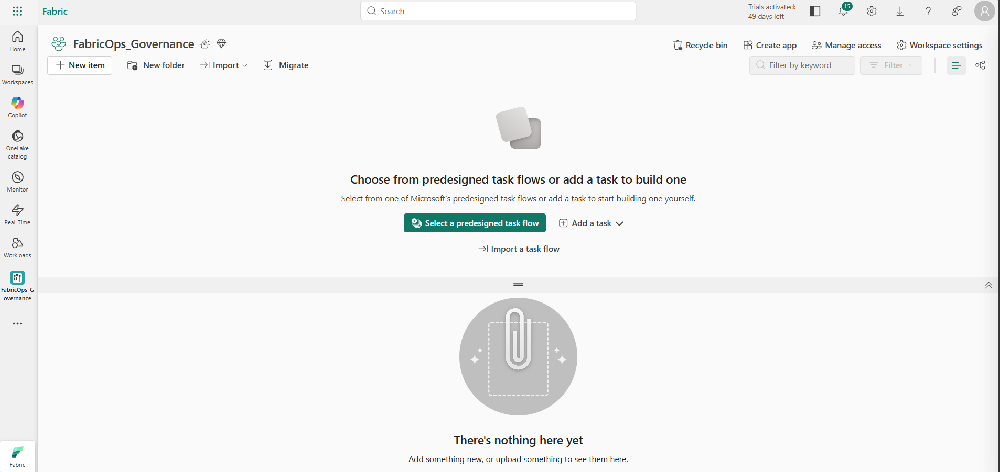
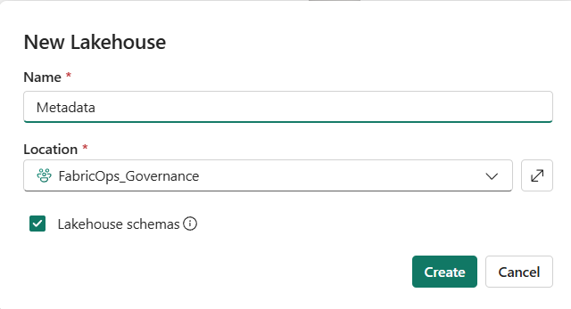
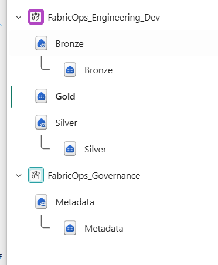
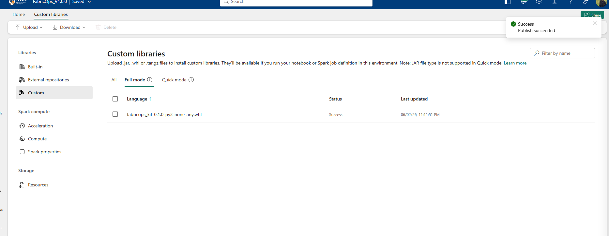

# 0A. Prepare the Fabric environment

### Before you begin

You need access to Microsoft Fabric to complete this walkthrough.

### Open Microsoft Fabric

Open [Microsoft Fabric](https://app.fabric.microsoft.com/) and sign in with your Microsoft account.

If your organisation does not provide Fabric capacity, you can use a Fabric trial where available.

## Create the workspaces

Only **Governance** and **Engineering Development** are needed initially. You can add the Production and Consumer workspaces when you reach Steps 6 and 7.

## Create the Governance metadata Lakehouse

Inside the **Governance** workspace and create a Lakehouse named **Metadata**, it is the shared home for FabricOps Governance records

Use this exact name and casing for the Guided Demo. FabricOps uses this Lakehouse to persist its Governance metadata throughout the walkthrough.

## Create the Engineering stores

Open **Engineering Development** and create three distinct stores: **bronze**, **silver** lakehouse and **gold** warehouse.

??? info "Optional: prepare Engineering Production and Consumer"

Production should be a **1:1 structural mirror** of Development so the validated pipeline can use the same logical stores after promotion.

    If you created **Engineering Production**, repeat the same setup there with `bronze`, `silver`, and `gold` using the same item types and names.

    The **Consumer** workspace does not need its own Fabric store for this Guided Demo.

## Get FabricOps

Obtain the administrator-built FabricOps wheel with the pinned central registry locator.

Use a package revision that supports centralized workspace registration. Earlier release wheels do not implement the current setup APIs. The public distribution is deliberately unconfigured until Governance builds a wheel with the reviewed Metadata Lakehouse locator.

Governance administrators follow the [central bootstrap and wheel-build procedure](00B-configure-environment-and-load-assets.md#central-workspace-registry). Engineers use the resulting approved runtime artifact; they do not edit the registry locator in a notebook.

## Create Fabric Environments and install FabricOps

Publish one centrally managed Fabric Environment where workspace compatibility permits sharing. Use centrally managed equivalent items when capacity or network settings prevent sharing.

A Fabric Environment belongs to a workspace and must be shared explicitly. Cross-workspace attachment requires compatible capacity and network security settings; see the [Environment publication and reuse requirements](00B-configure-environment-and-load-assets.md#fabric-environment-publication-and-reuse).

Start in the **Governance** workspace and create a Fabric **Environment**. Then:

1. Open **Custom libraries**.
2. Upload the FabricOps `.whl` file.
3. Confirm the wheel appears in the custom library list.
4. **Publish** the Environment.

Publishing is required before the installed FabricOps package is available to notebooks that use this Environment.

Reuse the same approved wheel and pinned locator across shared or equivalent Environment items. Registry mappings remain authoritative in one Metadata Lakehouse; Python does not change workspace-level default Environment settings.

??? info "Optional: enable Fabric AI Functions for AI-assisted Governance"

    FabricOps does not require AI to author or enforce Data Contracts. The AI-assisted authoring controls in Step 3 are optional.

    If you want to use them, ask your Fabric administrator to confirm **Users can use Copilot and other features powered by Azure OpenAI** is enabled for the relevant users or capacity. Fabric AI Functions also require a supported Fabric region, Fabric Runtime 1.3 or later, and an eligible paid capacity. Depending on the capacity region, your organisation might also need to allow cross-geo processing.

    See [AI Functions prerequisites](https://learn.microsoft.com/en-us/fabric/data-science/ai-functions/overview) and [Copilot and Agent tenant settings](https://learn.microsoft.com/en-us/fabric/admin/service-admin-portal-copilot).

    You will enable or disable the FabricOps authoring integration itself through `GOVERNANCE_CONFIG.ai_enrichment.enabled` in the centrally managed registry settings.

### Expected result

You now have:

- a Governance workspace with the `Metadata` Lakehouse and a published Fabric Environment containing FabricOps;
- an Engineering Development workspace with `bronze`, `silver`, and `gold`, plus its own published Fabric Environment containing the same FabricOps wheel;
- optionally, a matching Engineering Production workspace for Step 6, with its own Environment when you are ready to use it; and
- optionally, a Consumer workspace for Step 7, with its own Environment when you are ready to run project-specific consumer notebooks.

The physical Fabric foundation is ready. The next step imports the FabricOps notebook templates and demo data.

**Next:** [0B. Configure the environment and load demo data](00B-configure-environment-and-load-assets.md)
