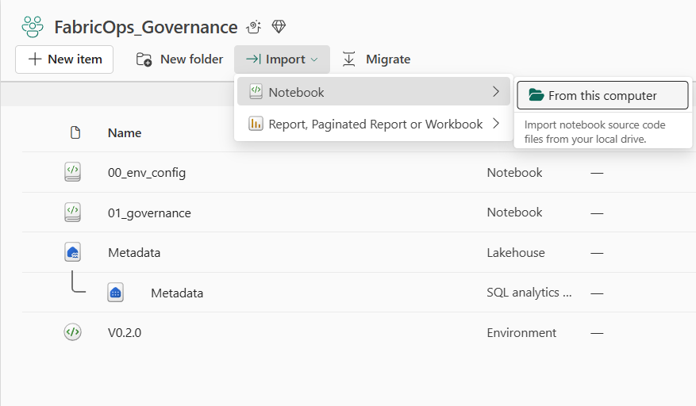
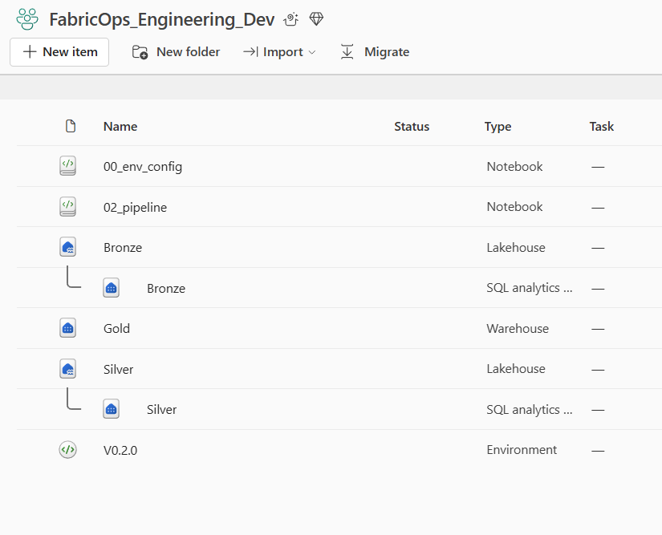
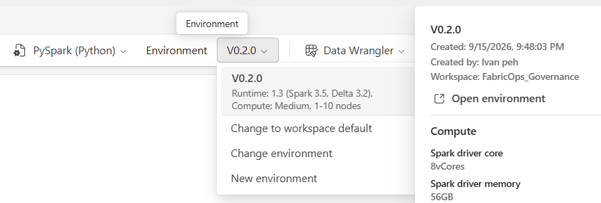
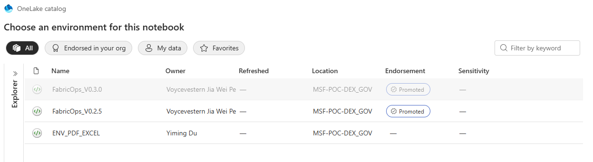
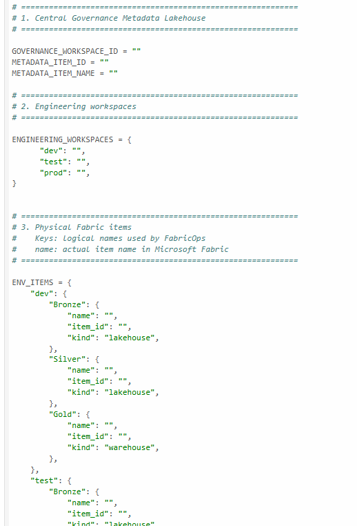
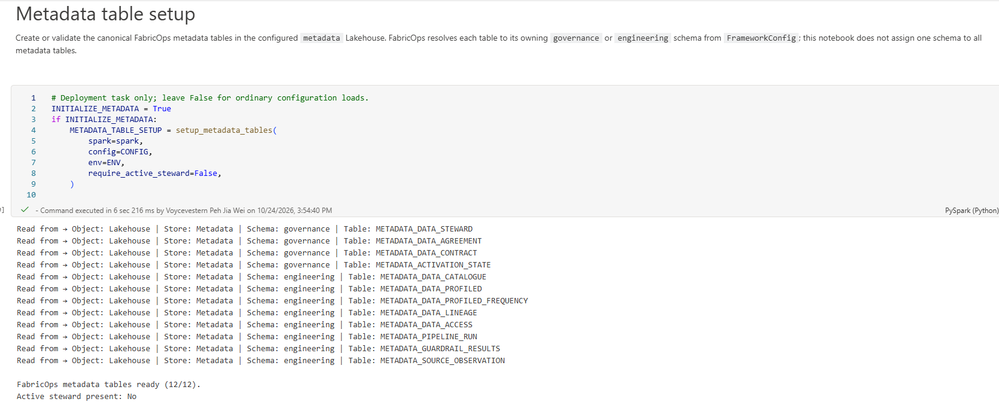
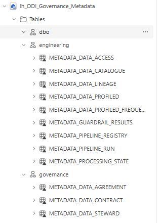
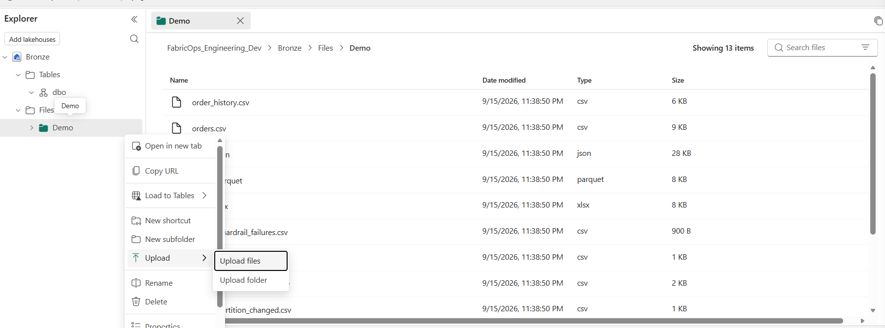

# 0B. Load and configure the Guided Demo assets

### Before you begin

Complete [Step 0A](00A-prepare-fabric-artifacts.md) before importing and configuring the demo assets.

<div class="fabricops-section-banner" markdown="1">

<div class="fabricops-section-content" markdown="1">

## Download and import the [FabricOps notebook templates](https://github.com/Voycepeh/FabricOps-Starter-Kit/tree/main/templates/notebooks)

Download the current notebook templates from the FabricOps repository:

</div>
</div>


Import the three reusable notebook templates:

| Notebook | Where it goes now |
| --- | --- |
| `00_env_config.ipynb` | Import into each workspace that runs FabricOps notebooks |
| `01_governance.ipynb` | Governance workspace |
| `02_pipeline.ipynb` | Engineering Development workspace |

In Fabric, open the target workspace, choose **Import notebook**, and upload the downloaded `.ipynb` file.

After importing the notebooks, the two required workspaces should now look like this.



The Governance workspace contains the `metadata` Lakehouse, its Fabric Environment, `00_env_config`, and `01_governance`.



The Engineering Development workspace contains `bronze`, `silver`, `gold`, its Fabric Environment, `00_env_config`, the reusable `02_pipeline`, and the demo notebooks. Production uses the same config template with its own registered workspace ID. Advanced deployments may instead load a shared config notebook from Central Engineering.

Consumers can use SQL or other native Fabric interfaces directly. For a project-specific consumer notebook using FabricOps, import the config template locally or explicitly select a shared config workspace, register its workspace, and grant access to the existing stores. Each registered workspace uses its workspace ID as the configuration key.

<div class="fabricops-section-banner" markdown="1">

<div class="fabricops-section-content" markdown="1">

## Open all the notebooks and set the Fabric Environment

Attach the shared Fabric Environment to the imported notebooks before running them.

</div>
</div>

Open each imported notebook and make sure it uses the Fabric Environment created in 0A that contains the FabricOps custom library.

1. Open the notebook.
2. In the notebook toolbar, make sure the runtime is set to **PySpark (Python)**.
3. Beside it, open the **Environment** dropdown and choose **Change environment**.
4. Select the Environment created for that workspace in 0A, where the FabricOps `.whl` was uploaded as a custom library.
5. Repeat this for every imported notebook in Governance, Engineering Development, and Consumer.





If you are a member of several Fabric workspaces, the Environment picker may show Environments from more than one workspace. For this Guided Demo, choose the Environment that belongs to the notebook's own workspace.

Use the same FabricOps wheel version across the workspace-specific Environments so the notebooks run against a consistent package version.

<div class="fabricops-section-banner" markdown="1">

<div class="fabricops-section-content" markdown="1">

## Configure `00_env_config`

In each deployment of `00_env_config`, replace the Fabric ID placeholders with the IDs for the items created in 0A. Configure `ENGINEERING_WORKSPACES` using stable workspace IDs as keys and each workspace’s business stores as values. The central Governance workspace uses `GOVERNANCE_WORKSPACE_ID` with Metadata only. Development and Production are example workspace roles; they do not control FabricOps identity or activation order. Keep all Metadata stores pointed at the same Governance Lakehouse.

By default, `setup_notebook()` loads `00_env_config` from the current workspace. Advanced callers can pass `config_workspace_id="<configuration-workspace-id>"` to `setup_notebook()` to load a shared deployment. The remote config must register the caller workspace, and cross-workspace execution and store permissions are required. See [Workspace configuration](https://github.com/Voycepeh/FabricOps-Starter-Kit/blob/main/templates/notebooks/README.md#workspace-configuration).

`01_governance` calls `setup_notebook()`; `02_pipeline` calls `setup_notebook()` followed by `setup_pipeline()`, which reuses the initialized configuration. Neither uses `%run` or manual environment selection. No process environment variable or separate JSON file is needed.

</div>
</div>



The easiest way to get them is directly from the Fabric URL in your browser.

1. Open the Fabric item you want to configure, for example the `bronze` Lakehouse.
2. Look at the browser address bar. A Fabric Lakehouse URL follows this shape:

```text
https://app.fabric.microsoft.com/groups/<workspace-id>/lakehouses/<item-id>/...
```

A Warehouse URL follows the same pattern, but uses `warehouses`:

```text
https://app.fabric.microsoft.com/groups/<workspace-id>/warehouses/<item-id>/...
```

3. Copy the GUID immediately after `/groups/`. This is the `workspace_id`.
4. Copy the GUID immediately after `/lakehouses/` or `/warehouses/`. This is the `item_id`.
5. Paste those values into the matching `FabricStore(...)` entry in `00_env_config`.

Use the current walkthrough store keys exactly as they appear in `00_env_config`:

| `FabricStore` key | Open this Fabric item | `kind` |
| --- | --- | --- |
| `Metadata` | Governance → `Metadata` | `lakehouse` |
| `Bronze` | Engineering Development → `Bronze` | `lakehouse` |
| `Silver` | Engineering Development → `Silver` | `lakehouse` |
| `Gold` | Engineering Development → `Gold` | `warehouse` |


<div class="fabricops-section-banner" markdown="1">

<div class="fabricops-section-content" markdown="1">

## Setup the metadata tables

In the Governance workspace, set `INITIALIZE_METADATA = True` and run `00_env_config` directly once, then restore `False`. Routine configuration loads return JSON without provisioning metadata tables.

</div>
</div>




This initializes the central governance and engineering metadata schemas before `01_governance` creates Stewards and Agreements. Contract Enrichment and Guardrails live in `METADATA_DATA_CONTRACT.contract_payload_json`.

This intentionally breaking workspace model requires a fresh metadata installation; no migration is supplied. Do not combine an empty Processing State table with existing incremental or SCD targets. Use fresh demo targets or perform a separately reviewed rebuild/replay.



<div class="fabricops-section-banner" markdown="1">

<div class="fabricops-section-content" markdown="1">

## Download the demo data

Download the supplied demo files from: [FabricOps DemoData](https://github.com/Voycepeh/FabricOps-Starter-Kit/tree/main/templates/DemoData)

</div>
</div>


Download the **entire DemoData folder**. Every retained file has an explicit Guided Demo owner:

| Demo asset | When it is used |
| --- | --- |
| `orders.csv`, `orders.json`, `orders.parquet`, `orders.xlsx` | 0C uses these equivalent 120-row files to demonstrate the FabricOps file readers. |
| `products.csv` | 0C seeds `bronze.demo.products`. |
| `order_history.csv` | 0C seeds `gold.demo.order_history` and demonstrates Warehouse reads. |
| `inventory_day1.csv`, `inventory_day2.csv` | Step 2B stages the inventory batches; Day 3 intentionally has no file. |
| `products_day1.csv`, `products_day2.csv`, `products_day3.csv` | Step 2C overwrites Bronze with each complete Product Master snapshot. |

Also download the ready-to-run pipeline demos from [FabricOps DemoData](https://github.com/Voycepeh/FabricOps-Starter-Kit/tree/main/templates/DemoData):

| Demo notebook | Where it goes now |
| --- | --- |
| `02A_full_refresh_demo.ipynb` | Engineering Development workspace |
| `02B_incremental_append_demo.ipynb` | Engineering Development workspace |
| `02C_scd_demo.ipynb` | Engineering Development workspace |
| `00C_demo_setup.ipynb` | Engineering Development workspace |


<div class="fabricops-section-banner" markdown="1">

<div class="fabricops-section-content" markdown="1">

## Upload the demo data

Upload the downloaded demo files to the Bronze Lakehouse and the demo notebooks into the engineering workspace.

</div>
</div>

1. Open the **Engineering Development** workspace.
2. Open the `bronze` Lakehouse created in 0A.
3. Under **Files**, create a subfolder named `Demo`.
4. Upload the **entire downloaded DemoData folder contents** into that folder.



At this point, stop. Do not create the managed source tables manually in 0B.

The next setup notebook demonstrates the FabricOps I/O helpers and prepares the original managed tables used by the Step 2A Full Refresh demo. Steps 2B and 2C stage their own source tables from the uploaded files.

### Expected result

The demo notebooks, Fabric Environment configuration, metadata tables, and demo files are ready for the next preparation step.

**Next:** [0C. Prepare the demo data with FabricOps I/O](00C-prepare-demo-data-with-fabricops-io.md)
