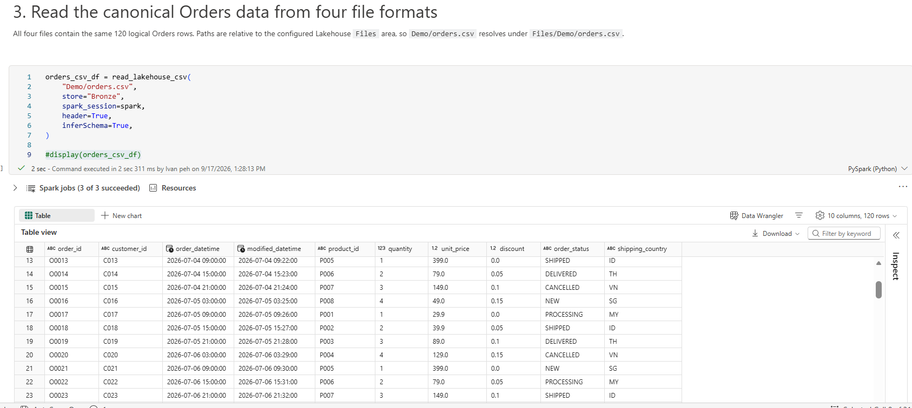
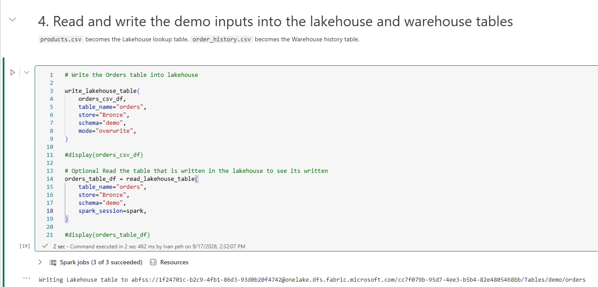
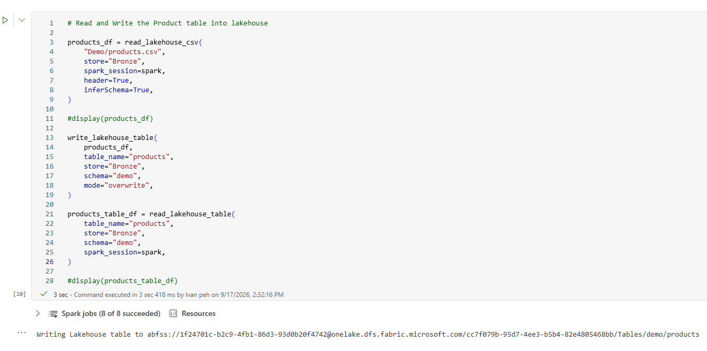
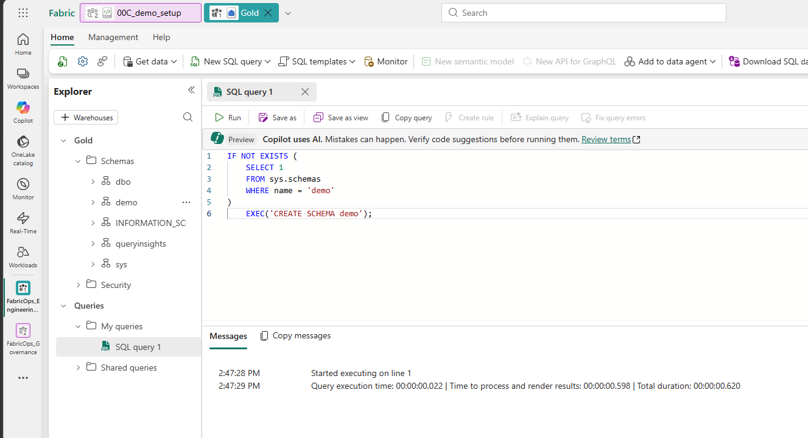
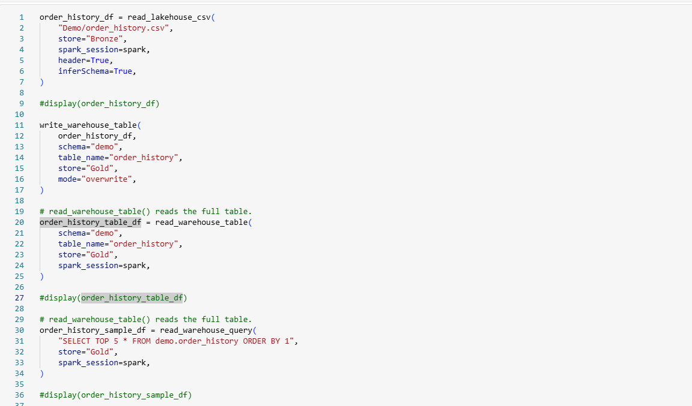

# 0C. Prepare the demo data with FabricOps I/O

**Demo setup:** After 00B, run this notebook once to prepare the baseline data for all three Step 2 demos: 02A Full Refresh, 02B Incremental (`demo.inventory_movements`), and 02C SCD (`demo.product_master_updates`).

This notebook demonstrates the FabricOps I/O helpers while preparing the shared starting data for Steps 02A, 02B, and 02C.

### Before you begin

Complete [Step 0B](00B-configure-environment-and-load-assets.md) before preparing the demo data.

### Import the setup notebook

1. Download [`00C_demo_setup.ipynb`](https://github.com/Voycepeh/FabricOps-Starter-Kit/blob/main/templates/DemoData/00C_demo_setup.ipynb) and import it into Fabric Engineering Workspace (Dev).

2. Attach the same Fabric Environment used by the other notebooks.

3. Make sure you have already uploaded the demo files required for this demo in the previous step [Step 00B](00B-configure-environment-and-load-assets.md).


4. Run the first two steps in the notebook.


<div class="fabricops-section-banner" markdown="1">

<div class="fabricops-section-content" markdown="1">

## Read the same Orders dataset from four file formats

Read the same canonical Orders dataset using CSV, JSON, Parquet, and Excel.

</div>
</div>




```python
# Optional: uncomment to inspect the loaded data
display(orders_csv_df)
```

### Optional: verify all four file formats match

Copy and paste this into an empty code cell.

Normalize the format-specific inferred schemas, then verify that CSV, JSON, Parquet, and Excel resolve to the same canonical Orders dataset using a checksum comparison.

```python
from pyspark.sql import functions as F

schema = {
    "order_id": "string",
    "customer_id": "string",
    "order_datetime": "timestamp",
    "modified_datetime": "timestamp",
    "product_id": "string",
    "quantity": "int",
    "unit_price": "double",
    "discount": "double",
    "order_status": "string",
    "shipping_country": "string",
}

def normalize(df):
    return df.select(*[
        F.col(c).cast(dtype).alias(c)
        for c, dtype in schema.items()
    ])

formats = {
    "CSV": orders_csv_df,
    "JSON": orders_json_df,
    "PARQUET": orders_parquet_df,
    "EXCEL": orders_excel_df,
}

normalized = {name: normalize(df) for name, df in formats.items()}

def checksum(df):
    cols = sorted(df.columns)
    return (
        df.select(F.sha2(F.concat_ws("||", *[F.coalesce(F.col(c).cast("string"), F.lit("<NULL>")) for c in cols]), 256).alias("hash"))
        .agg(F.sha2(F.concat_ws("", F.sort_array(F.collect_list("hash"))), 256).alias("hash"))
        .first()["hash"]
    )

hashes = [checksum(df) for df in normalized.values()]
assert len(set(hashes)) == 1, "Orders file variants do not match."

print("✓ CSV = JSON = PARQUET = EXCEL")
print("✓ 1:1:1:1 data match")
```

The expected output confirms that all four file formats resolve to equivalent data. This step is only used to demonstrate the FabricOps file I/O capabilities.

```text
✓ CSV = JSON = PARQUET = EXCEL
✓ 1:1:1:1 data match
```

<div class="fabricops-section-banner" markdown="1">

<div class="fabricops-section-content" markdown="1">

## Read and write the demo data

Read the remaining retail sources and write the managed Lakehouse and Warehouse tables for 02A. The notebook also seeds the Day 1 Bronze tables for 02B and 02C.

</div>
</div>


### Orders



### Products



### Create the Warehouse schema



### Order history


!!! tip "FabricOps provides two Warehouse read helpers"

    * `read_warehouse_table()` reads the full Warehouse table into a Spark DataFrame.
    * `read_warehouse_query()` executes SQL in the Warehouse first, then returns only the query result to Spark.

    Use `read_warehouse_query()` when filtering, selecting columns, joining, or aggregating Warehouse data. This pushes the SQL work down to the Warehouse before the result crosses into PySpark, avoiding translation of more Warehouse data into Spark than necessary.

    Use SQL pushdown when it materially reduces Warehouse data before Spark. For repeated heavy PySpark engineering, prefer landing the required data into Lakehouse Delta rather than repeatedly crossing the Warehouse-to-Spark boundary.


### Expected result

After the notebook finishes, Engineering Development should contain the starting tables for all three Step 2 demos:

```text
bronze Lakehouse
  demo.orders
  demo.products
  demo.inventory_movements      # 02B incremental Day 1 baseline
  demo.product_master_updates   # 02C SCD Day 1 baseline

gold Warehouse
  demo.order_history
```

**Next:** [Step 1. Establish Governance context](01-establish-governance-context.md)
