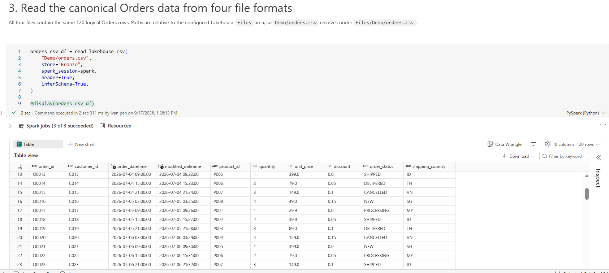
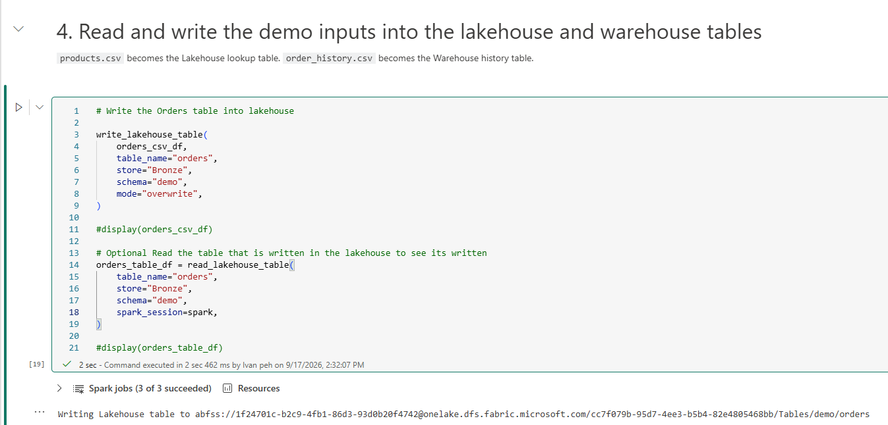
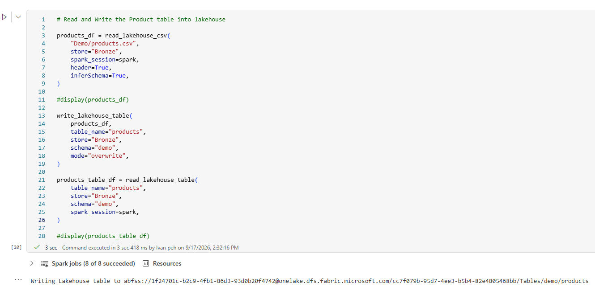
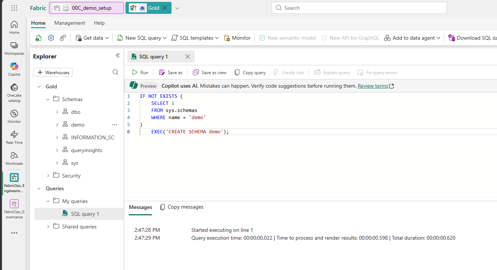
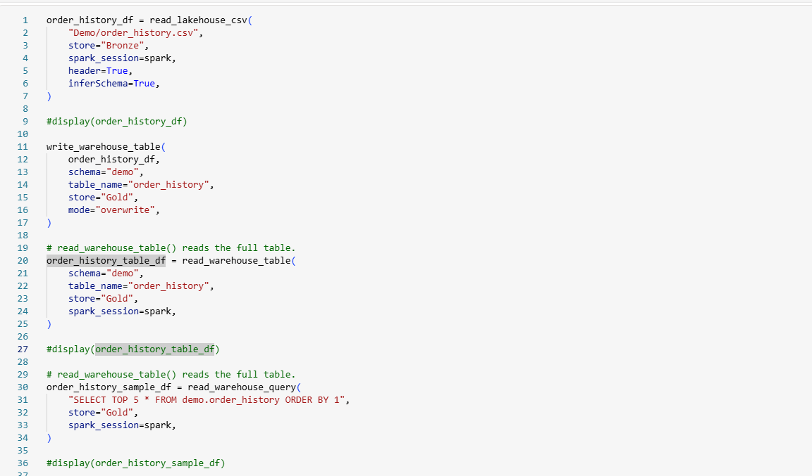
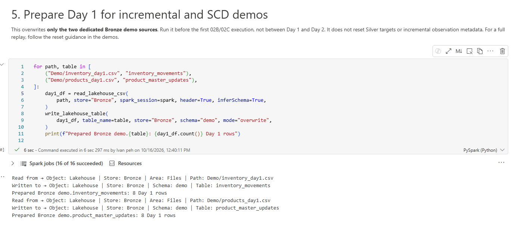

# 0C. Prepare the demo data with FabricOps I/O

Start with [00B](00B-configure-environment-and-load-assets.md), including your manually created, schema-enabled **`demo_metadata`** Lakehouse and uploaded Bronze **`Files/demo`** fixtures. The logical store remains `Metadata`; use the existing configuration fields. The `00_env_config` template is unchanged.

<div class="fabricops-section-banner" markdown="1">

<div class="fabricops-section-content" markdown="1">

## Import the setup notebook

Import the setup notebook and connect it to the configured Fabric Environment.

</div>
</div>

1. If you havent done so , download [`00C_demo_setup.ipynb`](https://github.com/Voycepeh/FabricOps-Starter-Kit/blob/main/templates/DemoData/00C_demo_setup.ipynb) and import it into Fabric Engineering Workspace (Dev).

2. Attach the same Fabric Environment used by the other notebooks.

3. Make sure you have already uploaded the demo files required for this demo in the previous step [Step 00B](00B-configure-environment-and-load-assets.md).


### Load the shared 00_env_config notebook that is in the same workspace via our helper function (Or if you did want to point to a notebook in another workpace just pass the workpace id into the helper funciton)


## Reset, rerun and validate a package

**Run the reset cell before the file-reading examples.** Install/publish the package being validated, start fresh notebook sessions and confirm its version in `setup_notebook()` output.

The notebook uses the public `orchestrate_demo_reset()` Preview API, with one switch:

```python
RESET_DEMO = False  # Preview only. Set True to reset the dedicated demo environment.

from fabricops_kit import orchestrate_demo_reset

orchestrate_demo_reset(reset=RESET_DEMO)
```

1. Run with `False` to inspect metadata counts. No data is changed.
2. Stop all demo schedules and executions, including earlier promoted copies. Set `True` and run the cell to reset.
3. Continue only when the cell prints **`RESET COMPLETE`**. The remaining cells demonstrate reads of the restored data.

!!! warning "Dedicated demo environment only"

    `True` deletes **all rows in the 14 metadata tables**, including Contracts, activations, approvals and Run history, plus saved submissions, Dry Run evidence and notebook snapshots in the dedicated Metadata item. It also restores five Day 1 sources and removes six demo outputs. Use only disposable demo assets. Source files and other business tables are preserved. Deployed notebooks and schedules are not deleted; stop or retire old copies before restarting.

??? info "Checks before deletion and reset scope"

    The orchestrator checks the configured and actual Metadata item name (`demo_metadata`), store separation, installed metadata schemas, exact demo table/workspace references, lifecycle artifact contents, active notebook jobs and all five fixture row counts. Unexpected references or unreadable evidence block deletion. A lakehouse name alone does not prove ownership: reserve this item and the eleven business tables exclusively for the walkthrough. Do not share it with production or unrelated projects.

    All current metadata tables are cleared together, with dependent records before their parents; schemas remain in place. The orchestrator reports rows removed per table, including zero, and checks that tables and lifecycle artifact folders are empty afterward. Missing/incompatible metadata tables require the existing 00B metadata setup first; the orchestrator does not migrate schemas. If a future package changes the metadata inventory, the reset stops for review.

    | Restore from Day 1 fixtures | Rows |
    | --- | --- |
    | Bronze `demo.orders` | 120 |
    | Bronze `demo.products` | 8 |
    | Gold `demo.order_history` | 180 |
    | Bronze `demo.inventory_movements` | 8 |
    | Bronze `demo.product_master_updates` | 8 |

    | Remove output | Store |
    | --- | --- |
    | `demo.curated_orders` | Silver |
    | `demo.customer_summary` | Gold |
    | `demo.inventory_movements_append_all` | Silver |
    | `demo.inventory_movements_append_new_only` | Silver |
    | `demo.product_master_scd1` | Silver |
    | `demo.product_master_scd2` | Silver |

    Verification compares full source content with the fixtures and checks all six outputs are absent. Missing outputs are OK. If preparation fails partway, fix the reported cause and rerun the same reset cell. Repeated resets return to the same Day 1 state. To retain old Contracts/history, use a separate demo environment instead of clearing this one.

<div class="fabricops-section-banner" markdown="1">

<div class="fabricops-section-content" markdown="1">

## Read the same Orders dataset from four file formats

Read the same canonical Orders dataset using CSV, JSON, Parquet, and Excel.

</div>
</div>




```python
# Optional: uncomment to inspect the loaded data
display(orders_csv_df)
```

??? tip "Optional: verify all four file formats match"

    Copy and paste this into an empty code cell.

    Normalize the format-specific inferred schemas, then verify that CSV, JSON, Parquet, and Excel resolve to the same canonical Orders dataset using a checksum comparison.

    ```python
    from pyspark.sql import functions as F

    schema = {
        "order_id": "string",
        "customer_id": "string",
        "order_datetime": "timestamp",
        "modified_datetime": "timestamp",
        "product_id": "string",
        "quantity": "int",
        "unit_price": "double",
        "discount": "double",
        "order_status": "string",
        "shipping_country": "string",
    }

    def normalize(df):
        return df.select(*[
            F.col(c).cast(dtype).alias(c)
            for c, dtype in schema.items()
        ])

    formats = {
        "CSV": orders_csv_df,
        "JSON": orders_json_df,
        "PARQUET": orders_parquet_df,
        "EXCEL": orders_excel_df,
    }

    normalized = {name: normalize(df) for name, df in formats.items()}

    def checksum(df):
        cols = sorted(df.columns)
        return (
            df.select(F.sha2(F.concat_ws("||", *[F.coalesce(F.col(c).cast("string"), F.lit("<NULL>")) for c in cols]), 256).alias("hash"))
            .agg(F.sha2(F.concat_ws("", F.sort_array(F.collect_list("hash"))), 256).alias("hash"))
            .first()["hash"]
        )

    hashes = [checksum(df) for df in normalized.values()]
    assert len(set(hashes)) == 1, "Orders file variants do not match."

    print("✓ CSV = JSON = PARQUET = EXCEL")
    print("✓ 1:1:1:1 data match")
    ```

    The expected output confirms that all four file formats resolve to equivalent data. This step is only used to demonstrate the FabricOps file I/O capabilities.

    ```text
    ✓ CSV = JSON = PARQUET = EXCEL
    ✓ 1:1:1:1 data match
    ```


<div class="fabricops-section-banner" markdown="1">

<div class="fabricops-section-content" markdown="1">

## Read the restored Orders table

Inspect the Orders baseline restored by the reset cell.

</div>
</div>



<div class="fabricops-section-banner" markdown="1">

<div class="fabricops-section-content" markdown="1">

## Read the restored Products table

Inspect the product records restored by the reset cell.

</div>
</div>



<div class="fabricops-section-banner" markdown="1">

<div class="fabricops-section-content" markdown="1">

## Check the Gold Warehouse schema

The reset cell uses the existing FabricOps Warehouse writer to create the `demo` schema when needed.

</div>
</div>



<div class="fabricops-section-banner" markdown="1">

<div class="fabricops-section-content" markdown="1">

## Read the restored Gold Order History

Inspect the restored history source with the existing Warehouse read helpers.

</div>
</div>


!!! tip "FabricOps provides two Warehouse read helpers"

    * `read_warehouse_table()` reads the full Warehouse table into a Spark DataFrame.
    * `read_warehouse_query()` executes SQL in the Warehouse first, then returns only the query result to Spark.

    Use `read_warehouse_query()` when filtering, selecting columns, joining, or aggregating Warehouse data. This pushes the SQL work down to the Warehouse before the result crosses into PySpark, avoiding translation of more Warehouse data into Spark than necessary.

    Use SQL pushdown when it materially reduces Warehouse data before Spark. For repeated heavy PySpark engineering, prefer landing the required data into Lakehouse Delta rather than repeatedly crossing the Warehouse-to-Spark boundary.


<div class="fabricops-section-banner" markdown="1">

<div class="fabricops-section-content" markdown="1">

## Inspect Day 1 for Append and SCD Demos

Inspect the Day 1 Bronze source tables for the Incremental Append vs Full Hash Append (02B) and SCD1/SCD2 (02C) demos.

</div>
</div>

The reset cell prepares these two Bronze sources:

| Source file | Bronze table | Used by |
|---|---|---|
| `demo/inventory_day1.csv` | `demo.inventory_movements` | 02B incremental/full append comparison |
| `demo/products_day1.csv` | `demo.product_master_updates` | 02C SCD1/SCD2 |

### Inspect the restored sources after `RESET COMPLETE`



The reset cell uses `read_lakehouse_csv()` and `write_lakehouse_table(mode="overwrite")`. The following inspection cells only read those tables.


### Expected result

After the notebook finishes, Engineering Development should contain the starting tables for all three Step 2 demos:

```text
bronze Lakehouse
  demo.orders
  demo.products
  demo.inventory_movements      # 02B append Day 1 baseline
  demo.product_master_updates   # 02C SCD Day 1 baseline

gold Warehouse
  demo.order_history
```

## Execute the engineering regression

After `RESET COMPLETE`, begin [Step 1](01-establish-governance-context.md), then follow Steps 2–7. Run these engineering scenarios in **Ungoverned** mode before Contract authoring. Do not run 00C between days.

| Day | Execute in order | Expected persisted results |
| --- | --- | --- |
| 1 | 02A → 02B (`DEMO_DAY = 1`) → 02C (`DEMO_DAY = 1`) | 02A: 120 orders, 30 customers. 02B: 8 rows per target. 02C: 8 SCD1 rows, 8 SCD2 versions. |
| 2 | 02B (`DEMO_DAY = 2`) → 02C (`DEMO_DAY = 2`) | 02B: 12 rows per target. 02C: 8 SCD1 rows, 9 SCD2 versions. |
| 3 | 02B (`DEMO_DAY = 3`) → 02C (`DEMO_DAY = 3`) | 02B: both targets stay at 12. 02C: 8 SCD1 rows, 10 SCD2 versions; 8 current products. |

Day 3 is supported: 02B stages no new file; 02C stages `demo/products_day3.csv`. Run each notebook from staging through Finalize; 02B finalizes two separate executions. The existing governed admission restrictions in Steps 5–6 still apply.

## Validate outputs and metadata

- [ ] Inspect persisted keys, values, hashes and history using the checks on [02A](02A-full-refresh-demo.md), [02B](02B-build-and-run-incremental-append-etl.md) and [02C](02C-build-and-run-scd-etl.md). Source content must remain intact after orchestration.
- [ ] Inspect the dedicated Metadata Lakehouse: expect 10 finalized Pipeline Runs before replays (one 02A, six 02B, three 02C), with `ungoverned_completed` status, `execution_mode = ungoverned`, `boundary_completed = true` and completion times. Both 02B paths share a Pipeline ID but have distinct Run IDs.
- [ ] Check exact source/target IDs in Run operations, Catalogue definitions, applicable profiles/frequencies and Lineage roles. Processing State checkpoints, baselines and committed receipts must link to the correct workspace, source, target and publication; failed/skipped publication must not advance progress.
- [ ] Use the same Metadata item and fresh sessions for Contract authoring. Only this walkthrough's observations and saved submissions should be visible.
- [ ] Replay each current day: 02A stays at 120/30; 02B adds no accepted movements/hashes; 02C keeps eight current products without duplicate unchanged versions. Then reset twice with `True`; both must print `RESET COMPLETE`.

For another package baseline, stop demo jobs, install/publish the new wheel, start fresh sessions and repeat 00C → Steps 1–7. Record the package version, date, tester, Metadata item ID, reset summary and Run IDs. Fabric job checks, cross-workspace routing, Lakehouse catalog removal, Warehouse I/O and Governance gates require actual Fabric acceptance; local tests do not establish that result.

**Next:** [Step 1. Establish Governance context](01-establish-governance-context.md)
