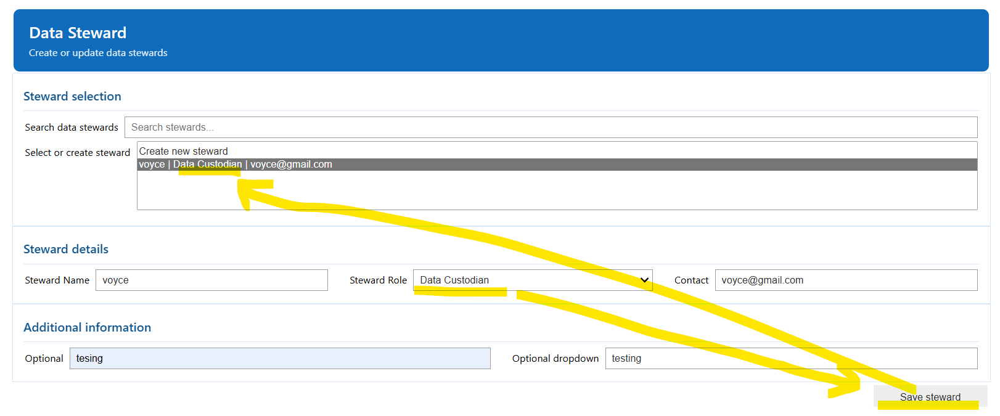
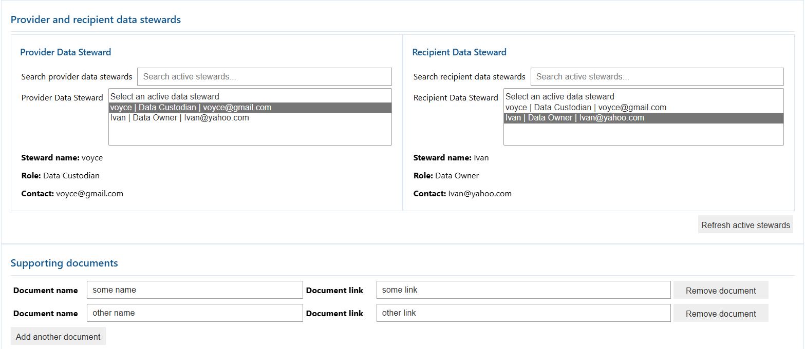

# Step 1. Establish Governance context

**Use `01_governance` for the first Governance task: creating the Data Stewards and the Data Agreement. We put this first in the walkthrough, but there is no dependency on the Data Agreement until Step 5 activation, so you may skip this step and revisit it later if you prefer to start with the ETL process first.**

## Before you begin

Complete [Step 0C](00C-prepare-demo-data-with-fabricops-io.md) and open `01_governance`.

## Load the shared environment

```python
%run 00_env_config
```

## Import required widget functions

- We created widgets with ipywidgets to provide users with a simple UI to record and capture the required data.
- Feel free to swap this out for an actual frontend, or capture the data directly into the underlying metadata tables if you prefer.

```python
from fabricops_kit import (
    widget_render_data_agreement,
    widget_render_data_steward,
)
```

## Create the Data Stewards

<div class="fabricops-mascot-callout">
  
  <div markdown="1">

Use the widget to create the data producer and consumer stewards.

  </div>
</div>

- The dropdown lists are configurable and come from the `00_env_config` notebook.
- To update a record, edit the data and press save again.
- The widget writes to the underlying metadata table. In the example below, I created myself as a Data Owner and later updated the record to Data Custodian.





## Create the Data Agreement

<div class="fabricops-mascot-callout">
  
  <div markdown="1">

Use the Data Agreement widget to define the relationship between the accountable producer and consumer stewards, including the purpose, scope, permitted use, and validity.

  </div>
</div>

- Capture the supporting information and other governance context required by your organisation.




## Expected result

At the end of Step 1 you should have:

- producer and consumer Data Steward records,
- one Data Agreement between them,
- visible persisted rows in the metadata tables.

**Next:** [Step 2. Build and run the ETL](02-build-and-run-etl.md)
