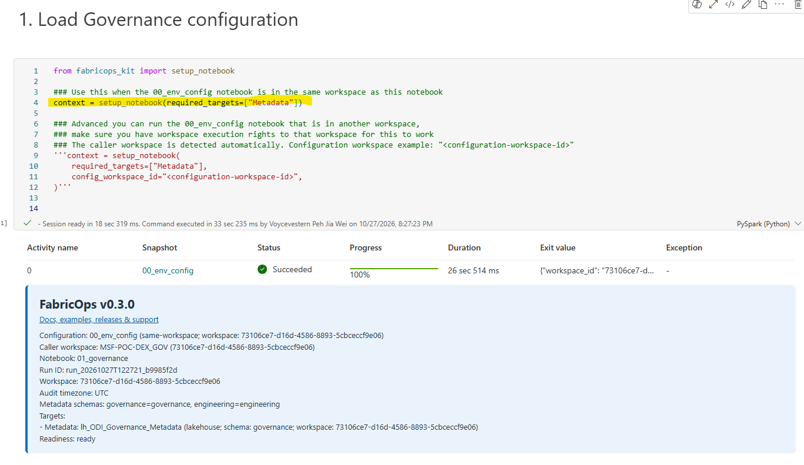
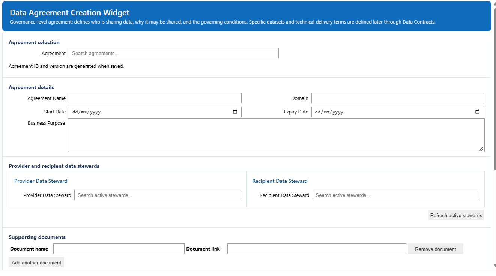
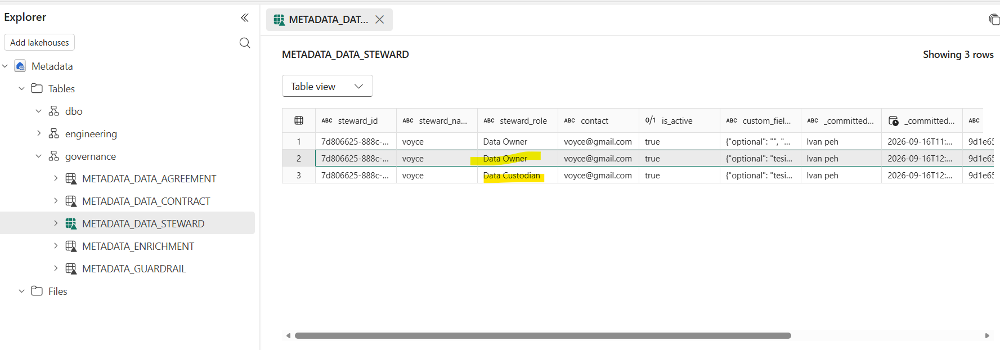

# Step 1. Establish Governance context

### Before you begin

Complete [Step 0C](00C-prepare-demo-data-with-fabricops-io.md) and open `01_governance`.

### Load the shared 00_env_config notebook that is in the same workspace via our helper function 

## Create the Data Stewards

Use the widget to create the data producer and consumer stewards.

- The dropdown lists are configurable and come from the `00_env_config` notebook.
- To update a record, edit the data and press save again.
- The widget writes to the underlying metadata table. In the example below, I created myself as a Data Owner and later updated the record to Data Custodian.

 
 -

## Create the Data Agreement

Use the Data Agreement widget to define the relationship between the accountable producer and consumer stewards, including the purpose, scope, permitted use, and validity.

- Capture the supporting information and other governance context required by your organisation.

### Expected result

At the end of Step 1 you should have:

- producer and consumer Data Steward records,
- one Data Agreement between them,
- visible persisted rows in the metadata tables.

**Next:** [Step 2. Build and run the ETL](02-build-and-run-etl.md)
