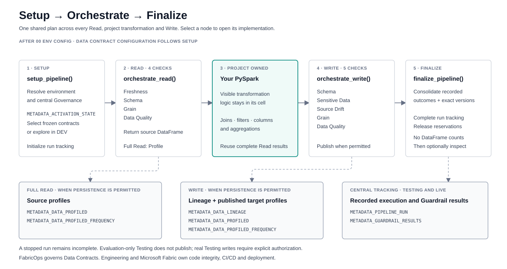
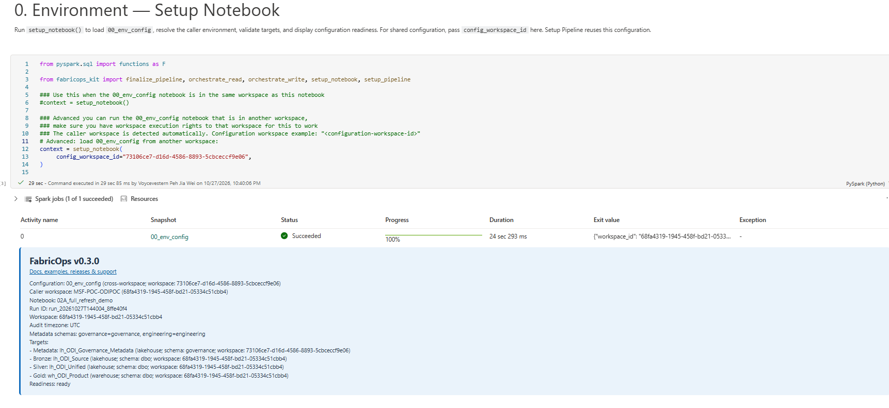

# Plug-and-Play 02: Pipeline Template

**Use this companion reference to understand the reusable `02_pipeline` notebook, its Read and Write strategies, and the execution output shown in Microsoft Fabric.**

<div class="fabricops-section-banner" markdown="1">

<div class="fabricops-section-content" markdown="1">

## Watch: Pipeline Template Walkthrough

See how the Plug-and-Play 02 template is structured and how its governed pipeline boundaries work.

</div>
</div>

<video class="fabricops-page-video" controls preload="metadata" aria-label="Plug-and-Play 02 Pipeline Template walkthrough">
  <source src="../assets/plug-and-play-pipeline-template.mp4" type="video/mp4">
  Your browser does not support embedded video. <a href="../assets/plug-and-play-pipeline-template.mp4">Open the Pipeline Template walkthrough</a>.
</video>

The walkthrough is the primary guided introduction. This page remains a standalone reference for the template's concepts, examples, strategy choices, and execution output.

<div class="fabricops-section-banner" markdown="1">

<div class="fabricops-section-content" markdown="1">

## What this template does

The notebook places governed Read and Write boundaries around project-owned PySpark transformation logic.

</div>
</div>



| Template section | What it provides |
| --- | --- |
| Environment | `setup_notebook()` loads configuration and resolves the caller's workspace environment. |
| Setup Pipeline | `setup_pipeline()` uses the saved Pipeline ID and starts the selected execution mode. |
| Read | `orchestrate_read()` reads a source and runs applicable checks and profiling. |
| Transform | Project-owned PySpark joins, filters, derives, aggregates, or selects data. |
| Write | `orchestrate_write()` checks and publishes the prepared DataFrame using the selected Write Mode. |
| Finalize | `finalize_pipeline(pipeline)` records the outcome. Each target has one owning pipeline with non-overlapping scheduled runs. |

### Explore the notebook

The template intentionally uses placeholder source and target names so it can be adapted to the tables in an Engineering Development workspace.

- [Download `02_pipeline.ipynb`](https://raw.githubusercontent.com/Voycepeh/FabricOps-Starter-Kit/main/templates/notebooks/02_pipeline.ipynb).
- Keep `00_env_config.ipynb` beside the pipeline notebook and attach the Fabric Environment configured in [0B. Configure the Environment and load assets](00B-configure-environment-and-load-assets.md) when exploring it in Fabric.

Want to explore the implementation? Open the corresponding notebook and experiment with the available Read and Write strategies. The examples below explain the scaffold without requiring the notebook to be run as an exercise.

### Pipeline setup and execution modes

The Environment block can point to a shared configuration workspace:

```python
context = setup_notebook(
    # config_workspace_id="<configuration-workspace-id>",
)
```

The Setup Pipeline block selects the execution mode. FabricOps derives the logical Pipeline ID from the current Fabric Notebook ID; after promotion, the Pipeline Registry maps the new physical notebook back to that logical identity.

```python
PIPELINE_MODE = "Ungoverned"  # "Dry Run", "Ungoverned", or "Governed"

pipeline = setup_pipeline(
    pipeline_mode=PIPELINE_MODE,
)
```



| Mode | Publishes target data? | Data Contract behavior |
| --- | --- | --- |
| `"Dry Run"` | No | Validates the selected frozen Data Contract configuration where applicable; operational changes are not published. |
| `"Ungoverned"` | Yes | Runs without contract-dependent checks and records observations for Governance. It cannot write to a destination that is already governed. |
| `"Governed"` | Yes, when required checks pass | Resolves and enforces the activated Data Contracts for the current workspace. |

Profiling is controlled by the active Data Contract profiling policy and execution triggers. Standard pipeline calls do not need separate profiling calls or a manually constructed execution plan.

!!! note "A typical adoption path"
    An initial Ungoverned execution can publish data and record the observations Governance needs for Data Contract authoring. Governance can then author, freeze, validate, and activate exact Contract versions before the same pipeline is used in Governed mode. Ungoverned execution cannot bypass an already-governed destination.

<div class="fabricops-section-banner" markdown="1">

<div class="fabricops-section-content" markdown="1">

## Understanding Read operations

Each source passes through `orchestrate_read()` as either a Full or Incremental Read.

</div>
</div>

### Read Modes

| Read Mode | What it reads | When it fits | Performance and processing considerations |
| --- | --- | --- | --- |
| **Full** | The complete governed source. | The complete source is needed for the transformation, is small enough to reread, or feeds a complete-state strategy. | Reprocesses the complete scope on every execution. Due profiling can reuse that complete Read. |
| **Incremental** | Work not yet committed for the exact source-to-target relationship. | A reliable watermark or SCD2 effective column can limit processing to newly eligible work. | Avoids repeated complete processing scans after bootstrap. The first execution without an accepted baseline is a Full bootstrap Read; due profiling or Full Source Observation can still scan the complete source. |

An Incremental Read requires the target identity because separate targets can consume the same source to different points. Reading alone does not advance its accepted checkpoint: progress is committed only after successful target publication. If publication fails, the same unconsumed work remains eligible for a later execution.

### Example implementation

The template keeps complete Read results in `sources`, preserving both the DataFrame and operation details:

```python
sources = {}

source = orchestrate_read(
    store="Bronze",
    schema="demo",
    table_name="source_table",
    read_mode="full",
    query=None,
    dq_diagnostics="sample",
)
sources["source"] = source

display(sources["source"]["dataframe"].limit(10))
```

The transform consumes `sources["source"]["dataframe"]`. Additional sources use distinct dictionary keys and should participate only when they contribute to a target.

`dq_diagnostics` controls Data Quality failure detail: `"sample"` returns a sample, `"none"` keeps metrics only, and `"full"` returns all failed rows as a lazy DataFrame.

### Read metrics and summaries

`read_metrics["rows_read"]` describes the exact processing DataFrame returned by the Read. In the notebook summary, **Rows read** and **Batch returned** therefore represent the selected Full or Incremental scope, not necessarily the complete physical source. The operation's Read Mode, stage statuses, duration, profiling result, and full-source observation details provide context for why that row count was produced.

See [Read & Write Modes](../reference/read-and-load-strategies.md) for watermark configuration, bootstrap behavior, Source Observation, and other strategy-specific settings.

<div class="fabricops-section-banner" markdown="1">

<div class="fabricops-section-content" markdown="1">

## Understanding the transformation

Project-owned PySpark remains between the governed Read and Write boundaries.

</div>
</div>

The template begins with an identity transformation:

```python
transformed_df = sources["source"]["dataframe"].select("*")

# Optional development inspection.
# display(transformed_df)
```

This block is where an implementation can join multiple source DataFrames, filter rows, derive columns, aggregate records, or select the target schema. FabricOps does not prescribe the transformation style.

<div class="fabricops-section-banner" markdown="1">

<div class="fabricops-section-content" markdown="1">

## Understanding Write operations

`orchestrate_write()` prepares, checks, and publishes the transformed DataFrame using one of five explicit Write Modes.

</div>
</div>

### Write strategy guide

| Write Mode | Target behavior | Appropriate when | Main trade-off |
| --- | --- | --- | --- |
| **Overwrite** | Replaces the complete target with the prepared DataFrame. | The incoming data represents the complete authoritative target state. | Every new Full execution replaces the target, even for identical content; partial Incremental input is rejected. |
| **Append All** | Appends every incoming row, including identical duplicates. | The source is append-only and the processing scope is trusted. | With an Incremental Read it avoids repeatedly processing the complete source, but replaying previously consumed records as new work can introduce duplicates. |
| **Append New Only** | Compares `_row_hash` values and appends only hashes not already present in the target. | Repeated submissions should add only unseen row content and no business-key update is needed. | With a Full Read it avoids duplicate row hashes but repeatedly scans the complete source and performs a distributed hash comparison. A changed row hash is an additional row, not an update. |
| **SCD1** | Updates matching business keys and inserts new keys. | Only the latest current-state value matters. | Previous values are overwritten and no historical versions are preserved. |
| **SCD2** | Closes changed current versions and inserts new historical versions. | Historical reporting or time-based analysis needs prior values. | Requires governed keys and effective dates; history and merge processing add complexity. |

Read Mode and Write Mode are independent choices. For example, Incremental + Append All minimizes repeated source processing when checkpoints and replay handling are reliable, while Full + Append New Only trades a repeated source scan for whole-row duplicate prevention. SCD1 and SCD2 can receive either Full or Incremental input when their governed processing requirements are met.

### Example implementation

```python
writes = {}

writes["target"] = orchestrate_write(
    transformed_df,
    store="Silver",
    schema="demo",
    table_name="target_table",
    write_mode="overwrite",
    repartition_by=None,
    dq_diagnostics="sample",
)

display(writes["target"]["dataframe"].limit(10))
```

The supported values are `"overwrite"`, `"append_all"`, `"append_new_only"`, `"scd1"`, and `"scd2"`. Strategy-specific parameters such as SCD keys belong in `write_parameters`.

### Prepared DataFrame and audit columns

The returned `result["dataframe"]` is the final prepared Write input available at that stage. It includes Sensitive Data treatment, the calculated `_row_hash`, FabricOps target audit columns, and applicable SCD2 lifecycle columns. Append New Only returns only the rows submitted for insertion. SCD1 and SCD2 return prepared processing input rather than a reconstructed post-merge destination. Dry Run returns prepared input without publication.

The FabricOps audit columns identify publication context and support verification; `_row_hash` supports exact prepared-batch identity and Append New Only comparison. These technical columns are part of the managed output, not fields the project transformation needs to construct itself.

### Rows written and execution metrics

**Rows loaded** in the immediate Write summary and **Rows written** in the finalized pipeline summary describe rows committed by the current attempt. `write_metrics["rows_committed"]` is based on native Delta commit metrics where available. Warehouse Overwrite, Append All, and Append New Only can fall back to the confirmed PublicationBatch receipt, including duplicate filtering. SCD change counts remain unavailable when they cannot be measured reliably.

`input_rows` is the incoming prepared batch count. Strategy-specific summaries can also show inserted, updated, unchanged, inserted-version, or expired-version counts when available. `total_target_rows` is the destination total only where profiling supplies it. A missing metric is displayed as **Not captured**, rather than inferred.

The returned DataFrame is a preview of the prepared processing input. The persisted target table remains the authoritative way to inspect what a successful Ungoverned or Governed execution committed.

### Already loaded versus skipped

FabricOps identifies an exact prepared batch from its business-row content, target, source participants, schema, and processing strategy, then compares its durable receipt and physical target evidence.

| Write result | Meaning | Rows written by this attempt |
| --- | --- | --- |
| **Loaded** | The prepared batch has not already been applied and the selected physical Write runs. | The measured committed rows, when available. |
| **Already loaded** | The same non-empty prepared batch has a verified successful receipt for this target. Only the redundant physical Write is skipped. | `0` |
| **Skipped — no new data** | An Incremental Read is empty, or Append New Only finds no unseen hashes. There is no eligible batch to publish. | `0` |

**Already loaded** does not mean the incoming DataFrame was empty, and **Skipped — no new data** does not mean an earlier receipt was reused. The **Load status** explains why both outcomes can report zero rows loaded.

A new Full Read execution with Overwrite replaces the complete target, even for identical content. Append All appends every incoming row again. Receipt-based recovery protects the same interrupted publication and incremental checkpoint; it does not suppress a new Full Overwrite or Append All request.

??? info "What happens inside Read and Write?"

    Read evaluates applicable Freshness, Schema, Grain, and Data Quality checks, then profiles eligible full-source data according to policy.

    Before publication, Write evaluates the configured Schema, Sensitive Data, Source Drift, Grain, and Data Quality checks. Only configured checks run. Governed execution stops when required checks fail or cannot execute.

    Dry Run prepares and validates the operation without publishing target data or persistent operational state. Successful persistent Writes publish the target and record associated metadata at the relevant lifecycle boundaries. These separate Fabric operations are not one atomic transaction.

??? tip "A summary is missing in Microsoft Fabric"

    Confirm the call uses `orchestrate_read()` or `orchestrate_write()` and has not disabled verbose output. Fabric notebooks run the package installed in the attached Environment, which may differ from repository `main`. Check the installed package version and restart the notebook session after updating the Environment package.

<div class="fabricops-section-banner" markdown="1">

<div class="fabricops-section-content" markdown="1">

## Understanding pipeline finalization

Finalization turns the individual operation outcomes into one authoritative pipeline result.

</div>
</div>

```python
pipeline_result = finalize_pipeline(pipeline)
```

A successful Read or Write does not prove that the entire notebook completed. `finalize_pipeline(pipeline)` records the overall outcome, displays operation-level Read and Write Modes, rows read, rows written, metrics, statuses, durations and stages, and releases physical publication claims. When project code catches an exception, `finalize_pipeline(pipeline, failed=True)` prevents the execution from being recorded as successful.

Dry Run returns a session-only summary and does not publish target data or persistent operational state. Ungoverned and Governed finalization persist the execution outcome in `METADATA_PIPELINE_RUN`. Finalization can display **Not captured** for a metric that the physical operation could not measure reliably.

<div class="fabricops-section-banner" markdown="1">

<div class="fabricops-section-content" markdown="1">

## Explore the available examples

Optional demo notebooks show the same template with complete Full Refresh, append, and slowly changing dimension scenarios.

</div>
</div>

| Example | What it demonstrates |
| --- | --- |
| [2A. Full Refresh](02A-full-refresh-demo.md) | Three retail sources transformed with PySpark and published to two targets using Full Reads and Overwrite. |
| [2B. Compare Incremental Append and Full Hash Append](02B-build-and-run-incremental-append-etl.md) | Incremental Read + Append All compared with Full Read + Append New Only across three days. |
| [2C. SCD1 and SCD2](02C-build-and-run-scd-etl.md) | SCD1 current-state updates compared with SCD2 historical versioning. |

For exact configuration constraints and edge cases, continue to [Read & Write Modes](../reference/read-and-load-strategies.md). For transformation patterns, see the [PySpark transformation reference](../reference/pyspark-transformation.md).
