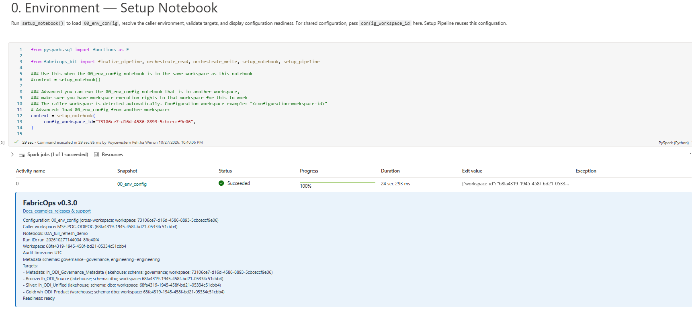

# Step 2A. Run the Full Refresh Demo

**Run the completed retail pipeline in Microsoft Fabric: three Full Reads, one PySpark transformation, and two Overwrite targets.**

This is the recommended first demo after learning the reusable pipeline structure in [Step 2. Build a Pipeline](02-build-and-run-etl.md). Follow the notebook from top to bottom and compare each result with this page.

## Before you begin

1. Complete [Step 00C. Prepare the demo data](00C-prepare-demo-data-with-fabricops-io.md).
2. Download [`02A_full_refresh_demo.ipynb`](https://raw.githubusercontent.com/Voycepeh/FabricOps-Starter-Kit/main/templates/DemoData/02A_full_refresh_demo.ipynb) and import it into the Engineering Development workspace.
3. Keep `00_env_config.ipynb` beside the demo notebook.
4. Attach the same Fabric Environment configured in [Step 00B](00B-configure-environment-and-load-assets.md).
5. Confirm these source tables exist:

| Source | Location |
| --- | --- |
| Orders | Bronze Lakehouse · `demo.orders` |
| Products | Bronze Lakehouse · `demo.products` |
| Order History | Gold Warehouse · `demo.order_history` |

## What you will do

1. Load the shared environment.
2. Run the Data Contract selector.
3. Read Orders, Products, and Order History.
4. Build detailed orders and a customer summary with PySpark.
5. Overwrite a Silver Lakehouse table and a Gold Warehouse table.
6. Inspect the saved data and FabricOps metadata.

## Run the demo in Fabric

### 1. Run the Environment block

Run the two cells under **0. Environment**:

```python
%run 00_env_config
```

Then run the import cell immediately below it.

You should see the shared FabricOps configuration load without an error. The notebook now has the configured Bronze, Silver, Gold, and Metadata stores and the public functions used by the demo.



### 2. Run the Data Contract block

Run the cell under **1. Data Contract**:

```python
CONTRACTS = widget_select_data_contract(spark_session=spark)
```

For the first Guided Demo run, there is no Data Contract yet, so leave the selection unchanged. Contract-backed checks will return as skipped, and the targets can publish in Engineering Development.


### 3. Run READ 1 — Orders

Run the `sources = {}` cell, then run **READ 1 — Orders**.

The block reads the complete Bronze `demo.orders` table and saves the result as `sources["orders"]`.

You should see the five Read stages complete. With no selected Data Contract, contract-backed checks show as `SKIPPED`; the Full Read still returns the Orders DataFrame and profiles it.


### 4. Run READ 2 — Products

Run **READ 2 — Products**.

The block reads the complete Bronze `demo.products` table and saves the result as `sources["products"]`.

You should see the same Read-stage summary for Products.


### 5. Run READ 3 — Order History

Run **READ 3 — Order History**.

This block pushes its `SELECT` query to the Gold Warehouse, returns the selected `demo.order_history` columns, and saves the result as `sources["history"]`.

You should see the Warehouse Read complete and the governed Read-stage summary appear.


### 6. Run the Transform block

Run the cell under **3. Transform**.

The PySpark code:

1. summarizes historical orders by `customer_id`;
2. joins Orders, Products, and the history summary;
3. calculates `order_net_amount`;
4. creates `transformed_df` at order level; and
5. creates `customer_summary_df` at customer level.

Uncomment these lines if you want to inspect both DataFrames before publishing:

```python
display(transformed_df)
display(customer_summary_df)
```

You should see one detailed row per current order in `transformed_df` and one aggregated row per customer in `customer_summary_df`.

*Image coming soon: transformed orders and customer summary DataFrames in Fabric.*

### 7. Run WRITE 1 — Lakehouse Curated Orders

Run the `writes = {}` cell, then run **WRITE 1 — Lakehouse Curated Orders**.

The block overwrites Silver Lakehouse `demo.curated_orders` with `transformed_df` and saves the result as `writes["curated_orders_lakehouse"]`.

You should see the Write stages complete and `published=True`. If you selected **Validate**, the notebook exits after successful validation because Validate deliberately does not publish.


### 8. Run WRITE 2 — Warehouse Customer Summary

Run **WRITE 2 — Warehouse Customer Summary**.

The block overwrites Gold Warehouse `demo.customer_summary` with `customer_summary_df` and saves the result as `writes["customer_summary_warehouse"]`.

You should see the Write stages complete and `published=True`.


!!! note "The two Writes publish independently"

    WRITE 1 and WRITE 2 are not one atomic transaction. If WRITE 1 succeeds and WRITE 2 fails, `demo.curated_orders` remains published. Fix the error and rerun the notebook; both targets use Overwrite, so a successful rerun replaces their contents.

### 9. Inspect the saved results

Open the target tables in Fabric or use the notebook's optional inspection cell.

**Silver Lakehouse**

`demo.curated_orders` contains the detailed joined order data.


**Gold Warehouse**

`demo.customer_summary` contains the customer-level aggregation.


## Expected result

### Data saved by the demo

| Store | Table | What was saved |
| --- | --- | --- |
| Bronze Lakehouse | `demo.orders` | Existing source prepared in Step 00C; unchanged by this notebook. |
| Bronze Lakehouse | `demo.products` | Existing source prepared in Step 00C; unchanged by this notebook. |
| Gold Warehouse | `demo.order_history` | Existing source prepared in Step 00C; unchanged by this notebook. |
| Silver Lakehouse | `demo.curated_orders` | Detailed order-level result, fully replaced by WRITE 1. |
| Gold Warehouse | `demo.customer_summary` | Customer-level result, fully replaced by WRITE 2. |

### Metadata saved by FabricOps

All metadata is routed to the Metadata Lakehouse configured by `00_env_config`.

| Metadata table | What this run records |
| --- | --- |
| `METADATA_DATA_CATALOGUE` | Canonical table and column identities for the governed sources and targets. |
| `METADATA_DATA_PROFILED` | Profile snapshots for the three Full Read sources and both published targets. |
| `METADATA_DATA_PROFILED_FREQUENCY` | Frequency rows linked to those profile snapshots where applicable. |
| `METADATA_DATA_LINEAGE` | Source and target participation for this notebook pipeline. |
| `METADATA_SOURCE_OBSERVATION` | Source-state observations associated with successful target publication where applicable. |
| `METADATA_GUARDRAIL_RESULTS` | Guardrail evaluation results when a selected Data Contract supplies executable Guardrails. |


### Reset the demo

Rerun the complete notebook. Both targets use Overwrite, so a successful rerun replaces their full contents instead of adding duplicate rows. To rebuild the source data as well, repeat Step 00C first.

**Next optional processing mode:** [Step 2B. Run the Incremental Append Demo](02B-build-and-run-incremental-append-etl.md)

**Continue the main Guided Demo:** [Step 3. Author and freeze the Data Contract](03-author-and-freeze-data-contract.md)
