# Step 2A. Run the Full Refresh Demo

### Before you begin

1. Complete [Step 00C. Prepare the demo data](00C-prepare-demo-data-with-fabricops-io.md).
2. Download [`02A_full_refresh_demo.ipynb`](https://raw.githubusercontent.com/Voycepeh/FabricOps-Starter-Kit/main/templates/DemoData/02A_full_refresh_demo.ipynb) and import it into the Engineering Development workspace.
3. Keep `00_env_config.ipynb` beside the demo notebook.
4. Attach the same Fabric Environment configured in [Step 00B](00B-configure-environment-and-load-assets.md).
5. Confirm these source datasets exist:

| Source | Location |
| --- | --- |
| Orders | Bronze Lakehouse Files · `demo/orders.csv` |
| Products | Bronze Lakehouse · `demo.products` |
| Order History | Gold Warehouse · `demo.order_history` |

!!! note "First run: Observe for Governance"
    Run the complete initial Ungoverned run, ending with `pipeline_result = finalize_pipeline(pipeline)`. Read and Write calculate due profiles automatically; a successful Ungoverned execution publishes the target and persists table source and target observations in workspace-scoped Catalogue/profile metadata for Data Contract authoring. Orders CSV profiles remain session-only; select its path in the existing Data Contract editor to observe its schema. It does not grant Governance approval. Governed execution continues to profile persisted targets after successful publication. No manual profiling calls or duplicated observation coordinates are needed.

    Author and freeze global Contracts in `01_governance`, validate them in Dry Run where useful, then activate exact versions for that workspace. An Ungoverned run cannot activate itself, and it cannot write a target that is already governed.

<div class="fabricops-section-banner" markdown="1">

<div class="fabricops-section-content" markdown="1">

This pipeline combines **CSV file, Lakehouse table and Warehouse table** Reads before its existing retail transformations, two table Writes, and a Silver Lakehouse CSV Write. READ 1 calls `orchestrate_read(store="Bronze", relative_path="demo/orders.csv", file_format="csv", read_options={"header": True, "inferSchema": True, "timestampFormat": "yyyy-MM-dd'T'HH:mm:ss"})`. The timestamp format preserves the fixture timestamp columns. Products and Order History keep their existing table reads, joins, aggregations and destinations.

File Reads use execution planning, applicable Data Contract checks and Read-stage reporting. They return `dataframe` with a stable `source_id`, without a fabricated `table_id`. Full Read is the only supported file mode; file checkpoints, change detection, deduplication and exactly-once guarantees are outside this workflow.

## The big picture

Apply the Step 2 scaffold to three Full Reads, one transform, and three Overwrite targets.

</div>
</div>

**Choose Full Read → Overwrite when the prepared dataset is the complete authoritative target state.** Every new execution replaces the target, including unchanged content. Partial incremental input is unsuitable because it would discard unaffected target rows; FabricOps rejects whole-table Overwrite with incremental source scope.

| Notebook section | What happens |
| --- | --- |
| Environment | Calls `setup_notebook()` to load configuration, resolve the environment and display readiness. |
| Setup Pipeline | Reuse notebook configuration, use the saved Pipeline ID and start execution tracking. |
| Data Contract Configuration | Optional in Dry Run, omitted in Ungoverned, and resolved from activation in Governed. |
| Governed Read | Reads Orders, Products, and Order History in full. |
| PySpark Transform | Produces detailed orders and a customer summary. |
| Write | Overwrites a Silver Lakehouse table, a Gold Warehouse table, and a CSV in Silver Lakehouse Files. |
| Execution report | Updates automatically with operation and Guardrail outcomes. |

Bounded DataFrame previews also remain directly below each Read and Write call.

Run **0. Environment** and **1. Setup Pipeline**. Reads and Writes define participants directly:

```python
context = setup_notebook(
    # Optional shared config: config_workspace_id="<configuration-workspace-id>",
)

PIPELINE_MODE = "Ungoverned"  # Dry Run, Ungoverned, Governed
pipeline = setup_pipeline(
    pipeline_mode=PIPELINE_MODE,
)
```


After Governance freezes contracts, use Dry Run to select exact frozen versions for preview validation. Dry Run never publishes business data or operational observations, and finalization returns only a session summary. Governed activations remain subject to activation and destination checks. See the [execution boundary and activation limits](https://github.com/Voycepeh/FabricOps-Starter-Kit/blob/main/templates/notebooks/README.md#source-participation-and-execution-boundaries).

Individual Guardrail stages are omitted when no Data Contract is selected; skipped check fields remain in the returned dictionaries. Persisted row counts and saved-data screenshots below require persistent publication. Advance the demo day only after publication succeeds.

<div class="fabricops-section-banner" markdown="1">

<div class="fabricops-section-content" markdown="1">

## Configure the Governed Reads

Read Orders, Products, and Order History using the governed Full Read pattern.

</div>
</div>

### What changes in the Reads

This demo runs three governed Full Reads instead of the single example in Step 2:

| Block | Source | Saved result | Difference to notice |
| --- | --- | --- | --- |
| READ 1 — Orders | Bronze Lakehouse Files · `demo/orders.csv` | `sources["orders"]` | Reads the complete CSV selection and profiles it in memory using pipeline settings. |
| READ 2 — Products | Bronze Lakehouse · `demo.products` | `sources["products"]` | Adds a second Lakehouse source to the same transform. |
| READ 3 — Order History | Gold Warehouse · `demo.order_history` | `sources["history"]` | Pushes a `SELECT` query to the Warehouse. |

Run all three blocks. Each should complete the governed Read stages; individual Guardrail stages are omitted when no Data Contract is selected.

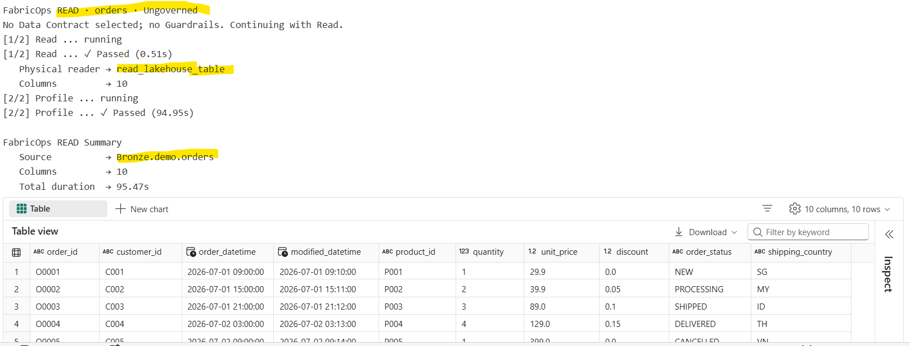

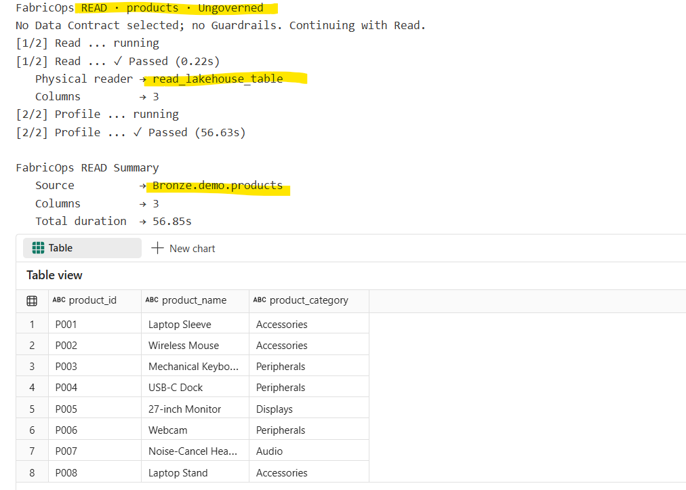

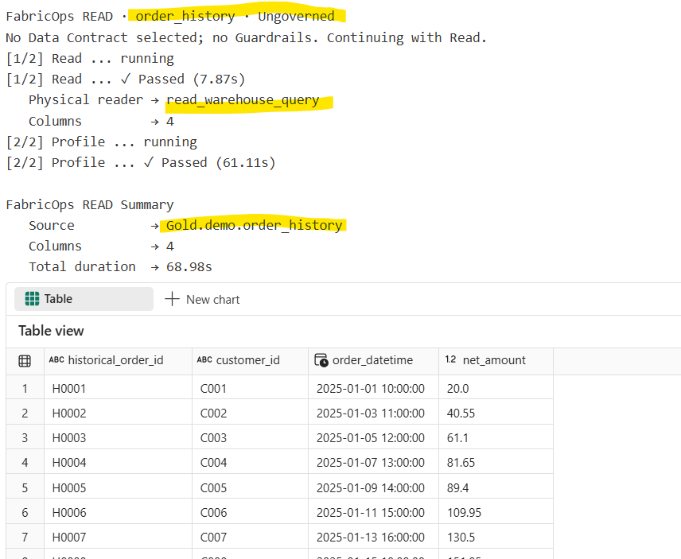

<div class="fabricops-section-banner" markdown="1">

<div class="fabricops-section-content" markdown="1">

## Write your PySpark Transform

Transform the three input sources into the curated and customer-level outputs.

</div>
</div>

Run **3. Transform**. Unlike the single-source example in Step 2, this transform:

1. summarizes historical orders by `customer_id`;
2. joins Orders, Products, and the history summary;
3. calculates `order_net_amount`;
4. creates `transformed_df` at order level; and
5. creates `customer_summary_df` at customer level.

The optional displays show:

- one detailed row per current order in `transformed_df`:

  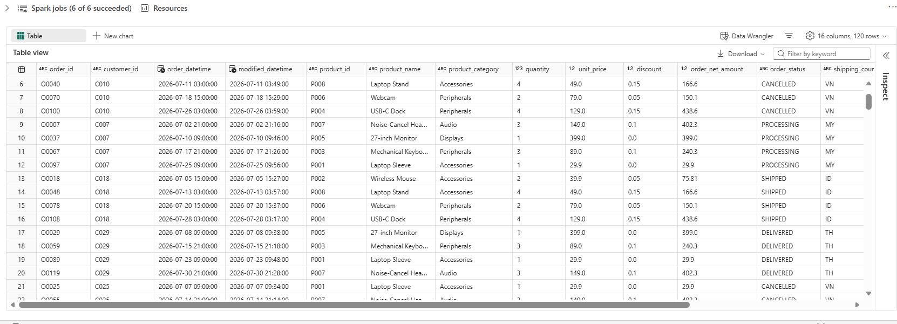

- one aggregated row per customer in `customer_summary_df`:

  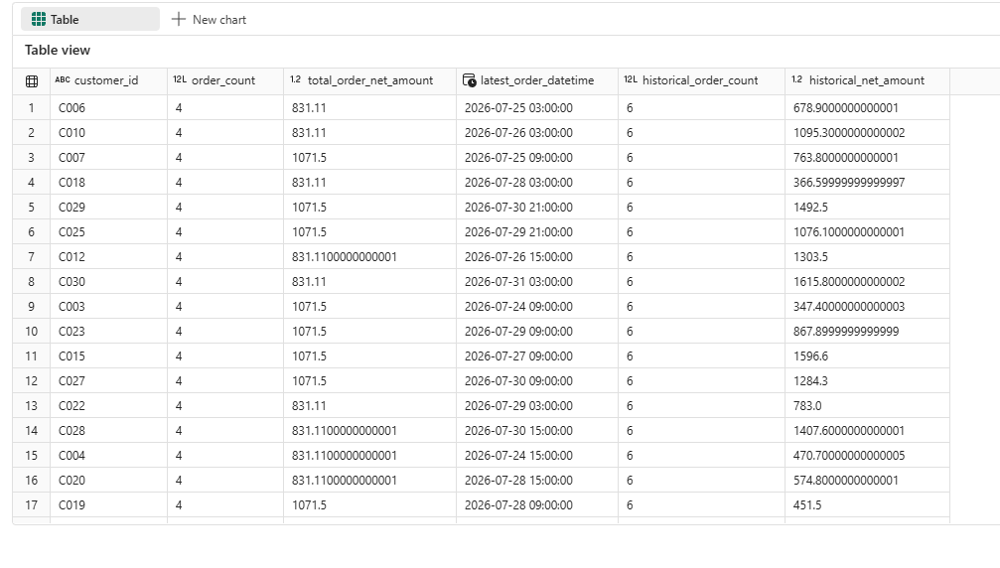

<div class="fabricops-section-banner" markdown="1">

<div class="fabricops-section-content" markdown="1">

## Configure the Writes

Overwrite the curated Lakehouse table, Warehouse customer summary, and Silver CSV export.

</div>
</div>

Initialize `writes = {}`, then run all three Write blocks. This demo publishes three independent Overwrite targets from the same transform:

| Block | DataFrame | Target | Saved result |
| --- | --- | --- | --- |
| WRITE 1 — Lakehouse Curated Orders | `transformed_df` | Silver Lakehouse · `demo.curated_orders` | `writes["curated_orders_lakehouse"]` |
| WRITE 2 — Warehouse Customer Summary | `customer_summary_df` | Gold Warehouse · `demo.customer_summary` | `writes["customer_summary_warehouse"]` |
| WRITE 3 — Silver Lakehouse Files CSV | `transformed_df` | Silver Lakehouse Files · `demo/curated_orders.csv` | `writes["curated_orders_csv"]` |

Use **Ungoverned** to publish all three targets or **Dry Run** to preview. **Governed file Writes are not currently supported**. Dry Run returns `published=False`; inspect `validation_passed` and finalize to receive a session-only summary. Ungoverned publishes without contracts and records table observations automatically.

WRITE 3 uses the same public orchestrator:

```python
writes["curated_orders_csv"] = orchestrate_write(
    transformed_df,
    store="Silver",
    relative_path="demo/curated_orders.csv",
    file_format="csv",
    write_mode="overwrite",
    write_options={"header": True, "timestampFormat": "yyyy-MM-dd'T'HH:mm:ss"},
    single_file=True,
    verbose=True,
)
```

`single_file=True` creates one named CSV; the default creates a Spark dataset folder. File outputs retain the supplied business columns without table audit columns or row hashes. File profiling stays in memory. Finalize shows the configured Store, `Files/demo/curated_orders.csv`, format, layout, publication status, and available output file/byte counts. These filesystem counts describe the output; they do not establish rows committed by this attempt.

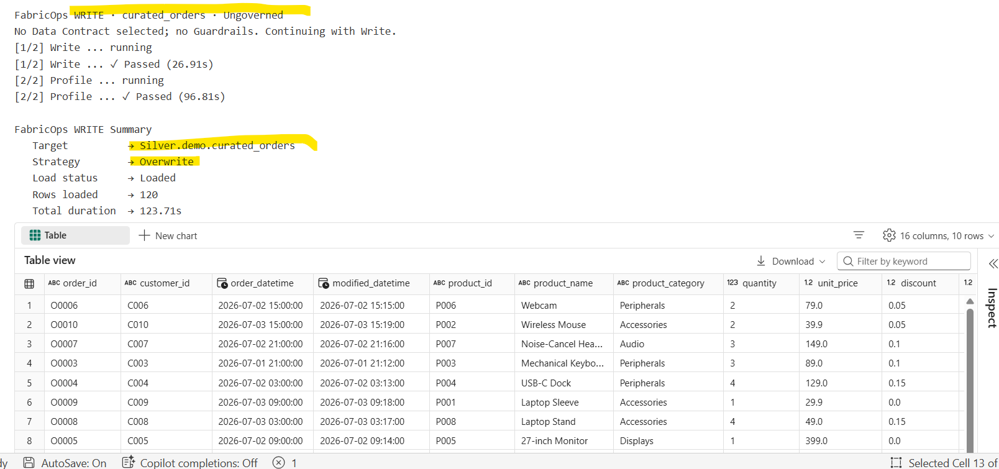

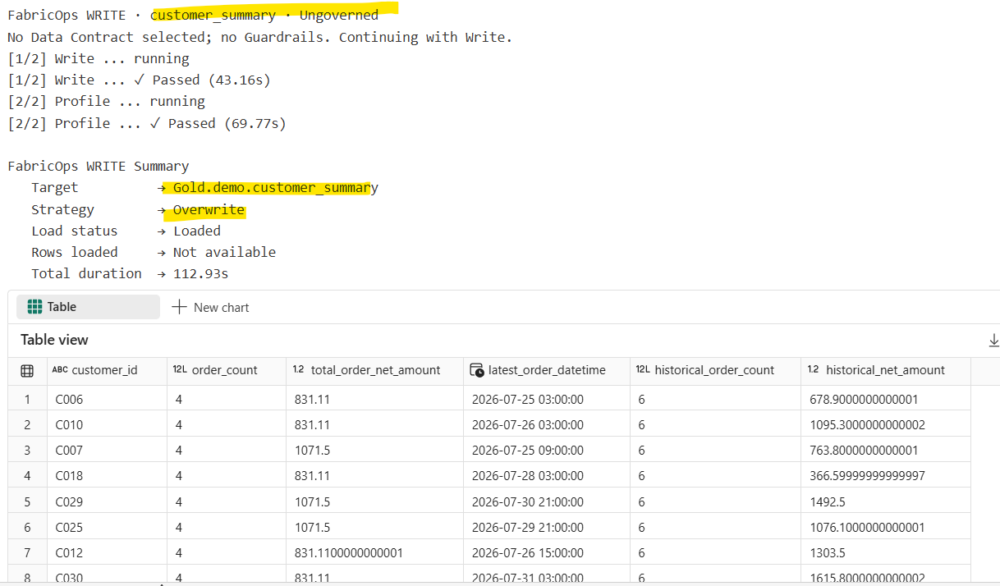

!!! note "The three Writes publish independently"

    WRITE 1, WRITE 2 and WRITE 3 are not one atomic transaction. If WRITE 1 succeeds and WRITE 2 fails, `demo.curated_orders` remains published. Fix the error and rerun the notebook; all three targets use Overwrite, so a successful rerun replaces their contents.

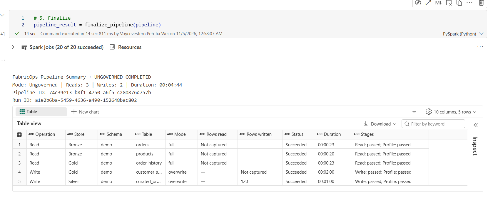

<div class="fabricops-section-banner" markdown="1">

<div class="fabricops-section-content" markdown="1">

## Verify the published tables and CSV

Verify the target tables and the recorded governance metadata.
The notebook now displays each Read and Write DataFrame in the same code cell as its orchestrator call. To verify what was committed, open the target tables in Fabric Stores and the CSV beneath the Silver Lakehouse Files area.

</div>
</div>


**Silver Lakehouse**

`demo.curated_orders` contains the detailed joined order data.

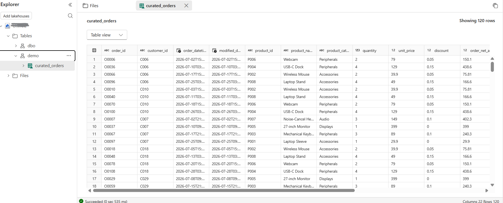

**Gold Warehouse**

`demo.customer_summary` contains the customer-level aggregation.

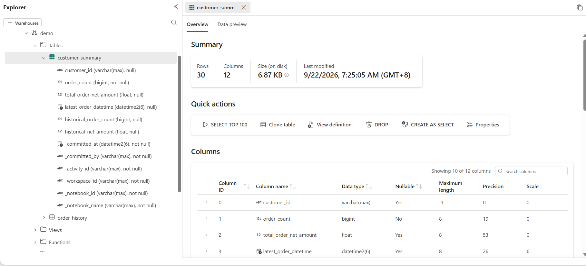

### Expected result

Dry Run completes all three Reads and all three prepared Writes without publication. After a successful Ungoverned run, all three Overwrite targets publish. Finalize reports three Reads and three Writes, with file paths and CSV publication details.

### Data saved by the demo

| Store | Table | What was saved |
| --- | --- | --- |
| Bronze Lakehouse Files | `demo/orders.csv` | CSV retained and validated in Step 00C; Bronze `demo.orders` is intentionally absent. |
| Bronze Lakehouse | `demo.products` | Existing source prepared in Step 00C; unchanged by this notebook. |
| Gold Warehouse | `demo.order_history` | Existing source prepared in Step 00C; unchanged by this notebook. |
| Silver Lakehouse | `demo.curated_orders` | Detailed order-level result, fully replaced by WRITE 1. |
| Gold Warehouse | `demo.customer_summary` | Customer-level result, fully replaced by WRITE 2. |
| Silver Lakehouse Files | `demo/curated_orders.csv` | Detailed order-level CSV with a header, fully replaced by WRITE 3. |

### Acceptance checklist

- [ ] Read the persisted Silver `demo.curated_orders` and Gold `demo.customer_summary`, using the optional public read cells. Expect 120 unique orders and 30 unique customers.
- [ ] Verify each `order_net_amount = round(quantity * unit_price * (1 - discount), 2)`, the product lookup, and the six historical orders per fixture customer. The total order net amount is **28,539.15**; customer `order_count` sums to 120 and customer totals sum to the same amount.
- [ ] Read `demo/curated_orders.csv` from Silver Files using `read_lakehouse_csv(..., store="Silver", inferSchema=True)`. Expect the same 120 business rows as the detailed transform and one named CSV with a header.
- [ ] Repeat 02A before advancing days. All three complete targets must be overwritten without duplicate business keys, with valid `_row_hash` and audit fields where the target writer adds them. Bronze Orders/Products and Gold Order History must retain their source content.
- [ ] Finalize the execution and inspect all three source and all three target operations, applicable table Catalogue/profiles, publication receipts and Lineage using the [00C metadata checklist](00C-prepare-demo-data-with-fabricops-io.md#validate-outputs-and-metadata). A successful cell alone is insufficient.

For a package regression, follow the [complete Day 1–3 sequence](00C-prepare-demo-data-with-fabricops-io.md#execute-the-engineering-regression): reset with 00C, then run 02A, 02B and 02C on Day 1, followed by 02B/02C on Days 2 and 3. To restart the full lifecycle, stop demo jobs and run the single 00C reset cell with `RESET_DEMO = True`. This clears the dedicated demo metadata; wait for `RESET COMPLETE` before Step 1.

### Metadata saved by FabricOps

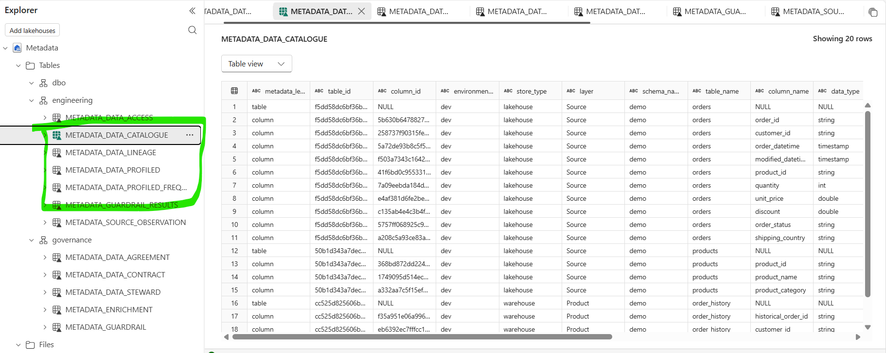

For **Ungoverned** and **Governed** executions, FabricOps writes applicable operational metadata to the Metadata Lakehouse configured by `00_env_config`. **Dry Run is session-only**: it does not write target data or persist catalogue, profile, processing-state, or pipeline-run records. The rows below describe the records this demo can produce during a persistent execution; the exact rows depend on the stages that complete and the Guardrails that are actually evaluated.

| Metadata table | What this run records |
| --- | --- |
| `METADATA_PIPELINE_REGISTRY` | No rows from this Ungoverned demo. The separate promotion workflow retains immutable per-workspace versions and Governed notebook snapshots; neither Ungoverned nor Dry Run automatically registers a Pipeline. |
| `METADATA_PIPELINE_RUN` | All six operations, including file locations, file Write options, publication status and available filesystem metrics, plus the finalized execution outcome and run identity. Persistent executions record the outcome at `finalize_pipeline(pipeline)`. |
| `METADATA_DATA_CATALOGUE` | Canonical table and column identities for the governed sources and targets, plus applicable target processing and profile metadata. |
| `METADATA_DATA_PROFILED` | Profile snapshots for the two table sources and two table targets when profiling completes; file profiles remain session-only. |
| `METADATA_DATA_PROFILED_FREQUENCY` | Frequency rows linked to profile snapshots where applicable. |
| `METADATA_DATA_LINEAGE` | Table source and target participation recorded for this notebook pipeline; file participation is retained in Run operations. |
| `METADATA_PROCESSING_STATE` | Typed source observations, checkpoints, Source Drift baselines and target publication receipts, when applicable. |
| `METADATA_GUARDRAIL_RESULTS` | Evaluation results when a selected Data Contract supplies executable Guardrails and the applicable execution flow evaluates them. |


!!! note "Repeat Full Refresh"

    Each successful Full Refresh Write replaces the target with the current prepared data. Rerun Read → Transform → Write with a fresh plan and verify the expected rows. Keep existing metadata and publication history; no manual deletion is required.

**Next optional processing mode:** [Step 2B. Compare Incremental Append and Full Hash Append](02B-build-and-run-incremental-append-etl.md)

**Continue the main Guided Demo:** [Step 3. Author and freeze the Data Contract](03-author-and-freeze-data-contract.md)

Run `pipeline_result = finalize_pipeline(pipeline)` after the last Write. Dry Run returns a session-only summary; Ungoverned and Governed record the actual execution outcome.
