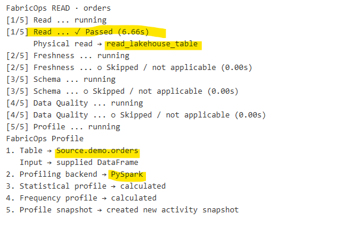
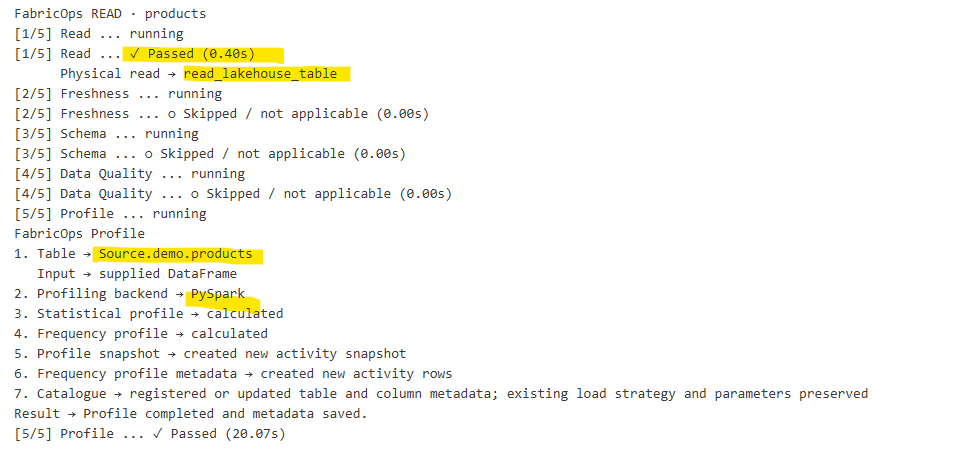
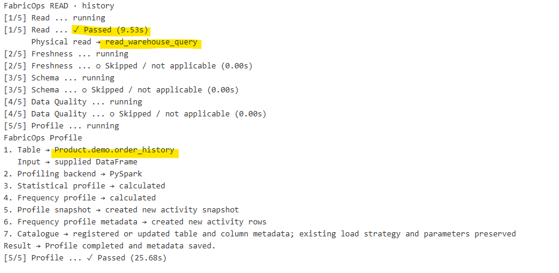
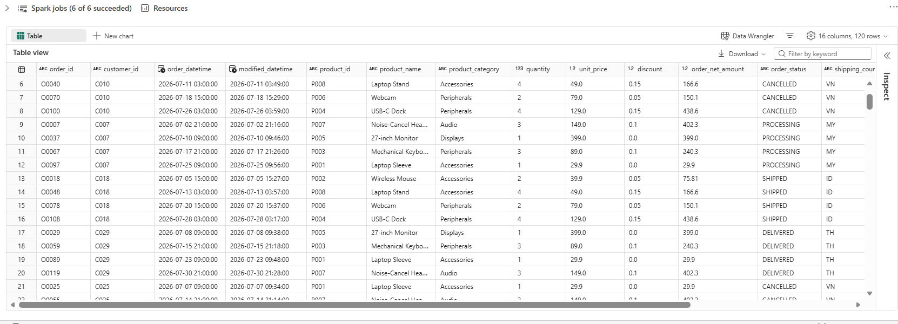
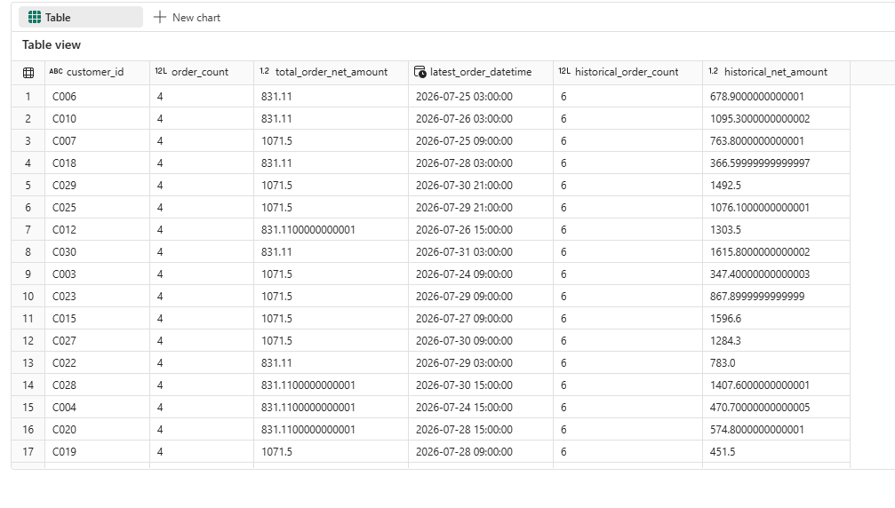
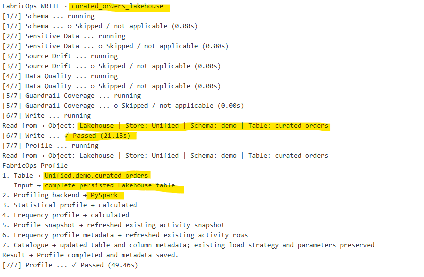
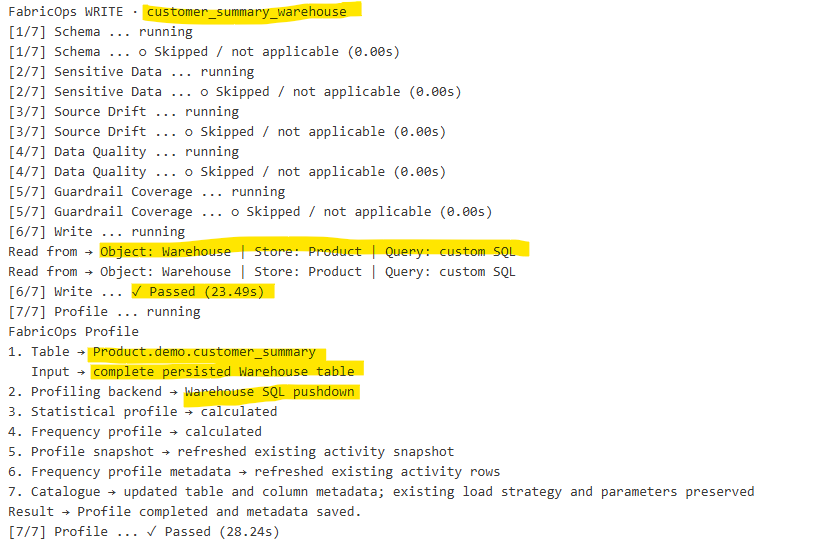
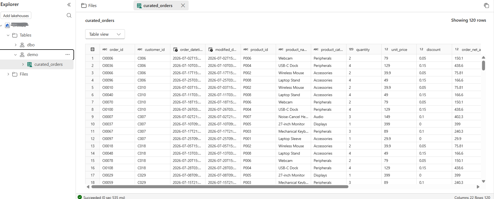
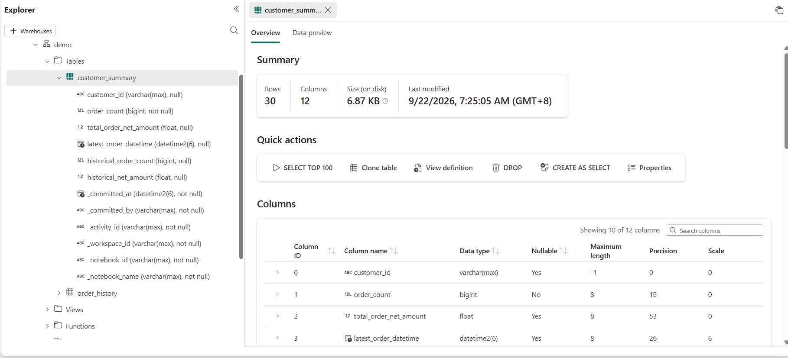
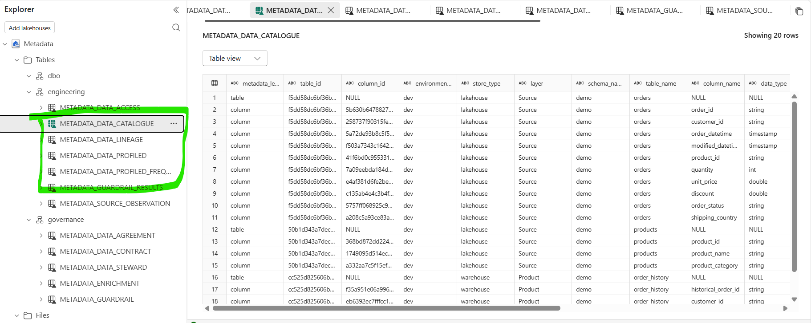

# Step 2A. Run the Full Refresh Demo

### Before you begin

1. Complete [Step 00C. Prepare the demo data](00C-prepare-demo-data-with-fabricops-io.md).
2. Download [`02A_full_refresh_demo.ipynb`](https://raw.githubusercontent.com/Voycepeh/FabricOps-Starter-Kit/main/templates/DemoData/02A_full_refresh_demo.ipynb) and import it into the Engineering Development workspace.
3. Keep `00_env_config.ipynb` beside the demo notebook.
4. Attach the same Fabric Environment configured in [Step 00B](00B-configure-environment-and-load-assets.md).
5. Confirm these source tables exist:

| Source | Location |
| --- | --- |
| Orders | Bronze Lakehouse · `demo.orders` |
| Products | Bronze Lakehouse · `demo.products` |
| Order History | Gold Warehouse · `demo.order_history` |

<div class="fabricops-section-banner" markdown="1">

<div class="fabricops-section-content" markdown="1">

## The big picture

Apply the Step 2 scaffold to three Full Reads, one transform, and two Overwrite targets.

</div>
</div>

| Notebook section | What happens |
| --- | --- |
| Environment | Loads the shared Fabric configuration and imports the functions used by this demo. |
| Setup Pipeline | Initialize context, declare participants and start execution tracking. |
| Data Contract Configuration | Choose an exact frozen version or No Contract independently for each table in Testing. |
| Governed Read | Reads Orders, Products, and Order History in full. |
| PySpark Transform | Produces detailed orders and a customer summary. |
| Governed Write | Overwrites a Silver Lakehouse target and a Gold Warehouse target. |
| Execution report | Updates automatically with operation and Guardrail outcomes. |

Bounded DataFrame previews also remain directly below each Read and Write call.

Run **0. Environment** and **1. Setup Pipeline**. Reads and Writes define participants directly:

```python
PIPELINE_ID = "02A_full_refresh_demo"
PIPELINE_MODE = "Test"  # Test or Live
CONTRACTS = setup_pipeline(pipeline_id=PIPELINE_ID, pipeline_mode=PIPELINE_MODE)
```


After Governance freezes contracts, select exact frozen versions in Test setup before Read. Test never publishes or commits metadata. Existing approved Live configurations remain subject to activation and destination checks. See the [execution boundary and activation limits](https://github.com/Voycepeh/FabricOps-Starter-Kit/blob/main/templates/notebooks/README.md#source-participation-and-execution-boundaries).

Individual Guardrail stages are omitted when no Data Contract is selected; skipped check fields remain in the returned dictionaries. Persisted row counts and saved-data screenshots below require approved Live publication. Advance the demo day only after publication succeeds.

<div class="fabricops-section-banner" markdown="1">

<div class="fabricops-section-content" markdown="1">

## Configure the Governed Reads

Read Orders, Products, and Order History using the governed Full Read pattern.

</div>
</div>

### What changes in the Reads

This demo runs three governed Full Reads instead of the single example in Step 2:

| Block | Source | Saved result | Difference to notice |
| --- | --- | --- | --- |
| READ 1 — Orders | Bronze Lakehouse · `demo.orders` | `sources["orders"]` | Reads and profiles the complete table. |
| READ 2 — Products | Bronze Lakehouse · `demo.products` | `sources["products"]` | Adds a second Lakehouse source to the same transform. |
| READ 3 — Order History | Gold Warehouse · `demo.order_history` | `sources["history"]` | Pushes a `SELECT` query to the Warehouse. |

Run all three blocks. Each should complete the governed Read stages; individual Guardrail stages are omitted when no Data Contract is selected.







<div class="fabricops-section-banner" markdown="1">

<div class="fabricops-section-content" markdown="1">

## Write your PySpark Transform

Transform the three input sources into the curated and customer-level outputs.

</div>
</div>

Run **3. Transform**. Unlike the single-source example in Step 2, this transform:

1. summarizes historical orders by `customer_id`;
2. joins Orders, Products, and the history summary;
3. calculates `order_net_amount`;
4. creates `transformed_df` at order level; and
5. creates `customer_summary_df` at customer level.

The optional displays show:

- one detailed row per current order in `transformed_df`:

  

- one aggregated row per customer in `customer_summary_df`:

  

<div class="fabricops-section-banner" markdown="1">

<div class="fabricops-section-content" markdown="1">

## Configure the Governed Writes

Overwrite the curated Lakehouse table and Warehouse customer summary.

</div>
</div>

Initialize `writes = {}`, then run both Write blocks. This demo publishes two independent Overwrite targets from the same transform:

| Block | DataFrame | Target | Saved result |
| --- | --- | --- | --- |
| WRITE 1 — Lakehouse Curated Orders | `transformed_df` | Silver Lakehouse · `demo.curated_orders` | `writes["curated_orders_lakehouse"]` |
| WRITE 2 — Warehouse Customer Summary | `customer_summary_df` | Gold Warehouse · `demo.customer_summary` | `writes["customer_summary_warehouse"]` |

With explicitly authorized real **Testing** writes or a governed **Live** run, both Write results should show `published=True`. In evaluation-only **Testing**, both show `published=False`; inspect each `validation_passed` result instead of treating an unpublished target as a successful test. The notebook continues through both targets and refreshes the selector with `CONTRACTS["refresh"]()` when contract Testing is enabled.





!!! note "The two Writes publish independently"

    WRITE 1 and WRITE 2 are not one atomic transaction. If WRITE 1 succeeds and WRITE 2 fails, `demo.curated_orders` remains published. Fix the error and rerun the notebook; both targets use Overwrite, so a successful rerun replaces their contents.

<div class="fabricops-section-banner" markdown="1">

<div class="fabricops-section-content" markdown="1">

## Verify the published tables

Verify the target tables and the recorded governance metadata.
The notebook now displays each Read and Write DataFrame in the same code cell as its orchestrator call. To verify what was committed, open the target tables in Fabric Stores. 

</div>
</div>


**Silver Lakehouse**

`demo.curated_orders` contains the detailed joined order data.



**Gold Warehouse**

`demo.customer_summary` contains the customer-level aggregation.



### Expected result

Evaluation-only Testing completes all three Reads and both prepared Writes without publication. After a run with approved Live publication, both Overwrite targets publish and the saved tables and metadata reflect that run.

### Data saved by the demo

| Store | Table | What was saved |
| --- | --- | --- |
| Bronze Lakehouse | `demo.orders` | Existing source prepared in Step 00C; unchanged by this notebook. |
| Bronze Lakehouse | `demo.products` | Existing source prepared in Step 00C; unchanged by this notebook. |
| Gold Warehouse | `demo.order_history` | Existing source prepared in Step 00C; unchanged by this notebook. |
| Silver Lakehouse | `demo.curated_orders` | Detailed order-level result, fully replaced by WRITE 1. |
| Gold Warehouse | `demo.customer_summary` | Customer-level result, fully replaced by WRITE 2. |

### Metadata saved by FabricOps



All metadata is routed to the Metadata Lakehouse configured by `00_env_config`.

| Metadata table | What this run records |
| --- | --- |
| `METADATA_DATA_CATALOGUE` | Canonical table and column identities for the governed sources and targets. |
| `METADATA_DATA_PROFILED` | Profile snapshots for the three Full Read sources and both published targets. |
| `METADATA_DATA_PROFILED_FREQUENCY` | Frequency rows linked to those profile snapshots where applicable. |
| `METADATA_DATA_LINEAGE` | Source and target participation for this notebook pipeline. |
| `METADATA_SOURCE_OBSERVATION` | Source-state observations associated with successful target publication where applicable. |
| `METADATA_GUARDRAIL_RESULTS` | Guardrail evaluation results when a selected Data Contract supplies executable Guardrails. |

!!! note "Reset the demo to a clean data state"

    Use these steps when you want the next run to behave like the first Full Refresh run:

    1. In the Silver Lakehouse, delete `demo.curated_orders` from the table explorer.
    2. In the Gold Warehouse query editor, drop the other demo target:

        ```sql
        DROP TABLE IF EXISTS demo.customer_summary;
        ```

    3. This notebook does not change its sources. If they have changed, rerun [Step 00C. Prepare the demo data](00C-prepare-demo-data-with-fabricops-io.md) to restore Bronze `demo.orders`, Bronze `demo.products`, and Gold `demo.order_history`.

**Next optional processing mode:** [Step 2B. Run the Incremental Append Demo](02B-build-and-run-incremental-append-etl.md)

**Continue the main Guided Demo:** [Step 3. Author and freeze the Data Contract](03-author-and-freeze-data-contract.md)
