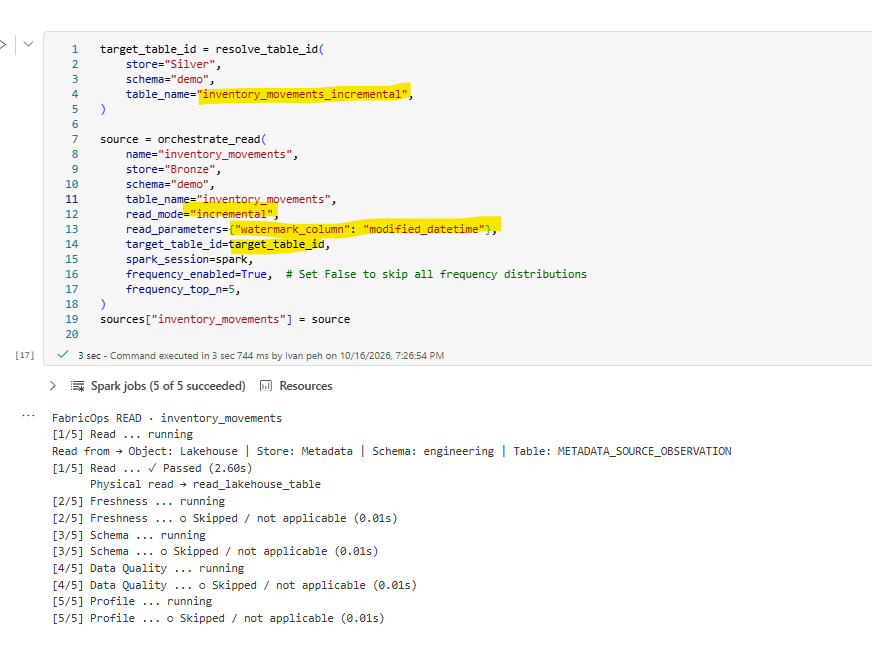
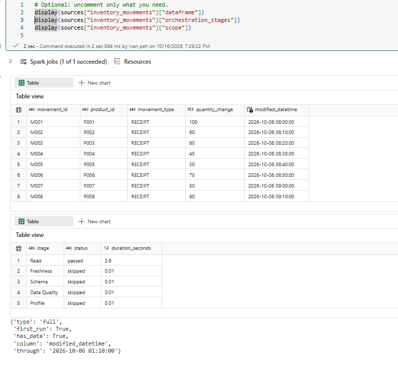
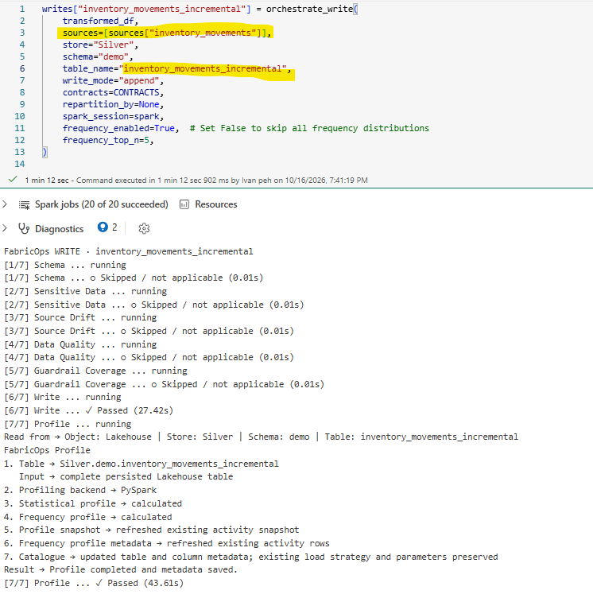
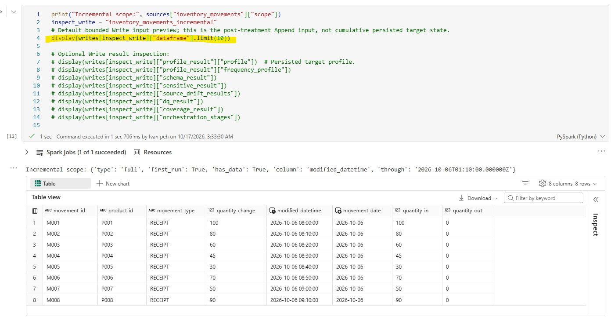
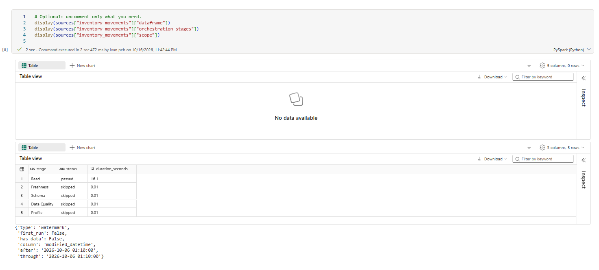
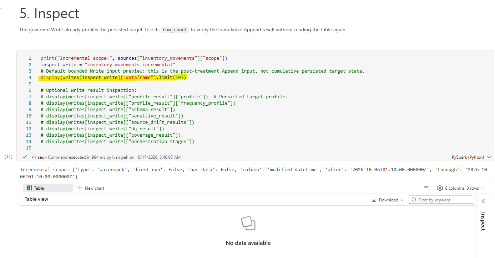
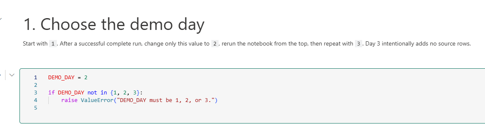
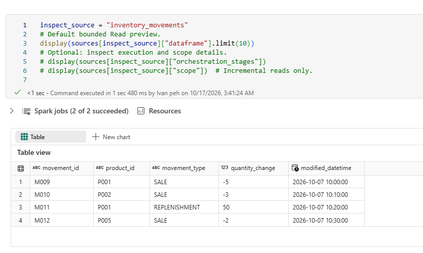
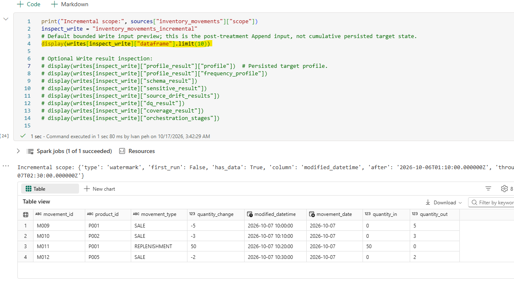

# Step 2B. Run the Incremental Append Demo

### Before you begin

1. Download [`02B_incremental_append_demo.ipynb`](https://raw.githubusercontent.com/Voycepeh/FabricOps-Starter-Kit/main/templates/DemoData/02B_incremental_append_demo.ipynb) and import it into the Engineering Development workspace.
2. Keep `00_env_config.ipynb` beside it and attach the same Fabric Environment used in Step 00B.
3. Make sure you have already uploaded the demo files required for this demo in the previous step [Step 00B](00B-configure-environment-and-load-assets.md).

4. Run [Step 00C](00C-prepare-demo-data-with-fabricops-io.md) first to stage Day 1. For Day 2, the notebook reads `Demo/inventory_day2.csv` directly from Bronze Lakehouse `Files/Demo`. There is no `incremental_inventory` subfolder.


<div class="fabricops-section-banner" markdown="1">

<div class="fabricops-section-content" markdown="1">

## The big picture

Change the Step 2 scaffold to an Incremental Read and Append Write, then compare its state across three runs.

</div>
</div>

| Run | What changes | Expected Silver rows |
| --- | --- | ---: |
| Day 1 | Use the eight movements staged by 00C and bootstrap the Incremental Read. | 8 |
| Day 2 | Add four movements and append only the newly eligible rows. | 12 |
| Day 3 | Add no source rows and observe an empty incremental scope. | 12 |

The notebook uses these governed tables throughout:

| Role | Location | Processing |
| --- | --- | --- |
| Source | Bronze Lakehouse · `demo.inventory_movements` | Incremental on `modified_datetime` |
| Target | Silver Lakehouse · `demo.inventory_movements_incremental` | Append |

??? info "Frequency profiling controls"

    The notebook sets `frequency_enabled=True` and `frequency_top_n=5` on its `orchestrate_read()` and `orchestrate_write()` calls. This retains up to five frequency values per eligible column.

    For faster runs when frequency distributions are not needed, set `frequency_enabled=False` on the relevant orchestrator call. The standard statistical profile still runs. Setting `frequency_top_n=None` retains all frequency values when enabled, but does not avoid the cost of calculating them.

The standard Environment, Data Contract, result-storage, and inspection patterns are explained in [Step 2](02-build-and-run-etl.md). This page covers only the day selection, source staging, incremental scope, and resulting target state.

<div class="fabricops-section-banner" markdown="1">

<div class="fabricops-section-content" markdown="1">

## Press Run all and run Day 1 in Fabric

For Day 1 , we load 8 rows of data from 
Bronze Lakehouse "demo.inventory_movement" table and load all 8 rows into 
Silver Lakehouse "demo.inventory_movement_incremental" and set "modified_datetime" column as our watermark column 

</div>
</div>


Ocestrate Read: 
Set a target table a read mode (incremental/full) and a Watermark Column



Day 1 first run 8 rows is read



Ocestrate Write: 
Set a single or multiple source table and Write mode = "Append"



Day 1 first run 8 rows is written



## Info How Does Incremental Load Work in FabricOps?

### FabricOps handles incremental loading through two orchestrators:

1. orchestrate_read() identifies and reads only new or modified records using a watermark.

2. orchestrate_write() applies the selected write strategy, such as Append, and commits watermark progress only after a successful publication.

### How It Works

1. Identify the source: Bronze Lakehouse demo.inventory_movements.
2. Identify the target: Silver Lakehouse demo.inventory_movements_incremental.
3. Retrieve the committed watermark for this source-to-target relationship.
4. Check Bronze for records where:modified_datetime > last_committed_watermark
5. Read only newer records, transform them, and append them to Silver.
6. Advance the watermark only after successful write.

<div class="fabricops-section-banner" markdown="1">

<div class="fabricops-section-content" markdown="1">

## Press Stop Session on the notebook and re-run the whole notebook again

This runs the pipeline on day 1 data which we have already loaded so you will expect to see no diff read and not diff written 

</div>
</div>

No new data so its empty read



No new data so its empty write



<div class="fabricops-section-banner" markdown="1">

<div class="fabricops-section-content" markdown="1">

## Change the demo day to 2 and press run all again 

For Day 2 , our underlying data has 12 rows of data in 
Bronze Lakehouse "demo.inventory_movement" table of which 8 were already loaded into Silver Lakehouse "demo.inventory_movement_incremental" in day 1 , hence only 4 rows of data was read and appended 

</div>
</div>



4 new rows are read based on the watermark column



Only this 4 rows are appended



<div class="fabricops-section-banner" markdown="1">

<div class="fabricops-section-content" markdown="1">

## Change the demo day to 3 and press run all again 

For Day 3, our underlying data still has 12 rows of data in 
Bronze Lakehouse "demo.inventory_movement" table of which 12 were already loaded into Silver Lakehouse "demo.inventory_movement_incremental" in day 1 , hence only 0 rows of data was read and appended 

</div>
</div>

```


No new data so its empty read


No new data so its empty write


### Expected result

Day 1 publishes the eight-row baseline, Day 2 appends four newly eligible rows, and Day 3 leaves the 12-row target unchanged because its incremental scope is empty.

### Data saved by the demo

| Location | Table | Final state after Day 3 |
| --- | --- | --- |
| Bronze Lakehouse | `demo.inventory_movements` | 12 unique source movements from Days 1 and 2. |
| Silver Lakehouse | `demo.inventory_movements_incremental` | 12 transformed movements appended across the successful incremental runs. |

### Metadata saved by FabricOps

All metadata is routed to the Metadata Lakehouse configured by `00_env_config`.

| Metadata table or governed record | What this demo records |
| --- | --- |
| `METADATA_DATA_CATALOGUE` | Canonical source and target table and column identities. |
| `METADATA_DATA_PROFILED` | Profile snapshots of the published Silver target. Incremental Read batches themselves are not profiled. |
| `METADATA_DATA_PROFILED_FREQUENCY` | Target frequency rows linked to profile snapshots where applicable. |
| `METADATA_DATA_LINEAGE` | The Bronze source and Silver target participation for this notebook pipeline. |
| `METADATA_SOURCE_OBSERVATION` | Source-state observations and history used by Incremental execution. |
| Governed target watermark | Successful watermark progress for the exact Bronze-to-Silver relationship. |
| `METADATA_GUARDRAIL_RESULTS` | Guardrail evaluation results when a selected Data Contract supplies executable Guardrails. |

*Image coming soon: Metadata Lakehouse records after the three Incremental Append runs.*

### Reset the demo

An Incremental demo cannot be reset by rerunning Day 1 or deleting only the Silver target. FabricOps remembers successful progress for the exact Bronze-to-Silver relationship.

1. In the Bronze Lakehouse, delete `demo.inventory_movements` from the table explorer.
2. In the Silver Lakehouse, delete `demo.inventory_movements_incremental` from the table explorer. This removes the appended business data and the successful watermark progress stored with the governed target.
3. Remove only the `METADATA_SOURCE_OBSERVATION` rows for the `inventory_movements` → `inventory_movements_incremental` relationship and the current environment. Do not clear observations for other pipelines.
4. Set `DEMO_DAY = 1`.
5. Run the notebook from the top. The Day 1 CSV recreates Bronze with eight rows, the Incremental Read bootstraps again, and the Append Write recreates the eight-row Silver target.

!!! warning "Keep incremental state aligned"

    The Bronze source, Silver target, scoped Source Observation history, and governed target watermark belong to one incremental state. Reset all four together. If you cannot perform the scoped metadata cleanup safely, use a fresh Guided Demo environment instead.

**Next optional processing mode:** [Step 2C. Run the SCD1 and SCD2 Demo](02C-build-and-run-scd-etl.md)

**Continue the main Guided Demo:** [Step 3. Author and freeze the Data Contract](03-author-and-freeze-data-contract.md)
