# Step 2B. Compare Incremental Append and Full Hash Append

Run two independent paths to see how extraction scope and target duplicate handling solve different problems.

### Before you begin

1. Download [`02B_incremental_append_demo.ipynb`](https://raw.githubusercontent.com/Voycepeh/FabricOps-Starter-Kit/main/templates/DemoData/02B_incremental_append_demo.ipynb) into Engineering Development.
2. Keep `00_env_config.ipynb` beside it and attach the Fabric Environment from [Step 00B](00B-configure-environment-and-load-assets.md).
3. Upload the demo CSVs and run [Step 00C](00C-prepare-demo-data-with-fabricops-io.md) once to stage Day 1. Day 2 reads `Demo/inventory_day2.csv` from Bronze Lakehouse `Files/Demo`.
4. Start with fresh Silver targets. Run Day 1, Day 2, and Day 3 in order; do not rerun 00C after advancing Bronze.


*The original 02B file-upload step: both inventory day files must be available before the three-day walkthrough.*

!!! note "Publication and Governance"
    Use Ungoverned for the first persistent observation against targets that are not already governed. Dry Run evaluates prepared input but does not publish target data, accept incremental progress, or produce the persisted counts below.

    After observation, author and freeze separate target Contracts with Processing strategies **Append All** and **Append New Only**. Governed runs require the corresponding approved activations. See the [execution boundaries](https://github.com/Voycepeh/FabricOps-Starter-Kit/blob/main/templates/notebooks/README.md#source-participation-and-execution-boundaries).

<div class="fabricops-section-banner" markdown="1">

<div class="fabricops-section-content" markdown="1">

## The two-path architecture

Hold the business transformation constant while changing the Read and Write decisions independently.

</div>
</div>

| Path | Source Read | Target Write | Target |
| --- | --- | --- | --- |
| A | Incremental on `modified_datetime` | Append All | Silver · `demo.inventory_movements_append_all` |
| B | Full | Append New Only by `_row_hash` | Silver · `demo.inventory_movements_append_new_only` |

| Day | Incremental rows read | Full rows read | Append All target total | Append New Only target total |
| --- | ---: | ---: | ---: | ---: |
| 1 | 8 | 8 | 8 | 8 |
| 2 | 4 | 12 | 12 | 12 |
| 3 | 0 | 12 | 12 | 12 |

**Read scope and Write behavior are separate choices.** Incremental extraction limits source processing for large tables when a reliable watermark exists. Append New Only instead makes repeated full submissions content-aware by comparing final row hashes, but it pays for a complete source scan and distributed hash comparison every time.

### Why the paths use separate executions

The execution session registers one operation for each logical source. A second Read of the same physical source in that session would replace or ambiguously share source evidence. The notebook therefore completes and finalizes Path A before it starts Path B. Each Write receives only the Read registered in its own execution:

```text
Path A: setup → incremental Read → transform → Append All → finalize
Path B: setup → full Read        → transform → Append New Only → finalize
```

This separation prevents Path B's full-source scope from being associated with Path A's incremental checkpoint or publication.


!!! warning "Independent publications"
    The two Writes are not atomic together. If Target A succeeds and Target B fails, inspect publication results and recover the failed publication before starting another execution. A new full execution adds the complete input to Append All again. Exact publication retries use verified receipts; they are different from new executions.

<div class="fabricops-section-banner" markdown="1">

<div class="fabricops-section-content" markdown="1">

## Run Day 1

Bootstrap Path A from eight movements, then submit the same eight business rows through Path B.

</div>
</div>

Set `DEMO_DAY = 1` and run the notebook from the top. With no accepted checkpoint, Incremental Read intentionally performs a full bootstrap.


**Path A Incremental Read + Append All**

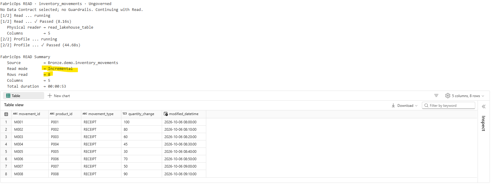

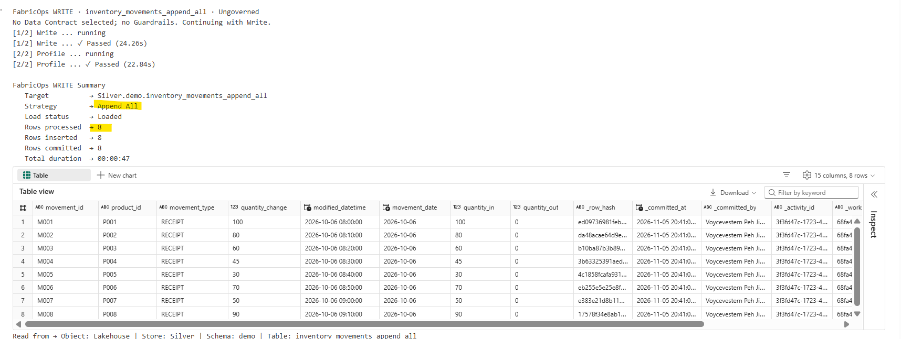

**Path B Full Read + Append New**

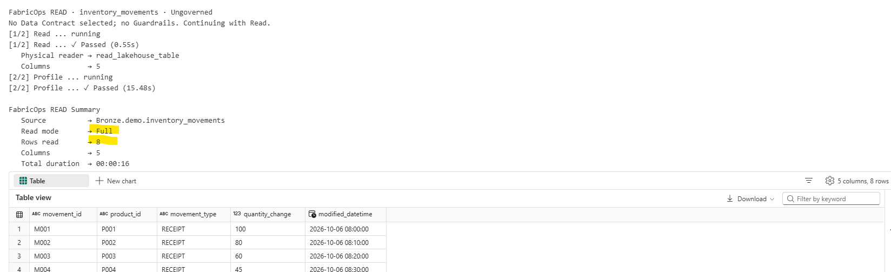

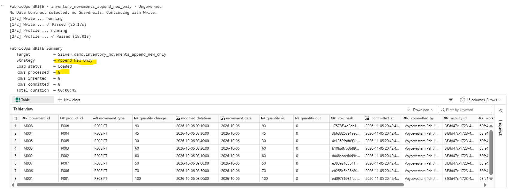

Both Writes commit eight business rows. Each target ends Day 1 at **8**.

<div class="fabricops-section-banner" markdown="1">

<div class="fabricops-section-content" markdown="1">

## Run Day 2

Add four movements; compare a four-row incremental scope with a 12-row full scope.

</div>
</div>

Set `DEMO_DAY = 2` and start from the top. The preparation cell unions the Day 2 CSV with Bronze and deduplicates `movement_id`, leaving 12 physical source rows.


**Path A Incremental Read + Append All**

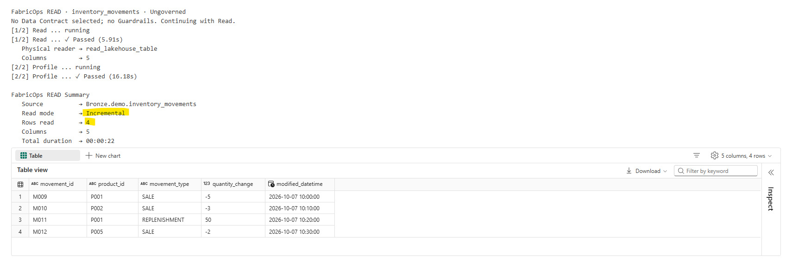

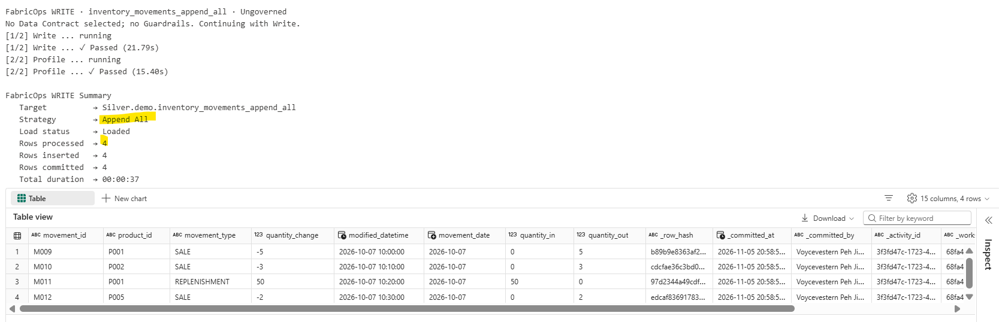

**Path B Full Read + Append New**

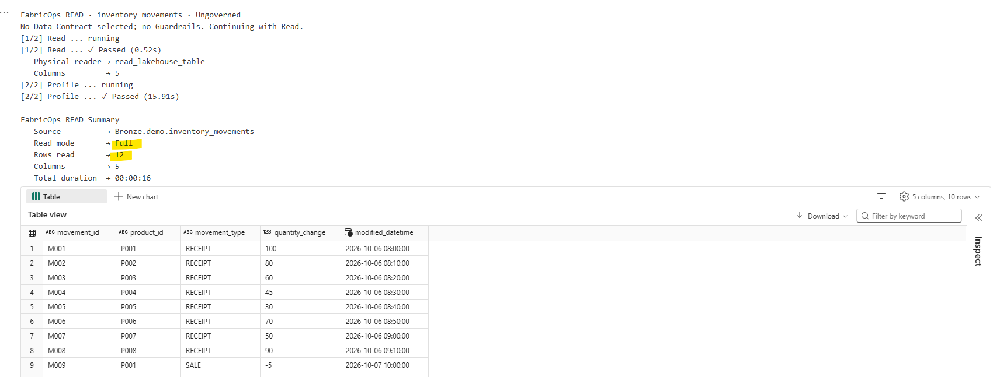

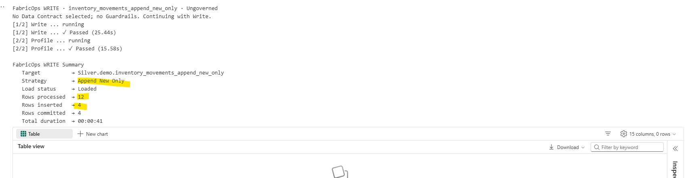

<div class="fabricops-section-banner" markdown="1">

<div class="fabricops-section-content" markdown="1">

## Run Day 3

Leave Bronze unchanged and observe two different kinds of no-op.

</div>
</div>

Set `DEMO_DAY = 3` and run from the top. The preparation cell makes no source change.


*Day 3 deliberately leaves the 12-row Bronze source unchanged.*
**Path A Incremental Read + Append All**

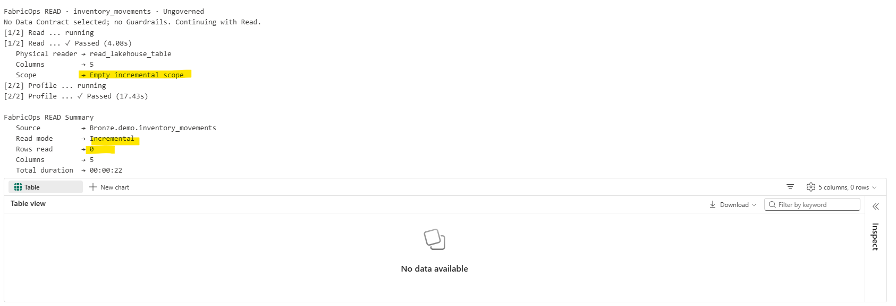

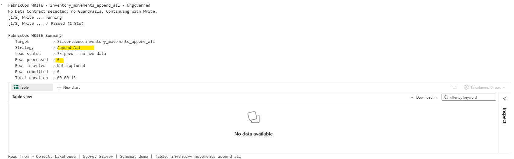

**Path B Full Read + Append New**

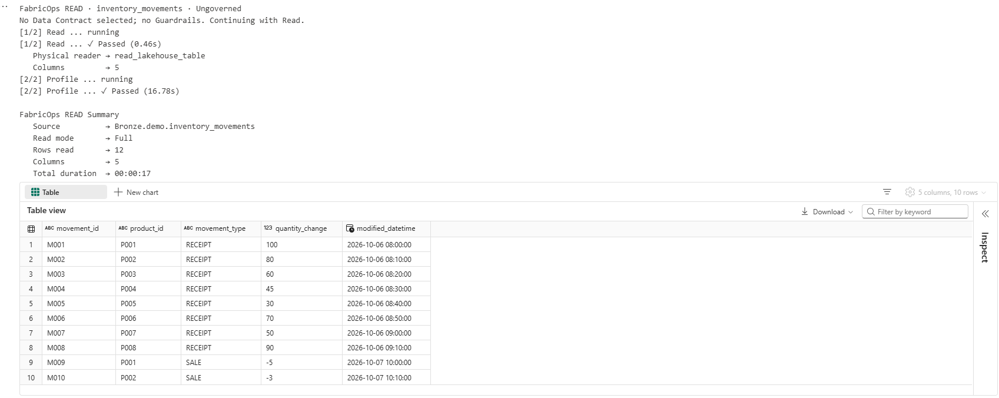

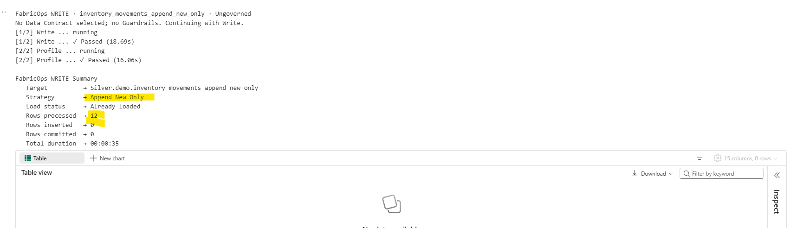

### Inspect the four row-count concepts

| Day | Path | Rows read | Rows submitted to Write | Rows committed | Persisted target total |
| --- | --- | ---: | ---: | ---: | ---: |
| 1 | Incremental + Append All | 8 | 8 | 8 | 8 |
| 1 | Full + Append New Only | 8 | 8 | 8 | 8 |
| 2 | Incremental + Append All | 4 | 4 | 4 | 12 |
| 2 | Full + Append New Only | 12 | 12 | 4 | 12 |
| 3 | Incremental + Append All | 0 | 0 | 0 | 12 |
| 3 | Full + Append New Only | 12 | 12 | 0 | 12 |

`Rows read` is the number of rows returned by that exact Read scope. For Path A it is the target-specific watermark batch (8, then 4, then 0), not the Bronze table's overall row count. For Path B it is the complete returned source (8, then 12, then 12). The Write result separately describes prepared input and rows actually committed. A separate `read_lakehouse_table()` count confirms cumulative persisted target state.

### Expected result

Bronze ends at 12 unique movements. Both Silver targets end at 12 business rows, but they get there differently: Path A processes 8 + 4 + 0 rows, while Path B processes 8 + 12 + 12 rows and filters already-seen hashes at Write time.

### Content and replay checklist

- [ ] Day 1 contains M001–M008; Day 2 adds M009–M012. Day 3 retains the same 12 unique `movement_id` values.
- [ ] Compare every business column in each persisted Silver target with the transformed Bronze snapshot; both targets must agree. `_row_hash` must be non-null, 64 characters and unique for these fixtures. Changing only FabricOps audit fields must not change the business hash.
- [ ] Rerun the current day: no new accepted incremental rows and no new Append New Only hashes; both target totals stay 8 on Day 1 or 12 on Days 2–3. Finalize both paths and inspect their separate Run operations and target-specific receipts/checkpoints.
- [ ] Follow the [complete metadata and package validation checklist](00C-prepare-demo-data-with-fabricops-io.md#validate-outputs-and-metadata); a failed publication must not advance accepted progress.

### Metadata saved by FabricOps

| Table | Purpose in this demo |
| --- | --- |
| `METADATA_PIPELINE_RUN` | Separate finalized outcomes for Path A and Path B on each day. |
| `METADATA_DATA_CATALOGUE` | Canonical Bronze source and both Silver target identities and processing definitions. |
| `METADATA_DATA_PROFILED` | Due source or published-target profile snapshots. |
| `METADATA_DATA_PROFILED_FREQUENCY` | Frequency rows linked to applicable profiles. |
| `METADATA_DATA_LINEAGE` | Source and target participation for each independently finalized execution. |
| `METADATA_PROCESSING_STATE` | Path A's target-specific source observations and accepted incremental checkpoints, plus target-specific publication receipts and applicable accepted baselines. |
| `METADATA_GUARDRAIL_RESULTS` | Results of applicable selected Contract Guardrails. |

### Repeat and recover safely

A failed Path A publication must not advance its accepted incremental checkpoint. Retry or recover that exact publication before starting later work for the same target. Verified target markers and receipts distinguish a completed publication from an unverified attempt.

Repeated Day 2 staging keeps Bronze unique. For a complete replay of the dedicated Ungoverned demo, run [00C](00C-prepare-demo-data-with-fabricops-io.md#reset-rerun-and-validate-a-package), wait for `RESET COMPLETE`, set both 02B and 02C back to `DEMO_DAY = 1`, and repeat the complete sequence. 00C resets targets and applicable metadata together. Never run it between days or against production assets.

If counts differ, inspect the two finalized results, Read scopes, Write metrics, publication statuses, and persisted targets. Do not delete a checkpoint or overwrite a target merely to force the expected demonstration counts.

**Next:** [Step 2C. Compare SCD1 and SCD2](02C-build-and-run-scd-etl.md)
