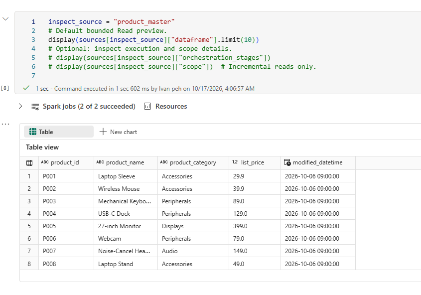
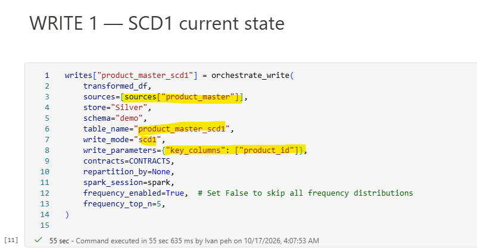
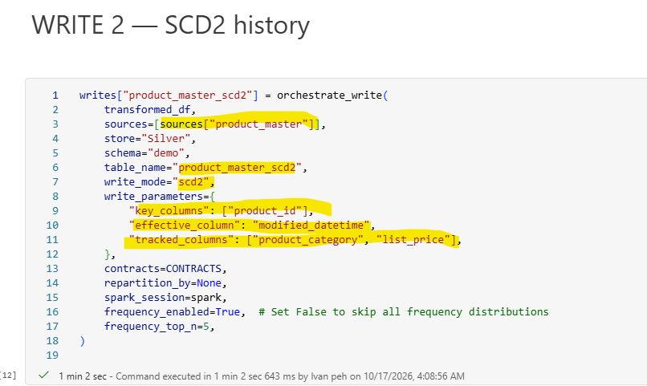
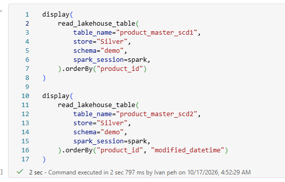
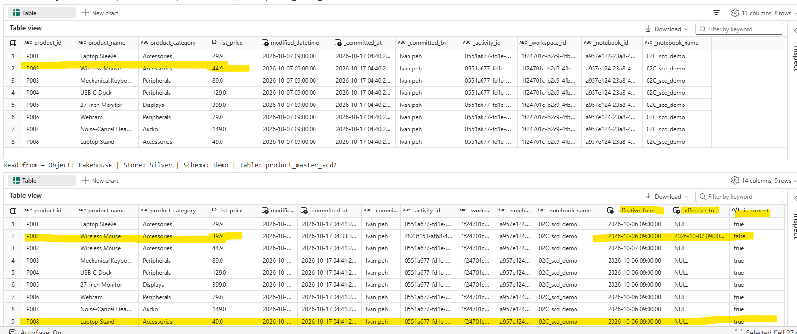
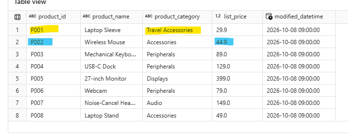
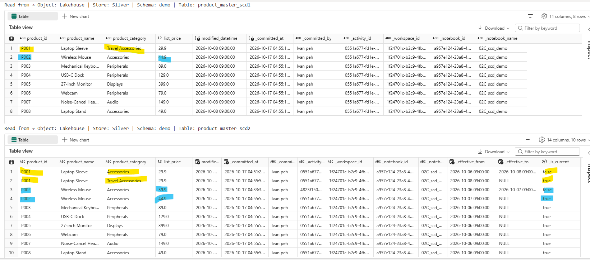

# Step 2C. Run the SCD1 and SCD2 Demo

### Before you begin

1. Download [`02C_scd_demo.ipynb`](https://raw.githubusercontent.com/Voycepeh/FabricOps-Starter-Kit/main/templates/DemoData/02C_scd_demo.ipynb) and import it into the Engineering Development workspace.
2. Keep `00_env_config.ipynb` beside it and attach the same Fabric Environment used in Step 00B.
3. Make sure you have already uploaded the demo files required for this demo in the previous step [Step 00B](00B-configure-environment-and-load-assets.md).

4. Run [Step 00C](00C-prepare-demo-data-with-fabricops-io.md) first for Day 1. For Days 2 and 3, the notebook reads `Demo/products_day2.csv` and `Demo/products_day3.csv` directly from Bronze Lakehouse `Files/Demo`. There is no `scd_product_master` subfolder.
5. Use a fresh demo state and run Day 1, then Day 2, then Day 3.


<div class="fabricops-section-banner" markdown="1">

<div class="fabricops-section-content" markdown="1">

## The big picture

Change the Step 2 Write strategy to SCD1 and SCD2, then compare how both targets record the same source changes.

</div>
</div>

| Run | Business change | Expected SCD1 rows | Expected SCD2 versions |
| --- | --- | ---: | ---: |
| Day 1 | Load the initial eight products. | 8 | 8 |
| Day 2 | Change `P002.list_price`. | 8 | 9 |
| Day 3 | Change `P001.product_category`. | 8 | 10 |

The notebook uses these governed tables throughout:

| Role | Location | Processing |
| --- | --- | --- |
| Source | Bronze Lakehouse · `demo.product_master_updates` | Full Read |
| Current-state target | Silver Lakehouse · `demo.product_master_scd1` | SCD1 keyed by `product_id` |
| Historical target | Silver Lakehouse · `demo.product_master_scd2` | SCD2 effective on `modified_datetime` and tracking `product_category` and `list_price` |

??? info "Frequency profiling controls"

    The notebook sets `frequency_enabled=True` and `frequency_top_n=5` on its `orchestrate_read()` and `orchestrate_write()` calls. This retains up to five frequency values per eligible column.

    For faster runs when frequency distributions are not needed, set `frequency_enabled=False` on the relevant orchestrator call. The standard statistical profile still runs. Setting `frequency_top_n=None` retains all frequency values when enabled, but does not avoid the cost of calculating them.

### Set up the pipeline

Run Environment, choose `DEMO_DAY`, and run the explicit Bronze source-preparation cell. That setup can change Bronze before pipeline selection. The default pipeline setup is:

```python
CONTRACT_TESTING = False  # First run: Bootstrap, no selections or UI.
CONTRACTS = setup_pipeline(
    sources=PIPELINE_SOURCES, targets=PIPELINE_TARGETS,
    interactive=CONTRACT_TESTING, spark_session=spark,
)
EXECUTION_PLAN = CONTRACTS["build_plan"]() if CONTRACT_TESTING else CONTRACTS
```

With the default `False`, Run all builds a Bootstrap plan and creates/profiles initial outputs without human interaction. Every Read and Write receives `execution_plan=EXECUTION_PLAN`. Metadata routing must already be initialized by the environment setup; business targets and Catalogue records do not need to exist.

After Governance authors and freezes the contracts, set `CONTRACT_TESTING = True`. Pause after setup to select the exact frozen versions, then run the execution-plan cell and all Reads and Writes. Testing evaluates every declared operation without publishing targets or committing ordinary operational metadata. Run the finalization cell after all Reads, transforms and Writes (also for Read-only pipelines). `METADATA_PIPELINE_RUN` records the complete run and links Guardrail diagnostics by `run_id`; passing target diagnostics alone do not prove completion. Supply a stable `pipeline_id` and deployed `executable_sha256` for qualifying Testing evidence. See the [complete-run lifecycle](https://github.com/Voycepeh/FabricOps-Starter-Kit/blob/main/templates/notebooks/README.md#complete-run-evidence). Current Live still uses existing active frozen Data Contract authority. Rerun setup for a new test; rebuilding on the same selector reuses its locked plan and journal.

Bootstrap fails closed if any participating table has a frozen or active contract, including one frozen after setup. It never silently drops governed requirements. UI visibility is separate from execution policy: headless Testing uses `interactive=False`, `execution_mode="testing"`, and saved exact selections.

The persisted row counts below describe Bootstrap runs before contracts exist, or governed Live runs after approval. Advance the day only after publication succeeds. Once contracts are frozen, Bootstrap is no longer an eligible way to publish; use Testing to evaluate changes and the governed release workflow for subsequent publication.

<div class="fabricops-section-banner" markdown="1">

<div class="fabricops-section-content" markdown="1">

## Run Day 1 with the Bootstrap defaults
Reads 8 rows of data from Bronze `demo.product_master_updates` then set 'product_id' as key column for SCD1 and write to silver.demo.product_master_scd1, likewise set 'product_id' as key column , set `product_category` and `list_price` as tracking columns with `modified_datetime` as the effective column for SCD2 and write to silver.demo.product_master_scd2


</div>
</div>


8 rows are read its just full read nothing special 



### SCD1 configurations
- write_mode="scd1"	Overwrites existing records instead of preserving historical versions.
- key_columns	Identifies the unique business entity, such as product_id.




### SCD2 Configurations
- write_mode="scd2"	Preserves historical records instead of overwriting them.
- key_columns	Identifies the unique business entity, such as product_id.
- effective_column	Specifies when each record version becomes effective, using modified_datetime.
- tracked_columns	Specifies which columns to monitor for changes. A change to any tracked value creates a new historical version.




<div class="fabricops-section-banner" markdown="1">

<div class="fabricops-section-content" markdown="1">

## Change to Day 2 and select a fresh plan

Product `P002` has a new `list_price`:

- SCD1 updates the value on `P002`'s existing row and keeps eight rows.
- SCD2 closes the earlier `P002` version and inserts a new current version.

</div>
</div>




The SCD1 profile should show `row_count = 8`; the SCD2 profile should show `row_count = 9`, confirming that the changed `P002` created one additional historical version.



<div class="fabricops-section-banner" markdown="1">

<div class="fabricops-section-content" markdown="1">

## Change to Day 3 and select a fresh plan

Product `P001` has a new `product_category`:

- SCD1 replaces the category on `P001`'s current row and keeps eight rows.
- SCD2 closes the earlier `P001` version and inserts a new current version.

</div>
</div>




The SCD1 profile should show `row_count = 8`; the SCD2 profile should show `row_count = 10`, confirming that the changed `P001` created one additional historical version.




### Expected result

Day 1 creates eight current records in each target, Day 2 creates the first historical SCD2 version, and Day 3 creates the second while SCD1 remains at eight current rows.

### Data saved by the demo

| Location | Table | Final state after Day 3 |
| --- | --- | --- |
| Bronze Lakehouse | `demo.product_master_updates` | The complete eight-row Day 3 Product Master snapshot. |
| Silver Lakehouse | `demo.product_master_scd1` | Eight current product rows with the latest values. |
| Silver Lakehouse | `demo.product_master_scd2` | Ten versions: eight current versions and two closed historical versions created by the Day 2 and Day 3 changes. |

### Metadata saved by FabricOps

The following records are committed by successful **Bootstrap** or governed **Live** runs and routed to the Metadata Lakehouse configured by `00_env_config`. Testing persists `METADATA_PIPELINE_RUN` and linked `METADATA_GUARDRAIL_RESULTS`; ordinary metadata remains unchanged.

| Metadata table | What this demo records |
| --- | --- |
| `METADATA_DATA_CATALOGUE` | Canonical table and column identities for the Bronze source and both Silver targets. |
| `METADATA_DATA_PROFILED` | Profile snapshots for each Full Read source snapshot and each published SCD target. |
| `METADATA_DATA_PROFILED_FREQUENCY` | Frequency rows linked to those profile snapshots where applicable. |
| `METADATA_DATA_LINEAGE` | The source and both target roles for this notebook pipeline. |
| `METADATA_SOURCE_OBSERVATION` | Source-state observations associated with successful target publication where applicable. |
| `METADATA_GUARDRAIL_RESULTS` | Guardrail evaluation results when a selected Data Contract supplies executable Guardrails. |


### Diagnose a later day before changing the SCD targets

Run the `DEMO_DAY` cell and the **Prepare the Bronze snapshot** cell before Read → Transform → Write. For Days 2 and 3, that cell replaces Bronze with the complete selected CSV. Changing the parameter alone does not stage a snapshot. Inspect `product_id`, `list_price`, `product_category` and `modified_datetime` for P001/P002 first in Bronze, then in the inline Full Read preview and transformed DataFrame:

| Day | P002 list price | P001 category | SCD1 rows | SCD2 versions |
| --- | ---: | --- | ---: | ---: |
| 1 | 39.90 | Accessories | 8 | 8 |
| 2 | 44.90 | Accessories | 8 | 9 |
| 3 | 44.90 | Travel Accessories | 8 | 10 |

Use a fresh permitted **Live** plan for governed publication. Testing keeps Silver and operational metadata unchanged; the explicit Bronze preparation is outside that plan. Retain the notebook's Bootstrap defaults only before contracts exist. Rerun each day in the same interactive session and repeat its Write: SCD2 must retain eight current products and must not add another version for unchanged business values. A new scheduled activity must produce the same results.

The Read and Write blocks display their DataFrames inline, without a separate Inspect selector. These previews are not the persisted SCD history. Inspect the physical Silver tables after publication. `Not available` SCD metrics do not establish that a merge failed. For SCD2, confirm that superseded P002/P001 versions have `_is_current=False` and populated `_effective_to`, that each product has one current version, and that no `(product_id, _effective_from)` pair is duplicated. Never replace these keyed merges with overwrite to hide a mismatch. For existing checkpoint divergence, follow the [scoped reconciliation guidance](02B-build-and-run-incremental-append-etl.md#if-silver-has-eight-rows-but-the-checkpoint-already-covers-day-2); immutable Append repairs must not be applied to SCD history.

### Reset the demo

Do not restart at Day 1 while either SCD target still contains later-day state. Reset the source and both targets together:

1. In the Bronze Lakehouse, delete `demo.product_master_updates` from the table explorer.
2. In the Silver Lakehouse, delete both targets:
    - `demo.product_master_scd1`
    - `demo.product_master_scd2`
3. Set `DEMO_DAY = 1`.
4. Rerun [Step 00C](00C-prepare-demo-data-with-fabricops-io.md) to restore the eight-row Day 1 Bronze snapshot. Day 1 of this notebook does not load its own CSV.
5. Run the notebook through a fresh selector, keep the Bootstrap defaults before contracts exist, then continue through both Writes.
6. Continue with Day 2 and Day 3 in order, building a fresh plan each day.

Deleting only the Bronze source is not enough: retained SCD targets still contain the previous current state and history. Conversely, deleting only the targets leaves the Bronze table on its later snapshot until the Day 1 staging cells run.

!!! note "Governance and metadata history"

    The steps above reset the business data. Existing Catalogue, profile, and lineage records remain as FabricOps run history. If Data Contracts or other Governance metadata were authored specifically for these demo identities and you need a completely new governance lifecycle, use a fresh Guided Demo environment or reset those records only through the normal FabricOps Governance workflow.

**Continue the main Guided Demo:** [Step 3. Author and freeze the Data Contract](03-author-and-freeze-data-contract.md)
