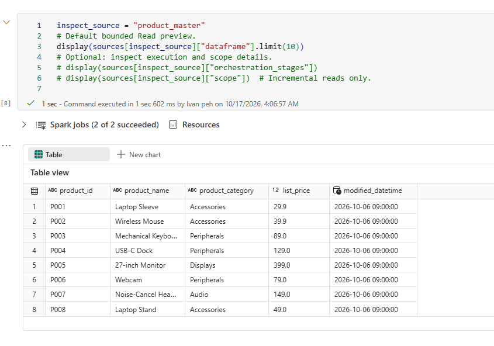
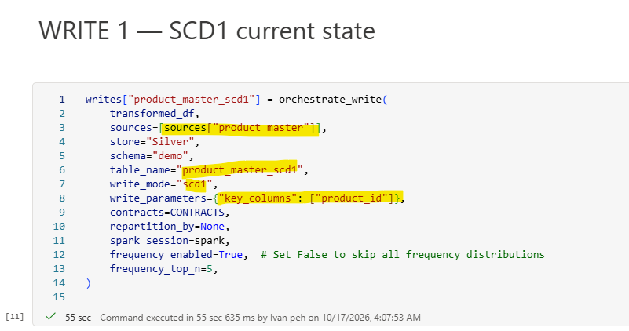
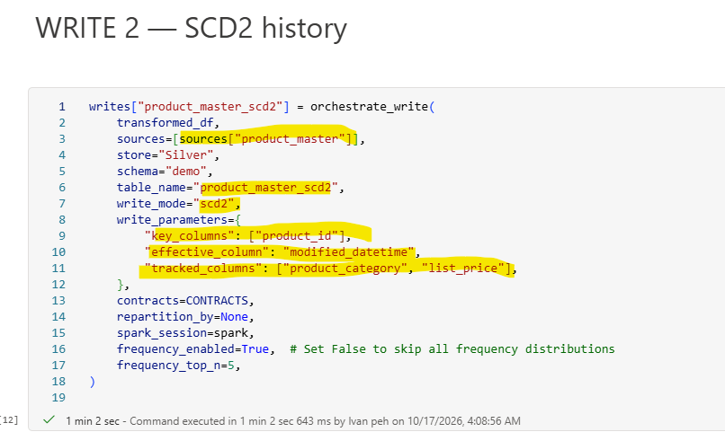
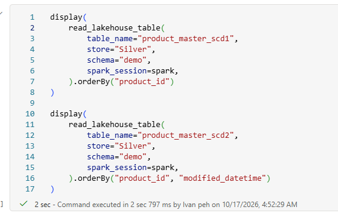
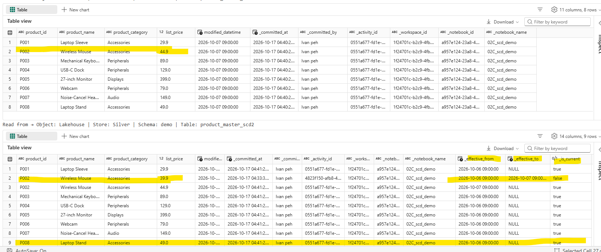
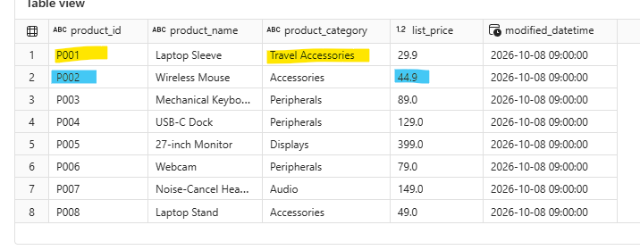
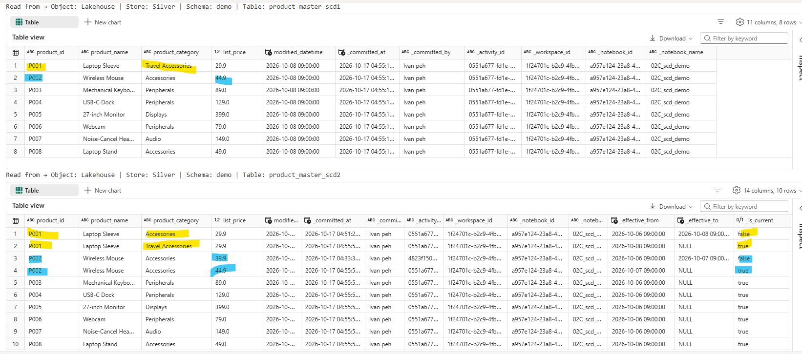

# Step 2C. Run the SCD1 and SCD2 Demo

### Before you begin

1. Download [`02C_scd_demo.ipynb`](https://raw.githubusercontent.com/Voycepeh/FabricOps-Starter-Kit/main/templates/DemoData/02C_scd_demo.ipynb) and import it into the Engineering Development workspace.
2. Keep `00_env_config.ipynb` beside it and attach the same Fabric Environment used in Step 00B.
3. Make sure you have already uploaded the demo files required for this demo in the previous step [Step 00B](00B-configure-environment-and-load-assets.md).

4. Run [Step 00C](00C-prepare-demo-data-with-fabricops-io.md) first for Day 1. For Days 2 and 3, the notebook reads `demo/products_day2.csv` and `demo/products_day3.csv` directly from Bronze Lakehouse `Files/demo`. There is no `scd_product_master` subfolder.
5. Use a fresh demo state and run Day 1, then Day 2, then Day 3.


!!! note "First run: Observe for Governance"
    Run the complete initial Ungoverned run, ending with `pipeline_result = finalize_pipeline(pipeline)`. Read and Write calculate due profiles automatically; a successful Ungoverned execution publishes the target and persists source and target observations in workspace-scoped Catalogue/profile metadata for Data Contract authoring. It does not grant Governance approval. Governed execution continues to profile persisted targets after successful publication. No manual profiling calls or duplicated observation coordinates are needed.

    Author and freeze global Contracts in `01_governance`, validate them in Dry Run where useful, then activate exact versions for that workspace. An Ungoverned run cannot activate itself, and it cannot write a target that is already governed. In Governance, set the two target Contract Processing strategies to **SCD1** and **SCD2**, with `product_id` as the key. For SCD2 use `modified_datetime` as the effective column and track `product_category` and `list_price`, matching the notebook Write parameters.

<div class="fabricops-section-banner" markdown="1">

<div class="fabricops-section-content" markdown="1">

## The big picture

Change the Step 2 Write strategy to SCD1 and SCD2, then compare how both targets record the same source changes.

</div>
</div>

| Run | Business change | Expected SCD1 rows | Expected SCD2 versions |
| --- | --- | ---: | ---: |
| Day 1 | Load the initial eight products. | 8 | 8 |
| Day 2 | Change `P002.list_price`. | 8 | 9 |
| Day 3 | Change `P001.product_category`. | 8 | 10 |

The notebook uses these governed tables throughout:

| Role | Location | Processing |
| --- | --- | --- |
| Source | Bronze Lakehouse · `demo.product_master_updates` | Full Read |
| Current-state target | Silver Lakehouse · `demo.product_master_scd1` | SCD1 keyed by `product_id` |
| Historical target | Silver Lakehouse · `demo.product_master_scd2` | SCD2 effective on `modified_datetime` and tracking `product_category` and `list_price` |

Profiling schedules and Read/Write triggers are saved per table in Data Contract Authoring. Standard pipeline calls need no profiling options.

### Decide between current truth and historical truth

**SCD1 maintains current truth.** Existing business keys are updated and new keys inserted. Previous values are not retained as historical versions. Choose it for current-state reference and master data when only the latest value matters.

**SCD2 preserves historical truth.** Changes to tracked values create new historical versions and close previous versions. `_is_current` identifies current rows. Choose it for audit, historical reporting and time-based analysis when users need to know what a record looked like at a particular point in time.

| Scenario | Recommended strategy |
| --- | --- |
| Only latest customer address matters | SCD1 |
| Need to know a customer's previous address | SCD2 |
| Product category mapping should always show latest classification | SCD1 |
| Need historical product classifications for past reporting | SCD2 |

??? info "Business keys, effective dates and tracked columns"
    Use stable business keys, with one non-null, unique `product_id` per incoming snapshot. Keys match the same entity across runs. A wrong key can merge unrelated entities or insert duplicates.

    SCD2 uses `effective_column="modified_datetime"` to set `_effective_from` and close the prior `_effective_to`. A changed version requires an effective time later than the current version start. These are business-effective times, not merely execution times.

    This demo tracks `product_category` and `list_price`. Only changes to those columns create versions; unchanged snapshots, even with a later timestamp, do not. Changes only to untracked business fields neither create versions nor refresh those stored fields. If `tracked_columns` is omitted, the implementation tracks eligible non-key business columns excluding the effective column and technical fields. Select these columns deliberately. Neither SCD mode infers deletions from missing source keys.

### Set up the pipeline

Run Environment, choose `DEMO_DAY`, and run the explicit Bronze source-preparation cell. That setup can change Bronze before pipeline selection. The default pipeline setup is:

```python
context = setup_notebook(
    # Optional shared config: config_workspace_id="<configuration-workspace-id>",
)

PIPELINE_MODE = "Ungoverned"  # Dry Run, Ungoverned, Governed
pipeline = setup_pipeline(
    pipeline_mode=PIPELINE_MODE,
)
```


After Governance freezes contracts, use Dry Run to select exact frozen versions for preview validation. Dry Run never publishes business data or operational observations, and finalization returns only a session summary. Governed activations remain subject to activation and destination checks. See the [execution boundary and activation limits](https://github.com/Voycepeh/FabricOps-Starter-Kit/blob/main/templates/notebooks/README.md#source-participation-and-execution-boundaries).

Individual Guardrail stages are omitted when no Data Contract is selected; skipped check fields remain in the returned dictionaries. Persisted row counts and saved-data screenshots below require persistent publication. Advance the demo day only after publication succeeds.

<div class="fabricops-section-banner" markdown="1">

<div class="fabricops-section-content" markdown="1">

## Run Day 1 with persistent publication
Reads 8 rows of data from Bronze `demo.product_master_updates` then set 'product_id' as key column for SCD1 and write to silver.demo.product_master_scd1, likewise set 'product_id' as key column , set `product_category` and `list_price` as tracking columns with `modified_datetime` as the effective column for SCD2 and write to silver.demo.product_master_scd2


</div>
</div>


8 rows are read its just full read nothing special 



### SCD1 configurations
- write_mode="scd1"	Overwrites existing records instead of preserving historical versions.
- key_columns	Identifies the unique business entity, such as product_id.




### SCD2 Configurations
- write_mode="scd2"	Preserves historical records instead of overwriting them.
- key_columns	Identifies the unique business entity, such as product_id.
- effective_column	Specifies when each record version becomes effective, using modified_datetime.
- tracked_columns	Specifies which columns to monitor for changes. A change to any tracked value creates a new historical version.




<div class="fabricops-section-banner" markdown="1">

<div class="fabricops-section-content" markdown="1">

## Change to Day 2 and select a fresh plan

Product `P002` has a new `list_price`:

- SCD1 updates the value on `P002`'s existing row and keeps eight rows.
- SCD2 closes the earlier `P002` version and inserts a new current version.

</div>
</div>




The SCD1 profile should show `row_count = 8`; the SCD2 profile should show `row_count = 9`, confirming that the changed `P002` created one additional historical version.



<div class="fabricops-section-banner" markdown="1">

<div class="fabricops-section-content" markdown="1">

## Change to Day 3 and select a fresh plan

Product `P001` has a new `product_category`:

- SCD1 replaces the category on `P001`'s current row and keeps eight rows.
- SCD2 closes the earlier `P001` version and inserts a new current version.

</div>
</div>




The SCD1 profile should show `row_count = 8`; the SCD2 profile should show `row_count = 10`, confirming that the changed `P001` created one additional historical version.




### Expected result

Day 1 creates eight current records in each target, Day 2 creates the first historical SCD2 version, and Day 3 creates the second while SCD1 remains at eight current rows.

### Data saved by the demo

| Location | Table | Final state after Day 3 |
| --- | --- | --- |
| Bronze Lakehouse | `demo.product_master_updates` | The complete eight-row Day 3 Product Master snapshot. |
| Silver Lakehouse | `demo.product_master_scd1` | Eight current product rows with the latest values. |
| Silver Lakehouse | `demo.product_master_scd2` | Ten versions: eight current versions and two closed historical versions created by the Day 2 and Day 3 changes. |

### Metadata saved by FabricOps

For **Ungoverned** and **Governed** executions, FabricOps writes applicable operational metadata to the Metadata Lakehouse configured by `00_env_config`. **Dry Run is session-only**: it does not write target data or persist catalogue, profile, processing-state, or pipeline-run records. The rows below describe the records this demo can produce during a persistent execution; the exact rows depend on the stages that complete and the Guardrails that are actually evaluated.

| Metadata table | What this demo records |
| --- | --- |
| `METADATA_PIPELINE_REGISTRY` | No rows from this Ungoverned demo. The separate promotion workflow retains immutable per-workspace versions and Governed notebook snapshots; neither Ungoverned nor Dry Run automatically registers a Pipeline. |
| `METADATA_PIPELINE_RUN` | The finalized execution outcome, including status and the run identity. Persistent executions record the outcome at `finalize_pipeline(pipeline)`. |
| `METADATA_DATA_CATALOGUE` | Canonical table and column identities for the Bronze source and both Silver targets, plus applicable target processing and profile metadata. |
| `METADATA_DATA_PROFILED` | Profile snapshots for each Full Read source snapshot and each published SCD target when profiling completes. |
| `METADATA_DATA_PROFILED_FREQUENCY` | Frequency rows linked to profile snapshots where applicable. |
| `METADATA_DATA_LINEAGE` | Source and both target roles recorded for this notebook pipeline. |
| `METADATA_PROCESSING_STATE` | Typed source observations, checkpoints, Source Drift baselines and target publication receipts, when applicable. |
| `METADATA_GUARDRAIL_RESULTS` | Evaluation results when a selected Data Contract supplies executable Guardrails and the applicable execution flow evaluates them. |


### Diagnose a later day before changing the SCD targets

Run the `DEMO_DAY` cell and the **Prepare the Bronze snapshot** cell before Read → Transform → Write. For Days 2 and 3, that cell replaces Bronze with the complete selected CSV. Changing the parameter alone does not stage a snapshot. Inspect `product_id`, `list_price`, `product_category` and `modified_datetime` for P001/P002 first in Bronze, then in the inline Full Read preview and transformed DataFrame:

| Day | P002 list price | P001 category | SCD1 rows | SCD2 versions |
| --- | ---: | --- | ---: | ---: |
| 1 | 39.90 | Accessories | 8 | 8 |
| 2 | 44.90 | Accessories | 8 | 9 |
| 3 | 44.90 | Travel Accessories | 8 | 10 |

For this engineering regression, use a fresh **Ungoverned** execution each day. Use a fresh permitted **Governed** plan only for the separate governed workflow. Dry Run keeps Silver and operational metadata unchanged; the explicit Bronze preparation is outside that plan. Governed publication requires approved activations and remains blocked pending trusted deployment verification. Rerun each day in the same interactive session and repeat its Write: SCD2 must retain eight current products and must not add another version for unchanged business values. A new scheduled activity must produce the same results.

The Read block displays the rows returned by the source Read. Both SCD Write previews use `display(write_result["dataframe"].limit(10))` (through the notebook's `writes` dictionary). They show the final prepared processing input with `_row_hash` and audit columns; SCD2 also includes `_effective_from`, `_effective_to` and `_is_current`. This is the input to the merge, rather than the reconstructed destination or full version history. Dry Run shows the input prepared at that stage without publication. No destination read is required for the inline preview. `Not available` SCD metrics do not establish that a merge failed. For SCD2, confirm that superseded P002/P001 versions have `_is_current=False` and populated `_effective_to`, that each product has one current version, and that no `(product_id, _effective_from)` pair is duplicated. Never replace these keyed merges with overwrite to hide a mismatch. For existing target or receipt divergence, follow the [retry and concurrency boundaries](../reference/read-and-load-strategies.md#retry-and-concurrency-boundaries) and reconcile the exact history with its owner. Append repairs must not be applied to SCD history.

### Acceptance checklist

- [ ] Compare current business values with the selected `products_day1.csv`, `products_day2.csv` or `products_day3.csv` snapshot. Bronze remains eight rows and must match that snapshot after pipeline processing.
- [ ] Verify P002 prices 39.90 → 44.90 → 44.90 and P001 categories Accessories → Accessories → Travel Accessories.
- [ ] SCD1 keeps eight distinct product keys. SCD2 keeps eight current products and 8/9/10 total versions; closed versions have populated `_effective_to`, with no duplicate `(product_id, _effective_from)` pairs or overlapping intervals.
- [ ] Inspect stored `_row_hash` values and audit columns. Repeating the current day changes no business values or SCD2 history; hashes reflect the implemented business columns, while version creation follows the configured tracked columns.
- [ ] Inspect both target operations, their source IDs and committed receipts in the new Runs using the [metadata checklist](00C-prepare-demo-data-with-fabricops-io.md#validate-outputs-and-metadata).

### Repeat the demo safely

Run Day 1, Day 2 and Day 3 in order. Do not restart Day 1 against targets containing later-day SCD history. Repeated Writes for the same day must preserve current rows and avoid duplicate versions; inspect the persisted target and publication receipts if those invariants fail. Keep accepted Processing State and its corresponding business targets together. For a complete replay, stop current/earlier demo executions and configure a fresh dedicated Metadata Lakehouse through 00B before running [00C](00C-prepare-demo-data-with-fabricops-io.md#reset-rerun-and-validate-a-package) and wait for `RESET COMPLETE`. Begin Step 1, set both 02B and 02C to `DEMO_DAY = 1`, and repeat the complete sequence. Existing Governance/deployment history stays in the previous Metadata Lakehouse. A used Metadata item blocks 00C; select and configure a fresh dedicated item first. Never delete the SCD targets or checkpoints separately.

**Continue the main Guided Demo:** [Step 3. Author and freeze the Data Contract](03-author-and-freeze-data-contract.md)
