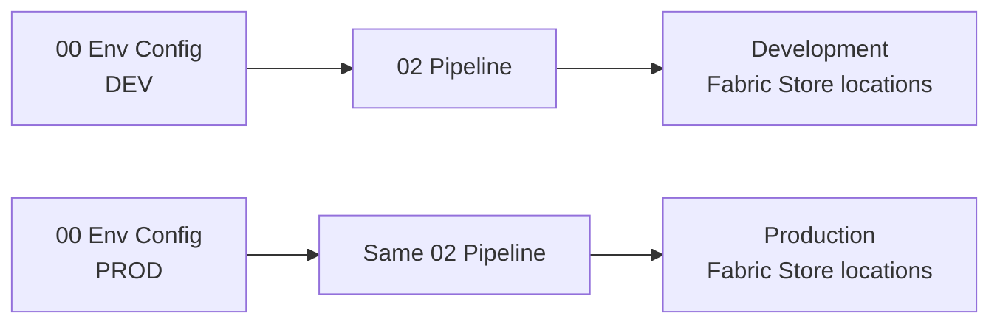
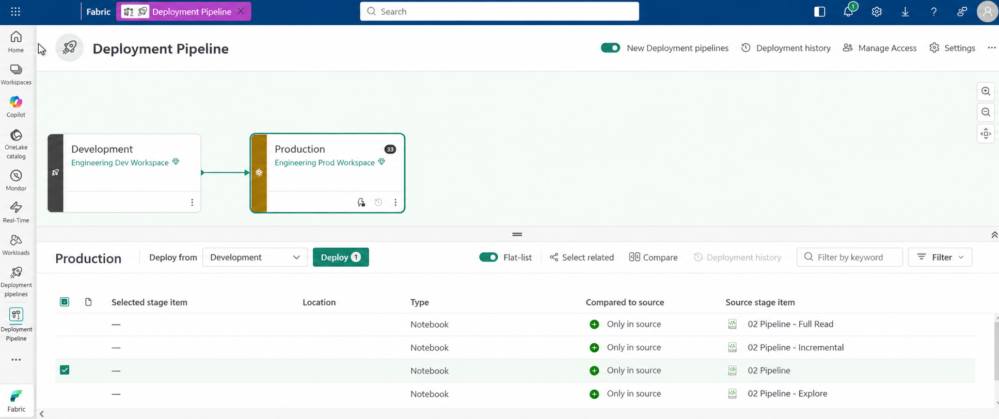
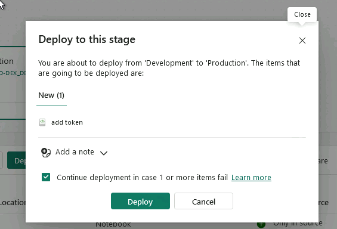

# Step 5. Activate the Data Contract and promote to Production

### Before you begin

Complete [Step 4](04-validate-frozen-data-contract.md) and use the validated frozen contract versions.

<div class="fabricops-section-banner" markdown="1">

<div class="fabricops-section-content" markdown="1">

## Select the tested Data Contract version

Return to the activation cell in `01_governance` and open [`widget_activate_data_contract()`](../api/reference/widget_activate_data_contract.md). Select each exact frozen Data Contract version that passed Step 4.

</div>
</div>


Do not activate a different draft or an untested version simply because it is newer. Activation requires a completed validation record for that exact frozen version. A successful pipeline validation records completion for each participating source and target, including sources with only Schema configured. Isolated or partial check results are insufficient. A later draft does not inherit its previous version's activation eligibility.

For the full `02A_full_refresh_demo` notebook, repeat activation for **five tables**: `orders`, `products`, `order_history`, `curated_orders`, and `customer_summary`. Both targets must have completed their separate Step 4 validation runs with the intended source versions.

### Link the Data Agreement

Select the exact Data Agreement version created in Step 1 that governs this producer-to-consumer relationship.

The approval path is now:

```text
Data Steward context
        ↓
Data Agreement
        ↓
real table_id from Engineering
        ↓
frozen Data Contract version
        ↓
Development validation
        ↓
Agreement linkage + activation
```

### Activate the Data Contract

Review the selected `table_id`, tested Data Contract version, and linked Data Agreement version, then activate it.

Activation tells FabricOps which immutable contract version Production must resolve for that governed table.

??? tip "Activation is blocked or the expected version is missing"

    | What you see | What to check |
    | --- | --- |
    | Candidate missing | Save and freeze that exact draft, then reopen the activation widget to refresh the available versions. |
    | No exact-version validation or validation incomplete | Rerun all participating Reads and the target's Validate Write through successful Coverage; a passing individual check is insufficient. |
    | Blocking validation failure | Restore the clean data or correct the implementation, then complete validation again. Changing a frozen rule requires a new draft/version. |
    | Previously validated version is blocked after another attempt | The latest run must complete; an earlier completion record cannot qualify a later partial or failed attempt. |
    | Agreement missing | Create the Data Agreement in Step 1 and select its exact version. |

    Reopen the widget after completing validation elsewhere. Review the linked agreement and use the explicit activation confirmation. Activation updates the active pointer; it does not deploy a notebook or modify the frozen JSON.

<div class="fabricops-section-banner" markdown="1">

<div class="fabricops-section-content" markdown="1">

## Promote the validated pipeline

`00_env_config` owns the environment-specific resolution. Your tested `02A_full_refresh_demo` copy owns this demo pipeline definition.

</div>
</div>


That separation means Engineering promotes the same tested 02A demo notebook from Development to Production while `00_env_config` maps logical Fabric Stores such as Bronze, Silver, Gold, and Metadata to their environment-specific Fabric locations.



In the Fabric Deployment Pipeline, select the tested notebook or engineering artifact from Development and deploy it to the Production stage.

FabricOps does not require one specific deployment mechanism. The important part is that the same validated 02A demo pipeline reaches the next environment unchanged. You can do that manually, including downloading and importing the notebook, or through your organisation's normal CI/CD process.

A Fabric-native option is **Deployment pipelines**. Set up a deployment pipeline, assign the Development and Production workspaces to its stages, then use it to promote the tested 02A demo pipeline between them. See [Microsoft Learn: Get started with deployment pipelines](https://learn.microsoft.com/en-us/fabric/cicd/deployment-pipelines/get-started-with-deployment-pipelines) for the current setup instructions.



Review the deployment selection and complete the deployment.



The important boundary is:

* activate the tested Data Contract for Production
* promote the validated engineering artifact
* keep environment-specific workspace IDs, item IDs, paths, schemas, and SQL endpoints in `00_env_config`
* do not move Development output data or draft governance state into Production

### Expected result

The exact tested contracts are active for all three sources and both targets, and the validated pipeline artifact is deployed to Engineering Production.

**Next:** [Step 6. Run the pipeline in Production](06-run-production.md)
