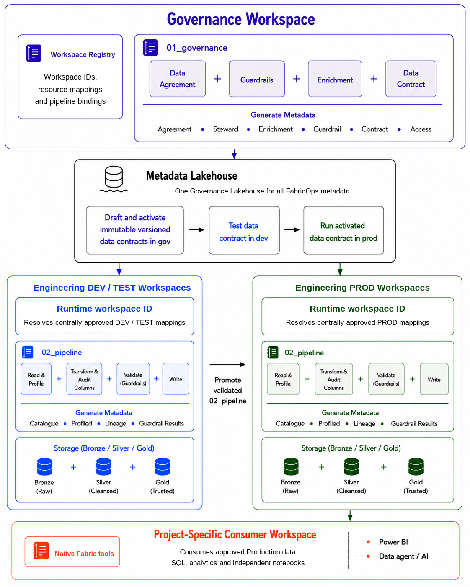
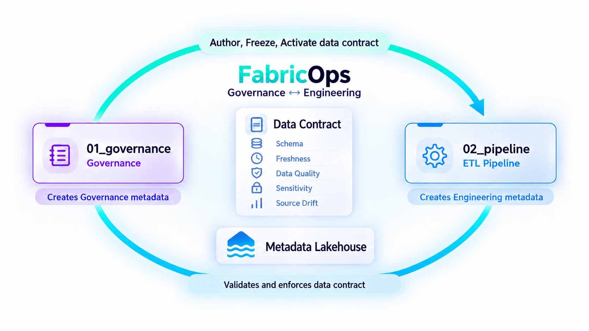
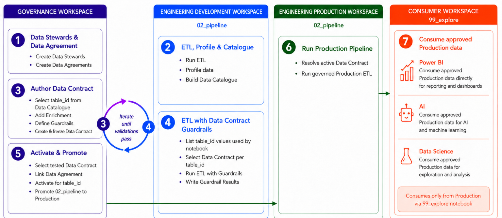

# How FabricOps works

## The Big Picture

**Governance defines the expectations. Engineering validates and runs the pipeline. Consumers use approved Production data.**

- **Governance** defines who is responsible for the data, what it means, and which rules it must meet.
- **Engineering Development** builds the pipeline and tests it against a frozen Data Contract.
- **Engineering Production** runs the validated pipeline with the active Data Contract. Approved consumers use the resulting data for analytics and AI.
- **Shared Metadata** connects Governance and Engineering responsibilities throughout the lifecycle.

---

## Workspace Architecture

**Microsoft Fabric provides the building blocks. FabricOps provides the repeatable operating practice that connects them.**



??? info "Detailed explanation"

    Fabric already gives teams notebooks, Lakehouses, Warehouses, pipelines, environments, AI capabilities, and many other building blocks. The harder question is how a team uses those building blocks repeatedly without every project inventing a different engineering and governance pattern.

    **How Governance and Engineering work hand in hand within Microsoft Fabric**

    - **Microsoft Fabric building blocks**
      FabricOps operates inside Microsoft Fabric using its native building blocks: Workspaces to separate responsibilities and environments, Notebooks running PySpark for engineering and governance logic, Deployment Pipelines for promotion, Lakehouses and Warehouses for Bronze, Silver, Gold, and Metadata storage, and Fabric environments and object configuration to keep Development and Production aligned.

    - **Governance Workspace**
      Owns the governed definition of the data. `00_env_config` stores the Governance environment configuration and Fabric object paths. `01_governance` manages Data Agreements, Stewards, Enrichment, Guardrails, Data Contracts, and access metadata.

    - **Shared Metadata Lakehouse**
      Lives in the Governance Workspace and connects Governance with Engineering. It stores the shared FabricOps metadata used across the lifecycle, including Catalogue, profiling, contracts, lineage, Guardrail Results, and related governance metadata.

    - **Engineering Development Workspace**
      This is where the engineering implementation is built and validated. Its `00_env_config` resolves its workspace ID to Development Lakehouses, Warehouses, schemas, and other Fabric object paths. `02_pipeline` reads and profiles data, applies transformations and audit columns, validates Guardrails, writes outputs, and records engineering metadata.

    - **Engineering Production Workspace**
      Runs the same validated `02_pipeline` using Production configuration. Its `00_env_config` resolves its workspace ID to the equivalent Production Lakehouses, Warehouses, schemas, and Fabric object paths, while the pipeline resolves the exact Activated Pipeline manifest and produces governed Production outputs.

      One reusable `00_env_config` template is deployed in each execution workspace by default. Advanced deployments can share a central copy by passing `config_workspace_id` to setup. Setup passes the caller workspace ID across the notebook boundary and receives the resolved environment and existing resource mappings as JSON. Unknown workspaces fail setup before pipeline execution.

    - **Aligned environments and promotion**
      Development and Production keep the same logical Bronze, Silver, and Gold architecture, whether those stores are implemented as Lakehouses or Warehouses. The physical Fabric objects differ by environment, but their roles and structure stay aligned 1:1. Once `02_pipeline` is validated in Development against the frozen Data Contract, that validated notebook is promoted to the Engineering Production Workspace through the deployment flow.

    - **Project-Specific Consumer Workspace**
      Consumers receive approved Production access through native Fabric controls and can use the Fabric interface appropriate to their work. Consumers can query centralized metadata directly through PySpark or SQL and use project-specific notebooks for analytics and AI. Data Agent publishing is the first automated target; direct analytics and future Power BI/reporting paths reuse the same governed foundation.


    ??? info "Why use a Warehouse for Gold consumption?"

        **Bronze and Silver focus on engineering; Gold focuses on publishing trusted data for downstream use.** FabricOps supports both Lakehouse and Warehouse stores across the medallion architecture. A Fabric Warehouse is a useful Gold choice when consumers need a controlled SQL interface and query execution visibility.

        A common pattern is to keep engineering workloads in governed Lakehouses and publish approved Gold tables or views through a Warehouse. Consumers receive scoped Warehouse SQL permissions rather than broad access to the underlying engineering stores. Native Fabric permissions must still be configured to prevent unintended alternate access paths through OneLake, Spark, or Lakehouse SQL endpoints.

        Warehouse and Lakehouse SQL analytics endpoints expose [Query Insights](https://learn.microsoft.com/en-us/fabric/data-warehouse/query-insights), which can help administrators inspect recorded SQL requests, connection identities, execution times, and query text subject to permissions and retention. This makes SQL-based consumption more observable, but **Query Insights is query history, not a complete table-level access audit**. Identifying tables from query text requires additional interpretation, and service identities may appear instead of individual end users.

        ??? info "What happens when Spark reads a Warehouse?"

            A Fabric notebook can read a Warehouse through the supported Spark SQL connector, for example `spark.read.synapsesql("ConsumptionWH.dbo.sales_orders")`. The connector uses the Warehouse access path, but its generated requests and their visibility in Query Insights should be verified in the target Fabric environment. Query history does not expose subsequent PySpark transformations or the original notebook code.

            Direct Spark access to Lakehouse Delta tables bypasses the Warehouse SQL endpoint. Power BI Direct Lake and other non-SQL access paths may also bypass Warehouse query history. Therefore, routing consumers through a Warehouse improves the opportunity for SQL activity monitoring **only when alternative access paths are appropriately restricted**.

---

## The Governance ↔ Engineering Cycle



**FabricOps turns Governance and Engineering into one executable cycle around the same `table_id`.**

Guardrails remain part of the Data Contract. Engineering calls `orchestrate_read()` and `orchestrate_write()`; those entrypoints resolve the contract, run the applicable checks and treatments, record Guardrail Results, and decide whether execution can continue. Project-owned transformations stay between Read and Write.

- **Engineering** records observed data and profiling metadata.
- **Governance** uses that evidence to author a versioned **Data Contract**.
- **Engineering** validates the pipeline against the frozen contract.
- **Governance** activates the approved whole-pipeline version.
- **Production** enforces the active contract.
- **Repeat** the cycle whenever changes are needed.

??? info "Detailed explanation"

    `02_pipeline` creates the Engineering side of the shared metadata: `METADATA_DATA_CATALOGUE`, `METADATA_DATA_PROFILED`, `METADATA_DATA_PROFILED_FREQUENCY`, `METADATA_DATA_LINEAGE`, and `METADATA_SOURCE_OBSERVATION`.

    `01_governance` creates the Governance side: `METADATA_DATA_STEWARD`, `METADATA_DATA_AGREEMENT`, and the versioned `METADATA_DATA_CONTRACT`. Engineering selects that contract, validates and enforces its Guardrails, and records the outcomes in `METADATA_GUARDRAIL_RESULTS`.

    If the implementation or governed definition needs refinement, Governance creates the next contract version and Engineering validates it again. Once the tested version is approved, Governance activates it for Production and the same `02_pipeline` resolves the approved environment activation revision.

    **For the notebook-level implementation, browse the [FabricOps notebook templates](https://github.com/Voycepeh/FabricOps-Starter-Kit/tree/main/templates/notebooks). For the schema, purpose, and relationships of each metadata table, see the [Metadata reference](reference/metadata.md).**

    ??? info "Implementation and metadata handoff"

        | What happens | Implementation | Metadata |
        | --- | --- | --- |
        | Establish Governance context | [`widget_render_data_steward()`](api/reference/widget_render_data_steward.md), [`widget_render_data_agreement()`](api/reference/widget_render_data_agreement.md) | `METADATA_DATA_STEWARD`, `METADATA_DATA_AGREEMENT` |
        | Register and profile the table | [`profile_table()`](api/reference/profile_table.md) | [`METADATA_DATA_CATALOGUE`](reference/metadata/metadata_data_catalogue.md), [`METADATA_DATA_PROFILED`](reference/metadata/metadata_data_profiled.md), [`METADATA_DATA_PROFILED_FREQUENCY`](reference/metadata/metadata_data_profiled_frequency.md) |
        | Author/freeze contracts, test and activate the whole pipeline | [`widget_data_contract()`](api/reference/widget_data_contract.md), [`setup_pipeline()`](api/reference/setup_pipeline.md), [`widget_activate_pipeline(testing_results=[pipeline_result])`](api/reference/widget_activate_pipeline.md) | [`METADATA_DATA_CONTRACT`](reference/metadata/metadata_data_contract.md), [`METADATA_ACTIVATION_STATE`](reference/metadata/metadata_activation_state.md) |
        | Execute the Data Contract and record pipeline state | [`orchestrate_read()`](api/reference/orchestrate_read.md), [`orchestrate_write()`](api/reference/orchestrate_write.md) | [`METADATA_DATA_LINEAGE`](reference/metadata/metadata_data_lineage.md), [`METADATA_SOURCE_OBSERVATION`](reference/metadata/metadata_source_observation.md), [`METADATA_GUARDRAIL_RESULTS`](reference/metadata/metadata_guardrail_results.md) |

        `table_id` connects the physical table, Engineering observations, and governed definition.

        Some Guardrails also return caller-owned row-level support DataFrames. FabricOps does not persist these automatically: the orchestrators return DQ `failed_values` inside `dq_result`, and Write returns token `support_mapping` inside `sensitive_result`. See the [Metadata reference](reference/metadata.md) for the full table schemas, relationships, access metadata, and runtime-output details.

---

## The 7-Step FabricOps Lifecycle



??? info "7-step lifecycle details"

    1. **Establish Governance context.** Create Data Stewards and a Data Agreement.
    2. **Build the pipeline.** Engineering runs, profiles, and catalogues the data in Development.
    3. **Author and freeze the Data Contract.** Governance defines the data's meaning and rules, then freezes a version for testing.
    4. **Validate the frozen Data Contract.** Engineering tests that exact version against the pipeline.
    5. **Activate and promote.** Governance activates the tested whole pipeline; Engineering promotes the validated pipeline to Production.
    6. **Run Production and grant access.** Run with Production configuration and give approved consumers access through native Fabric controls.
    7. **Consume governed data.** Use approved Production data for analytics and AI. Query centralized metadata directly through PySpark or SQL when governance context is needed.

    ??? info "Detailed lifecycle responsibilities"

        1. **Governance establishes the people and agreement context.** [`widget_render_data_steward()`](api/reference/widget_render_data_steward.md) writes Data Steward records, and [`widget_render_data_agreement()`](api/reference/widget_render_data_agreement.md) writes Data Agreement records.
        2. **Engineering Development builds the ETL and produces the governed table.** `02_pipeline` reads, transforms, writes, profiles, and records the technical context around the real table. [`profile_table()`](api/reference/profile_table.md) keeps the Data Catalogue and profiling metadata aligned with what Engineering actually produced.
        3. **Governance authors the Data Contract for that `table_id`.** [`widget_data_contract()`](api/reference/widget_data_contract.md) brings together Enrichment, Guardrails, and the governed processing definition for the table.
        4. **Engineering Development selects a contract version and validates the real pipeline.** [`setup_pipeline()`](api/reference/setup_pipeline.md) sets the selected contract per linked `table_id`, and the Guardrail functions execute its expectations against the real data flow.

            **Steps 3 ↔ 4 are intentionally iterative.** Governance authors the next contract version; Engineering selects that immutable version and reruns the pipeline against it. If the expectation needs refinement or the implementation does not satisfy the intended rule, the flow returns to Governance for another version and then back to Engineering for another validation run. The loop continues until the governed definition and the real engineering implementation agree.

        5. **Governance activates the tested whole pipeline, then Engineering deploys it.** For each transferred Test result, Governance independently confirms the actual Fabric notebook execution and enters its run reference. [`widget_activate_pipeline(testing_results=[pipeline_result])`](api/reference/widget_activate_pipeline.md) validates the supplied result, current notebook binding, exact candidate, frozen definitions and Agreement, then records verification and explicit approval in `METADATA_ACTIVATION_STATE`. Contracts remain Frozen and reusable. Engineering and Microsoft Fabric own executable integrity, source control, CI/CD and deployment. The notebook calls `setup_pipeline()` to resolve the approved Data Contracts, then Read → Transform → Write, followed by `finalize_pipeline()` to consolidate outcomes and finish tracking. Fabric Deployment Pipelines are not assumed to copy metadata rows.
        6. **Engineering runs the same workflow again in Production and hands off access.** The promoted `02_pipeline` resolves Production stores through `00_env_config`, automatically resolves the active Data Contract, applies the same Read → Transform → Write pattern and Guardrail functions, and publishes the governed output. Successful writes commit the associated runtime Lineage and Source Observation state. Approved consumers then receive access through native Fabric controls and can use standard Fabric interfaces directly.
        7. **Analytics and AI consumers use native Fabric interfaces or project-specific notebooks.** Centralized metadata provides the governed context for downstream use. One-shot Data Agent publishing is the first automated target; explicit reusable relationship context later extends the same pattern to multiple tables and other consumers.

!!! tip "Validation is iterative"

    **Steps 3 ↔ 4 repeat** until the Data Contract and pipeline agree. See the [Governance ↔ Engineering Cycle](#the-governance-engineering-cycle) above for how this feedback loop works. Activate the contract only after validation; Production uses the active version.

<div align="center" markdown="1">

[Try the lifecycle in the Guided Demo →](guided-demo.md){ .md-button .md-button--primary }

</div>

---

## Data Contracts

**A Data Contract is a versioned definition of a governed table: what it means, how it is processed, and which rules the pipeline must check.** These rules are called Guardrails.

Engineering supplies the table's observed structure; Governance adds descriptions, classifications, and expectations. Freezing makes a version immutable for testing. Activation selects the tested version for Production and links it to the exact Data Agreement version.

**The Data Contract is the versioned, executable governance definition for one governed `table_id`.** It is assembled from the real Engineering metadata and the Governance decisions made against that asset, then stored as a single `contract_payload_json` manifest in `METADATA_DATA_CONTRACT`.

The manifest captures:

- **Contract identity and lifecycle** — `contract_id`, `contract_version`, and lifecycle status.
- **Table definition** — the governed `table_id`, schema/table identity, observed columns and data types from `METADATA_DATA_CATALOGUE`, plus the governed processing definition.
- **Enrichment** — reviewed table- and column-level descriptions, classifications, and table grain authored by Governance.
- **Guardrails** — the executable Schema, Grain, Freshness, Source Drift, Data Quality, and Sensitive Data expectations authored by Governance.

In other words, **Engineering supplies what physically exists; Governance adds what it means and what must be enforced.** Saving updates the mutable draft manifest. Freezing makes that version immutable. Activation selects the tested frozen version for Production and links it to the exact Data Agreement version.

??? example "What the JSON manifest looks like"

    ```json
    {
      "contract": {
        "contract_id": "...",
        "contract_version": 1,
        "status": "frozen"
      },
      "table": {
        "table_id": "...",
        "schema_name": "demo",
        "table_name": "orders",
        "columns": [
          {
            "column_id": "...",
            "column_name": "order_id",
            "data_type": "string"
          }
        ],
        "processing": {
          "load_strategy": "overwrite"
        }
      },
      "enrichment": {
        "table": [],
        "columns": []
      },
      "guardrails": []
    }
    ```

    The exact manifest grows with the Enrichment, Processing, and Guardrails authored for the table. See [METADATA_DATA_CONTRACT](reference/metadata/metadata_data_contract.md) for the persisted table schema.

---

## Featured Solutions

The operating model above is the shared foundation. These solutions apply it to specific engineering, governance, access, and consumption problems.

<div class="fabricops-solution-grid">
<a class="fabricops-solution-card" href="../solutions/plug-and-play-data-pipelines/"><span class="fabricops-solution-status">Live</span><strong>Plug-and-Play Data Pipelines with Data Contract Enforcement</strong><small>Run a standard FabricOps pipeline pattern across Development and Production with governed boundaries around project-specific PySpark.</small></a>
<a class="fabricops-solution-card" href="../solutions/production-table-to-data-agent/"><span class="fabricops-solution-status">Preview</span><strong>Production Table to Data Agent</strong><small>Carry governed Production table context forward into a Microsoft Fabric Data Agent.</small></a>
<a class="fabricops-solution-card" href="../solutions/ai-assisted-data-contract-authoring/"><span class="fabricops-solution-status">Preview</span><strong>Direct &amp; Indirect PII Discovery &amp; Treatment with Built-in AI Suggestions</strong><small>Identify sensitive data, review suggested classifications, and apply governed treatments while keeping the final decision with a human.</small></a>
<a class="fabricops-solution-card" href="../solutions/business-rules-to-data-quality/"><span class="fabricops-solution-status">Preview</span><strong>Data Quality Rules from Natural Language</strong><small>Translate business requirements into reviewable Data Quality rules that FabricOps can enforce deterministically.</small></a>
<a class="fabricops-solution-card" href="../solutions/effective-data-access/"><span class="fabricops-solution-status">Preview</span><strong>Scan Effective Data Access</strong><small>Resolve who can reach governed data across the Fabric permission paths visible to the identity running the scan.</small></a>
<a class="fabricops-solution-card" href="../function-call-graph/"><span class="fabricops-solution-status">Live · Maintainer</span><strong>Explore How FabricOps Functions Work Under the Hood</strong><small>Inspect the generated public function call-flow model, callable relationships, and architecture signals.</small></a>
</div>

---

## Go deeper

**Ready to try it? [Start the Guided Demo →](guided-demo.md)**

Continue from the operating model into the level of detail you need:

- [Browse the Function Reference](reference/index.md) for public APIs and callable behaviour.
- [Review Data Quality Rules](reference/dq-rules/index.md) for supported deterministic checks.
- [Inspect Metadata Tables](reference/metadata.md) for the persisted governance and engineering model.
- [Use the Glossary](glossary.md) for FabricOps terminology.

<style>
.md-typeset .fabricops-solution-grid {
  display: grid;
  grid-template-columns: repeat(2, minmax(0, 1fr));
  gap: 0.75rem;
  margin: 1rem 0 0;
}

.md-typeset .fabricops-solution-card {
  display: block;
  padding: 0.9rem 1rem;
  border: 1px solid var(--md-default-fg-color--lightest);
  border-radius: 0.4rem;
  color: var(--md-default-fg-color) !important;
  text-decoration: none;
}

.md-typeset .fabricops-solution-card:hover,
.md-typeset .fabricops-solution-card:focus {
  border-color: var(--md-primary-fg-color);
  background: var(--md-accent-fg-color--transparent);
}

.md-typeset .fabricops-solution-card strong {
  display: block;
  margin: 0.25rem 0 0.25rem;
}

.md-typeset .fabricops-solution-card small {
  display: block;
  color: var(--md-default-fg-color--light);
  line-height: 1.45;
}

.md-typeset .fabricops-solution-status {
  display: inline-block;
  padding: 0.1rem 0.4rem;
  border-radius: 999px;
  background: color-mix(in srgb, var(--md-primary-fg-color) 10%, transparent);
  color: var(--md-primary-fg-color);
  font-size: 0.64rem;
  font-weight: 800;
  line-height: 1.4;
  text-transform: uppercase;
  letter-spacing: 0.02em;
}

@media (max-width: 960px) {
  .md-typeset .fabricops-solution-grid {
    grid-template-columns: 1fr;
  }
}
</style>
