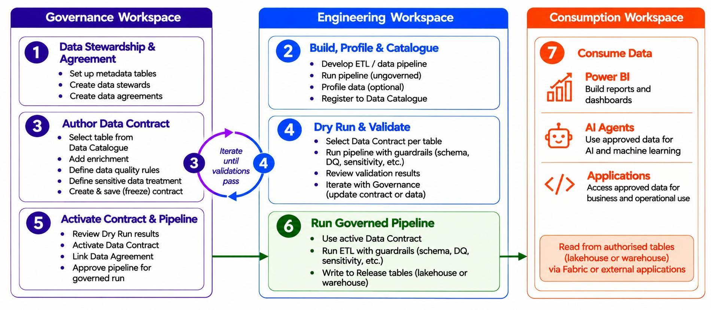

# Governed engineering for Microsoft Fabric

**FabricOps Starter Kit connects reusable notebook pipelines with governance decisions that Engineering can inspect and validate.** Start with the outcome, then go as deep as the implementation requires.

<video class="fabricops-page-video" controls preload="metadata" aria-label="FabricOps Starter Kit overview video">
  <source src="assets/FabricOps_Overview_Video_web.mp4" type="video/mp4">
  Your browser does not support embedded video. <a href="assets/FabricOps_Overview_Video_web.mp4">Open the FabricOps overview video</a>.
</video>

{ .fabricops-home-loop }

FabricOps keeps project-specific PySpark visible between governed boundaries. Governance can work from Engineering observations and profiles; Engineering can trace expectations to exact contract versions and Guardrail Results.

  <a class="fabricops-card fabricops-card--governance" href="governance/">
    <strong>Governance</strong>
    <small>Turn steward decisions, Data Contracts, Enrichment and Guardrails into structured metadata connected to the real engineering flow.</small>
  </a>
  <a class="fabricops-card fabricops-card--engineering" href="engineering/">
    <strong>Engineering</strong>
    <small>Build portable Read → Transform → Write pipelines across Lakehouses and Warehouses, with incremental processing, recovery, profiling and lineage.</small>
  </a>

<a class="fabricops-metadata-preview fabricops-architecture-preview" href="architecture/" aria-label="Explore the FabricOps Architecture">
  
    Architecture
    <strong class="fabricops-metadata-preview__title">See how FabricOps fits together</strong>
    Understand the Governance, Engineering Development, Engineering Production, shared metadata, Data Contract, and consumer relationships.
    Explore Architecture →
  
  
    
  
</a>

<a class="fabricops-metadata-preview" href="reference/metadata/" aria-label="Explore the interactive FabricOps metadata tables map">
  
    Interactive reference
    <strong class="fabricops-metadata-preview__title">Explore the Metadata Tables map</strong>
    See how Governance and Engineering tables connect, then inspect their keys, relationships and schemas.
    Open interactive map →
  
  
    
  
</a>

<a class="fabricops-metadata-preview fabricops-guided-preview" href="guided-demo/" aria-label="Start the seven-step FabricOps Guided Demo">
  
    Guided Demo
    <strong class="fabricops-metadata-preview__title">Run the seven-step FabricOps workflow</strong>
    Prepare Microsoft Fabric, build the pipeline, author and preview Data Contracts, then follow the Production and consumption hand-offs.
    Start Guided Demo →
  
  
    
  
</a>

<section class="fabricops-metadata-preview fabricops-resource-preview" aria-labelledby="download-fabricops-title">
  
    Download FabricOps
    <strong class="fabricops-metadata-preview__title" id="download-fabricops-title">Get the package, notebooks, and demo assets</strong>
    Install the Python package, reuse the notebook templates, and download the demo data used by the Guided Demo.
  
  <nav class="fabricops-preview-menu" aria-label="Download FabricOps resources">
    <a href="releases/">Releases <small>Python package</small></a>
    <a href="https://github.com/Voycepeh/FabricOps-Starter-Kit/tree/main/templates/notebooks">Notebook Templates</a>
    <a href="https://github.com/Voycepeh/FabricOps-Starter-Kit/tree/main/templates/DemoData">Demo Assets</a>
  </nav>
</section>

<section class="fabricops-metadata-preview fabricops-resource-preview" aria-labelledby="reference-documentation-title">
  
    Reference Documentation
    <strong class="fabricops-metadata-preview__title" id="reference-documentation-title">Inspect the implemented FabricOps contracts</strong>
    Explore public functions, Data Quality rules, metadata structures, PySpark guidance, and canonical terminology.
  
  <nav class="fabricops-preview-menu" aria-label="FabricOps reference documentation">
    <a href="reference/">Function Reference</a>
    <a href="reference/dq-rules/">Data Quality Rules</a>
    <a href="reference/metadata/">Metadata Tables</a>
    <a href="reference/pyspark-transformation/">PySpark Transformation</a>
    <a href="glossary/">Glossary</a>
  </nav>
</section>

## What is available today?

Core notebook setup, Fabric I/O, pipeline orchestration, profiling and metadata capture are **Live** public capabilities. Data Contract authoring, activation and AI-assisted authoring remain **Preview**. Governed execution currently fails closed until trusted deployment verification is integrated; use the reference lifecycle labels for the authoritative status of each callable.

