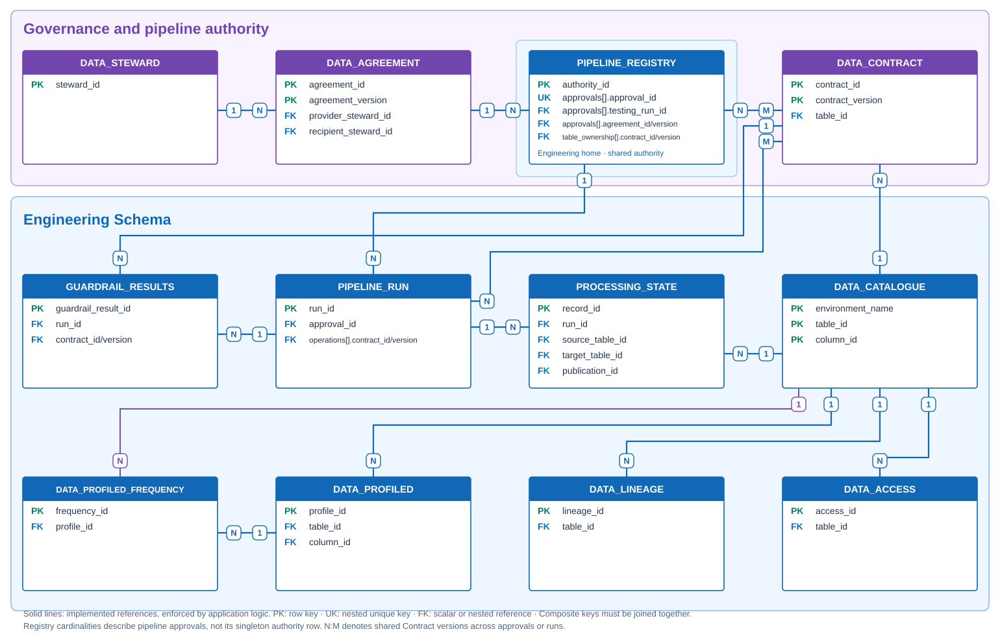
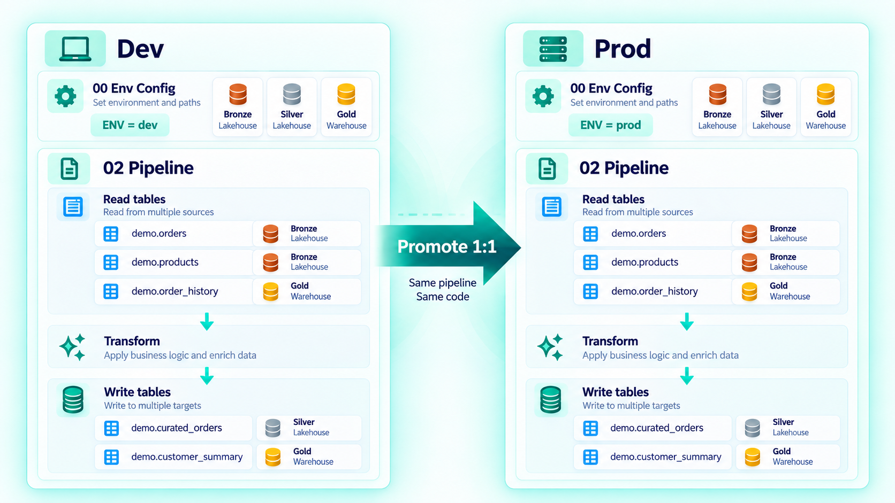
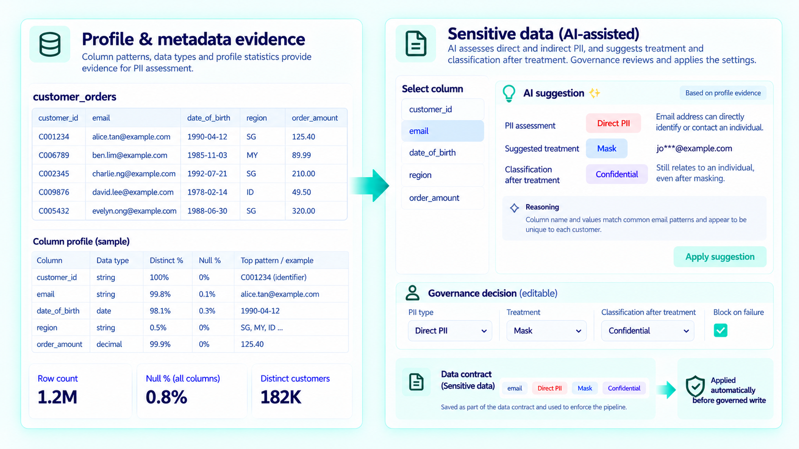
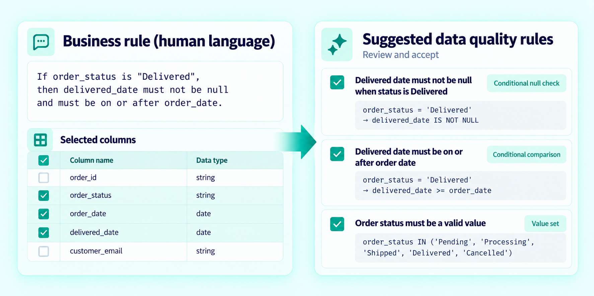

# Microsoft Fabric gives you the platform.
### FabricOps gives you the Plug-and-play Data Engineering and Data Governance foundations.

## Start here

  <a class="fabricops-home-action" href="how-fabricops-works/">
    
      
    
    
      How FabricOps works
      See how Governance and Engineering work together across the FabricOps lifecycle.
    
    →
  </a>

  <a class="fabricops-home-action" href="guided-demo/">
    
      
    
    
      Step-by-step Guided Demo
      Follow practical steps, screenshots, and expected results. Microsoft Fabric access is required.
    
    →
  </a>

<a class="fabricops-metadata-preview" href="reference/metadata/" aria-label="Explore the interactive FabricOps metadata relationship map">
  
    Interactive reference
    <strong class="fabricops-metadata-preview__title">Explore the Metadata Tables map</strong>
    See how Governance and Engineering tables connect, then inspect their keys, relationships and schemas.
    Open interactive map →
  
  
    
  
</a>

<video class="fabricops-home-video" controls preload="metadata" playsinline aria-label="FabricOps overview video">
  <source src="assets/FabricOps_Overview_Video_web.mp4" type="video/mp4">
  Your browser does not support embedded video. <a href="assets/FabricOps_Overview_Video_web.mp4">Open the FabricOps overview video</a>.
</video>

## Featured Solutions

Explore the key capabilities FabricOps provides within that operating model. Each solution includes a walkthrough and implementation context. Live solutions are ready to use; Preview capabilities are still being developed.

  <a class="fabricops-feature-card" href="solutions/plug-and-play-data-pipelines/">LivePlug-and-Play Data Pipelines with Data Contract EnforcementPromote the same pipeline from Development to Production while configuration resolves environment-specific Fabric resources.Explore solution</a>
  <a class="fabricops-feature-card" href="solutions/ai-assisted-data-contract-authoring/">PreviewDirect & Indirect PII Discovery & Treatment with Built-in AI SuggestionsIdentify Direct and Indirect PII, review the suggested classification, and apply governed Mask, Bucket, Tokenize, or Remove treatments. Built-in AI suggestions accelerate authoring while Governance remains in control.Explore solution</a>
  <a class="fabricops-feature-card" href="solutions/business-rules-to-data-quality/">PreviewData Quality Rules from Natural LanguageDescribe what clean data means in natural language and turn one nuanced business requirement into multiple reviewable, deterministic Data Quality rules.Explore solution</a>

## Download FabricOps

Get the Python package, reusable notebook templates, and demo assets to start building. Follow the <a href="guided-demo/">Guided Demo</a> to put them to work.

  <a class="fabricops-home-quicklink" href="releases/">Releases (Python package)</a>
  <a class="fabricops-home-quicklink" href="https://github.com/Voycepeh/FabricOps-Starter-Kit/tree/main/templates/notebooks">Notebook Templates</a>
  <a class="fabricops-home-quicklink" href="https://github.com/Voycepeh/FabricOps-Starter-Kit/tree/main/templates/DemoData">Demo Assets</a>

## Reference Documentation

Explore FabricOps functions, Data Quality rules, metadata structures, and implementation guidance.

  <a class="fabricops-home-quicklink" href="reference/">Function Reference</a>
  <a class="fabricops-home-quicklink" href="reference/dq-rules/">Data Quality Rules</a>
  <a class="fabricops-home-quicklink" href="reference/metadata/">Metadata Tables</a>
  <a class="fabricops-home-quicklink" href="reference/pyspark-transformation/">PySpark Transformation</a>
  <a class="fabricops-home-quicklink" href="glossary/">Glossary</a>

