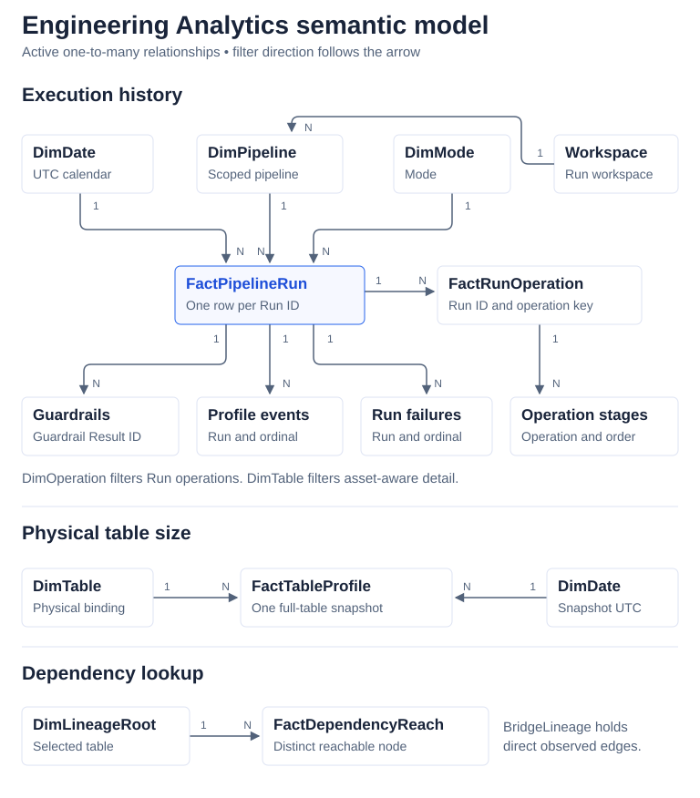

# FabricOps Engineering Analytics Power BI plan

**Approved implementation contract.** Source reviewed at `0d90fed8181c61a11474420a2a894f906a8e3263` on `main`. The report is designed for engineers investigating persisted FabricOps Runs, operation workload, Guardrails, profiling and known dependencies. The Import project lives in [reports/engineering-analytics](../../reports/engineering-analytics/README.md). Production deployment is gated on proving a lossless, refreshable connection to the configured Metadata Lakehouse.

## 1. Release gate and connection

`METADATA_PIPELINE_RUN.operations`, `profiling` and `failures` are Delta STRING values. The writer serializes complete arrays, including bindings, stage results and the profiling journal, with no 8 KB limit. Microsoft documents an 8 KB truncation limit for ordinary Lakehouse Delta strings exposed through the SQL analytics endpoint. A SQL view or cast over a truncated value cannot recover the lost suffix. Treating an invalid array as empty would preserve some headline run counts while silently damaging operation, profiling and dependency results.

Use a narrowly projected **Import** model. The primary candidate is the Microsoft Lakehouse connector with schema navigation enabled, through the Lakehouse route. First prove that Power Query returns the full value from OneLake, honors the active Delta snapshot and refreshes in both Desktop and the Fabric service. Run this probe on metadata written by FabricOps with one multi-operation Run whose `operations` exceeds 8 KB and has a known final operation, and one journal whose `profiling` exceeds 8 KB. Compare UTF-8 byte length, array length, keys and last entry to Spark in the same committed snapshot. Also refresh a Run after its in-place Delta update and check it appears once with its latest values. Confirm schema identification for non-default engineering schemas. The SQL connector remains ineligible without the same proof on every supported endpoint configuration.

Parameterize `MetadataWorkspaceId`, `MetadataLakehouseId` and `EngineeringMetadataSchema` (default `engineering`). Bind them to the `Metadata` store in `00_env_config`. Supply an optional deployment-specific workspace name mapping keyed by workspace ID. Configure source credentials with Microsoft Entra ID and schedule refresh after metadata publication. Disable background refresh for a query where testing shows it can produce mismatched source snapshots. At minimum, monitor cross-table consistency for rows committed during refresh. The imported model is a refresh-time snapshot. Restrict access to engineering readers approved for its execution metadata and runtime identities. The baseline has no implicit workspace security or RLS. Provision separate models or define and verify RLS before sharing across security boundaries.

Direct Lake would require typed projections for JSON expansion, latest status and dependency traversal. Direct Lake on SQL can fall back to DirectQuery for views. Direct Lake on OneLake does not have that fallback. DirectQuery would need validated SQL-side typed projections, lossless access and adequate interactive query performance. Neither removes the ingestion gate. If the native Lakehouse path fails the probe, investigate a supported OneLake Delta access route or seek approval for an explicitly projected Spark-side serving layer. Keep the baseline free of new physical reporting tables.

Microsoft references: [Lakehouse connector](https://learn.microsoft.com/en-us/power-query/connectors/lakehouse), [SQL analytics endpoint limits](https://learn.microsoft.com/en-us/fabric/data-engineering/lakehouse-sql-analytics-endpoint), [Direct Lake security and fallback](https://learn.microsoft.com/en-us/fabric/fundamentals/direct-lake-manage), [PBIP](https://learn.microsoft.com/en-us/power-bi/developer/projects/projects-overview), [PBIR](https://learn.microsoft.com/en-us/power-bi/developer/projects/projects-report), [TMDL project structure](https://learn.microsoft.com/en-us/power-bi/developer/projects/projects-dataset).

## 2. Physical projections and extraction

All physical tables below are in the configured engineering metadata schema (default `engineering`). Use explicit projection as the first table transformation, push source filters where practical and keep staging queries connection-only. Never persist raw JSON in VertiPaq. Full-history refresh is the baseline because Run rows are updated in place and latest status and lineage need retained history. The date slicer limits reporting, independent of storage retention. Apply UTC to native timestamps and parse JSON ISO timestamps as offset-aware before conversion to UTC. Invalid durations or optional timestamps yield blank. Malformed nonempty arrays or conflicting duplicate Run IDs fail refresh with the table and key, without logging payloads.

| Physical table | Exact projected columns and use | Grain, selection and coverage |
| --- | --- | --- |
| `engineering.METADATA_PIPELINE_RUN` | `run_id` for entity key and drillthrough, `pipeline_id` and `workspace_id` for pipeline scope, `execution_mode`, `started_at`, `completed_at`, `status`, `boundary_completed` for activity, outcome and elapsed time, `execution_identity`, `pipeline_version`, `run_schema_version` for provenance, `_notebook_name` as a qualified display fallback, `operations`, `profiling`, `failures` for child facts. | Key `run_id`. Read the authoritative Delta snapshot. Collapse identical repeats and reject conflicting records. Retain incomplete and failed rows. Run version 3 persists execution identity and optional promotion version. Legacy null-version Run data may lack newer fields. Dry Run is diagnostic and does not persist Run rows in the current writer. |
| `engineering.METADATA_GUARDRAIL_RESULTS` | `guardrail_result_id` for grain, `run_id`, `workspace_id`, `table_id`, `source_id`, `table_name` for run and asset, `guardrail_rule_id`, `guardrail_version`, `contract_id`, `contract_version` for exact recorded rule context, `status`, `can_continue`, `severity`, `guardrail_type`, `rule_type`, `action`, `reason` for decisions and safe reason text. | Key `guardrail_result_id`. Keep rows matching a loaded Run on `(run_id, workspace_id)`. Rows from standalone evaluations and mismatched scopes are outside this report. Trim empty identifiers and treat the empty contract ID plus version zero as an absent contract. No join to the current Data Contract. Drop raw reason after extracting approved diagnostic text. |
| `engineering.METADATA_DATA_CATALOGUE` | `metadata_level`, `table_id`, `workspace_id`, `store_type`, `layer`, `schema_name`, `table_name`, `is_active`, `_committed_at`. Use for table-level labels, store details and Catalogue resolution. | Physical grain `(workspace_id, metadata_level, table_id, column_id)`. Filter `metadata_level = 'table'` at extraction. Use the newest commit for each workspace and Table ID. Preserve inactive entries for historical labels and flag their state. Conflicting ties leave Catalogue attributes unknown. There is no guaranteed physical item ID in this table. |
| `engineering.METADATA_DATA_PROFILED` | `profile_snapshot_id`, `table_id`, `workspace_id`, `row_count`, `profile_scope`, `profiling_max_rows`, `_committed_at`. Use for scoped statistical snapshots and physical size. | Physical grain `profile_id`, a row per column per snapshot. Project no per-column data or values. Collapse by `(workspace_id, table_id, profile_snapshot_id)`. Require consistent nonnull row count, explicit `full_table` scope, null row limit and a resolvable physical binding. Derive one timestamp from the matching completed profiling event, with latest column audit commit as fallback only for an independently resolved physical snapshot. |

Excluded sources:

| Inspected source | Keys and reason for exclusion |
| --- | --- |
| `engineering.METADATA_DATA_LINEAGE` | `lineage_id` keys table and role participation in an activity, with a workspace predicate on upserts. It has no per-write association identifying which source fed which target. Operation JSON supplies the actual recorded associations. |
| `engineering.METADATA_PROCESSING_STATE` | `record_id` keys typed source observations, checkpoints, baselines and publication receipts. Receipts support target recovery and state progress. They do not supply general per-mode operation telemetry. Source columns loaded from this table: none. |
| Other metadata | Frequency distributions, Data Contracts and governance snapshots, failed-row samples, business values, query text, audit writer and raw configuration are outside the projection. |

### Run JSON projection

| JSON location | Paths retained, type and use |
| --- | --- |
| `operations[]` | Strings `operation_key`, `table_id`, `source_id`, `source_type`, `pipeline_role`, `status`, `read_mode`, `write_mode`, `publication_status` for identity, workload and outcomes. `started_at`, `completed_at` are nullable timestamps. Keep `contract_id` string, `contract_version` integer for provenance and `query_sha256` string only in staging for comparable query cohorts. Use `source_table_ids[]` and `source_ids[]` as typed source references for the dependency graph. Read top-level `rows_read` and `rows_written` as legacy fallbacks for the same metric, never added to nested counts. |
| `operations[].destination` | Strings `workspace_id`, `item_id`, `kind`, `schema`, `table_name` for table binding. For Files use the workspace/item and `file_format` with `source_id`. A configured safe label or a short Source ID provides the display fallback. Raw relative paths, URLs, reader options, parameters and query details stay out of the model. |
| `operations[].metrics` | Nullable 64-bit integers `rows_read`, `columns`, `input_rows`, `rows_committed`, `rows_inserted`, `rows_updated`, `rows_unchanged`, `versions_inserted`, `versions_expired`, `total_target_rows`, `file_count`, `output_bytes`. `measurement_source` is a nullable string. Check that duplicate top-level and nested counts agree where both present. Conflicts yield unavailable counts and a data validation failure in tests. |
| `operations[].stages[]` | Preserve array ordinal and string `stage`, `status`, `evaluation_status`. The writer strips stage elapsed time and a failing call can exit before its local stage list is copied into the Run. Missing stages mean no persisted stage outcome. |
| `profiling[]` | Strings `context_key`, `activity`, `status`, `profile_snapshot_id`, `reason`, `table_id`, `profile_scope`, `trigger`, `workspace_id`, `pipeline_run_id`, `physical.workspace_id`, `physical.item_id`, `physical.kind`, `physical.schema`, `physical.table_name`. Current canonical event schema has **no** `source_id`. Project no such field in this implementation. Booleans `results_persisted`, `empty_result`, integers `row_count`, `profiling_max_rows`, ISO strings `executed_at`, `completed_at`. Array ordinal identifies the recorded event. Preserve file profiling context without creating an asset FK where the file evidence has no typed ID. |
| `failures[]` | Array ordinal, `code` and `exception_type` strings. Keep original codes. The metadata does not retain detailed exception messages. |

Free-form Guardrail reasons can contain unexpected values because the generic writer accepts `result.reason` or `result.message`. Keep only verified diagnostic patterns such as the DQ aggregate count and tolerance sentence, or exact allowlisted writer reason codes and messages. Apply the same rule to profiling reasons. Show “Reason withheld” for other nonempty reasons and “Not captured” for missing values. Status and continuation remain visible in both cases.

## 3. Semantic model

The execution model has single-direction dimensions and a unique Run header that filters Run children. Operation, Guardrail, profiling and failure tables are never expanded into a common rowset. The physical asset and dependency views use separate keys from execution workspace.

Use structured, collision-safe serialized tuples for composite keys. Normalize GUIDs to lowercase, preserve recorded identifier semantics for names, and ensure generated text keys cannot differ only by case in VertiPaq. Never coalesce an absent File Source ID to a Table ID or vice versa. Physical table identity uses `(destination.workspace_id, destination.item_id, kind, schema, table_name)`. Execution code derives the logical Table ID from store kind, store alias, schema and table name without the workspace. Resolve references first within the same Run using matching typed participant IDs and a unique embedded binding. Resolve Catalogue labels through unambiguous mappings from execution workspace plus Table ID to a binding. For historical Catalogue or Profiled rows where an alias was rebound, require exact snapshot evidence or show an unresolved scoped asset and exclude the row from physical size and dependency counts. Never infer asset workspace from execution workspace or audit workspace. A configured workspace name takes precedence, with `Workspace <short ID>` and the full ID available when unmapped. A pipeline uses its configured display name when present, otherwise logical ID and workspace. The latest notebook name is descriptive metadata and does not group pipelines.

| Model table | Source and grain | Primary key and row treatment |
| --- | --- | --- |
| DimDate | UTC calendar spanning retained run dates, snapshot dates and refresh day. | Date. Mark date table and disable auto date/time. |
| DimWorkspace | Run execution workspace IDs plus optional deployment mapping. | Workspace ID. Reject duplicate conflicting display mappings. Workspace on DimTable describes the asset location. |
| DimPipeline | Distinct execution workspace and pipeline combinations. Holds latest Run ID, outcome, started time and elapsed time computed at refresh over the entire retained history. | PipelineKey. Rank Run start UTC descending, then Run ID ascending as deterministic tie-breaker. One exact current Run per pipeline. |
| DimMode | Distinct recorded execution modes. | Mode. Keep unknown modes as recorded and classify them as outside current success semantics. |
| FactPipelineRun | Run parent, one authoritative Run. | Run ID. Include UTC start and completion, reporting date, duration, run state group, identity, version and boundary. |
| FactRunOperation | One declared Read or Write participant in a Run, including recorded `not_started` members. | `(Run ID, operation_key)`. Reject duplicates. Keep actual status, role, binding, mode and metrics. Resolve AssetKey or leave it null. |
| DimOperation | Distinct pipeline, operation role/key, physical binding and recorded operation mode. | OperationSeriesKey. Include a readable role, target/source and mode label. A changed binding or strategy starts a separate series. Query hash is a separate comparison criterion. |
| FactOperationStage | One persisted stage outcome. | `(OperationKey, stage ordinal)`. Ordinal preserves written order, including repeated names if the retained record permits them. |
| FactGuardrailResult | One persisted Guardrail result belonging to a matching Run. | Guardrail Result ID. Deduplicate identical repeats. Match asset from the Run only if every matching operation identifies the same asset. Operation filters are disabled for this visual. |
| FactProfileEvent | One profiling journal row. | `(Run ID, event ordinal)`. Preserve running and terminal entries. Count completed/failed activities from terminal entries only. Resolve assets from recorded physical evidence when available. |
| FactRunFailure | One retained code and exception type. | `(Run ID, failure ordinal)`. Build a separate concatenated code summary per Run for the run list. |
| DimTable | Unique physical table bindings observed in Runs, with Catalogue enrichment and scoped unresolved Catalogue placeholders. | AssetKey. Table slicers show resolved binding or clearly identify scoped unresolved Catalogue assets. File operations retain their typed Source ID separately. |
| FactTableProfile | One verified physical full-table snapshot. | `(AssetKey, profile_snapshot_id)`. The conservative baseline includes standard profiling snapshots matched by exact Run event snapshot ID and physical binding. Show other Profiled snapshots only after independent physical identity is verified. |
| DimLineageRoot | Report selector for known table nodes. | Physical table AssetKey. Include readable asset and workspace label. |
| BridgeLineage | Current direct dependency associations and first/last observed dates. | `(source typed asset, pipeline key, target typed asset)`. Use a separate explicit unresolved status for missing/ambiguous prerequisites. |
| FactDependencyReach | One reachable upstream or downstream asset or pipeline for each root table. | `(RootKey, Direction, NodeType, ReachableKey)`. Store shortest table-hop distance and direct flag. |

### Active relationship matrix

Every physical relationship listed below is active, one to many and single-direction from left to right. The Run parent is unique and cross-filters detail only. Shared child selections do not reverse-filter the Run header. No inactive physical relationships are required.

| One side | Many side | Join and filter purpose |
| --- | --- | --- |
| DimWorkspace | DimPipeline | Execution Workspace ID, never asset workspace. |
| DimPipeline | FactPipelineRun | PipelineKey. |
| DimMode | FactPipelineRun | Recorded execution mode. |
| DimDate | FactPipelineRun, FactTableProfile | UTC Run start date and UTC snapshot date respectively. |
| FactPipelineRun | FactRunOperation, FactGuardrailResult, FactProfileEvent, FactRunFailure | Run ID after each source has verified its execution workspace. |
| DimOperation | FactRunOperation | OperationSeriesKey. |
| FactRunOperation | FactOperationStage | Composite run-operation key. |
| DimTable | FactRunOperation, FactGuardrailResult, FactProfileEvent, FactTableProfile | Resolved physical AssetKey. No forced match on missing or ambiguous items. |
| DimLineageRoot | FactDependencyReach | RootKey. |
| DimPipeline | BridgeLineage | PipelineKey for direct relationship search. |
| DimTable | BridgeLineage | Source or target role is selected with explicit measure filters and `TREATAS`. This is a virtual relationship. |
| DimLineageRoot | BridgeLineage | Virtual filter by membership of the selected root's reachable node set, including the root, on both endpoints. No direct filter from execution date to current topology. |

Date, Workspace, Pipeline, Execution Mode and Table are the visible context filters. Use a native relative Date slicer saved to last 30 calendar days (including today), with built-in presets via 7/30/90-day bookmarks scoped to that slicer. Sync historical filters on Overview, Pipeline Detail and Table Analytics. Sync the table context only where comparable. Table selection filters historical Run measures using a distinct Run ID set from matching started operations and `TREATAS` into the Run header. Apply no operation-volume weighting to Run counts. Current latest status ignores date and mode; restrict only the displayed pipeline population by explicitly selected workspace/pipeline, and optionally by assets that started in that pipeline's current Run. Annotate its separate scope on the Overview. Standalone full-table size is independent of execution mode and pipeline selectors. Lineage root and relationship search are independent of execution date and mode.

### Dependency graph

Build edges from the supplied `source_table_ids[]` or `source_ids[]` on each actual target operation. Keep no Cartesian expansion of reads by writes. Deduplicate by typed endpoints and pipeline. Maintain observed bounds across Run history and expose the current observed topology using each pipeline's latest **complete successful Run**. An incomplete or failed newer Run does not overwrite that evidence. Label the reference Run and observation time. An empty target membership in a successful read-only Run clears that pipeline's current edges. Failed-run exposure starts at the selected Run's started, recorded target assets. Describe reachability from each output separately. Run failure remains a property of its Run. A target with no known source bindings is listed with unresolved source status where applicable. Keep files typed and visible as direct relationships where the recorded binding is resolved.

Traverse the graph at refresh using breadth-first search per resolved root with a visited set. Expand a recorded source-to-target association as one dependency hop through its owning pipeline. Preserve pipeline and table as separate nodes in the lookup, with pipeline observations keyed by PipelineKey. For a table reached by converging paths store its minimum hop count exactly once. Exclude the root from downstream table metrics even when a cycle reaches it. `Maximum Downstream Depth` is the maximum of these minimum distances. Track pipelines encountered along reachable edges once even when they feed multiple tables. Include resolved File nodes in adjacency for known paths where allowed, and exclude them from table counts. Unresolved edges never create reachability. Validate closure size on real metadata before increasing refresh frequency. If a configured resource limit prevents complete traversal, fail refresh without a partial closure. For inspection of the complete known network, compute a separate upstream reachability traversal by reversing the same edges. Include Direction in the reachability key and apply downstream-only predicates to dependency cards. Use a native relationship table and a direction/hop-grouped dependency matrix for the baseline. A graph requires verifying AppSource licensing, export support, security/admin approval and filtering behaviour. Use legible, left-to-right unweighted connections and separate node roles before considering adoption.

## 4. Measure catalogue

**S** supported persisted facts, **D** derived, **C** conditional coverage, **U** unavailable. Point durations and snapshot sizes require one observation and return blank at totals. Count cards show zero for an empty valid selection and blank without a required singleton selection. Sum known values within compatible cohorts. A missing observation remains blank, a recorded zero stays zero, and totals of reported operations do not imply distinct business rows.

| Measure | Class | Source, calculation, aggregation and filters | Expected check |
| --- | --- | --- | --- |
| Run Count | D | DISTINCTCOUNT of Run ID under UTC start date, execution workspace, pipeline, mode and optional matched table membership. Recompute at each date grain. | Two runs with three operations each count as 2. |
| Unique Pipelines | D | DISTINCTCOUNT of PipelineKey in that Run set. Recompute per date bin and over the entire period. | Same pipeline ID in two workspaces counts as 2. |
| Successful Runs | D | Run Count where status is succeeded or ungoverned_completed and the completion and completed boundary are recorded. | One of each counts as 2. |
| Failed Runs | S | Run Count where status is failed. The completion time can be missing. | Monday failure stays in Monday history after Tuesday succeeds. |
| Incomplete Runs | S | Run Count where status is incomplete, including incomplete finalization. | Incomplete with an end time still counts as incomplete. |
| Current Failed Pipelines | D | Count DimPipeline entries whose latest Run is failed across all retained starts and modes. Respect current pipeline population in §3. | After recovery, the historical failure's date filter still yields zero current failures. |
| Run Success Rate | D | DIVIDE(Successful Runs, Successful Runs + Failed Runs) under historical scope. Exclude incomplete, diagnostic and unknown states. | Two successes, one failed, one incomplete give 66.7%. No eligible outcomes gives blank. |
| Latest Status, Latest Run Start UTC, Latest Run Duration Seconds | D | Single selected pipeline, from its refresh-time latest Run attributes. Fetch failure summary and latest volumes using that exact Run ID. | Two tied timestamps select one deterministic ID. |
| Pipeline Duration Seconds | D | At one Run ID, UTC elapsed completion minus start, in fractional seconds. Return blank for invalid, negative or missing endpoints. | Ten and a quarter seconds gives 10.25. |
| Operation Duration Seconds | D | Same elapsed calculation at an exact started RunOperation key with its own timestamps. | Missing start is blank. Operation durations do not add to wall time. |
| Previous Period Duration | C | Label Previous comparable duration (s). At one successful timed operation find the immediately preceding successful timed observation within the selected comparison window, for the same execution workspace, pipeline, binding, role, operation mode, execution mode, query signature and governed version. For run comparisons also match the sorted recorded participant and mode signature. Require known comparison keys. Break time ties using the Run order key. The comparison controls telemetry cohort, while input volumes remain visible for context. | A 12 s overwrite supplies no baseline to an append. Two comparable appends at 4 s and 6 s give a 4 s baseline for the second. |
| Duration Change Seconds, Duration Change Percent | D | Current elapsed minus comparable elapsed, and DIVIDE(change, comparable elapsed). Show both side by side. Missing baseline means both blank. | 6 s vs 4 s gives +2 s and +50%. A zero baseline gives absolute change and blank percent. |
| Started Operations | D | Count distinct run-operation keys with a start timestamp, by Run start date and selected role or series. Failed attempts with a start qualify. | A declared unstarted target adds zero. |

### Volume and mode applicability

Volume points are per started operation. Additive totals may be used within one exact operation mode and compatible asset type. Separate per-strategy write totals or show blank if the visual has no compatible scope. Filter by Read or Write role and expose the recorded measurement source. A physical size is always a point value.

| Measure | Class | Source, calculation and filter | Expected check |
| --- | --- | --- | --- |
| Rows Read | C | Nested rows_read, falling back to the identical legacy top-level value. Sum reported rows per compatible read mode. Preserve writer-measured full-table backfill where present. | Lazy query missing a count stays blank. |
| Input Rows | C | metrics.input_rows, sum reported values per strategy. Input scope follows measurement source. | Input 200 and committed 0 are distinct. |
| Rows Committed | C | metrics.rows_committed with legacy rows_written fallback. Sum within strategy. SCD2 can include expired and inserted versions. | Overwrite 1,000,000 committed adds no inserted rows. |
| Rows Inserted | C | metrics.rows_inserted for append variants and SCD1. Sum per strategy. | A measured no-unseen-hashes append shows 0. |
| Rows Updated | C | metrics.rows_updated for SCD1. | 15 inserted, 70 updated, 15 unchanged gives 70 updated. |
| Rows Unchanged | C | metrics.rows_unchanged in SCD1/SCD2 separately. | SCD1 example gives 15. |
| Versions Inserted | C | metrics.versions_inserted for SCD2. | 4 inserted and 3 expired reports 4. |
| Versions Expired | C | metrics.versions_expired for SCD2. | Same example reports 3, independent of inserts. |
| Total Target Rows | C | One operation's metrics.total_target_rows only when matching full-table write profile evidence verifies the value and physical binding. A changed alias is a separate asset. | No size from a bounded profile or volume-only overwrite. |
| Output Files, Output Bytes | C | Independent metrics.file_count and metrics.output_bytes at file operation grain. Totals only if validated as compatible publication deltas. | Two files and 3,000 bytes stay separate. |
| No-change Appends | C | Count started append_new_only operations with measurement_source no_unseen_hashes and explicit zero inserts and commits. | Already applied and empty incremental scope remain separate from no unseen hashes. |

| Strategy | Meaningful when recorded | Limits |
| --- | --- | --- |
| append_all | Input, committed, inserted, elapsed. | Updated, unchanged and versions unavailable. |
| append_new_only | Input, committed, inserted, explicit no-change occurrence, elapsed. | A measured zero is a valid outcome. No percentage without compatible input measurement. |
| overwrite | Input, committed, verified full target size, elapsed. | Replacement rows cannot be interpreted as newly inserted. |
| scd1 | Input, committed, inserted, updated, unchanged, elapsed. | Stack only when components are present, share one measured execution transaction and sum to input. Recovery and partial counts stay outside composition. |
| scd2 | Input, committed, inserted versions, expired versions, unchanged, elapsed. | Expiration and insertion can describe the same change. Show separate measures. |
| historical append | Retained compatible measurements and elapsed. | Preserve exact historical label distinct from append_all. |
| Files | Elapsed, file publication status, file count, bytes, optional measured input. Preserve overwrite, append, append_all, errorifexists and ignore as recorded. | Current filesystem writer leaves committed rows unknown. SCD and physical table size do not apply. Table publication status is not serialized by the current Run writer. |

### Checks, profiling and dependencies

| Measure | Class | Source, aggregation and filters | Expected check |
| --- | --- | --- | --- |
| Checks Evaluated | D | Distinct Guardrail Result IDs with evaluated statuses allowed by guardrail type. Include passed, warning, failed, blocked, and actual Source Drift comparisons no_change and changes_detected. Exclude not_run, not_due, baseline_pending, skipped, unrecognized statuses and contract_validation completion markers. Filter by Run start date and matched asset. | A DQ result on a table used by both Read and Write counts once. |
| Checks Failed | D | Evaluated Guardrail IDs with exact failed status. | Warning adds zero to failed. |
| Checks Blocked | S | Guardrail IDs where can_continue is false. This may overlap failed. An action label alone is insufficient. | Passed blocking rule contributes 0. Noncontinuable failure contributes 1. |
| Stage Outcome Counts | S | Count stage rows by recorded name, status and evaluation status under Run and operation scope. Keep aggregate rule outcomes separate. | One stage can contain multiple Guardrail results. |
| Profiling Activities | D | Count terminal passed and failed profiling entries per Run and asset. Running and skipped are separately visible in the journal. | Running followed by passed counts as 1, regardless of column count. |
| Profiled Table Row Count | C | Return the consistent row count for one eligible physical asset and snapshot. Use snapshot UTC date. | Four column rows each reporting 150 show one point at 150. |
| Table Row Count Change, Table Row Count Change Percent | C | Compare to previous eligible snapshot for the same binding inside the displayed date window. Sort by timestamp and snapshot ID. Apply safe difference and division. | 150 to 180 gives +30 and +20%. Unknown baseline remains blank. |
| Direct Downstream Tables | D | Distinct resolved downstream tables at shortest hop 1 for one root, excluding root. | Two pipelines from A to B count B once. |
| Total Downstream Tables | D | Distinct resolved downstream tables at any hop, excluding root. | A to B/C, both to D, gives 3. |
| Downstream Pipelines | D | Distinct scoped pipeline keys on traversed edges for one root. | A pipeline feeding multiple targets counts once. |
| Maximum Downstream Depth | D | Max shortest hop to a reachable physical table. Zero for isolated known root, blank without one selected root. | D is two hops away. Adding D to A changes neither depth nor count. |

Unavailable (U) telemetry includes historical stage duration, live scheduler state, unpersisted stage outcomes, detailed exception messages, confirmed downstream failure attribution and a verifiable Fabric Run deep link. An activity ID by itself does not establish a supported URL. Profile counts without reliable whole-table coverage stay out of the physical size series.

## 5. Visual catalogue

Use 1440 × 1000 canvases, shared native page navigation and slicer positions, off-white surfaces, Segoe UI and engineering blue. Reserve red and green for actual recorded failure and success. Default to Filter interactions where semantically compatible. Presets use scoped bookmarks to select 7, 30 or 90 calendar days. Keep non-additive totals off. Status captions indicate scope and date axes indicate UTC.

By Run on a line chart means a unique, chronologically ordered Run observation. If timestamp collides or the visual cannot accept an exact Run key, use a unique categorical label sorted by chronological index. UTC timestamp and Run ID remain in tooltips. Snapshot axes apply the same pattern. Each marker represents a raw observation. Use gaps for missing values and single-select inputs where required. Shared slices apply as in §3. A point click filters the corresponding history when a Run key is available.

| Page and title, class | Native visual and field mappings | Tooltip, interaction, drillthrough and empty behavior |
| --- | --- | --- |
| History pages / Date, Workspace, Pipeline, Execution Mode, Table (D) | One relative date slicer, scoped preset buttons and searchable dimension dropdowns. | Sync historical contexts. Require one scoped pipeline on Pipeline Detail and one table on Table Analytics. Show selection instructions for empty required selections. |
| Overview / Execution activity (D) | Multi-metric card for Unique Pipelines, Run Count, Successful Runs, Failed Runs, Incomplete Runs and Run Success Rate. | Historical scope. Empty counts 0, rate blank. |
| Overview / Current failed pipelines (D) | Card for Current Failed Pipelines. | Latest recorded Run across all retained dates and modes. No historical filter action on this card. |
| Overview / Active pipelines by day (D) | Line. X UTC date, Y Unique Pipelines, no legend. | Daily Run Count. Date point filters historical activity only. |
| Overview / Run outcomes by day (D) | Stacked column. X UTC date, Y Run Count, legend Run outcome group. | Success, Failed, Incomplete and Other series with corresponding counts. Selection filters historical activity. |
| Overview / Latest Run by pipeline (D/C) | Table. Workspace, pipeline, latest status, start, duration, started Reads/Writes, recorded Rows Read and compatible per-mode write metrics, failure code summary and Latest Run ID. | Use current scope. Table-backed conditional colors for status. Navigate via exact PipelineKey or Latest Run ID. A native latest-run drillthrough button needs verification of exact key binding. |
| Pipeline / Elapsed time by Run (D) | Line with markers. X By Run, Y Pipeline Duration Seconds. | Run ID, start, workspace, identity, mode, status, previous comparable duration, both changes. One pipeline. Missing time yields no point. |
| Pipeline / Elapsed time by operation (D) | Multi-series line. X By Run, Y Operation Duration Seconds, legend operation series with role, binding and mode. | Operation and Run, start, exact mode, outcome and both changes. Searchable operation selector limits series. |
| Pipeline / Rows read by source (C) | Multi-series line. X By Run, Y Rows Read, legend read series. | Exact mode and measurement source. Blank observations shown as gaps. |
| Pipeline / Write volume by target (C) | Multi-series line. X By Run, legend target series, Y single-select native field parameter for the write volume measures. | Native write strategy filter. Title includes metric and unit. Tooltip input rows, publication status if captured, strategy and measurement source. Use no available measurement caption for inapplicable metrics. |
| Pipeline / SCD1 write composition (C) | Stacked column. X By Run, Y inserted, updated, unchanged from eligible SCD1 observations. | Input and measurement source. Require one target series and compatible SCD1 values. Blank with explanation otherwise. |
| Pipeline / Recent Runs (S/D) | Table ordered UTC start then Run ID. Status, workspace, time, pipeline elapsed, Started Operations, identity and failure codes. | Use exact Run ID field for drillthrough. Empty on no matching Runs. |
| Table / Asset identity (S/C) | Multi-field card. Schema and table name, store kind/layer, physical workspace and technical item identity. | Require one physical asset, with unresolved bindings explicitly labelled. |
| Table / Full-table row count (C) | Line with markers. X sorted snapshot observation, Y Profiled Table Row Count. | Snapshot ID, UTC, scope, absolute and percent change. Date/table context only. No measured snapshots caption when empty. |
| Table / Table activity by day (D) | Stacked column. X Run UTC date, Y Started Operations, legend Read/Write. | Show recorded status counts in tooltips. Date point filters operation history. |
| Table / Write volume over time (C) | Multi-series line. X By Run, Y selected write volume metric, legend scoped pipeline and write operation/mode. | Same strategy and metric controls as Pipeline. One point per series and Run. Tooltip input and measurement source. |
| Table / Write elapsed time (D) | Multi-series line. X By Run, Y Operation Duration Seconds, legend workspace/pipeline/operation/mode. | Raw durations and comparable changes. Missing observations stay blank. |
| Table / Recent table operations (S/C) | Table. Run ID, role, operation, pipeline, workspace, timestamps, identity, elapsed, mode, status and reported rows. | Filter to started operations. Drillthrough to exact Run ID. |
| Table / Recorded checks and Run failures (S/C) | Guardrail result table with Run ID, type, rule, status, severity, continuation and safe reason. Separate failed Run list with failure codes where exact membership qualifies. | Run and asset filters apply. No speculative join between operation and Guardrail. Blank when no retained outcomes. |
| Table / Dependencies (D) | Native button to lineage with asset drillthrough where validated. | Use matching physical root key; otherwise select the asset on lineage. |
| Lineage / Downstream counts (D) | Four metrics in a card. Direct Downstream Tables, Total Downstream Tables, Downstream Pipelines, Maximum Downstream Depth. Single-select searchable root dropdown. | Date and mode independent. Zero for an isolated known root. |
| Lineage / Dependency relationships (D) | Table. Source label/workspace, pipeline/workspace, target label/workspace, reference Run, first/last observed UTC and resolution. Native searchable endpoint slicers. | Root scope filters to known upstream and downstream network; no root shows direct relationships. Missing endpoints remain explicitly unresolved. |
| Lineage / Known dependency network (D) | Matrix. Rows Direction → Hop → Node Type → Reachable Node, values direct flag and observed date bounds where known. | Expand/collapse by hop. Display one entry per reachable node with known node type. Caption for no known dependencies. |
| Run Detail / Run identity and timing (S/D) | Multi-field card. Exact Run ID, pipeline/workspace, identity, start/end, duration, execution mode, pipeline version, boundary. Native Back button. | Hidden page, exact Run ID drillthrough. Keep all filters disabled to avoid a date/mode selection hiding the selected Run. |
| Run Detail / Operations and Stages (S/C) | Two tables. Operations show role, identity, mode, timestamps, outcome, elapsed and row measurements. Stages show operation, ordinal, name, status and evaluation status. | Operation table filters stage table only. Missing stage data is uncaptured. |
| Run Detail / Guardrail outcomes (S) | Table. Asset, type/rule, exact contract and version, status, severity, action, continuation and safe reason. | Run scope. No operation filter. |
| Run Detail / Profiling journal (S/C) | Table. Event ordinal, asset or context, trigger, activity, status, persistence, snapshot, completion, scope, rows, limit and safe reason. | Run scope. Running, skipped and terminal outcomes remain distinguishable. |
| Run Detail / Failures and downstream scope (S/D) | Code/exception table and separate matrix grouped by selected Run's output asset, hop and downstream table/pipeline. | Use only that Run's started target roots. Label dependency reachability as potential exposure. Empty when no known output or no recorded failure. |

The network graph is U for the baseline. The native table and matrix provide the known network without a custom visual. Before adding an AppSource graph, validate security and admin policy, cost/licensing, export and filter behavior. Require a legible left-to-right unweighted layout with pipeline and table nodes distinct.

## 6. Acceptance and validation

| Gate | Evidence required |
| --- | --- |
| Schema and ingestion | Compare projections with physical and logical registries. Validate current and legacy JSON, multi-operation Runs, offset timestamps, missing optional metrics and the long-payload/idempotent snapshot probes in §1. |
| Grain and graph | Validate one Run per ID, exact operation membership, unchanged Guardrail counts if a table appears twice, one profile count across column rows, changed alias binding, repeated dependency edges, converging paths, cycle termination, file sources and unresolved identities. |
| Measures | Execute the catalogue examples in DAX against an imported synthetic fixture. Include same-day and same-timestamp Runs, missing operation times, mode changes, overwrite, append with zero inserts, SCD1 and SCD2, full-table and bounded profiles, recovery and cross-workspace pipeline reuse. |
| PBIP and PBIR | Start from a small Desktop-authored baseline. Validate report definitions against declared public JSON schemas, including transitive references. Parse TMDL using Microsoft's Tabular Object Model TMDL serializer and check all relationships, DAX references and visual field bindings. |
| Desktop and Fabric | Open and refresh the PBIP, validate cardinality and plotted point counts, check each mode, all slicers, date-independent latest status, drillthrough keys, empty states and live service refresh. Test authentication and downstream closure size under expected production history. |

### Project tree

~~~text
docs/maintainer/
  engineering-analytics-powerbi-plan.md
  engineering-analytics-powerbi-model.svg
reports/engineering-analytics/
  .gitignore
  README.md
  FabricOps Engineering Analytics.pbip
  FabricOps Engineering Analytics.Report/
    definition.pbir
    definition/
      version.json
      report.json
      pages/
        pages.json
        <page-id>/page.json
        <page-id>/visuals/<visual-id>/visual.json
      bookmarks/
  FabricOps Engineering Analytics.SemanticModel/
    definition.pbism
    definition/
      database.tmdl
      model.tmdl
      expressions.tmdl
      relationships.tmdl
      tables/*.tmdl
  tests/
    validate_project.py
~~~

The PBIP implements the native Lakehouse Import route and rejects malformed required arrays. Desktop rendering, connector runtime checks and service refresh remain deployment acceptance tests.

### Completed design validation

- Checked the proposed four physical projections against `metadata_table_schema_registry()`. Verified nested stage shape and the absence of a typed File Source ID in the profiling event schema.
- Exercised the repository Run fixture and production Run serializer locally. A synthetic 16-operation Run had a 17,681-byte operations array. Its synthetic 40-entry profiling journal required 13,681 bytes. Both full payloads parsed at the expected grain. Slicing each to the documented SQL byte ceiling caused JSON parsing to fail. This simulates truncation locally. Fabric endpoint transport was not tested.
- The 78 existing focused unit tests for Run records, Run persistence evidence, profiling observations and finalize summaries passed. These validate source behavior and do not exercise Power Query, DAX, PBIR or live refresh.

### Implemented behavior to verify in Desktop

The report uses a table for the selected physical asset and for the Run header so technical fields remain inspectable. The Run history and Overview latest Runs expose native drillthrough on the exact Run ID. Table Analytics opens the lineage page, where the root is selected independently. File outputs remain typed and are available in operation and direct dependency views, while the lineage root selector is for physical tables. Complete dependency reachability uses the native matrix.

### Static implementation verification

Microsoft Tabular Object Model deserialized the TMDL database with 17 tables, 17 active single-direction relationships and 78 measures. Microsoft's Power Query parser accepted the embedded M queries and partitions. The checked-in validator passed 106 public JSON definitions, visual bindings on all five pages, relationship endpoints and static DAX field references. The four physical projections matched their canonical schema columns. The 78 focused FabricOps tests passed again.

These checks cover project structure and source contracts. DAX results, Power Query execution, connector losslessness, visual rendering, selected-visual bookmark behavior, drillthrough and scheduled service refresh require the Desktop and Fabric acceptance run in the [project README](../../reports/engineering-analytics/README.md).
