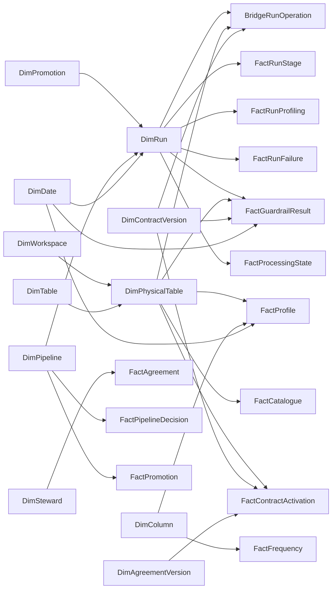

# Power BI operating report design

This blueprint defines the report experience and semantic model for a shared Governance and Engineering view of FabricOps metadata.

## Outcome

**The report should answer one question first: is governed data operating as intended?**

Governance and Engineering should start from the same portfolio view, use the same definitions, and move from a visible exception to the exact Data Contract, approval, deployment, run, table, or Guardrail record that explains it. The report is an operational lens over the Metadata Lakehouse; it is not a second governance system and must not create reporting copies of canonical metadata.

The first implementation should ship as a Power BI Desktop Project (`.pbip`) with a PBIR report definition and a TMDL semantic model. It should connect to the configured Governance and Engineering schemas through the Fabric Lakehouse SQL analytics endpoint and use Import mode.

## Audience and decisions

| Audience | Start with | Decisions supported |
| --- | --- | --- |
| Governance | Coverage, approvals, policy outcomes and exceptions | Which physical tables are protected, which exact Contract and Agreement apply, which submissions need a decision, and where Guardrails are blocking or warning. |
| Engineering | Deployments, runs, operations and processing health | Which approved implementation is active, whether the expected version ran, where a run or operation failed, and which table or processing record needs attention. |
| Shared review | Portfolio status and hand-off gaps | Whether Governance approval, Engineering promotion and runtime execution describe one consistent operating state. |

The report should make the hand-off visible rather than presenting Governance and Engineering as separate dashboards:

```text
Table evidence -> frozen Contract -> physical Contract activation
                                      |
Saved pipeline submission -> Governance decision -> Engineering promotion -> Pipeline Run
                                      |                    |                 |
                               approved package     deployed version   operations and results
```

## Experience principles

1. **Shared overview, role-specific depth.** Both audiences land on the same Command Center. Governance and Engineering bookmarks may change emphasis, but they must not change metric definitions.
2. **Exceptions before inventory.** Lead with missing coverage, expired decisions, blocked Guardrails, failed runs, incomplete completion boundaries and stale evidence. Keep full inventories behind drill-through or detail pages.
3. **Exact identities everywhere.** Tooltips and detail tables expose `table_id`, workspace ID, Contract ID/version, Agreement ID/version, approval ID, promotion ID, Pipeline ID/version and run ID as applicable.
4. **State and time are explicit.** Labels distinguish current selections from history, event time from commit time, and latest observations from authoritative decisions.
5. **No inferred authority.** A Frozen Contract is not an activation. A Pipeline Registry row is deployment evidence, not Governance approval. An observed access row is not effective authorization.
6. **One-click traceability.** Every exception should drill to Asset 360 or Pipeline 360 with the relevant filters preserved.

## Look and feel

**Use a calm operations-console style with FabricOps role colors, restrained status colors and generous whitespace.**

| Element | Standard |
| --- | --- |
| Canvas | 16:9, light neutral `#F5F7FB`, 12-column grid, 24 px outer margin. |
| Surfaces | White cards, 8 px radius, 1 px `#E2E8F0` border, no decorative shadows. |
| Shared accent | FabricOps teal `#0F8F83` for navigation, selected state and neutral highlights. |
| Governance | Purple `#7952B3` for authored policy, activation and approval. |
| Engineering | Blue `#1168B6` for deployment, execution and technical observations. |
| Status | Green for healthy/pass, amber for attention/warn, red for blocked/failed, grey for unavailable or not applicable. Always pair color with text or an icon. |
| Typography | Segoe UI; 24-28 pt page title, 18-22 pt KPI, 11-12 pt visual title, at least 10 pt labels. |
| Density | Four to six KPIs per page, one primary visual, two or three supporting visuals, and a detail table only when it supports action. |

Use a consistent page header:

- page title and a one-sentence question the page answers;
- last successful semantic-model refresh time;
- synced filters for date, workspace, table/domain and Pipeline;
- a clear **Reset filters** control;
- a compact Governance / Shared / Engineering bookmark switch when it improves emphasis.

Do not rely on pie charts for operational status. Prefer horizontal bars for ranked exceptions, line charts for trends, matrices for coverage, and compact status strips for lifecycle hand-offs. Avoid custom visuals in the first release so the project remains portable and reviewable in source control.

## Report pages

### 01 — Command Center

**Give both roles one portfolio-level operating picture.**

Top KPIs:

- active physical tables;
- physical tables with an active Contract selection;
- current approved Pipelines;
- active Pipeline Promotions;
- completed-run success rate for the selected period;
- blocking Guardrail Results.

Primary visuals:

- a Governance-to-Engineering hand-off matrix showing Contract activation, pipeline approval, active promotion and latest complete run by Pipeline or physical table;
- a seven- or thirty-day trend of completed runs split by outcome;
- ranked exception queues for missing Contract coverage, approved-not-promoted Pipelines, failed/incomplete runs and blocking Guardrails.

Selecting any exception drills through to Asset 360 or Pipeline 360.

### 02 — Governed Assets

**Show whether each physical table has enough current Governance context and Engineering evidence to be operated safely.**

Use a matrix at `workspace_id + table_id` grain with:

- current Catalogue identity and active state;
- latest Frozen Contract version for the global `table_id`;
- current physical Contract activation and its exact Agreement;
- accountable provider and recipient Data Stewards;
- latest profile observation;
- latest Guardrail outcome;
- source/target pipeline participation;
- latest access-observation timestamp.

Supporting visuals show coverage by workspace, store type, layer and domain. A tooltip explains every coverage state and never labels a table “governed” from Frozen status alone.

### 03 — Approval to Deployment

**Make the independent Governance decision and Engineering deployment comparable without conflating them.**

Show the lifecycle:

```text
Submission -> decision revision -> approved package -> promotion version -> active notebook -> latest run
```

Required views:

- current decision by execution workspace and Pipeline ID;
- approval expiry and decision history;
- approved submissions with no active promotion;
- active promotions whose approval, submission or hashes do not align;
- superseded, retired and restored Pipeline versions;
- time from approval to promotion and promotion to first completed run.

The page must label `METADATA_PIPELINE_ACTIVATION` as Governance authority and `METADATA_PIPELINE_REGISTRY` as Engineering deployment evidence.

### 04 — Operations and Quality

**Connect run health, operation outcomes, Guardrail outcomes, profiling and Processing State.**

Required views:

- run status and duration trend by execution mode;
- incomplete completion boundaries and safe failure codes;
- Read/Write operation outcomes by table and Pipeline role;
- Guardrail pass, warn and block trend by type and severity;
- profiling activity completion and result persistence;
- Processing State observations, accepted checkpoints, Source Drift baselines and publication receipts.

Guardrail visuals count aggregate rule outcomes only. They must not imply that failed business rows are stored. “Freshness Guardrail outcome” and “metadata last updated” must remain separate metrics.

### 05 — Asset 360

**Provide one table-centred drill-through page.**

The selected global `table_id` anchors:

- physical observations by workspace;
- Catalogue columns and processing definition;
- Contract version history and current physical activations;
- linked Agreement and Steward accountability;
- profile trends and frequent values;
- Guardrail Result history;
- source/target participation;
- observed access;
- related run operations and Processing State.

The header shows both the global table identity and the selected physical workspace-table identity. If no workspace is selected, physical sections show all workspaces rather than choosing one silently.

### 06 — Pipeline 360

**Provide one Pipeline-centred drill-through page.**

The selected execution workspace and `pipeline_id` anchor:

- decision history and the current Governance state;
- promotion history and the active Engineering version;
- approved versus deployed content hashes;
- source and target operations;
- Contract versions used by each run operation;
- run duration, status, failures and stages;
- related Guardrail Results and Processing State;
- the governed notebook and actual execution identity.

### 07 — Audit Explorer

**Keep exact records available without turning every page into a data dump.**

Provide exportable detail tables for Contract activations, Pipeline decisions, promotions, runs, operations, Guardrail Results and access observations. Default identifiers may be shortened for readability, but tooltips and exports must retain the complete value.

## Semantic model

### Modelling rules

- Preserve the grain of every canonical table.
- Use dimensions and model-only bridge tables; do not join independent facts directly.
- Keep relationship direction single from dimension to fact.
- Use exact composite keys where FabricOps identity is composite.
- Parse validated JSON strings during Power Query refresh into model-only tables. Do not persist flattened reporting tables back to the Metadata Lakehouse.
- Keep raw JSON columns hidden from report authors after the required model-only projections are created.
- Derive “current” rows with explicit revision/version and status rules; never assume the latest commit timestamp is authoritative when a domain revision exists.

### Conformed dimensions

| Model table | Key | Purpose |
| --- | --- | --- |
| `DimDate` | `date_key` | One role-playing calendar with inactive relationships for secondary dates. |
| `DimTable` | `table_id` | Global governed table identity across Contracts and physical observations. |
| `DimPhysicalTable` | `workspace_table_key` | One `workspace_id + table_id` physical identity, with current Catalogue labels and location. |
| `DimColumn` | `workspace_column_key` | One `workspace_id + table_id + column_id` physical column identity. |
| `DimWorkspace` | `workspace_id` | Workspace identity. Use a known name only when the metadata records that same ID/name pair; otherwise display a shortened ID. |
| `DimPipeline` | `workspace_pipeline_key` | One `execution_workspace_id + pipeline_id` deployment and decision scope. |
| `DimContractVersion` | `contract_version_key` | One `contract_id + contract_version` exact immutable or draft version. |
| `DimAgreementVersion` | `agreement_version_key` | One `agreement_id + agreement_version` exact Agreement version. |
| `DimSteward` | `steward_id` | Accountable provider or recipient, with one inactive role relationship. |
| `DimPromotion` | `promotion_id` | Exact immutable Engineering promotion used by Pipeline Runs. |
| `DimRun` | `run_id` | Run header used to filter operation, profiling, failure, Guardrail and Processing State facts. |

`DimTable` filters `DimPhysicalTable`, and `DimWorkspace` filters `DimPhysicalTable`. Physical facts relate to `DimPhysicalTable`; global Contract facts relate to `DimTable`. This snowflake edge is intentional and prevents relationships based on `table_id` alone from mixing workspaces.

### Facts and bridges

| Model table | Source | Grain |
| --- | --- | --- |
| `FactCatalogue` | `METADATA_DATA_CATALOGUE` | One current table or column observation in one workspace. |
| `FactProfile` | `METADATA_DATA_PROFILED` | One column in one profiling snapshot. |
| `FactFrequency` | `METADATA_DATA_PROFILED_FREQUENCY` | One value frequency for one column and snapshot. |
| `FactLineageParticipation` | `METADATA_DATA_LINEAGE` | One source or target table participation observation. |
| `FactAccessObservation` | `METADATA_DATA_ACCESS` | One observed permission in one scan. |
| `FactContract` | `METADATA_DATA_CONTRACT` | One Draft or Frozen Contract version. |
| `FactContractActivation` | `METADATA_DATA_CONTRACT_ACTIVATION` | One retained revision for one physical workspace-table identity. |
| `FactAgreement` | `METADATA_DATA_AGREEMENT` | One Agreement version. |
| `FactPipelineDecision` | `METADATA_PIPELINE_ACTIVATION` | One append-only import or decision event. |
| `FactPromotion` | `METADATA_PIPELINE_REGISTRY` | One immutable Pipeline version in one execution workspace. |
| `FactRun` | `METADATA_PIPELINE_RUN` | One authoritative Pipeline execution. |
| `BridgeRunOperation` | parsed `METADATA_PIPELINE_RUN.operations` | One Read or Write operation within one run. |
| `BridgeRunOperationSource` | expanded `source_table_ids` | One source table associated with one run operation. |
| `FactRunStage` | expanded operation `stages` | One stage outcome within one run operation. |
| `FactRunProfiling` | parsed `METADATA_PIPELINE_RUN.profiling` | One profiling activity outcome within one run. |
| `FactRunFailure` | parsed `METADATA_PIPELINE_RUN.failures` | One safe failure code within one run. |
| `BridgePromotionOperation` | parsed `METADATA_PIPELINE_REGISTRY.operations_json` | One reviewed physical operation in one promotion. |
| `FactGuardrailResult` | `METADATA_GUARDRAIL_RESULTS` | One saved aggregate Guardrail outcome. |
| `FactProcessingState` | `METADATA_PROCESSING_STATE` | One typed observation, checkpoint, baseline or publication receipt. |

`METADATA_DATA_STEWARD` supplies `DimSteward`; it is not duplicated as a fact. `METADATA_DATA_AGREEMENT` can behave as an exact-version dimension for slicers while its version history remains reportable.

### Relationship schematic



The implementation must check the final paths for ambiguity in Desktop. Where the same fact can be filtered through both a physical table and an exact Contract, keep both dimensions independent and do not add a relationship between `DimContractVersion` and `DimTable`; `table_id` remains an attribute on the Contract dimension for display and validation.

### Model-only composite keys

| Key | Definition |
| --- | --- |
| `workspace_table_key` | escaped `workspace_id + "|" + table_id` |
| `workspace_column_key` | escaped `workspace_id + "|" + table_id + "|" + column_id` |
| `workspace_pipeline_key` | escaped `execution_workspace_id + "|" + pipeline_id` |
| `contract_version_key` | escaped `contract_id + "|" + contract_version` |
| `agreement_version_key` | escaped `agreement_id + "|" + agreement_version` |
| `run_operation_key` | escaped `run_id + "|" + operation_key` |

Use a collision-safe encoding or length-prefixed concatenation rather than assuming the delimiter cannot occur in an identifier. Keys exist only in the imported semantic model and never write back to canonical metadata.

## Source coverage and boundaries

The first release must import all 14 canonical tables from `metadata_table_schema_registry()`.

| Source | Report responsibility | Boundary |
| --- | --- | --- |
| `METADATA_DATA_STEWARD` | accountability | Active state is a record attribute, not proof of current employment or Fabric access. |
| `METADATA_DATA_AGREEMENT` | approved purpose and parties | Use exact version selected by Contract activation. |
| `METADATA_DATA_CONTRACT` | versioned table expectation | Frozen is immutable, not activated. |
| `METADATA_DATA_CONTRACT_ACTIVATION` | physical Contract and Agreement selection | Latest active revision per workspace/table is current authority. |
| `METADATA_PIPELINE_ACTIVATION` | independent Pipeline decision | Approval never implies deployment. |
| `METADATA_DATA_CATALOGUE` | current physical table/column evidence | Respect `metadata_level` and `is_active`. |
| `METADATA_DATA_PROFILED` | profile statistics | Compare snapshots at their real column grain. |
| `METADATA_DATA_PROFILED_FREQUENCY` | frequent values | `profile_id` may be absent for independent Frequency Profiling. |
| `METADATA_DATA_LINEAGE` | source/target participation | Do not claim transformation-level lineage. Use audit notebook identity only as recorded context. |
| `METADATA_DATA_ACCESS` | access observations | Do not claim effective authorization. |
| `METADATA_PIPELINE_REGISTRY` | immutable Engineering promotions | Status is deployment state, not Governance authority. |
| `METADATA_PIPELINE_RUN` | run header and validated JSON detail | Whole-run success requires the explicit completion boundary. |
| `METADATA_GUARDRAIL_RESULTS` | aggregate rule outcomes | No failed business rows are present. |
| `METADATA_PROCESSING_STATE` | observations, checkpoints, baselines and receipts | Filter by `record_type`; do not treat every row as a publication. |

## Metric contracts

Define measures centrally and include the definition in a report tooltip.

| Measure | Definition |
| --- | --- |
| Active physical tables | Distinct `workspace_table_key` at Catalogue table level where `is_active = true`. |
| Contract activation coverage | Active physical tables with a current active `METADATA_DATA_CONTRACT_ACTIVATION` divided by active physical tables. |
| Current approved Pipelines | Latest decision revision per `workspace_pipeline_key` whose decision/status is approved and not expired. |
| Active Pipeline Promotions | Registry rows with `status = active`, counted at `workspace_pipeline_key`. Validate that at most one is active. |
| Completed-run success rate | Completed successful runs divided by runs whose explicit completion boundary finished in the selected period. Incomplete runs remain a separate exception count. |
| Blocking Guardrails | Guardrail Results where the persisted outcome cannot continue or the supported blocking status applies. Do not derive this from color or severity alone. |
| Profile evidence age | Time since the latest applicable successful profile observation. “Overdue” additionally requires the exact Contract profiling policy to be parsed and evaluated. |

Do not publish a metric until its allowed values and current-row rule have been verified against the implementation that writes the source.

## Refresh, security and performance

- Use deployment parameters for SQL endpoint, database, Governance schema and Engineering schema. Store no tenant, workspace, Lakehouse or user identifier in source control.
- Select columns explicitly from every source. Do not use `SELECT *`.
- Keep query folding through source projection and basic row filtering; parse JSON after the relational projection.
- Use incremental refresh only after a signed-in test proves that the relevant event column folds and retained history requirements are understood. Current-state tables still require a complete current view.
- Apply Power BI workspace permissions and, if required, semantic-model row-level security as deployment concerns. `METADATA_DATA_ACCESS` is an observation source, not an RLS policy table.
- Hide technical keys, hashes and raw JSON from the default field list while retaining them for tooltips, validation and audit detail.

## Delivery plan

### Phase 1 — model foundation

1. Create the PBIP/PBIR/TMDL project from current `main`.
2. Import all 14 canonical tables with explicit scalar projections.
3. Add conformed dimensions, collision-safe keys and JSON-derived run/promotion tables.
4. Add a structural validator that compares model source columns with `metadata_schemas.py`, validates relationship cardinality and rejects missing canonical tables.
5. Build a hidden Model QA page with row counts, orphan-key counts, duplicate one-side keys, active-promotion conflicts and JSON parse failures.

### Phase 2 — shared operating view

1. Implement Command Center, Governed Assets and Approval to Deployment.
2. Define and test central measures against representative synthetic metadata covering history, missing links and conflicting states.
3. Add Asset 360 and Pipeline 360 drill-through paths.
4. Add Operations and Quality only after run JSON detail is validated in Power BI Desktop.

### Phase 3 — signed-in acceptance

1. Refresh against a non-production Fabric Metadata Lakehouse.
2. Validate SQL endpoint exposure, folding, JSON expansion, DAX results and representative cross-filter paths.
3. Review every page with one Governance user and one Engineering user using the same exception scenarios.
4. Test keyboard navigation, contrast, alt text, focus order, mobile layout where supported, export behavior and empty/error states.
5. Publish to a test workspace, bind Organizational Account credentials and verify scheduled refresh.

## Acceptance criteria

- The project starts from the current `main` schema and includes exactly the 14 canonical metadata tables.
- Governance approval, Contract activation, Engineering promotion and runtime execution remain visibly distinct.
- A reviewer can trace a portfolio exception to exact source identifiers in no more than two interactions.
- Asset 360 and Pipeline 360 reconcile the same records shown in portfolio KPIs.
- No measure labels inferred access as effective, lineage as transformation-level, Frozen as activated, or deployment as approval.
- The structural validator, deterministic regeneration check, lint, relevant metadata tests and strict MkDocs build pass.
- Power BI Desktop and signed-in Fabric validation are recorded separately from repository-only structural validation.

## Authoritative sources

- [`metadata_schemas.py`](https://github.com/Voycepeh/FabricOps-Starter-Kit/blob/main/src/fabricops_kit/config/metadata_schemas.py) defines the canonical table and column schemas.
- [Metadata Tables](../reference/metadata.md) defines grains, keys, writers and application-enforced relationships.
- [Governance](../governance.md) defines Contract activation and Pipeline approval boundaries.
- [Product Definition](product-definition.md) defines the Governance and Engineering operating model.

