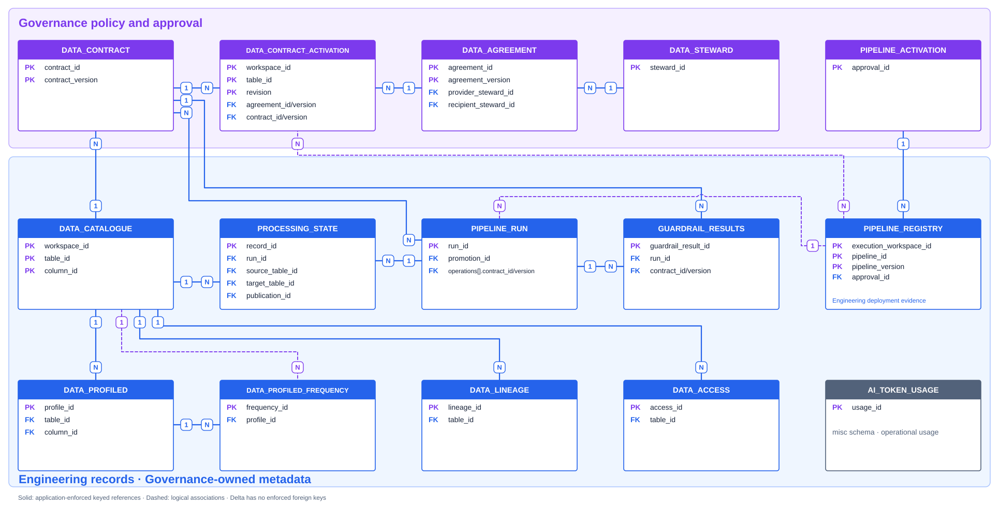

# Power BI operating report design

This blueprint defines the report experience and semantic model for a shared Governance and Engineering view of FabricOps metadata.

## Outcome

**The report should answer one question first: as a Data Steward, do I need to act?**

The selected Data Steward should see their Agreements, accountable tables, active Data Contracts, observed access, physical storage, pipeline use and operational failures as one connected story. A visible exception must lead to the exact Agreement, Contract activation, access observation, Pipeline Run, table, or Guardrail Result that explains it and to a clear recommended next action.

Governance and Engineering should use the same definitions and underlying evidence. The report is an observability and decision-support lens over the Metadata Lakehouse; it is not a second governance system, it does not perform remediation, and it must not create reporting copies of canonical metadata.

The first implementation should ship as a Power BI Desktop Project (`.pbip`) with a PBIR report definition and a TMDL semantic model. It should connect to the configured Governance and Engineering schemas through the Fabric Lakehouse SQL analytics endpoint and use Import mode.

## Audience and decisions

| Audience | Start with | Decisions supported |
| --- | --- | --- |
| Data Steward | Personal action state, Agreements and accountable tables | Who the Steward has Agreements with, which tables they provide or receive, whether those tables are protected, who has observed access, how they are used, and what needs attention. |
| Governance | Coverage, approvals, policy outcomes and exceptions | Which physical tables are protected, which exact Contract and Agreement apply, which submissions need a decision, and where Guardrails are blocking or warning. |
| Engineering | Deployments, runs, operations and processing health | Which approved implementation is active, whether the expected version ran, where a run or operation failed, and which table or processing record needs attention. |
| Shared review | Portfolio status and hand-off gaps | Whether Governance approval, Engineering promotion and runtime execution describe one consistent operating state. |

The report should make the hand-off visible rather than presenting Governance and Engineering as separate dashboards:

```text
Table evidence -> frozen Contract -> physical Contract activation
                                      |
Saved pipeline submission -> Governance decision -> Engineering promotion -> Pipeline Run
                                      |                    |                 |
                               approved package     deployed version   operations and results
```

## Data Steward decision journey

**The default report path follows the questions a Data Steward asks, not the physical metadata-table layout.**

The user selects a Data Steward at the top of the report. If `METADATA_DATA_STEWARD.contact` exactly matches Power BI `USERPRINCIPALNAME()`, the report may preselect that Steward; it must still show the selected identity and allow an authorized user to change it. A contact value is not guaranteed to be a sign-in name, so a failed match must show an explicit selection prompt rather than an empty or misleading personal view.

| Steward question | Answer shown | Authoritative metadata path | Possible decision or action |
| --- | --- | --- | --- |
| What Agreements do I have, and with whom? | Provider and recipient Agreements, counterparty Steward, purpose, approved use, validity and versions. | Selected `METADATA_DATA_STEWARD` -> provider/recipient keys in `METADATA_DATA_AGREEMENT`. | Review an Agreement that is expired, approaching expiry, inactive at either party, or not linked to an active table selection. |
| Which tables belong to me, and what do they look like? | Provider-side physical tables, schema, columns, Processing, profile statistics and frequent values. Recipient-side tables appear separately as **Shared with me**. | Provider Steward -> exact Agreement version -> `METADATA_DATA_CONTRACT_ACTIVATION` -> physical `workspace_id + table_id` -> Catalogue and Profile tables. | Add or update Catalogue/profile evidence, investigate material profile change, or resolve an Agreement/activation gap. |
| Which active Data Contract protects each table? | Exact active Contract ID/version, Agreement version, Enrichment, schema, Processing, profiling policy and Guardrails. | Current active `METADATA_DATA_CONTRACT_ACTIVATION` -> exact `METADATA_DATA_CONTRACT`; parse the validated `contract_payload_json` in the model. | Author a new version, freeze it, activate the correct version, or resolve an expired/missing Agreement link. |
| Who has access to my data? | Latest observed principals, user type, role, permission source, access level/state and observation age. | Physical table -> latest relevant `METADATA_DATA_ACCESS` snapshot. | Review a new, unexpected, stale or elevated access observation in the native Fabric control plane. The report does not grant or revoke access. |
| Where is the table stored, and which Pipelines read or write it? | Workspace, store type, schema, table, layer, writer notebook, source/target participation and actual run operations. | Catalogue physical fields; `METADATA_DATA_LINEAGE`; parsed Registry and Run operations. | Confirm an unexpected reader/writer, stale writer identity, or physical binding mismatch with Engineering. |
| Did any related Pipeline fail or degrade? | Latest completed run, incomplete runs, operation/stage failures, safe failure codes, blocking Guardrails and Processing State exceptions. | Table -> parsed Run operations -> Run header, Guardrail Results and Processing State. | Ask Engineering to investigate a failed/incomplete run, or ask Governance to review a blocking policy outcome. |

### What “belongs to me” means

FabricOps does not currently store a direct `steward_id` on `METADATA_DATA_CATALOGUE`. The dashboard must therefore use the implemented governance chain:

```text
selected provider Steward
  -> exact Data Agreement version
  -> current active Contract Activation
  -> physical workspace_id + table_id
```

This is **accountability through an activated Agreement**, not inferred ownership from `_committed_by`, notebook author, access observation or table name. Tables connected through a recipient Agreement are labelled **Shared with me**, not **Owned by me**. A table with no exact Agreement link is **Unassigned / unknown**, never silently attributed to a Steward.

## Action-state contract

**Every summary item must end in one of four decision states.**

| State | Meaning | Presentation |
| --- | --- | --- |
| **Action required** | Persisted evidence shows a failed, blocked, expired, missing-authority or conflicting state. | Red label, reason, affected object, evidence timestamp, responsible role and recommended next step. |
| **Review soon** | Evidence is valid but approaching a threshold, unusually changed, stale, or requires human judgement. | Amber label with due date or reason and the review owner. |
| **No action needed** | All evidence required by the metric is present and currently healthy. | Green label with the checks evaluated and latest evidence time. |
| **Unknown** | Required evidence is absent, too old, unparsable or not supported by the metadata. | Grey label explaining what is missing. Unknown must never be counted as healthy. |

The Action Center is a model-only union of deterministic rules. Each action row contains severity, state, Steward, workspace/table or Pipeline key, reason code, human explanation, evidence source, evidence time, responsible role, recommended next step and drill-through target. It writes nothing back to FabricOps.

Initial action rules should include:

- active provider-side table without a current active Contract selection;
- active Contract selection with a missing, expired or mismatched exact Agreement version;
- Agreement or Pipeline approval approaching expiry within a configurable warning window;
- current approved Pipeline with no active promotion, or active promotion that does not match its approval/submission identity;
- latest related run failed, remained incomplete, or did not complete its explicit boundary;
- related operation or stage failed;
- blocking Guardrail Result or `can_continue = false`;
- profile evidence overdue according to the exact active Contract profiling policy;
- access snapshot older than the configured observation threshold;
- newly observed or elevated access, shown as **Review soon** unless a separately authored policy establishes that it is prohibited;
- JSON parse failure, orphaned key or duplicate one-side key detected by Model QA.

“No action needed” is allowed only after all rules applicable to the selected scope have enough evidence to evaluate. The report must show which checks contributed to that conclusion.

## Experience principles

1. **Steward-first overview, shared definitions.** The default landing page is the Steward Action Center. Governance and Engineering bookmarks may broaden scope or change emphasis, but they must not change metric definitions.
2. **Exceptions before inventory.** Lead with missing coverage, expired decisions, blocked Guardrails, failed runs, incomplete completion boundaries and stale evidence. Keep full inventories behind drill-through or detail pages.
3. **Exact identities everywhere.** Tooltips and detail tables expose `table_id`, workspace ID, Contract ID/version, Agreement ID/version, approval ID, promotion ID, Pipeline ID/version and run ID as applicable.
4. **State and time are explicit.** Labels distinguish current selections from history, event time from commit time, and latest observations from authoritative decisions.
5. **No inferred authority.** A Frozen Contract is not an activation. A Pipeline Registry row is deployment evidence, not Governance approval. An observed access row is not effective authorization.
6. **One-click traceability.** Every exception should drill to Asset 360 or Pipeline 360 with the relevant filters preserved.

## Look and feel

**Use a calm operations-console style with FabricOps role colors, restrained status colors and generous whitespace.**

| Element | Standard |
| --- | --- |
| Canvas | 16:9, light neutral `#F5F7FB`, 12-column grid, 24 px outer margin. |
| Surfaces | White cards, 8 px radius, 1 px `#E2E8F0` border, no decorative shadows. |
| Shared accent | FabricOps teal `#0F8F83` for navigation, selected state and neutral highlights. |
| Governance | Purple `#7952B3` for authored policy, activation and approval. |
| Engineering | Blue `#1168B6` for deployment, execution and technical observations. |
| Status | Green for healthy/pass, amber for attention/warn, red for blocked/failed, grey for unavailable or not applicable. Always pair color with text or an icon. |
| Typography | Segoe UI; 24-28 pt page title, 18-22 pt KPI, 11-12 pt visual title, at least 10 pt labels. |
| Density | Four to six KPIs per page, one primary visual, two or three supporting visuals, and a detail table only when it supports action. |

Use a consistent page header:

- page title and a one-sentence question the page answers;
- selected Data Steward and whether the view matched the signed-in principal or was chosen manually;
- last successful semantic-model refresh time;
- synced filters for date, Agreement, workspace, table/domain and Pipeline;
- a clear **Reset filters** control;
- a compact Governance / Shared / Engineering bookmark switch when it improves emphasis.

Do not rely on pie charts for operational status. Prefer horizontal bars for ranked exceptions, line charts for trends, matrices for coverage, and compact status strips for lifecycle hand-offs. Avoid custom visuals in the first release so the project remains portable and reviewable in source control.

## Report pages

### 01 — Steward Action Center

**Answer “Do I need to act?” before showing inventories or charts.**

The page header shows the selected Data Steward, role/contact, last semantic-model refresh and evidence completeness. The first row contains four cards:

- action required;
- review soon;
- no action needed;
- unknown because evidence is missing or stale.

The primary visual is a ranked action queue grouped by responsibility: **Data Steward**, **Governance** or **Engineering**. Each item shows the affected Agreement, table or Pipeline; why it was raised; when the evidence was recorded; the recommended next step; and an **Investigate** drill-through action.

Supporting visuals summarize:

- active and expiring Agreements;
- accountable provider tables and tables shared with the Steward;
- Contract activation coverage;
- observed access requiring review;
- failed/incomplete related Pipelines and blocking Guardrails.

If all applicable checks have sufficient healthy evidence, the page states **No action needed** and lists the checks and timestamps supporting that conclusion. An empty action queue alone is not enough.

### 02 — My Agreements

**Show every relationship the selected Data Steward participates in and the tables governed through it.**

Required views:

- Agreements where the Steward is provider versus recipient;
- counterparty Steward name and contact;
- business purpose, approved use, domain, start date and expiry date;
- current, upcoming and expired versions;
- physical tables linked through current Contract activations;
- Agreements with no linked active table selection and active selections with a missing Agreement.

Selecting an Agreement filters the rest of the report to the exact `agreement_id + agreement_version`. Do not roll different Agreement versions into one apparently current record.

### 03 — My Data

**Show what provider-side tables look like and separate them clearly from data shared with the Steward.**

Use two explicit scopes:

- **Accountable data** — physical tables reached through the provider side of an exact Agreement linked by current Contract activation;
- **Shared with me** — physical tables reached through the recipient side.

For each physical table show:

- workspace, store type, layer, schema and table name;
- active Catalogue state and writer notebook;
- columns, data types and required/current schema context;
- latest row, null, distinct and distribution statistics;
- profile age and profiling-policy status;
- latest Guardrail state and related Pipeline health.

Profile change visuals compare like-for-like column snapshots and surface material changes for review. Thresholds must be defined by an implemented rule or labelled as configurable report heuristics.

### 04 — Contracts and Access

**Explain what currently protects each selected physical table and who has been observed with access.**

Contract section:

- exact active Contract ID/version and payload hash;
- linked exact Agreement version;
- Enrichment and information classifications;
- expected schema and Processing definition;
- profiling policy;
- Guardrail definitions and their latest outcomes;
- activation revision, destination, actor and timestamp.

Access section:

- principal, user type, role, permission source, access level/value/state;
- database, schema, object and object type;
- latest snapshot and observation age;
- new, removed or elevated observations between comparable snapshots where the source supports the comparison.

The page must say **Observed access**, not **Effective access** or **Authorized users**. A suspicious observation produces a recommended review in the native Fabric control plane; the report cannot determine policy compliance unless an explicit policy source exists.

### 05 — Storage and Pipelines

**Show where the selected table physically lives and how Engineering uses it.**

Required views:

- workspace, store type, layer, schema, table, current writer workspace/notebook and Processing strategy;
- source/target participation from `METADATA_DATA_LINEAGE`;
- reviewed physical bindings parsed from active Pipeline Promotions;
- actual Read/Write operations parsed from Pipeline Runs;
- Pipeline, version, notebook, operation role, mode and most recent use;
- mismatches between approved/promoted bindings and observed run operations.

`METADATA_DATA_LINEAGE` does not store canonical `pipeline_id`. Its audit notebook fields may be shown as recorded context, but the report must use parsed Registry/Run operations for a reliable Pipeline-to-table relationship and must not manufacture a Pipeline ID from a notebook name.

### 06 — Reliability and Quality

**Show whether the Pipelines serving the Steward's tables are healthy and what needs intervention.**

Required views:

- latest completed run and trend by Pipeline and execution mode;
- failed and incomplete runs, including explicit completion boundary;
- failed Read/Write operations and stages;
- safe failure codes and exception types;
- Guardrail pass, warn and block outcomes by table, type and severity;
- profiling completion/result persistence;
- Processing State observations, accepted checkpoints, Source Drift baselines and publication receipts.

Every failure row identifies the recommended owner: Engineering for execution/deployment failures, Governance for policy/activation decisions, and the Data Steward for Agreement or access review. Guardrail visuals count aggregate outcomes only and never imply that failed business rows are stored.

### 07 — Asset 360

**Provide one physical-table drill-through page containing the complete Steward story.**

The page follows this order: Agreement and parties, active Contract, table shape and profile, observed access, physical location, Pipeline use, latest failures and action history. It exposes full IDs and timestamps in tooltips and detail tables.

The header shows both the global `table_id` and selected `workspace_id + table_id`. If no workspace is selected, physical sections show all workspaces rather than choosing one silently.

### 08 — Pipeline 360

**Provide the Engineering drill-through behind a Steward's Pipeline question.**

The selected execution workspace and `pipeline_id` anchor:

- decision history and current Governance state;
- promotion history and active Engineering version;
- approved versus deployed content hashes;
- source and target operations;
- Contract versions used by each run operation;
- run duration, status, failures and stages;
- related Guardrail Results and Processing State;
- governed notebook and actual execution identity.

### 09 — Audit Explorer

**Keep exact raw records available without making raw metadata the primary user experience.**

Provide exportable detail tables for Agreements, Contract activations, access observations, Pipeline decisions, promotions, runs, operations, Guardrail Results and Processing State. Default identifiers may be shortened for readability, but tooltips and exports retain the complete value. This page explains the action state; it does not replace the Action Center.

## Semantic model

### Use the canonical ERD

**The reviewed FabricOps metadata ERD is the model foundation and remains the source of truth.**



The ERD is generated from `METADATA_TABLE_MODELS` in [`scripts/reference_docs_metadata.py`](https://github.com/Voycepeh/FabricOps-Starter-Kit/blob/main/scripts/reference_docs_metadata.py), validated against [`metadata_schemas.py`](https://github.com/Voycepeh/FabricOps-Starter-Kit/blob/main/src/fabricops_kit/config/metadata_schemas.py), and published as [`fabricops-metadata-approved.svg`](../assets/fabricops-metadata-approved.svg). The Power BI project must use that same generated relationship definition; it must not maintain a competing hand-authored ERD.

The model view should preserve the approved diagram's visual structure:

- Governance tables together in purple;
- Engineering tables together in blue;
- `METADATA_DATA_CATALOGUE` as the central physical data-asset anchor;
- `METADATA_DATA_CONTRACT_ACTIVATION` between Agreements, Contracts and physical tables;
- Pipeline Activation -> Pipeline Registry -> Pipeline Run as the approval, deployment and execution chain;
- Profile, Frequency, Lineage, Access, Guardrail and Processing State tables around their canonical parent records;
- small report-only projections in a separate grey area on the right.

### Keep the 14 canonical tables intact

All canonical sources keep their implemented names and grains in the semantic model. Do not duplicate or rename every source into a parallel `Dim*` or `Fact*` table.

| Canonical relationship | Power BI implementation |
| --- | --- |
| Data Steward -> Data Agreement | `steward_id` to provider and recipient roles. Keep one role relationship inactive where required; Steward-scope reporting uses the explicit report projection below. |
| Data Agreement -> Data Contract Activation | Exact `agreement_id + agreement_version` model key. One Agreement version may govern many physical activations. |
| Data Contract -> Data Contract Activation | Exact `contract_id + contract_version` model key. Never join on `contract_id` alone. |
| Pipeline Activation -> Pipeline Registry | `approval_id`, preserving Governance decision versus Engineering deployment. |
| Pipeline Registry -> Pipeline Run | `promotion_id`, preserving exact promoted version provenance. |
| Pipeline Run -> Guardrail Results | `run_id`. |
| Pipeline Run -> Processing State | `run_id`, while allowing standalone records with no Run. |
| Data Contract -> Guardrail Results | Exact `contract_id + contract_version` model key. |
| Data Catalogue -> Data Profiled | Physical column identity: `workspace_id + table_id + column_id`. |
| Data Profiled -> Data Profiled Frequency | Optional `profile_id`; independent Frequency Profiling remains valid when it is null. |
| Data Catalogue -> Frequency, Lineage and Access | Physical workspace/table or workspace/column key as appropriate. Never join a physical observation on `table_id` alone. |
| Data Catalogue -> Processing State | Separate source and target physical-table roles; only one default relationship may be active. |
| Pipeline Registry -> Contract Activation | Logical many-to-many association through parsed reviewed operations and physical `workspace_id + table_id`. |
| Pipeline Run -> Data Contract | Logical many-to-many association through parsed Run operations and exact Contract versions. |
| Data Catalogue -> Data Contract | Global logical `table_id` context only. Physical reporting flows through Contract Activation or a workspace-table projection so different workspaces cannot be mixed. |

Relationship directions remain single from the one side to the many side. The implementation may use an inactive role relationship with `USERELATIONSHIP`, or an explicit report projection, where the ERD has two roles such as provider/recipient or source/target. Bidirectional filtering is not the default fix for ambiguity.

### Minimal report-only projections

Only the projections needed to make nested JSON and exact composite identities reportable are added. Prefix them `REPORT_`, color them grey in the model view, hide technical columns, and keep them physically separate from the canonical ERD.

| Report table | Derived from | Grain and purpose |
| --- | --- | --- |
| `REPORT_DATE` | generated calendar | One date used for primary event dates; secondary date roles remain inactive. |
| `REPORT_PHYSICAL_TABLE` | Catalogue table-level rows | One `workspace_id + table_id` identity. This is the unique reporting side needed because Catalogue also contains column rows. |
| `REPORT_STEWARD_SCOPE` | Steward roles + exact Agreement version + current Contract Activation | One provider or recipient Steward association to one physical table. Powers **Accountable data** and **Shared with me** without changing the ERD. |
| `REPORT_PROMOTION_OPERATION` | parsed `METADATA_PIPELINE_REGISTRY.operations_json` | One reviewed physical source or target operation for one promotion. Connects deployment evidence to physical tables and active Contract selections. |
| `REPORT_RUN_OPERATION` | parsed `METADATA_PIPELINE_RUN.operations` | One actual Read or Write operation for one Run, physical table and exact Contract version. Includes derived failed-stage counts needed for overview reporting. |
| `REPORT_RUN_ISSUE` | parsed Run operation stages, profiling and safe failures | One normalized issue or profiling outcome. Keeps detail available without loading three separate public-facing helper tables. |
| `REPORT_CONTRACT_POLICY` | parsed `contract_payload_json` | One normalized Contract detail record with `policy_type` such as column, Enrichment, Processing, profiling or Guardrail. The canonical JSON remains authoritative. |
| `REPORT_ACTION_QUEUE` | deterministic rules over canonical tables and report projections | One Action required, Review soon, No action needed or Unknown finding with exact evidence and drill target. |

No `DimWorkspace`, `DimPipeline`, `DimContractVersion`, `DimAgreementVersion`, `DimPromotion` or `DimRun` copies are created. Those identities already exist at a usable grain in the canonical tables. Friendly labels, shortened IDs and display folders belong on those tables rather than in duplicate wrappers.

### Model view layout

The Power BI model view should be readable in three bands:

```text
GOVERNANCE — canonical purple tables from the approved ERD
  DATA_STEWARD -> DATA_AGREEMENT -> DATA_CONTRACT_ACTIVATION -> DATA_CONTRACT
  PIPELINE_ACTIVATION -> PIPELINE_REGISTRY

ENGINEERING — canonical blue tables from the approved ERD
  DATA_CATALOGUE -> PROFILE / FREQUENCY / LINEAGE / ACCESS
  PIPELINE_REGISTRY -> PIPELINE_RUN -> GUARDRAIL_RESULTS / PROCESSING_STATE

REPORTING — small grey projection area
  DATE | PHYSICAL_TABLE | STEWARD_SCOPE | PROMOTION_OPERATION
  RUN_OPERATION | RUN_ISSUE | CONTRACT_POLICY | ACTION_QUEUE
```

The approved ERD owns domain meaning. The grey area only resolves Power BI constraints: composite one-side keys, role-playing relationships and validated JSON expansion.

### Model-only composite keys

| Key | Definition |
| --- | --- |
| `workspace_table_key` | escaped `workspace_id + "|" + table_id` |
| `workspace_column_key` | escaped `workspace_id + "|" + table_id + "|" + column_id` |
| `workspace_pipeline_key` | escaped `execution_workspace_id + "|" + pipeline_id` |
| `contract_version_key` | escaped `contract_id + "|" + contract_version` |
| `agreement_version_key` | escaped `agreement_id + "|" + agreement_version` |
| `run_operation_key` | escaped `run_id + "|" + operation_key` |

Use a collision-safe encoding or length-prefixed concatenation rather than assuming the delimiter cannot occur in an identifier. Keys exist only in the imported semantic model and never write back to canonical metadata.

## Source coverage and boundaries

The first release must import all 14 canonical tables from `metadata_table_schema_registry()`.

| Source | Report responsibility | Boundary |
| --- | --- | --- |
| `METADATA_DATA_STEWARD` | accountability | Active state is a record attribute, not proof of current employment or Fabric access. |
| `METADATA_DATA_AGREEMENT` | approved purpose and parties | Use exact version selected by Contract activation. |
| `METADATA_DATA_CONTRACT` | versioned table expectation | Frozen is immutable, not activated. |
| `METADATA_DATA_CONTRACT_ACTIVATION` | physical Contract and Agreement selection | Latest active revision per workspace/table is current authority. |
| `METADATA_PIPELINE_ACTIVATION` | independent Pipeline decision | Approval never implies deployment. |
| `METADATA_DATA_CATALOGUE` | current physical table/column evidence | Respect `metadata_level` and `is_active`. |
| `METADATA_DATA_PROFILED` | profile statistics | Compare snapshots at their real column grain. |
| `METADATA_DATA_PROFILED_FREQUENCY` | frequent values | `profile_id` may be absent for independent Frequency Profiling. |
| `METADATA_DATA_LINEAGE` | source/target participation | Do not claim transformation-level lineage. Use audit notebook identity only as recorded context. |
| `METADATA_DATA_ACCESS` | access observations | Do not claim effective authorization. |
| `METADATA_PIPELINE_REGISTRY` | immutable Engineering promotions | Status is deployment state, not Governance authority. |
| `METADATA_PIPELINE_RUN` | run header and validated JSON detail | Whole-run success requires the explicit completion boundary. |
| `METADATA_GUARDRAIL_RESULTS` | aggregate rule outcomes | No failed business rows are present. |
| `METADATA_PROCESSING_STATE` | observations, checkpoints, baselines and receipts | Filter by `record_type`; do not treat every row as a publication. |

## Metric contracts

Define measures centrally and include the definition in a report tooltip.

| Measure | Definition |
| --- | --- |
| My active Agreements | Exact Agreement versions where the selected Steward is provider or recipient and the selected date falls from `start_date` through `expiry_date`. Show provider and recipient counts separately. |
| My accountable physical tables | Distinct `workspace_table_key` reached through selected Steward -> provider Agreement role -> exact current Contract activation. |
| Tables shared with me | Distinct `workspace_table_key` reached through selected Steward -> recipient Agreement role -> exact current Contract activation. |
| Active physical tables | Distinct `workspace_table_key` at Catalogue table level where `is_active = true`. |
| Contract activation coverage | Active physical tables with a current active `METADATA_DATA_CONTRACT_ACTIVATION` divided by active physical tables. |
| Active Contract for my table | Exact Contract ID/version on the current active Contract activation for the selected `workspace_table_key`; never the latest Frozen version by itself. |
| Observed principals | Distinct principals in the latest comparable access snapshot for the selected physical table. Label the snapshot time and never call this effective or approved access. |
| Related Pipelines | Distinct `workspace_pipeline_key` found through parsed Promotion or Run operations for the selected table. Lineage audit notebook context is supplementary. |
| Current approved Pipelines | Latest decision revision per `workspace_pipeline_key` whose decision/status is approved and not expired. |
| Active Pipeline Promotions | Registry rows with `status = active`, counted at `workspace_pipeline_key`. Validate that at most one is active. |
| Completed-run success rate | Completed successful runs divided by runs whose explicit completion boundary finished in the selected period. Incomplete runs remain a separate exception count. |
| Blocking Guardrails | Guardrail Results where the persisted outcome cannot continue or the supported blocking status applies. Do not derive this from color or severity alone. |
| Profile evidence age | Time since the latest applicable successful profile observation. “Overdue” additionally requires the exact Contract profiling policy to be parsed and evaluated. |
| Steward action state | Highest-priority applicable deterministic action state after evidence-completeness evaluation. Unknown outranks No action needed when a required check cannot be evaluated. |

Do not publish a metric until its allowed values and current-row rule have been verified against the implementation that writes the source.

## Refresh, security and performance

- Use deployment parameters for SQL endpoint, database, Governance schema and Engineering schema. Store no tenant, workspace, Lakehouse or user identifier in source control.
- Select columns explicitly from every source. Do not use `SELECT *`.
- Keep query folding through source projection and basic row filtering; parse JSON after the relational projection.
- Use incremental refresh only after a signed-in test proves that the relevant event column folds and retained history requirements are understood. Current-state tables still require a complete current view.
- Apply Power BI workspace permissions and, if required, semantic-model row-level security as deployment concerns. `METADATA_DATA_ACCESS` is an observation source, not an RLS policy table.
- Hide technical keys, hashes and raw JSON from the default field list while retaining them for tooltips, validation and audit detail.

## Delivery plan

### Phase 1 — model foundation

1. Create the PBIP/PBIR/TMDL project from current `main`.
2. Import all 14 canonical tables with explicit scalar projections.
3. Add conformed dimensions, Steward/Agreement/physical-table role bridges, collision-safe keys and JSON-derived Contract, run and promotion tables.
4. Add a structural validator that compares model source columns with `metadata_schemas.py`, validates relationship cardinality and rejects missing canonical tables.
5. Build a hidden Model QA page with row counts, orphan-key counts, duplicate one-side keys, active-promotion conflicts, Steward attribution gaps and JSON parse failures.
6. Implement the deterministic Action Queue with reason-code tests for healthy, actionable and missing-evidence scenarios.

### Phase 2 — shared operating view

1. Implement Steward Action Center, My Agreements and My Data first.
2. Add Contracts and Access, then Storage and Pipelines.
3. Define and test central measures against representative synthetic metadata covering provider/recipient roles, version history, missing links and conflicting states.
4. Add Asset 360 and Pipeline 360 drill-through paths.
5. Add Reliability and Quality only after run JSON detail is validated in Power BI Desktop.

### Phase 3 — signed-in acceptance

1. Refresh against a non-production Fabric Metadata Lakehouse.
2. Validate SQL endpoint exposure, folding, JSON expansion, DAX results and representative cross-filter paths.
3. Review every page with at least one Data Steward, one Governance user and one Engineering user using the same exception scenarios.
4. Test keyboard navigation, contrast, alt text, focus order, mobile layout where supported, export behavior and empty/error states.
5. Publish to a test workspace, bind Organizational Account credentials and verify scheduled refresh.

## Acceptance criteria

- The project starts from the current `main` schema and includes exactly the 14 canonical metadata tables.
- A selected Data Steward can answer all six journey questions from the Action Center and reach exact evidence in no more than two interactions.
- Provider-side accountable tables and recipient-side Shared with me tables are visibly separate and traceable to an exact Agreement version and current Contract activation.
- The dashboard distinguishes Action required, Review soon, No action needed and Unknown; missing evidence can never produce a healthy conclusion.
- Every action identifies the reason, evidence timestamp, affected object, responsible role and recommended next step.
- Governance approval, Contract activation, Engineering promotion and runtime execution remain visibly distinct.
- A reviewer can trace a portfolio exception to exact source identifiers in no more than two interactions.
- Asset 360 and Pipeline 360 reconcile the same records shown in portfolio KPIs.
- No measure labels inferred access as effective, lineage as transformation-level, Frozen as activated, or deployment as approval.
- The structural validator, deterministic regeneration check, lint, relevant metadata tests and strict MkDocs build pass.
- Power BI Desktop and signed-in Fabric validation are recorded separately from repository-only structural validation.

## Authoritative sources

- [`metadata_schemas.py`](https://github.com/Voycepeh/FabricOps-Starter-Kit/blob/main/src/fabricops_kit/config/metadata_schemas.py) defines the canonical table and column schemas.
- [Metadata Tables](../reference/metadata.md) defines grains, keys, writers and application-enforced relationships.
- [Governance](../governance.md) defines Contract activation and Pipeline approval boundaries.
- [Product Definition](product-definition.md) defines the Governance and Engineering operating model.
