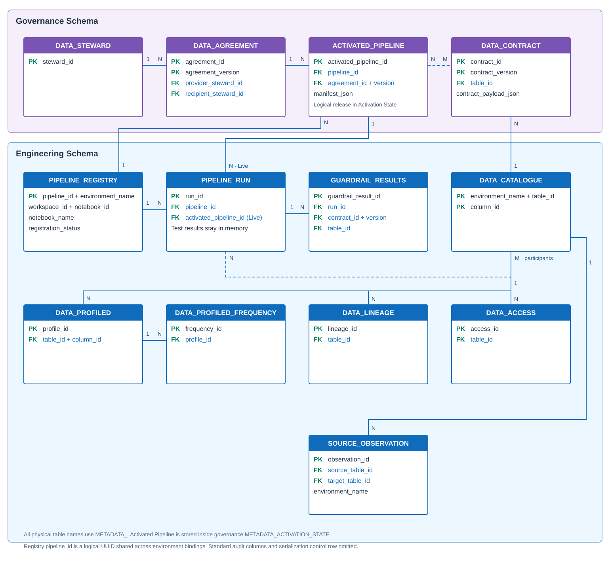

# List of Metadata Tables

FabricOps metadata is stored in one Metadata Lakehouse with two physical schemas:

- **Governance** stores authored governance definitions.
- **Engineering** stores technical observations, profiling, lineage, access observations, and runtime results.

`table_id` connects the same governed asset across both schemas. `contract_id` and `contract_version` identify one exact Data Contract version.

`METADATA_DATA_CONTRACT.contract_payload_json` is the JSON string column containing authored Guardrails, Enrichment and profiling policies for each contract version.

## Metadata tables

<a class="metadata-table-card metadata-table-card--engineering" href="metadata_pipeline_registry/" aria-label="Open METADATA_PIPELINE_REGISTRY schema">
  
    
      METADATA_PIPELINE_REGISTRY
      engineering
    
    →
  
  Permanent UUIDv4 identity and environment-specific notebook bindings; registration never authorizes Live. A seeded Authority control row serializes binding transactions in this same table.
  
    <strong>Grain</strong>
    One logical pipeline per environment, plus one serialization control row (central, *).
  
  
    <strong>Primary key</strong>
    <code>pipeline_id</code> + <code>environment_name</code>
  
  
    Relationships
    
      1 → N
      
        <code>METADATA_PIPELINE_RUN</code>
      
    
  
</a>
<a class="metadata-table-card metadata-table-card--engineering" href="metadata_pipeline_run/" aria-label="Open METADATA_PIPELINE_RUN schema">
  
    
      METADATA_PIPELINE_RUN
      engineering
    
    →
  
  One complete logical run, exact table mappings, operation results, per-table profiling activity outcomes, warnings and pinned activation revision. Profiling completion joins persisted result snapshots; Grain Discovery and empty Frequency Profiling use minimal success markers in operation_summary_json.
  
    <strong>Grain</strong>
    One Live pipeline execution attempt. Test results remain in memory.
  
  
    <strong>Primary key</strong>
    <code>run_id</code>
  
  
    Relationships
    
      N → 1
      
        <code>METADATA_PIPELINE_REGISTRY</code>
      
    
    
      1 → N
      
        <code>METADATA_SOURCE_OBSERVATION</code>
      
    
    
      1 → N
      
        <code>METADATA_GUARDRAIL_RESULTS</code>
      
    
  
</a>
<a class="metadata-table-card metadata-table-card--governance" href="metadata_data_steward/" aria-label="Open METADATA_DATA_STEWARD schema">
  
    
      METADATA_DATA_STEWARD
      governance
    
    →
  
  Know who is responsible for the data.
  
    <strong>Grain</strong>
    One registered Data Steward.
  
  
    <strong>Primary key</strong>
    <code>steward_id</code>
  
  
    Relationships
    
      1 → N
      
        <code>METADATA_DATA_AGREEMENT</code>
      
    
  
</a>
<a class="metadata-table-card metadata-table-card--governance" href="metadata_data_agreement/" aria-label="Open METADATA_DATA_AGREEMENT schema">
  
    
      METADATA_DATA_AGREEMENT
      governance
    
    →
  
  Define why the data is shared, with whom, and under what conditions.
  
    <strong>Grain</strong>
    One version of one Data Agreement.
  
  
    <strong>Primary key</strong>
    <code>agreement_id</code> + <code>agreement_version</code>
  
  
    Relationships
    
      N → 1
      
        <code>METADATA_DATA_STEWARD</code>
      
    
  
</a>
<a class="metadata-table-card metadata-table-card--governance" href="metadata_data_contract/" aria-label="Open METADATA_DATA_CONTRACT schema">
  
    
      METADATA_DATA_CONTRACT
      governance
    
    →
  
  Reusable immutable frozen table definition with Enrichment, executable Guardrails and independent profiling policies. Agreement linkage belongs to Activated Pipeline.
  
    <strong>Grain</strong>
    One Draft or Frozen version of one table contract; Frozen contents are immutable.
  
  
    <strong>Primary key</strong>
    <code>contract_id</code> + <code>contract_version</code>
  
  
    Relationships
    
      N → M
      
        <code>METADATA_ACTIVATION_STATE</code>
      
    
    
      N → 1
      
        <code>METADATA_DATA_CATALOGUE</code>
      
    
    
      1 → N
      
        <code>METADATA_GUARDRAIL_RESULTS</code>
      
    
  
</a>
<a class="metadata-table-card metadata-table-card--governance" href="metadata_activation_state/" aria-label="Open METADATA_ACTIVATION_STATE schema">
  
    
      METADATA_ACTIVATION_STATE
      governance
    
    →
  
  Single atomic central authority for environment activation revisions, immutable approval history, table contracts, writer ownership, running execution reservations and renewable profiling claims.
  
    <strong>Grain</strong>
    One central authority row containing environment snapshots.
  
  
    <strong>Primary key</strong>
    <code>authority_id</code>
  
  
    Relationships
    
      N → M
      
        <code>METADATA_DATA_CONTRACT</code>
      
    
  
</a>
<a class="metadata-table-card metadata-table-card--engineering" href="metadata_data_catalogue/" aria-label="Open METADATA_DATA_CATALOGUE schema">
  
    
      METADATA_DATA_CATALOGUE
      engineering
    
    →
  
  The current structural registry of known table and column assets. table_id identifies the logical table, and column_id identifies the logical column while its normalized column name remains the same. data_type stores the current structural datatype, and is_active indicates whether the asset currently exists. Datatype changes preserve column_id, removed columns become inactive, and returning columns reuse their deterministic ID. METADATA_DATA_PROFILED retains historical observations.
  
    <strong>Grain</strong>
    One table or column asset in one environment.
  
  
    <strong>Primary key</strong>
    <code>environment_name</code> + <code>table_id</code> + <code>column_id</code>
  
  
    Relationships
    
      1 → N
      
        <code>METADATA_DATA_CONTRACT</code>
      
    
    
      1 → N
      
        <code>METADATA_SOURCE_OBSERVATION</code>
      
    
    
      1 → N
      
        <code>METADATA_DATA_PROFILED</code>
      
    
    
      1 → N
      
        <code>METADATA_DATA_LINEAGE</code>
      
    
    
      1 → N
      
        <code>METADATA_DATA_ACCESS</code>
      
    
  
</a>
<a class="metadata-table-card metadata-table-card--engineering" href="metadata_source_observation/" aria-label="Open METADATA_SOURCE_OBSERVATION schema">
  
    
      METADATA_SOURCE_OBSERVATION
      engineering
    
    →
  
  Store source evidence observed by one logical pipeline for one governed target, including source_table_name and target_table_name captured for that observation. run_id joins METADATA_PIPELINE_RUN.run_id for planned executions; _activity_id retains the actual Fabric activity shared by different attempts. Legacy and standalone observations may have no run_id. observation_status=observed means the run captured the evidence but has not accepted it; observation_status=committed records accepted incremental progress, and drift_committed records the Source Drift baseline. Warehouse publication_observed and publication_committed rows store target-only retry receipts with empty source identity and no watermark; they also cover Full Read and source-free writes.
  
    <strong>Grain</strong>
    One observed or committed partition-state row within one logical notebook, source table, target table, and observation; target-only Warehouse publication receipt rows have an empty source identity.
  
  
    <strong>Primary key</strong>
    <code>observation_id</code> + <code>partition_value</code> + <code>observation_status</code>
  
  
    Relationships
    
      N → 1
      
        <code>METADATA_PIPELINE_RUN</code>
      
    
    
      N → 1
      
        <code>METADATA_DATA_CATALOGUE</code>
      
    
  
</a>
<a class="metadata-table-card metadata-table-card--engineering" href="metadata_data_profiled/" aria-label="Open METADATA_DATA_PROFILED schema">
  
    
      METADATA_DATA_PROFILED
      engineering
    
    →
  
  See column-level profile metrics for a dataset snapshot. table_name and column_name record the names observed when written and do not follow later Catalogue renames.
  
    <strong>Grain</strong>
    One observed column in one profiling snapshot.
  
  
    <strong>Primary key</strong>
    <code>profile_id</code>
  
  
    Relationships
    
      N → 1
      
        <code>METADATA_DATA_CATALOGUE</code>
      
    
    
      1 → 1
      
        <code>METADATA_DATA_PROFILED_FREQUENCY</code>
      
    
  
</a>
<a class="metadata-table-card metadata-table-card--engineering" href="metadata_data_profiled_frequency/" aria-label="Open METADATA_DATA_PROFILED_FREQUENCY schema">
  
    
      METADATA_DATA_PROFILED_FREQUENCY
      engineering
    
    →
  
  Frequency distributions retain Table ID, Column ID, environment, captured names and datatype. Independently scheduled Frequency Profiling owns its activity snapshot and leaves profile_id null; combined standalone profiling may link a statistical Profile. Captured names do not follow later renames.
  
    <strong>Grain</strong>
    One ranked value for a column and frequency activity snapshot. The statistical Profile reference is optional.
  
  
    <strong>Primary key</strong>
    <code>frequency_id</code>
  
  
    Relationships
    
      N → 1
      
        <code>METADATA_DATA_PROFILED</code>
      
    
  
</a>
<a class="metadata-table-card metadata-table-card--engineering" href="metadata_data_lineage/" aria-label="Open METADATA_DATA_LINEAGE schema">
  
    
      METADATA_DATA_LINEAGE
      engineering
    
    →
  
  See which registered tables participated as sources and targets in pipeline activities; table_name records the name at the participation write while table_id remains stable. The current notebook's Lineage defines Data Contract resolution scope.
  
    <strong>Grain</strong>
    One registered table participating as a source or target in one pipeline activity.
  
  
    <strong>Primary key</strong>
    <code>lineage_id</code>
  
  
    Relationships
    
      N → 1
      
        <code>METADATA_DATA_CATALOGUE</code>
      
    
  
</a>
<a class="metadata-table-card metadata-table-card--engineering" href="metadata_data_access/" aria-label="Open METADATA_DATA_ACCESS schema">
  
    
      METADATA_DATA_ACCESS
      engineering
    
    →
  
  See observable Workspace, OneLake Security, and SQL access for registered governed physical tables across configured Fabric data items; table_name records the Catalogue name matched at scan time. This is not an effective-access resolver.
  
    <strong>Grain</strong>
    One observed access grant for one principal or access selector and one governed table within one access snapshot.
  
  
    <strong>Primary key</strong>
    <code>access_id</code>
  
  
    Relationships
    
      N → 1
      
        <code>METADATA_DATA_CATALOGUE</code>
      
    
  
</a>
<a class="metadata-table-card metadata-table-card--engineering" href="metadata_guardrail_results/" aria-label="Open METADATA_GUARDRAIL_RESULTS schema">
  
    
      METADATA_GUARDRAIL_RESULTS
      engineering
    
    →
  
  Store aggregate Live Guardrail summaries for exact participating contract versions, captured table name, readable rule context, and continuation decisions; caller-owned failed business rows are not persisted here. Captured context does not follow later table or rule changes.
  
    <strong>Grain</strong>
    One persisted Live Guardrail outcome for one exact Data Contract version; Testing returns outcomes in memory only.
  
  
    <strong>Primary key</strong>
    <code>guardrail_result_id</code>
  
  
    Relationships
    
      N → 1
      
        <code>METADATA_PIPELINE_RUN</code>
      
    
    
      N → 1
      
        <code>METADATA_DATA_CONTRACT</code>
      
    
  
</a>

