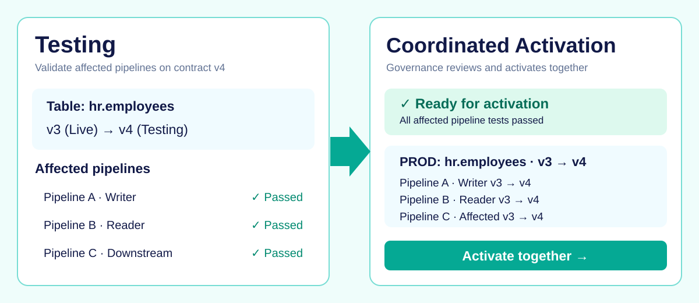

# Dependency-Aware Pipeline Activation

Preview

{ .fabricops-solution-hero }

## The problem

A Data Contract is shared by pipelines that read or write its table. Upgrading one pipeline to a new version while other Live pipelines use the old version creates inconsistent governance. Passing an isolated pipeline test does not establish that the shared-table change is safe.

## The solution

  
  

<strong>Validate every affected pipeline, then activate the change together.</strong> Governance reviews the impact of a Data Contract upgrade before changing what is Live.

One central Governance Metadata workspace stores a global table identity and frozen Data Contract version history. Each environment independently activates a version of that shared definition.

This page illustrates the **planned coordinated-activation capability**, not a claim that all dependency checks are implemented today.

## How it works

| Responsibility | What happens |
| --- | --- |
| **Governance authors** | Freezes a new Data Contract version for a table. |
| **Engineering tests** | Runs affected pipelines against the proposed frozen version. |
| **FabricOps checks** | Identifies active readers, writer ownership, version conflicts and affected downstream dependencies. |
| **Governance activates** | Reviews complete Testing evidence and approves a coordinated switch. |

## Under the hood

  
  

Explore how shared-table dependencies affect the decision to activate a new contract.

??? info "Shared-table governance invariants"

    - One global `table_id` and centrally managed Data Contract version history.
    - One active contract version per environment and table.
    - One active writer per environment and table; multiple readers are allowed.
    - One active configuration per environment and pipeline.
    - Testing may select any frozen version associated with the table.
    - An activatable Testing run requires frozen contracts for every participating table; contract-free exploratory Testing is not eligible.

??? info "Cascading dependency checks"

    When a proposed activation changes a shared table's contract, FabricOps should identify active pipelines referencing that table, including the writer and readers. Affected downstream pipelines are included when their effective inputs or contract expectations change.

    Every affected pipeline must have complete successful Testing evidence for compatible contract mappings. Missing tests, conflicting contract versions and competing writers block activation.

    Coordinated activation must publish consistent governance metadata. It does not imply that notebook deployments, already-running executions and business-table writes are transactionally atomic.

## Example

??? info "Upgrade hr.employees from v3 to v4"

    **Current PROD:** Pipeline A writes the table on v3, Pipeline B reads it on v3, and Pipeline C is an affected downstream consumer.

    1. Governance freezes v4 without changing the active PROD version.
    2. Engineers test A and B on v4, and C where its expectations change.
    3. FabricOps collects complete successful runs and identifies missing evidence.
    4. Governance reviews and approves the affected pipeline configurations together.
    5. PROD activates the consistent v4 mappings. DEV may independently use a different active version.

    **Blocked case:** A passes v4 Testing but B remains Live on v3 without compatible Testing evidence. A cannot activate alone.

## Go deeper

See [Plug-and-Play Data Pipelines](plug-and-play-data-pipelines.md) for the engineering workflow and [Step 5: Activate Data Contract and Promote](../guided-demo/05-activate-data-contract-and-promote.md) for the current activation walkthrough.
