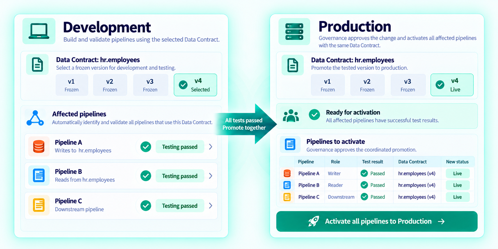
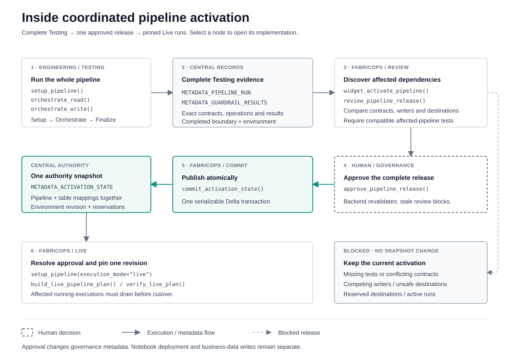

# Governed Pipelines from Development to Production

Preview

{ .fabricops-solution-hero }

*Develop pipelines with versioned Data Contracts, validate shared dependencies, and promote them safely to Production.*

## The problem

Development may need a new Data Contract while Production still uses an earlier version. If Pipeline A writes a shared table and Pipeline B reads it, activating A alone must not leave the two Live pipelines expecting different contracts.

The same problem extends downstream when a replacement pipeline changes its output contract or writer expectations. Governance needs to see the affected pipelines, their complete Testing results, and any ownership or destination conflicts before approving a release.

## The solution

  
  

<strong>Author → Test → Activate → Live.</strong> Review the affected pipelines together and publish one consistent workspace activation revision.

FabricOps stores global Data Contract versions centrally and approves pipeline configurations separately for each workspace. [`widget_activate_pipeline()`](../api/reference/widget_activate_pipeline.md) discovers affected active pipelines, checks their selected Testing candidates, and presents one coordinated approval.

**This workflow is implemented on `main`; its lifecycle APIs remain Preview.** See the [public API lifecycle registry](https://github.com/Voycepeh/FabricOps-Starter-Kit/blob/main/src/fabricops_kit/public_api.py) for the current callable status.

### What is a Data Contract?

A **Data Contract** is a shared agreement between the teams producing and consuming a dataset. It defines what data a pipeline is expected to deliver, how its quality is assessed, and how sensitive information must be handled.

A schema describes the columns and their data types. A Data Contract goes further by defining the rules and responsibilities associated with that data:

- **Structure:** Which columns exist, their data types, and which fields are required.
- **Data quality:** Expectations such as completeness, uniqueness, valid values, and acceptable failure thresholds.
- **Sensitive data:** Which fields need protection and what treatment should be applied.
- **Ownership and accountability:** Who is responsible for the dataset and its agreed expectations.

For example, an employee dataset might require a non-null `employee_id`, unique employee records, valid department values, and protection of personal identifiers. These are explicit, testable expectations rather than assumptions that downstream users must discover themselves.

In FabricOps, Data Contracts provide the governance rules used to validate pipeline reads and writes. **Versioning lets teams develop against proposed changes without immediately changing the contract used in Production.**

## How it works

**Engineers and Governance use six core functions.** Function names open the API reference; the source links open their implementation.

| Function | What the user does | Implementation |
| --- | --- | --- |
| [`widget_data_contract()`](../api/reference/widget_data_contract.md) | Author, review and freeze a global table Data Contract. | [Contract widget](https://github.com/Voycepeh/FabricOps-Starter-Kit/blob/main/src/fabricops_kit/widgets/widget_data_contract.py#L603) |
| [`setup_pipeline()`](../api/reference/setup_pipeline.md) | Declare a stable `pipeline_id`, sources and targets. Choose frozen versions interactively in Testing; resolve the approved workspace configuration headlessly in Live. | [Pipeline setup](https://github.com/Voycepeh/FabricOps-Starter-Kit/blob/main/src/fabricops_kit/pipeline/setup_pipeline.py#L130) |
| [`orchestrate_read()`](../api/reference/orchestrate_read.md) | Read each source with its applicable Freshness, Schema, Grain, Data Quality and Profile checks. | [Read orchestrator](https://github.com/Voycepeh/FabricOps-Starter-Kit/blob/main/src/fabricops_kit/pipeline/orchestrate_read.py#L22) |
| [`orchestrate_write()`](../api/reference/orchestrate_write.md) | Evaluate prepared targets and optionally publish them. Write-side checks include Sensitive Data, Source Drift and required source Guardrail coverage. | [Write orchestrator](https://github.com/Voycepeh/FabricOps-Starter-Kit/blob/main/src/fabricops_kit/pipeline/orchestrate_write.py#L26) |
| [`widget_activate_pipeline()`](../api/reference/widget_activate_pipeline.md) | Select successful Testing candidates, review affected dependencies, choose an effective Data Agreement and approve the complete release once. | [Activation widget](https://github.com/Voycepeh/FabricOps-Starter-Kit/blob/main/src/fabricops_kit/widgets/widget_activate_pipeline.py#L65) |

The [standard 02 Pipeline notebook](https://github.com/Voycepeh/FabricOps-Starter-Kit/blob/main/templates/notebooks/02_pipeline.ipynb) runs Setup Pipeline → Read → Transform → Write → Finalize. Execution reporting and failure cleanup are automatic. The explicit `finalize_pipeline()` step records whole-run completion and commits Test run and Guardrail results for activation review. Stopped runs remain incomplete; all existing approval checks remain strict. See the [execution boundaries and limits](https://github.com/Voycepeh/FabricOps-Starter-Kit/blob/main/templates/notebooks/README.md#source-participation-and-execution-boundaries).

Testing permits a frozen version or No Contract independently for each participant and records the exact coverage in `METADATA_PIPELINE_RUN`. Testing success reports execution under that selected coverage. Activation eligibility requires complete valid frozen contract coverage, passing required Guardrails and operation results, and all existing Data Agreement and approval checks. Mixed-contract and contract-free exploration cannot activate; missing contracts are reported by table ID. The same Setup → Orchestrate → Finalize notebook flow applies in DEV and PROD. Engineering and Microsoft Fabric own executable checksums, source control, CI/CD and deployment.

Testing evaluates without business publication by default. Explicit `testing_writes=True` permits real writes only to destinations protected from Live ownership and concurrent reservations.

## Under the hood

  
  

Trace complete Testing records through dependency review, atomic metadata publication and pinned Live execution.

??? info "Implementation flow and source links"

    [{ .fabricops-solution-diagram }](../assets/dependency-aware-pipeline-activation-implementation.svg)

    Open the SVG at full size to follow its implementation links. The services below run behind the public widget and pipeline setup; engineers do not call them as additional notebook APIs.

    | Internal service | Implemented responsibility |
    | --- | --- |
    | [`tested_pipeline_run()`](https://github.com/Voycepeh/FabricOps-Starter-Kit/blob/main/src/fabricops_kit/activated_pipeline/shared.py#L85) | Revalidate a completed governed Testing run, exact table contract references, bindings, operation modes and results, rule diagnostics and effective Data Agreement. |
    | [`review_pipeline_release()`](https://github.com/Voycepeh/FabricOps-Starter-Kit/blob/main/src/fabricops_kit/activated_pipeline/shared.py#L328) and [`activation_impact()`](https://github.com/Voycepeh/FabricOps-Starter-Kit/blob/main/src/fabricops_kit/activated_pipeline/shared.py#L277) | Compare the proposed release with active mappings. Discover affected readers/writers, missing replacement tests, contract and destination conflicts, and executions that must drain. Propagate requirements when replacement outputs change downstream expectations. |
    | [`approve_pipeline_release()`](https://github.com/Voycepeh/FabricOps-Starter-Kit/blob/main/src/fabricops_kit/activated_pipeline/shared.py#L362) | Require explicit Governance approval, revalidate every candidate and reject a stale review or any blocking conflict. |
    | [`commit_activation_state()`](https://github.com/Voycepeh/FabricOps-Starter-Kit/blob/main/src/fabricops_kit/activated_pipeline/shared.py#L223) | Publish the complete authority snapshot with one serializable Delta compare-and-swap. Overlapping changes fail safely rather than partially updating pipeline and table approvals. |
    | [`build_live_pipeline_plan()`](https://github.com/Voycepeh/FabricOps-Starter-Kit/blob/main/src/fabricops_kit/activated_pipeline/shared.py#L450) and [`verify_live_plan()`](https://github.com/Voycepeh/FabricOps-Starter-Kit/blob/main/src/fabricops_kit/activated_pipeline/shared.py#L492) | Resolve and reserve a pinned Live configuration, then enforce its Agreement, exact Data Contracts, table mappings and physical destinations during execution. |

    | Central metadata | What it supplies |
    | --- | --- |
    | [`METADATA_DATA_CONTRACT`](../reference/metadata/metadata_data_contract.md) | Global frozen table contract versions and immutable payloads. |
    | [`METADATA_PIPELINE_RUN`](../reference/metadata/metadata_pipeline_run.md) | Whole-run completion, participants, exact contract mappings, physical bindings and operation modes, operation outcomes and workspace. |
    | [`METADATA_GUARDRAIL_RESULTS`](../reference/metadata/metadata_guardrail_results.md) | Rule-level diagnostics linked to the Testing run. |
    | [`METADATA_DATA_AGREEMENT`](../reference/metadata/metadata_data_agreement.md) | The exact effective Agreement selected for approval. |
    | [`METADATA_PIPELINE_REGISTRY`](../reference/metadata/metadata_pipeline_registry.md) | One native authority row containing workspace revisions, active pipelines, contract/writer mappings, immutable approval history and running reservations. |

??? info "Shared-table rules and safe cutover"

    - One global `table_id` and centrally managed Data Contract version history.
    - One active contract version per workspace and table.
    - One active writer per workspace and table; multiple readers are allowed.
    - One active configuration per workspace and pipeline.
    - Testing may select any frozen version associated with the table.
    - An activatable Testing run requires frozen contracts for every participating table; contract-free exploratory Testing is not eligible.

    Every directly affected active pipeline needs complete successful Testing evidence for compatible mappings. Downstream pipelines require replacement evidence when their effective input expectations change; unchanged output expectations stop propagation. FabricOps does not infer compatibility with AI.

    Live runs reserve and pin a revision. Activation affecting a running pipeline or reserved destination blocks until the execution drains; a notebook does not silently switch configurations midway through its run. Physical reservations are checked across workspaces and logical table aliases. Crashed runs retain reservations until reviewed administrative cleanup.

    Approval commits governance metadata only. Notebook deployment and business-table writes are separate operations. See the [execution, cutover and recovery guidance](https://github.com/Voycepeh/FabricOps-Starter-Kit/blob/main/templates/notebooks/README.md#live-cutover-and-deployment) for the operating policy and snapshot limitations.

## Example

??? info "Upgrade the hr.employees Data Contract from v3 to v4"

    **Current PROD:** Pipeline A writes the table on v3, Pipeline B reads it on v3, and Pipeline C is an affected downstream consumer.

    1. Governance freezes v4 without changing the active PROD version.
    2. Engineers complete governed Testing for A and B on v4, and C where its expectations change, using the intended PROD configuration and physical bindings.
    3. FabricOps collects complete successful runs and identifies missing evidence.
    4. Governance reviews and approves the affected pipeline configurations together.
    5. PROD activates the consistent v4 mappings. DEV may independently use a different active version.

    **Blocked case:** A passes v4 Testing but B remains Live on v3 without compatible Testing evidence. A cannot activate alone.

    **Environment boundary:** DEV and PROD can use different versions from the same global history. A successful DEV run alone does not authorize PROD: the current backend requires Testing evidence from the activation workspace with its exact physical destinations. Evaluation-only Testing can validate those configurations without publishing to Live-owned tables.

## Go deeper

- [Step 4: Validate the frozen Data Contract](../guided-demo/04-validate-frozen-data-contract.md) — produce complete governed Testing results.
- [Step 5: Activate the tested pipeline and promote](../guided-demo/05-activate-data-contract-and-promote.md) — use the Governance activation widget.
- [Step 6: Run in Production](../guided-demo/06-run-production.md) — resolve approved Live execution automatically.
- [Plug-and-Play Data Pipelines](plug-and-play-data-pipelines.md) — the reusable engineering scaffold and Read/Write boundaries.
- [Pipeline template and lifecycle guide](https://github.com/Voycepeh/FabricOps-Starter-Kit/blob/main/templates/notebooks/README.md) — whole-run completion, real Testing writes, cutover and upgrade limits.
