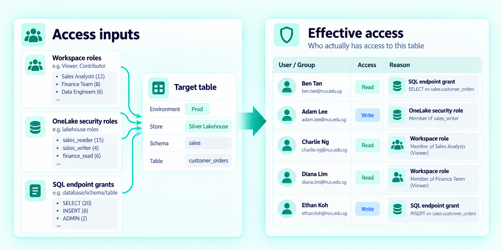

# Inspect OneLake access

<span class="fabricops-release-status fabricops-release-status--preview">Preview</span>

Inventory OneLake role assignments and visible item access, map supplied group membership to users, and optionally save observations for registered tables.

{ .fabricops-solution-hero }

## The problem

OneLake roles, direct item sharing and workspace roles expose different parts of an access assignment. A role can return an object ID without its name, and group membership cannot be enumerated through the tested APIs without another source.

## The solution

**Use `scan_onelake_role_members` as the single scanner.** It joins identities across visible responses and accepts a dictionary of group object IDs or display names to user UPNs. Keep the original assignment alongside each supplied user mapping.

!!! warning "Preview workaround"

    Name resolution uses the undocumented Power BI portal item-access endpoint. Its contract, minimum permissions and availability are unverified and may change. A successful caller test does not establish support for every Workspace Member. This is an observation inventory, not proof of effective access.

## How it works

| Source | Result |
| --- | --- |
| OneLake role API | Explicit members, permission paths, actions and restrictions |
| Workspace assignments | Names, principal types and inherited workspace roles |
| Portal item-access response | Additional names and raw item permission observations |
| Supplied membership dictionary | User mappings labelled `CALLER_SUPPLIED_GROUP_MEMBERSHIP` |

Workspace assignment listing requires Member or Admin and appropriate token scopes; Contributor is insufficient for that operation. OneLake role listing requires item Read permission and an appropriate OneLake scope. No Graph or tenant-admin API is used. Notebook and Environment access are separate prerequisites.

## Under the hood

??? info "Identity reconciliation and metadata snapshots"

    The scanner reconciles principal types across all sources before producing any result. Object ID mappings take precedence over names. Ambiguous names and conflicting identity types remain unresolved. Nested groups are not traversed: supply the final users for each assigned group, and treat DL membership as caller-supplied rather than verified directory membership.

    Automatic membership, such as a `DefaultReader` selector, remains a selector. Raw portal permission bitmasks are retained without decoding them into data grants. Item Read alone does not establish permission to read table data.

    With `catalogue_df` and a configured `target`, paths map only to active registered TABLE assets for the scanned physical workspace and item. Files paths and unregistered paths remain in `unmatched`. Mapping uses the Catalogue-owned `asset_workspace_id`, `table_id` and `asset_type`; notebook workspace audit fields remain separate.

    With `persist=True`, the function writes `METADATA_DATA_ACCESS` through the configured Metadata Lakehouse. Run `setup_metadata_tables()` after upgrading for additive provenance columns. Every saved row has `access_verification_status=UNVERIFIED`. `permission_details_json` preserves original principals, supplied membership source, raw permissions and complete role rules, including restrictions. Unresolved groups and selectors remain visible. A snapshot retry uses the same transaction identity; reuse an explicit snapshot ID only for the same immutable observations.

    Inspect `coverage` and `unmatched` with every result. A source failure or missing row is not evidence of no access. SQL permissions are outside this scanner's scope.

## Example

??? info "Inspect first, then save observations"

    ```python
    from fabricops_kit import scan_onelake_role_members
    import pandas as pd

    memberships = {"Data Readers": ["alice@example.com", "bob@example.com"]}

    # portal_origin is the HTTPS wabi-*.analysis.windows.net origin observed
    # in the browser Network panel. Do not copy browser bearer tokens.
    result = scan_onelake_role_members(
        workspace_id,
        lakehouse_id,
        portal_base_url=portal_origin,
        group_memberships=memberships,
    )
    display(pd.DataFrame(result["users"]))
    display(pd.DataFrame(result["coverage"]))

    # Optional configured metadata persistence.
    saved = scan_onelake_role_members(
        workspace_id,
        lakehouse_id,
        portal_base_url=portal_origin,
        group_memberships=memberships,
        catalogue_df=catalogue_df,
        target="Silver",
        persist=True,
    )
    display(saved["access"])
    display(saved["unmatched"])
    ```

    The expected result is a named assignment inventory, supplied user mappings, and explicit coverage gaps. Persistence adds an observation snapshot, preserving prior history and the original group or selector provenance.

## Go deeper

- [Function reference](../api/reference/scan_onelake_role_members.md)
- [Data Access metadata](../reference/metadata/metadata_data_access.md)
- [Workspace assignment API permissions](https://learn.microsoft.com/rest/api/fabric/core/workspaces/list-workspace-role-assignments)
- [OneLake role API permissions](https://learn.microsoft.com/rest/api/fabric/core/onelake-data-access-security/list-data-access-roles)
