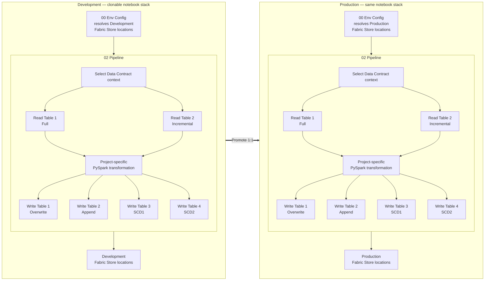
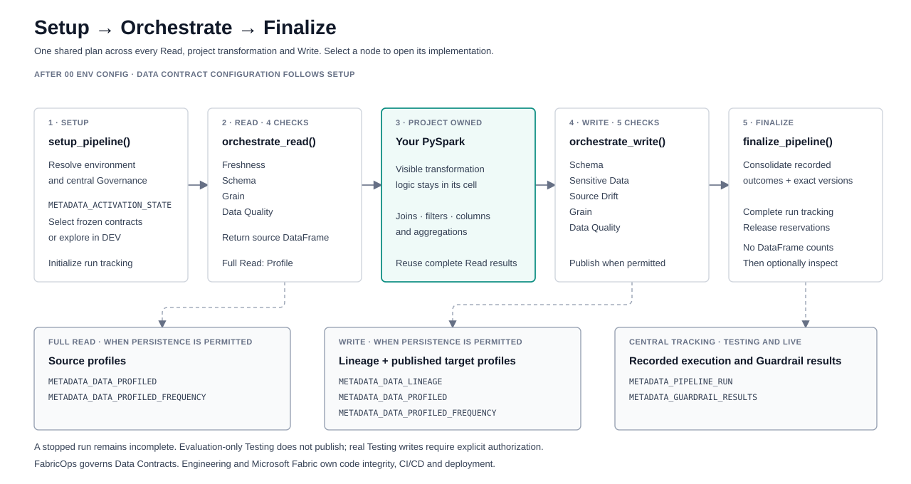

# Plug-and-Play Data Pipelines with Data Contract Enforcement

<span class="fabricops-release-status fabricops-release-status--live">Live</span>

{ .fabricops-solution-hero }

## The problem

Building a governed data pipeline involves much more than reading a table, transforming a DataFrame, and writing the result. Engineers also need to handle environment resolution, incremental processing, load strategies, metadata, profiling, Data Contracts, Guardrails, validation, lineage, and the differences between Fabric Lakehouses and Warehouses.

A new engineer should not need to understand or rebuild all of that governance and engineering plumbing before they can create a reliable pipeline. At the same time, the framework should not hide so much that nobody can understand what the pipeline is doing.

FabricOps abstracts the repeatable plumbing behind a small, readable notebook interface: **choose how each source is read, write the project transformation in normal PySpark, choose how each target is written, and let FabricOps apply the governed lifecycle around it.**

## The solution

<div class="fabricops-mascot-callout">
  <span style="display:inline-flex;align-items:center;gap:0.4rem;flex-shrink:0">
    
    
  </span>
  <div><p>FabricOps provides a <strong>clonable two-notebook engineering stack</strong>:</p></div>
</div>

- [`00_env_config.ipynb`](https://github.com/Voycepeh/FabricOps-Starter-Kit/blob/main/templates/notebooks/00_env_config.ipynb) maps logical Fabric Stores to the correct environment-specific Fabric locations.
- [`02_pipeline.ipynb`](https://github.com/Voycepeh/FabricOps-Starter-Kit/blob/main/templates/notebooks/02_pipeline.ipynb) keeps the pipeline definition portable between environments, with governed Read and Write boundaries around ordinary project-owned PySpark.

The result is a pipeline pattern that engineers can clone and adapt without rebuilding the governance and engineering plumbing each time.

### The big picture



The picture has four important parts working together:

1. **Environment-aware configuration.** Each environment has its own `00_env_config`, which resolves the logical Fabric Stores to the correct Development or Production locations.
2. **A portable pipeline.** `02_pipeline` keeps the same governed shape: **Read → project-owned PySpark → Write**. The engineer changes the project logic, not the surrounding operating pattern.
3. **Executable governance.** Governance defines the Data Contract and Guardrails. Engineering selects and validates that contract in Development; after approval, Production resolves the active contract and enforces it through the same pipeline boundaries.
4. **A shared evidence layer.** Reads and writes continuously produce the Catalogue, profiles, processing state, Guardrail results, and lineage that connect the physical pipeline back to Governance.

Once the Development implementation and Data Contract agree, the validated `02_pipeline` is promoted unchanged. Production uses its own environment configuration and the active contract, so the same engineering definition runs against Production Fabric Stores without embedding environment-specific locations in the pipeline.

This is the core FabricOps pipeline model: **the engineer owns the transformation; Governance owns the governed definition; FabricOps makes the surrounding lifecycle repeatable and executable across environments.**

## How it works

| Responsibility | What happens |
| --- | --- |
| **Engineer configures** | Chooses logical sources and targets, Read and Write modes, the project-specific PySpark transformation, and the Data Contract context for governed tables. |
| **AI can support** | Microsoft Fabric Copilot or another coding agent can help write or refactor project-specific PySpark. AI is optional and is not part of pipeline execution or enforcement. |
| **FabricOps handles deterministically** | Resolves environment-specific Fabric locations, runs governed Read and Write orchestration, applies the selected Data Contract and Guardrails, and records metadata, profiling, lineage, and processing state. |

## Under the hood

<div class="fabricops-mascot-callout">
  
  <div><p>Explore how the reusable pipeline orchestrators handle governed Read and Write operations around your PySpark transformations.</p></div>
</div>

??? info "What happens in a standard FabricOps Pipeline"

    { .fabricops-solution-diagram }

    ### Read side

    **`orchestrate_read()` checks the source before returning its DataFrame to your PySpark transformation.**

    1. Resolve the table and its Data Contract, then read the requested rows.
    2. Run the configured Freshness, Schema, Grain, and Data Quality checks.
    3. On a Full read, profile the returned dataset. Incremental batches skip Profile.

    The Grain check covers the returned rows: the full read result or the incremental batch. It does not compare an incremental batch with historical rows.

    ### Write side

    **`orchestrate_write()` checks the prepared input before publishing the target.**

    1. Run configured Schema and Sensitive Data checks, then Source Drift checks for participating sources.
    2. Check Grain and Data Quality after Sensitive Data treatment, enforcing the selected Data Contract policies before publication.
    3. In Live mode, publish through the selected Write strategy, record lineage in `METADATA_DATA_LINEAGE`, and profile the complete persisted target.

    Testing mode runs checks and profiles the prepared input in memory, with persistence limited to `METADATA_PIPELINE_RUN` and Guardrail diagnostics. Explicit `finalize_pipeline()` records complete-run status after all declared operations. The Grain check covers prepared input; it does not guarantee resulting-table uniqueness for Append or SCD strategies.

    ### Both sides

    - **Contract enforcement:** Live checks commit `METADATA_GUARDRAIL_RESULTS`; Testing returns the same diagnostics in memory. Discovering possible keys is separate from enforcing the contract's selected Grain key.
    - **Profiling:** when the lifecycle reaches Profile, `profile_table()` calculates statistics and can also calculate frequency distributions and discover candidate Grain keys.
    - **Caller controls:** Read and Write accept the same profiling switches and discovery limits. Your notebook or external scheduler chooses when to enable them; FabricOps does not apply a discovery schedule.

??? info "How frequency profiling and Grain discovery work"

    ### Frequency distributions

    **Frequency answers “which values occur most often in this column?”** FabricOps groups values, counts occurrences, and ranks them. Null can appear as a frequency value.

    Automatic selection uses eligible scalar columns and skips columns whose distinct-per-non-null percentage exceeds 80% by default. `frequency_top_n=5` retains the five highest-ranked values per selected column; `None` retains all. Top N limits retained output, but exact frequencies still require grouped counts across the input data.

    Statistics are saved in `METADATA_DATA_PROFILED`; frequency rows are saved in `METADATA_DATA_PROFILED_FREQUENCY` and linked to the profile snapshot. Turning frequency off skips its calculations for that call. Existing snapshots from earlier activities remain available.

    ### Grain key discovery

    **Discovery answers “which column or combination uniquely identifies every row in this dataset?”** It uses exact data checks, without AI or column-name guesses.

    1. Check eligible scalar columns for nulls and exact distinct counts. If single-column keys exist, return those candidates.
    2. Otherwise test combinations of null-free columns, starting with pairs and widening up to `grain_discovery_max_columns`.
    3. Stop at the smallest width with valid keys, retaining up to `grain_discovery_max_candidates` suggestions.

    Candidates are stored in the table row's `METADATA_DATA_CATALOGUE.profile_key_candidates_json` for contract authoring. Governance reviews and chooses the intended Grain key. A unique combination in today's data is a candidate for that decision, not a guarantee about future data.

    ### Where the compute runs

    **The orchestrators invoke profiling; the data engine performs the calculations.** Supplied DataFrames and physical Lakehouse tables use PySpark. Complete physical Warehouse tables use SQL pushdown, including frequency and key-discovery queries.

    Each composite-key test performs an exact distinct-count operation. With 20 eligible null-free columns and no single-column key, a search through triples can require 190 pair checks and 1,140 triple checks. Large inputs can add scans and shuffles; deterministic discovery can still be expensive. The candidate limit helps when keys are found but does not cap the search when none qualify.

    ### Choose when to run each calculation

    Both orchestrators and `profile_table()` accept these controls:

    ```python
    source = orchestrate_read(
        store="Bronze", schema="demo", table_name="orders",
        grain_discovery_enabled=True,
        grain_discovery_max_columns=3,
        grain_discovery_max_candidates=8,
        frequency_enabled=True,
        frequency_top_n=5,
    )
    ```

    - **First run or meaningful data changes:** enable discovery to refresh candidate keys. A maximum of `1` checks singles only; `2` also checks pairs.
    - **Routine runs:** set `grain_discovery_enabled=False` to skip discovery and preserve saved candidates. Independently set `frequency_enabled=False` to skip frequency calculations.
    - **After the Data Contract is defined:** discovery can stay off until you choose to revisit the key. Configured Grain checks still validate the contract's key on each applicable Read or Write call.

    These switches leave statistical profiling enabled whenever the lifecycle runs Profile. Incremental Read skips Profile. Testing Write profiles its prepared input without persistence. Scheduling belongs to the caller.

    See [`profile_table()`](../api/reference/profile_table.md) for exact parameters, direct column selection, and persistence behavior.

## Example

??? info "Orders + Products → Curated Orders"

    A project can read an Orders source and a Products reference table through governed Read boundaries, join and transform them using ordinary PySpark, then publish a Curated Orders table through a governed Write boundary.

    The engineer owns the transformation. FabricOps handles the repeatable environment, governance, metadata, and enforcement plumbing around it.

    See [Guided Demo Step 2: Build and run the ETL](../guided-demo/02-build-and-run-etl.md) for the working pipeline example.

## Go deeper

Use [How FabricOps Works](../how-fabricops-works.md) for the wider Governance and Engineering lifecycle.

For implementation details:

- [Read & Write Modes](../reference/read-and-load-strategies.md) — Full and Incremental reads, Overwrite, Append, SCD1, SCD2, and processing semantics.
- [PySpark Transformation](../reference/pyspark-transformation.md) — project-owned transformation patterns and performance guidance.
- [Guided Demo Step 2](../guided-demo/02-build-and-run-etl.md) — build and run the canonical pipeline.
- [Guided Demo Step 4](../guided-demo/04-validate-frozen-data-contract.md) — validate the frozen Data Contract against the pipeline.
- [Guided Demo Step 5](../guided-demo/05-activate-data-contract-and-promote.md) — activate the contract and promote the pipeline to Production.
- [`orchestrate_read()`](../api/reference/orchestrate_read.md) and [`orchestrate_write()`](../api/reference/orchestrate_write.md) — lifecycle stages and per-call profiling controls.
- [`profile_table()`](../api/reference/profile_table.md) — statistical profiling, frequency distributions, and Grain discovery limits.
- [Function Reference](../reference/index.md) — lower-level FabricOps APIs and orchestrators.
