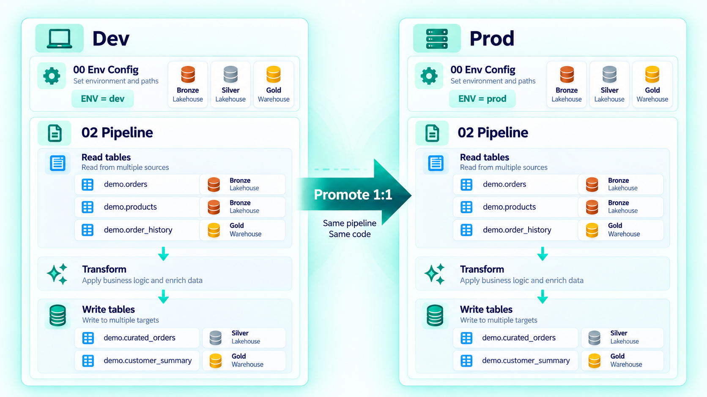
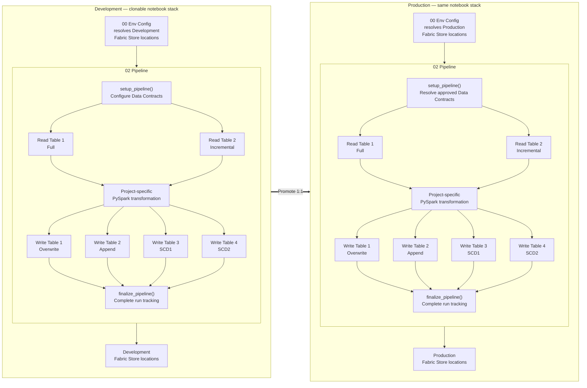

# Plug-and-Play Data Pipelines with Optional Data Contract Enforcement

Live

{ .fabricops-solution-hero }

## The problem

Building a reliable data pipeline involves much more than reading a table, transforming a DataFrame, and writing the result. Engineers also need to handle environment resolution, incremental processing, load strategies, metadata, profiling, Data Contracts, Guardrails, validation, lineage, and the differences between Fabric Lakehouses and Warehouses.

A new engineer should not need to understand or rebuild all of that governance and engineering plumbing before they can create a reliable pipeline. At the same time, the framework should not hide so much that nobody can understand what the pipeline is doing.

FabricOps keeps that work behind a readable notebook flow: **Setup → Read → Transform → Write → Finalize**. Engineers own the PySpark transformation; FabricOps handles the repeatable pipeline operations and applies Data Contract enforcement when Governed mode is selected.

## The solution

  
    
    
  
  

FabricOps provides a <strong>clonable two-notebook engineering stack</strong>:

- [`00_env_config.ipynb`](https://github.com/Voycepeh/FabricOps-Starter-Kit/blob/main/templates/notebooks/00_env_config.ipynb) maps logical Fabric Stores to the correct environment-specific Fabric locations.
- [`02_pipeline.ipynb`](https://github.com/Voycepeh/FabricOps-Starter-Kit/blob/main/templates/notebooks/02_pipeline.ipynb) keeps the pipeline definition portable between environments, with FabricOps Read and Write boundaries around ordinary project-owned PySpark.

The result is a pipeline pattern that engineers can clone and adapt without rebuilding the governance and engineering plumbing each time.

**Curious what FabricOps handles behind the scenes?** [Explore the engineering decisions and their trade-offs](#what-fabricops-takes-care-of-for-you), including store routing, Warehouse SQL pushdown, row-level audit fields, recovery and Data Contract checks.

Inside `02_pipeline.ipynb`, four functions frame the engineer's own transformation:

| Pipeline function | Purpose |
| --- | --- |
| `setup_pipeline()` | Establish the pipeline run and selected execution mode. |
| `orchestrate_read()` | Read each source using its chosen Read Mode. |
| `orchestrate_write()` | Publish each prepared target using its chosen Write Mode (or preview in Dry Run). |
| `finalize_pipeline()` | Complete run tracking after the project work finishes. |

**Between Read and Write, the PySpark logic belongs to the project.** Engineers can join, filter, enrich, or aggregate DataFrames as needed; FabricOps does not prescribe the transformation. The same pipeline can read multiple sources and write multiple targets.

### The big picture

The same pipeline definition can move between Development and Production: each workspace resolves its own Fabric Stores, while Governed execution enforces the activated Data Contracts.

### Choose an execution mode

| Capability | Dry Run | Ungoverned | Governed |
| --- | --- | --- | --- |
| Automatic profiling | Yes | Yes | Yes |
| Publish data | No | Yes | Yes |
| Persist observations | No | Yes | Yes |
| Activated Data Contract required | No | No | Yes |
| Enforce contract guardrails | Yes | No | Yes |

**Ungoverned** runs without Data Contracts. **Dry Run** previews without writing. **Governed** enforces activated Data Contracts. Pipeline source participation and reporting are automatic.

## From Dry Run to Governed execution

Start with **Dry Run** to inspect the pipeline's Read, transformation, and Write results without publishing data or persisting observations. An optional frozen Data Contract can be evaluated during this preview; Dry Run does not activate it.

A **Data Contract** defines the agreed schema, Grain, Data Quality rules, and Sensitive Data expectations for a table. Governance authors and freezes a version, and engineers validate the pipeline against that version. When it is ready for use, Governance **activates the Data Contract for the relevant table in the target workspace's environment**. That activation selects the contract version that Governed runs must enforce there.

**Ungoverned** remains available for pipelines without an activated Data Contract, while **Governed** requires the applicable active contracts and enforces their rules at the Read and Write boundaries. Activation is a **table-and-environment decision**, not a separate activation for every pipeline that uses the table. Pipelines sharing a table in the same environment therefore use its same active contract version.

This section describes validation and activation within a workspace; deployment and promotion are outside its scope.

## Read & Write Modes

Read Mode controls **which source rows to process**. Write Mode controls **how the prepared rows update the target**. They are selected independently for each Read and Write operation.

| Side | Mode | What it does |
| --- | --- | --- |
| Read | **Full** | Read the complete source. |
| Read | **Incremental** | Read unprocessed source changes for the target. |
| Write | **Overwrite** | Replace the target with the prepared result. |
| Write | **Append** | Add prepared rows to the target. |
| Write | **SCD1** | Update the latest state by business key. |
| Write | **SCD2** | Preserve historical versions of changes by business key. |

A common pattern is **Full → Overwrite** for rebuilding a target or **Incremental → Append** for adding new records. SCD1 and SCD2 support changing records. See [Read & Write Modes](../reference/read-and-load-strategies.md) for detailed behavior and examples.

## How it works

| Responsibility | What happens |
| --- | --- |
| **Engineer configures** | Chooses logical sources and targets, Read and Write modes, the project-specific PySpark transformation, and whether to run in Dry Run, Ungoverned or Governed mode. |
| **AI can support** | Microsoft Fabric Copilot or another coding agent can help write or refactor project-specific PySpark. AI is optional and is not part of pipeline execution or enforcement. |
| **FabricOps handles deterministically** | Resolves environment-specific Fabric locations, runs Read and Write orchestration, enforces activated Data Contracts in Governed mode, and records the applicable metadata, profiling, lineage, processing state and run outcome for persisting modes. |

## What FabricOps Takes Care of for You

Reliable pipelines need more than a successful write. These engineering decisions explain how FabricOps coordinates Fabric access, processing and safe publication. Expand a title for the implementation, stored evidence and trade-off.

??? info "Test the real pipeline before anything is published"
    Engineers can run their normal Read, Transform and Write flow, inspect the checks and profiling, and fix problems without changing production tables or advancing incremental progress.

    **How it works:** [`setup_pipeline()`](../api/reference/setup_pipeline.md) establishes `dry_run` as the execution mode. The execution plan sets `permits_persistence=False`; [`orchestrate_read()`](../api/reference/orchestrate_read.md) evaluates source checks and retains observations in the session without committing checkpoints. [`orchestrate_write()`](../api/reference/orchestrate_write.md) prepares the DataFrame, evaluates applicable Schema, Sensitive Data, Grain and Data Quality checks, profiles the prepared rows in memory and previews the chosen processing strategy. Its Dry Run branch returns `published=False` and `publication_status=not_published` rather than calling `pipeline_write()`. An optional selected frozen Data Contract can be evaluated without activating it.

    **Where to look:** `ExecutionPlan.permits_persistence` and `persistence_permitted()` in `src/fabricops_kit/pipeline/shared.py` gate writes to persistent metadata. The Dry Run branches in `src/fabricops_kit/pipeline/orchestrate_read.py` and `orchestrate_write.py` return `orchestration_stages`, `profile_result` and publication status in memory; no target rows or accepted progress are committed.

    **Trade-off:** A successful preview does not prove that a later physical write, Warehouse connector operation or deployment permission will succeed. Dry Run checks the preparation and rules, not the final publication.

??? info "One function coordinates the checks around each read and write"
    Engineers should focus on their transformation, not repeat the same validation, profiling and publishing steps for every table.

    **How it works:** [`orchestrate_read()`](../api/reference/orchestrate_read.md) calls `pipeline_read()`, then runs applicable Freshness, Schema, Grain and Data Quality checks and schedules source profiling. After the engineer's PySpark transformation, [`orchestrate_write()`](../api/reference/orchestrate_write.md) coordinates Schema, Sensitive Data treatment, Source Drift, Grain and Data Quality checks before calling `pipeline_write()` and scheduling post-publication profiling. The active execution mode and selected Data Contract determine which checks apply. Stage outcomes are collected rather than hidden.

    **Where to look:** [`METADATA_GUARDRAIL_RESULTS`](../reference/metadata/metadata_guardrail_results.md) records persisted rule outcomes such as `guardrail_type`, `status`, `can_continue` and `reason`. [`METADATA_PIPELINE_RUN`](../reference/metadata/metadata_pipeline_run.md) captures `operations` and the finalized run status; profiling uses [`METADATA_DATA_PROFILED`](../reference/metadata/metadata_data_profiled.md).

    **Trade-off:** The orchestrators deliberately impose a repeatable execution sequence. Engineers retain control of transformations but cannot treat a blocked governed check as an ordinary successful publication.

??? info "One notebook can work with more than one Fabric store"
    Fabric's default notebook attachment is not a convenient way to address every source and destination across workspaces.

    **How it works:** [`00 Env Config`](https://github.com/Voycepeh/FabricOps-Starter-Kit/blob/main/templates/notebooks/00_env_config.ipynb) defines logical store names and their environment-specific workspace, item and store type. Internal `resolve_fabric_context()`, `get_store()` and `resolve_store()` select the correct physical store for the running workspace. Lakehouse reads resolve OneLake `abfss://` table or file paths; Warehouse reads use the Fabric Spark connector with the configured Warehouse identity. `orchestrate_read()` and `orchestrate_write()` use the logical store key, not a hard-coded default attachment.

    **Where to look:** `src/fabricops_kit/config/shared.py` implements `get_store()` and the Lakehouse `FabricStore.root` path; `src/fabricops_kit/io/shared.py` implements `resolve_store()` and the physical Lakehouse and Warehouse readers. The store mapping lives in each workspace's `00 Env Config`, not in a new metadata table.

    **Trade-off:** This avoids dependence on one attached default Lakehouse, but does not bypass Fabric permissions. Each workspace and item still needs valid configuration and access rights.

??? info "Warehouse reads filter at the source instead of moving everything into Spark"
    An incremental job should not fetch a whole Warehouse table just to discard most of its rows in PySpark.

    **How it works:** [`pipeline_read()`](../api/reference/pipeline_read.md) resolves the accepted source-to-target watermark, then internal `_warehouse_incremental_query()` builds a bounded T-SQL `WHERE` predicate. The generated query is passed to `read_warehouse_query()` through Fabric's `synapsesql` connector. Lakehouse incremental reads instead apply Spark filtering to the Delta DataFrame. Caller-supplied Warehouse SQL is supported for full reads, but rejected in Incremental mode because FabricOps must own the checkpoint predicate.

    **Where to look:** `src/fabricops_kit/pipeline/pipeline_read.py` implements `_warehouse_incremental_query()` and `_filter_lakehouse_incremental()`. `src/fabricops_kit/io/shared.py` implements `read_warehouse_synapsesql()`. [`METADATA_PROCESSING_STATE`](../reference/metadata/metadata_processing_state.md) stores `source_table_id`, `target_table_id`, `watermark_type` and `max_change_value` for accepted progress.

    **Trade-off:** SQL pushdown can reduce Warehouse data transferred into Spark, but still incurs connector and Warehouse query overhead. It is an efficiency design, not a guarantee that Warehouse reads outperform direct Lakehouse Delta reads.

??? info "Every published row tells us where it came from"
    Published data should carry enough context to identify which Fabric execution wrote it, without every engineer having to add tracking columns manually.

    **How it works:** Internal `pipeline_write()` resolves one run-consistent audit record with `resolve_target_audit_fields()` and uses `add_target_audit_fields()` to add `_committed_at`, `_committed_by`, `_activity_id`, `_workspace_id`, `_notebook_id` and `_notebook_name` to managed target rows. The physical target also receives `_row_hash`, computed from the final business row values rather than those audit literals. SCD2 targets additionally carry `_effective_from`, `_effective_to` and `_is_current` for record history.

    **Where to look:** These are **physical columns on the published Lakehouse or Warehouse target**, not a separate audit metadata table. The definitions and `add_target_audit_fields()` are in `src/fabricops_kit/pipeline/shared.py`; `pipeline_write()` calls them in `src/fabricops_kit/pipeline/pipeline_write.py`. [`METADATA_PIPELINE_RUN`](../reference/metadata/metadata_pipeline_run.md) and [`METADATA_DATA_LINEAGE`](../reference/metadata/metadata_data_lineage.md) separately describe run-level outcomes and lineage.

    **Trade-off:** Every managed target stores extra columns. These identify the publishing execution, not necessarily the original creator of each source record; updates and merges can refresh audit values.

??? info "A failed run shouldn't mean writing everything twice"
    A successful write followed by a metadata failure should not silently duplicate the same publication on retry.

    **How it works:** [`orchestrate_write()`](../api/reference/orchestrate_write.md) delegates to internal `pipeline_write()` and `PublicationBatch`. FabricOps checks the batch identity, saved receipt and physical target before recovering. Lakehouse verification uses Delta commit evidence; Warehouse verification checks the exact publication audit-marker row count. Unverifiable or partial writes fail closed.

    **Where to look:** [`METADATA_PROCESSING_STATE`](../reference/metadata/metadata_processing_state.md) records `record_type = publication_receipt`, `publication_id`, `publication_batch_id`, `publication_activity_id`, `publication_input_rows`, `target_table_id` and `status`. Implementation: `src/fabricops_kit/pipeline/shared.py`.

    **Trade-off:** Fingerprinting and physical verification cost compute. Recovery requires evidence, not a best-effort guess.

??? info "Incremental runs don't lose track of unfinished work"
    Reading a record does not mean it has reached the destination, and records arriving during a run should not shift the current processing boundary.

    **How it works:** [`pipeline_read()`](../api/reference/pipeline_read.md), called by `orchestrate_read()`, resolves the accepted source-to-target watermark and captures an upper bound for the current read. Lakehouse filtering uses Spark; Warehouse filtering uses FabricOps-owned SQL. Internal `pipeline_write()` commits progress only after verified publication. First-time incremental reads bootstrap from the source, subject to target safety checks.

    **Where to look:** [`METADATA_PROCESSING_STATE`](../reference/metadata/metadata_processing_state.md) records `record_type = source_observation` or `incremental_checkpoint`, `source_table_id`, `target_table_id`, `watermark_type`, `min_change_value`, `max_change_value`, `status` and `accepted_at`.

    **Trade-off:** Each source-to-target pair needs its own checkpoint; later arrivals wait for another run. Correctness depends on a reliable source change value.

??? info "Different kinds of changes need different write behaviour"
    An event log may need every record, while another target should ignore repeated rows or maintain the latest state of each business key.

    **How it works:** [`orchestrate_read()`](../api/reference/orchestrate_read.md) selects Full or Incremental independently of [`orchestrate_write()`](../api/reference/orchestrate_write.md). Internal `pipeline_write()` supports Overwrite, Append All, Append New Only, SCD1 and SCD2. `add_row_hash()` and `row_hash_expression()` calculate a mandatory SHA256 `_row_hash` after transformation and Sensitive Data treatment. `append_new_only` uses `filter_unpublished_rows()` to remove repeated incoming hashes and anti-join target hashes; SCD strategies use business keys. A separate `PublicationBatch` fingerprint supports retry recovery.

    **Where to look:** The **published target table** stores `_row_hash`; [`METADATA_PROCESSING_STATE`](../reference/metadata/metadata_processing_state.md) stores `publication_batch_id`, `publication_input_rows` and `publication_strategy`. See [Read & Write Modes](../reference/read-and-load-strategies.md) for the exact strategy rules.

    **Trade-off:** Hashing and target comparison add compute. Append New Only does not update or delete existing rows, and changed ingestion values can change the hash. Existing targets with missing or invalid hashes require reviewed migration or overwrite.

??? info "We can see beyond the rows processed today"
    An incremental batch might look healthy even when records elsewhere in the full source have changed or disappeared.

    **How it works:** [`setup_pipeline()`](../api/reference/setup_pipeline.md) configures `observe_source` and `source_observation_days`. Internal `observe_full_source()` can fingerprint the complete physical source independently of the incremental read; `orchestrate_read()` exposes `full_source_observation`. The baseline is accepted after verified publication. Separately, `orchestrate_read()` and `orchestrate_write()` schedule whole-table profiling for row counts, missing values and common values.

    **Where to look:** [`METADATA_PROCESSING_STATE`](../reference/metadata/metadata_processing_state.md) records `record_type = full_source_baseline`, `source_table_id`, `row_count`, `content_fingerprint`, `publication_id` and `accepted_at`. [`METADATA_DATA_PROFILED`](../reference/metadata/metadata_data_profiled.md) records `profile_snapshot_id`, `table_id`, `column_id`, `row_count` and `non_null_count`; [`METADATA_DATA_PROFILED_FREQUENCY`](../reference/metadata/metadata_data_profiled_frequency.md) records `frequency_id`, `column_id` and `value`.

    **Trade-off:** Full-source observation and profiling both scan beyond the incremental batch, so they are scheduled. A changed source fingerprint provides evidence, not automatic deletion or a publication block.

??? info "Unsafe changes are stopped rather than guessed through"
    A failed rule, inconsistent target or competing writer should not silently produce an unreliable result.

    **How it works:** `orchestrate_read()` and `orchestrate_write()` apply relevant schema, grain, Data Quality, freshness and Sensitive Data checks. Internal `pipeline_write()` validates checkpoints, existing target hashes and publication ownership. A target lease in the Serializable Pipeline Registry prevents competing **managed** writers from publishing concurrently; `finalize_pipeline()` releases it. Governed deployment verification currently fails closed pending trusted verification.

    **Where to look:** [`METADATA_GUARDRAIL_RESULTS`](../reference/metadata/metadata_guardrail_results.md) stores `guardrail_type`, `status`, `can_continue`, `reason` and `result_payload_json`. [`METADATA_PIPELINE_REGISTRY`](../reference/metadata/metadata_pipeline_registry.md) stores managed lease state in `leases_json`; [`METADATA_PROCESSING_STATE`](../reference/metadata/metadata_processing_state.md) holds checkpoints and publication receipts.

    **Trade-off:** Extra validation and exclusive leases require coordination. Interrupted leases or inconsistent targets can need manual reconciliation; external writers are not protected by FabricOps leases.

??? info "Every completed run has an explanation"
    Engineers need to know which tables participated, what happened and whether the entire notebook finished, not just whether one write succeeded.

    **How it works:** [`setup_pipeline()`](../api/reference/setup_pipeline.md) starts the session; the orchestrators collect operation results and timings; [`finalize_pipeline()`](../api/reference/finalize_pipeline.md) persists the run outcome in persistent modes. Dry Run keeps results in memory. Multiple target writes remain independent rather than one atomic transaction.

    **Where to look:** [`METADATA_PIPELINE_RUN`](../reference/metadata/metadata_pipeline_run.md) stores `run_id`, `pipeline_id`, `execution_mode`, `status`, `operations`, `boundary_completed` and `completed_at`. [`METADATA_DATA_LINEAGE`](../reference/metadata/metadata_data_lineage.md) stores `lineage_id`, `table_id`, `pipeline_role` and `workspace_id`.

    **Trade-off:** Explicit finalization is required. A successful individual publication does not mean the entire pipeline completed.

## Get started

See [Guided Demo Step 2: Build and run the ETL](../guided-demo/02-build-and-run-etl.md) for an Orders + Products → Curated Orders example using the standard pipeline template.

## Go deeper

For the wider lifecycle, see [How FabricOps Works](../how-fabricops-works.md). For implementation details, use [PySpark Transformation](../reference/pyspark-transformation.md) and the [Function Reference](../reference/index.md).
