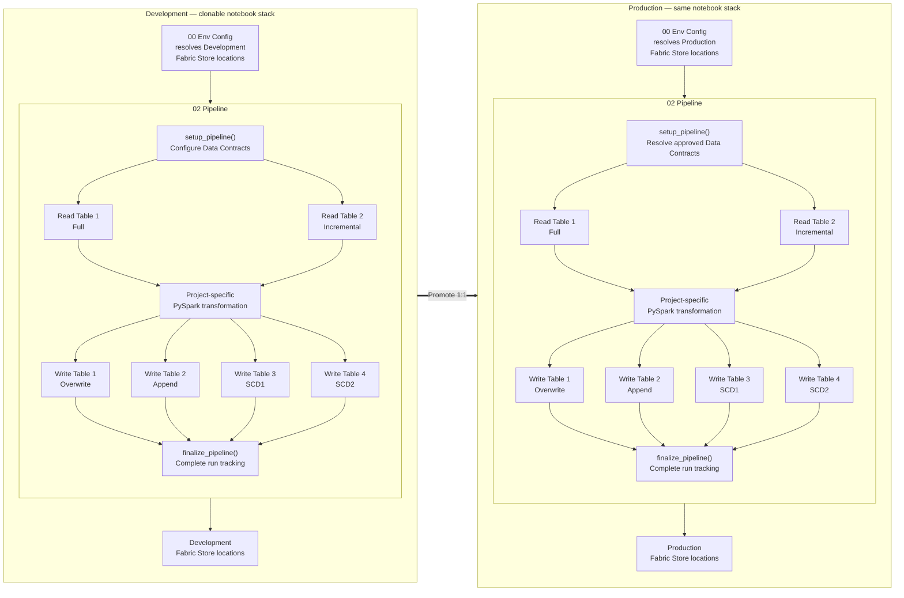

# Plug-and-Play Data Pipelines with Optional Data Contract Enforcement

Live

{ .fabricops-solution-hero }

## The problem

Building a reliable data pipeline involves much more than reading a table, transforming a DataFrame, and writing the result. Engineers also need to handle environment resolution, incremental processing, load strategies, metadata, profiling, Data Contracts, Guardrails, validation, lineage, and the differences between Fabric Lakehouses and Warehouses.

A new engineer should not need to understand or rebuild all of that governance and engineering plumbing before they can create a reliable pipeline. At the same time, the framework should not hide so much that nobody can understand what the pipeline is doing.

FabricOps keeps that work behind a readable notebook flow: **Setup → Read → Transform → Write → Finalize**. Engineers own the PySpark transformation; FabricOps handles the repeatable pipeline operations and applies Data Contract enforcement when Governed mode is selected.

## The solution

  
    
    
  
  

FabricOps provides a <strong>clonable two-notebook engineering stack</strong>:

- [`00_env_config.ipynb`](https://github.com/Voycepeh/FabricOps-Starter-Kit/blob/main/templates/notebooks/00_env_config.ipynb) maps logical Fabric Stores to the correct environment-specific Fabric locations.
- [`02_pipeline.ipynb`](https://github.com/Voycepeh/FabricOps-Starter-Kit/blob/main/templates/notebooks/02_pipeline.ipynb) keeps the pipeline definition portable between environments, with FabricOps Read and Write boundaries around ordinary project-owned PySpark.

The result is a pipeline pattern that engineers can clone and adapt without rebuilding the governance and engineering plumbing each time.

Inside `02_pipeline.ipynb`, four functions frame the engineer's own transformation:

| Pipeline function | Purpose |
| --- | --- |
| `setup_pipeline()` | Establish the pipeline run and selected execution mode. |
| `orchestrate_read()` | Read each source using its chosen Read Mode. |
| `orchestrate_write()` | Publish each prepared target using its chosen Write Mode (or preview in Dry Run). |
| `finalize_pipeline()` | Complete run tracking after the project work finishes. |

**Between Read and Write, the PySpark logic belongs to the project.** Engineers can join, filter, enrich, or aggregate DataFrames as needed; FabricOps does not prescribe the transformation. The same pipeline can read multiple sources and write multiple targets.

### The big picture

The same pipeline definition can move between Development and Production: each workspace resolves its own Fabric Stores, while Governed execution enforces the activated Data Contracts.

### Choose an execution mode

| Capability | Dry Run | Ungoverned | Governed |
| --- | --- | --- | --- |
| Automatic profiling | Yes | Yes | Yes |
| Publish data | No | Yes | Yes |
| Persist observations | No | Yes | Yes |
| Activated Data Contract required | No | No | Yes |
| Enforce contract guardrails | Yes | No | Yes |

**Ungoverned** runs without Data Contracts. **Dry Run** previews without writing. **Governed** enforces activated Data Contracts. Pipeline source participation and reporting are automatic.

## Read & Write Modes

Read Mode controls **which source rows to process**. Write Mode controls **how the prepared rows update the target**. They are selected independently for each Read and Write operation.

| Side | Mode | What it does |
| --- | --- | --- |
| Read | **Full** | Read the complete source. |
| Read | **Incremental** | Read unprocessed source changes for the target. |
| Write | **Overwrite** | Replace the target with the prepared result. |
| Write | **Append** | Add prepared rows to the target. |
| Write | **SCD1** | Update the latest state by business key. |
| Write | **SCD2** | Preserve historical versions of changes by business key. |

A common pattern is **Full → Overwrite** for rebuilding a target or **Incremental → Append** for adding new records. SCD1 and SCD2 support changing records. See [Read & Write Modes](../reference/read-and-load-strategies.md) for detailed behavior and examples.

## How it works

| Responsibility | What happens |
| --- | --- |
| **Engineer configures** | Chooses logical sources and targets, Read and Write modes, the project-specific PySpark transformation, and whether to run in Dry Run, Ungoverned or Governed mode. |
| **AI can support** | Microsoft Fabric Copilot or another coding agent can help write or refactor project-specific PySpark. AI is optional and is not part of pipeline execution or enforcement. |
| **FabricOps handles deterministically** | Resolves environment-specific Fabric locations, runs Read and Write orchestration, enforces activated Data Contracts in Governed mode, and records the applicable metadata, profiling, lineage, processing state and run outcome for persisting modes. |

## Get started

See [Guided Demo Step 2: Build and run the ETL](../guided-demo/02-build-and-run-etl.md) for an Orders + Products → Curated Orders example using the standard pipeline template.

## Go deeper

For the wider lifecycle, see [How FabricOps Works](../how-fabricops-works.md). For implementation details, use [PySpark Transformation](../reference/pyspark-transformation.md) and the [Function Reference](../reference/index.md).
