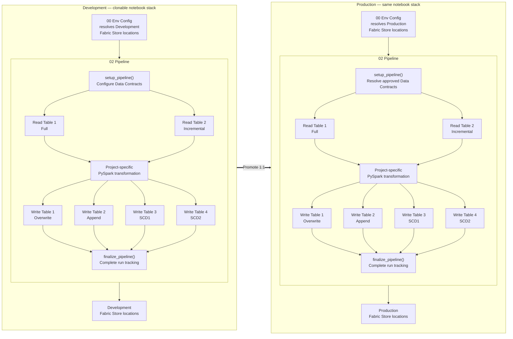

# Plug-and-Play Data Pipelines with Optional Data Contract Enforcement

Live

{ .fabricops-solution-hero }

## The problem

Building a reliable data pipeline involves much more than reading a table, transforming a DataFrame, and writing the result. Engineers also need to handle environment resolution, incremental processing, load strategies, metadata, profiling, Data Contracts, Guardrails, validation, lineage, and the differences between Fabric Lakehouses and Warehouses.

A new engineer should not need to understand or rebuild all of that governance and engineering plumbing before they can create a reliable pipeline. At the same time, the framework should not hide so much that nobody can understand what the pipeline is doing.

FabricOps keeps that work behind a readable notebook flow: **Setup → Read → Transform → Write → Finalize**. Engineers own the PySpark transformation; FabricOps handles the repeatable pipeline operations and applies Data Contract enforcement when Governed mode is selected.

## The solution

  
    
    
  
  

FabricOps provides a <strong>clonable two-notebook engineering stack</strong>:

- [`00_env_config.ipynb`](https://github.com/Voycepeh/FabricOps-Starter-Kit/blob/main/templates/notebooks/00_env_config.ipynb) maps logical Fabric Stores to the correct environment-specific Fabric locations.
- [`02_pipeline.ipynb`](https://github.com/Voycepeh/FabricOps-Starter-Kit/blob/main/templates/notebooks/02_pipeline.ipynb) keeps the pipeline definition portable between environments, with FabricOps Read and Write boundaries around ordinary project-owned PySpark.

The result is a pipeline pattern that engineers can clone and adapt without rebuilding the governance and engineering plumbing each time.

Inside `02_pipeline.ipynb`, four functions frame the engineer's own transformation:

| Pipeline function | Purpose |
| --- | --- |
| `setup_pipeline()` | Establish the pipeline run and selected execution mode. |
| `orchestrate_read()` | Read each source using its chosen Read Mode. |
| `orchestrate_write()` | Publish each prepared target using its chosen Write Mode (or preview in Dry Run). |
| `finalize_pipeline()` | Complete run tracking after the project work finishes. |

**Between Read and Write, the PySpark logic belongs to the project.** Engineers can join, filter, enrich, or aggregate DataFrames as needed; FabricOps does not prescribe the transformation. The same pipeline can read multiple sources and write multiple targets.

### The big picture

The same pipeline definition can move between Development and Production: each workspace resolves its own Fabric Stores, while Governed execution enforces the activated Data Contracts.

### Choose an execution mode

| Capability | Dry Run | Ungoverned | Governed |
| --- | --- | --- | --- |
| Automatic profiling | Yes | Yes | Yes |
| Publish data | No | Yes | Yes |
| Persist observations | No | Yes | Yes |
| Activated Data Contract required | No | No | Yes |
| Enforce contract guardrails | Yes | No | Yes |

**Ungoverned** runs without Data Contracts. **Dry Run** previews without writing. **Governed** enforces activated Data Contracts. Pipeline source participation and reporting are automatic.

## From Dry Run to Governed execution

Start with **Dry Run** to inspect the pipeline's Read, transformation, and Write results without publishing data or persisting observations. An optional frozen Data Contract can be evaluated during this preview; Dry Run does not activate it.

A **Data Contract** defines the agreed schema, Grain, Data Quality rules, and Sensitive Data expectations for a table. Governance authors and freezes a version, and engineers validate the pipeline against that version. When it is ready for use, Governance **activates the Data Contract for the relevant table in the target workspace's environment**. That activation selects the contract version that Governed runs must enforce there.

**Ungoverned** remains available for pipelines without an activated Data Contract, while **Governed** requires the applicable active contracts and enforces their rules at the Read and Write boundaries. Activation is a **table-and-environment decision**, not a separate activation for every pipeline that uses the table. Pipelines sharing a table in the same environment therefore use its same active contract version.

This section describes validation and activation within a workspace; deployment and promotion are outside its scope.

## Read & Write Modes

Read Mode controls **which source rows to process**. Write Mode controls **how the prepared rows update the target**. They are selected independently for each Read and Write operation.

| Side | Mode | What it does |
| --- | --- | --- |
| Read | **Full** | Read the complete source. |
| Read | **Incremental** | Read unprocessed source changes for the target. |
| Write | **Overwrite** | Replace the target with the prepared result. |
| Write | **Append** | Add prepared rows to the target. |
| Write | **SCD1** | Update the latest state by business key. |
| Write | **SCD2** | Preserve historical versions of changes by business key. |

A common pattern is **Full → Overwrite** for rebuilding a target or **Incremental → Append** for adding new records. SCD1 and SCD2 support changing records. See [Read & Write Modes](../reference/read-and-load-strategies.md) for detailed behavior and examples.

## How it works

| Responsibility | What happens |
| --- | --- |
| **Engineer configures** | Chooses logical sources and targets, Read and Write modes, the project-specific PySpark transformation, and whether to run in Dry Run, Ungoverned or Governed mode. |
| **AI can support** | Microsoft Fabric Copilot or another coding agent can help write or refactor project-specific PySpark. AI is optional and is not part of pipeline execution or enforcement. |
| **FabricOps handles deterministically** | Resolves environment-specific Fabric locations, runs Read and Write orchestration, enforces activated Data Contracts in Governed mode, and records the applicable metadata, profiling, lineage, processing state and run outcome for persisting modes. |

## What FabricOps Takes Care of for You

Running a pipeline is easy when everything goes right. The harder part is keeping data accurate when sources change, a run fails or the same data arrives again. Each topic starts with the business outcome; expand it for the functions, exact stored evidence and known trade-off.

??? info "A failed run shouldn't mean starting over"
    If a write succeeded but saving its processing history failed, a retry should not blindly insert the same batch again.

    **How it works:** [`orchestrate_write()`](../api/reference/orchestrate_write.md) calls internal `pipeline_write()` and `PublicationBatch`. A deterministic batch identity is checked against the exact publication receipt and physical target. Lakehouse verification uses Delta commit evidence; Warehouse verification requires the exact publication audit-marker row count. An unverified or partial write fails closed.

    **Where to look:** [`METADATA_PROCESSING_STATE`](../reference/metadata/metadata_processing_state.md) stores `record_type = publication_receipt`, `record_id`, `publication_id`, `publication_batch_id`, `publication_activity_id`, `publication_input_rows`, `target_table_id` and `status`. `PublicationBatch` is implemented in `src/fabricops_kit/pipeline/shared.py`.

    **Trade-off:** Physical verification and fingerprinting add Spark and metadata work. A Warehouse publication without verifiable row markers cannot be assumed successful.

??? info "We only mark data as processed when it's safely written"
    Reading 1,000 records does not mean those records have reached the destination.

    **How it works:** [`pipeline_read()`](../api/reference/pipeline_read.md), called by `orchestrate_read()`, resolves the last accepted watermark for the exact source and target. Internal `pipeline_write()` stages the next progress and accepts it only with verified publication. Publication receipts and their source members are acknowledged together.

    **Where to look:** [`METADATA_PROCESSING_STATE`](../reference/metadata/metadata_processing_state.md) uses `record_type = incremental_checkpoint`, `source_table_id`, `target_table_id`, `max_change_value`, `watermark_type`, `publication_id`, `status` and `accepted_at`.

    **Trade-off:** Each source-to-target relationship needs its own checkpoint. A first incremental read without an accepted baseline bootstraps from the source, and unsafe target combinations are rejected.

??? info "New records arriving mid-run won't disrupt the current batch"
    A source can continue receiving new records while a pipeline works through a defined batch.

    **How it works:** [`pipeline_read()`](../api/reference/pipeline_read.md) captures an upper watermark and reads after the accepted lower watermark through that upper bound. Lakehouse filtering uses Spark; Warehouse filtering uses FabricOps-owned SQL. A later source change is left for a subsequent run.

    **Where to look:** [`METADATA_PROCESSING_STATE`](../reference/metadata/metadata_processing_state.md) records `record_type = source_observation` and `incremental_checkpoint`, with `observation_id`, `partition_column`, `change_column`, `watermark_type`, `min_change_value` and `max_change_value`.

    **Trade-off:** Some fresh records wait for the next run. Incremental correctness depends on a trustworthy source watermark, not simply on the time the notebook ran.

??? info "FabricOps knows whether a row is new or already published"
    Different use cases need different treatment of repeated records: preserve all, keep only unseen rows or update a business key.

    **How it works:** Internal `add_row_hash()` and `row_hash_expression()` calculate the mandatory SHA256 `_row_hash` **after transformations and Sensitive Data treatment**. The hash includes business and source ingestion values, column names and logical types, while excluding FabricOps-owned audit and SCD lifecycle fields. `pipeline_write()` applies the chosen `write_mode`: `append_all` keeps identical duplicates; `append_new_only` uses `filter_unpublished_rows()` to drop duplicate incoming hashes and Spark anti-join against target hashes; SCD1/SCD2 continue to use their governed business-key rules. Separately, `PublicationBatch` aggregates row hashes into a multiplicity-sensitive batch fingerprint for retry recovery.

    **Where to look:** Every managed **published target table** stores `_row_hash` on each row; it is **not** a column in a FabricOps metadata table. [`METADATA_PROCESSING_STATE`](../reference/metadata/metadata_processing_state.md) stores the separate publication receipt fields `publication_batch_id`, `publication_input_rows` and `publication_strategy`. See [Read & Write Modes](../reference/read-and-load-strategies.md) for strategy behavior and hash rules.

    **Trade-off:** Row hashing adds compute and a physical target column. `append_new_only` must compare hashes against the target and does **not** update or delete existing rows; a changed source Job ID or ingestion timestamp may produce a new hash. Existing targets with missing or invalid hashes need an explicitly reviewed overwrite or migration before non-overwrite publication.

??? info "We can spot changes in the complete source, even during incremental processing"
    A small incremental batch should not hide changes or disappearing records elsewhere in the source.

    **How it works:** [`setup_pipeline()`](../api/reference/setup_pipeline.md) accepts `observe_source` and `source_observation_days`. When requested or due, internal `observe_full_source()` observes the complete physical source independently of `read_mode`; `orchestrate_read()` exposes the result as `full_source_observation`. The baseline is accepted only after a verified target publication. A changed fingerprint is evidence, not an instruction to delete target rows or automatically block publication.

    **Where to look:** [`METADATA_PROCESSING_STATE`](../reference/metadata/metadata_processing_state.md) uses `record_type = source_observation` and `full_source_baseline`, with `source_table_id`, `observation_id`, `row_count`, `content_fingerprint`, `is_present`, `publication_id` and `accepted_at`.

    **Trade-off:** Full-source observation adds a source scan and hashing work, so its interval should reflect data volume. A no-op or failed write does not consume the next observation interval.

??? info "You can understand your data without writing profiling code"
    FabricOps can capture missing-value statistics, row counts and common values automatically.

    **How it works:** [`orchestrate_read()`](../api/reference/orchestrate_read.md) and [`orchestrate_write()`](../api/reference/orchestrate_write.md) schedule profiling when due. Read-side profiling observes the complete physical source; post-publication profiling observes the published target.

    **Where to look:** [`METADATA_DATA_PROFILED`](../reference/metadata/metadata_data_profiled.md) stores `profile_id`, `profile_snapshot_id`, `table_id`, `column_id`, `row_count` and `non_null_count`. [`METADATA_DATA_PROFILED_FREQUENCY`](../reference/metadata/metadata_data_profiled_frequency.md) stores `frequency_id`, `profile_snapshot_id`, `column_id` and `value`.

    **Trade-off:** Whole-table profiling uses additional compute. It is scheduled rather than necessarily repeated on every operation.

??? info "When FabricOps isn't sure, it doesn't guess"
    Missing processing history or failed required checks should not silently become an unsafe publication.

    **How it works:** `orchestrate_read()` and `orchestrate_write()` run applicable `check_schema()`, `check_grain()`, `check_dq()`, `check_freshness()` and `check_sensitive_data()` stages. Internal `pipeline_write()` also validates writer ownership, checkpoints and existing target hashes. The Registry uses a target lease to exclude competing managed writers. Governed deployment verification currently fails closed until trusted verification is integrated.

    **Where to look:** [`METADATA_GUARDRAIL_RESULTS`](../reference/metadata/metadata_guardrail_results.md) records `guardrail_result_id`, `guardrail_type`, `status`, `can_continue`, `reason` and `result_payload_json` for persisted outcomes. [`METADATA_PIPELINE_REGISTRY`](../reference/metadata/metadata_pipeline_registry.md) holds the writer activation and lease context; [`METADATA_PROCESSING_STATE`](../reference/metadata/metadata_processing_state.md) holds checkpoint and receipt evidence.

    **Trade-off:** More checks and exclusive publication leases add coordination. A crashed lease or an inconsistent target can require deliberate reconciliation.

??? info "Every completed pipeline run leaves a record of what happened"
    Engineers should be able to tell which tables participated, which operations ran and whether the whole execution completed.

    **How it works:** [`setup_pipeline()`](../api/reference/setup_pipeline.md) starts the session; the orchestrators collect operation and stage outcomes; [`finalize_pipeline()`](../api/reference/finalize_pipeline.md) persists the final run for persistent modes. Dry Run keeps results in memory. Multiple writes publish independently, not as one atomic transaction.

    **Where to look:** [`METADATA_PIPELINE_RUN`](../reference/metadata/metadata_pipeline_run.md) stores `run_id`, `pipeline_id`, `execution_mode`, `status`, `operations`, `boundary_completed` and `completed_at`. [`METADATA_DATA_LINEAGE`](../reference/metadata/metadata_data_lineage.md) records `lineage_id`, `table_id`, `pipeline_role` and `workspace_id`.

    **Trade-off:** Finalization is explicit. A successful individual write is not proof that the entire notebook completed.

## Get started

See [Guided Demo Step 2: Build and run the ETL](../guided-demo/02-build-and-run-etl.md) for an Orders + Products → Curated Orders example using the standard pipeline template.

## Go deeper

For the wider lifecycle, see [How FabricOps Works](../how-fabricops-works.md). For implementation details, use [PySpark Transformation](../reference/pyspark-transformation.md) and the [Function Reference](../reference/index.md).
